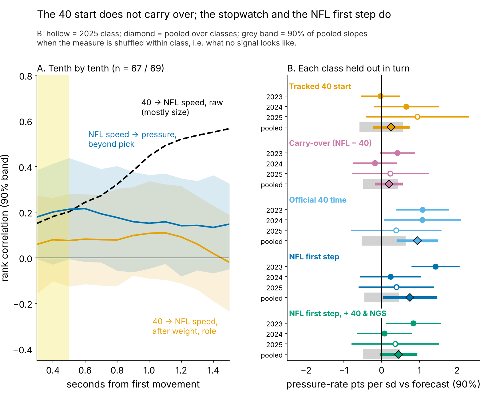
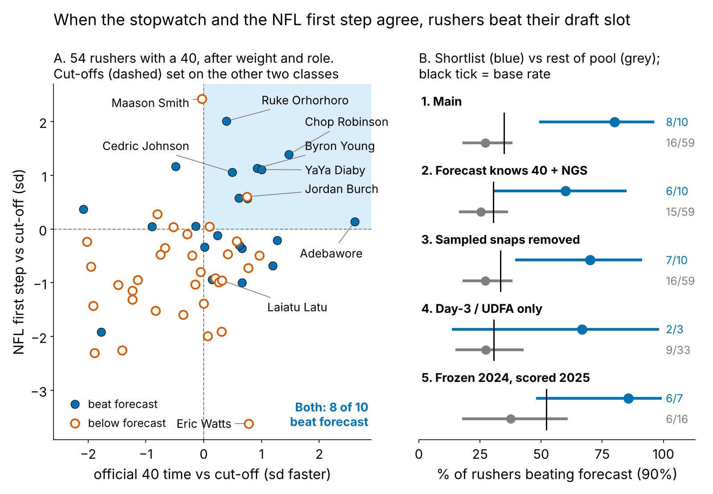

# Speed That Translates: Rushers Fast on the Stopwatch and on Sundays Beat Their Draft Slot

**Pool, used throughout:** 69 defensive linemen (2023–25 classes) with 100+ NFL pass rushes and 8+ random sampled NFL starts.

**We laid each lineman's tracked Combine 40 start over his own NFL pass-rush starts. After size, the start does not carry over. Agreement does: rushers fast on the official 40 *and* in about 20 NFL starts beat a draft-slot pressure forecast 8 times in 10, against 16 in 59 for the rest, on held-out classes.**

## Why it matters

A club bets on a young rusher's speed twice: on draft day from a stopwatch, and a year later when it hands out third-down snaps and opens extension talks. The second bet is usually made on sacks, which are rare and noisy. After about 20 random rushes, tracking shows whether the speed appears when he leaves a stance. We test whether that read, with the 40, says something draft slot and the box score do not.

## So what for a team

1. **Pro personnel: keep a "speed that translates" shortlist** (top-third NFL first step and top-half 40 time). On held-out classes it produced +5.0 pressures a season over forecast; the rest of the pool, −1.4. The 2026 list is Table 4.
2. **Draft room: pay for the stopwatch, not the trace.** The official 40 adds pressure beyond draft slot; the tracked 40 start adds nothing.
3. **Tape: a fast start alone is not a buy.** A top NFL first step without the 40 time is a hands-and-counter question (Maason Smith, below).

## The metric

**First step = how fast a lineman is moving 0.3 to 0.5 s after he first moves.** In that window the 40 and a pass rush are the same movement: a big man leaving a stance. By 1.5 s they part (median 6.8 yd/s in the 40, 3.1 on a rush, because he has met a blocker). Both sides are in sd after weight and role (share of snaps at EDGE). **Translation** = the Combine number previewing the NFL number.

**Data.** Every tracked Combine 40 rep, year-standardized. NFL: random sampled pass plays only, alignment-adjusted: 1563 starts by 85 linemen, median 19 each, reliability 0.64; it tracks NGS get-off snap by snap (ρ = 0.51). Outcome: career pressures per rush. **Baseline without tracking:** draft pick, weight and role, fit on the other two classes; a stronger one adds the official 40 time and season NGS get-off.

## Finding 1: the Combine start does not translate

Raw, the 40 ranks NFL speed at 1.5 s at 0.57, but that is weight (ρ = 0.82 with NFL speed, 0.65 with the 40). After weight and role, the 40 first step previews the NFL first step at ρ = 0.07 [−0.14, 0.28] (n = 67). Corrected for noise in both measures the point estimate is 0.12, and a true translation of 0.5 or more has posterior probability 0.03 (flat prior). The pass-rush drill start does no better (0.04, n = 84), and no per-player similarity score (gap, speed ratios, curve shape) exceeds 0.18 against pressure beyond pick.

| Measure, one sd faster (DL) | n | Beyond pick, weight, role | Beyond that + official 40 + NGS get-off |
|---|---|---|---|
| Tracked 40 start (Combine clip) | 52 | 0.3 [−0.2, 0.7] | 0.2 [−0.4, 0.8] |
| Carry-over (NFL start minus 40 start) | 52 | 0.2 [−0.1, 0.5] | 0.2 [−0.3, 0.7] |
| Official 40 time (stopwatch) | 54 | 0.9 [0.4, 1.5] | in baseline |
| **NFL first step (game tracking)** | 69 | **0.8 [0.1, 1.4]** | **0.4 [0.0, 0.9]** |

*Table 1. Pressure-rate points per sd faster (DL average about 8%), 90% interval, each class held out in turn.*

## Finding 2: two signals that agree beat the forecast

What carries is the official 40 time and the NFL first step (Table 1). They overlap, so we ask one football question: does the speed he showed in Indianapolis show up when he leaves his stance on Sundays?

**The rule.** *Both* = NFL first step in the top third and 40 time in the top half, each class's cut-offs set on the other two classes. A rusher "hits" if his pressure rate beats the held-out forecast (base rate 35%). Both hits 8 of 10, the rest 16 of 59; dropping any one shortlisted rusher leaves at least 78%.

| Check | Shortlist beat forecast | Everyone else | Gap, pts [90%] |
|---|---|---|---|
| Main: pick, weight, role forecast; cut-offs from the other two classes | 8 of 10 | 16 of 59 | 53 [28, 75] |
| Forecast also knows the official 40 time and NGS get-off | 6 of 10 | 15 of 59 | 35 [8, 62] |
| All ~40 sampled snaps per rusher removed from the outcome | 7 of 10 | 16 of 59 | 43 [14, 71] |
| Day-3 picks and UDFAs only (pick 103+) | 2 of 3 | 9 of 33 | 39 [−26, 82] |
| Frozen after 2024, scored on 2025 vs his own 2023-24 pressure | 6 of 7 | 6 of 16 | 48 [15, 75] |

*Table 2. Five checks on one shortlist. Gap interval: rushers resampled within class.*

**Time-forward and persistence.** Row 5 is the cleanest test: the call is frozen after 2024 from 2023–24 starts only (median 11 per rusher) and scored on 2025 against a forecast that knows each rusher's own 2023–24 pressure rate. A no-tracking rule, "top third of past pressure", beats the pick forecast 6 of 8; the Both list beats it 6 of 7, and beats the persistence forecast 6 of 7 too. As a slope, the frozen first step adds +0.4 points per sd beyond persistence [−0.5, 1.3]: right direction, not proven. Edges shrink on sacks (5 of 10) and in the day-3 pool (three shortlisted).

## Why it works: the same rusher, faster snap

On 1279 random rushes by 69 linemen, a first step one sd faster than *his own* average multiplies the odds of pressure on that snap by 1.49 [1.25, 1.77], errors clustered by rusher: 14.8% for his fastest fifth of starts, 6.6% for his slowest (Figure 4). It holds with that snap's NGS get-off, sideways path, down and alignment held fixed (1.51). The 40 says the speed exists; the NFL starts say he uses it from a stance.

**Price.** Clubs already pay for the 40 (one sd faster goes 50% earlier in pick number, n = 89), yet it still adds pressure beyond the pick.

## The board

Percentiles within the pool; * = 2025 class. Actions are football judgement, not model output.

| Rusher (class, pick, team, role) | 40 time | 40 start | NFL first step | Pressure vs forecast | Call: action |
|---|---|---|---|---|---|
| Byron Young (2023, 77, LAR, EDGE) | 89 | 21 | 96 | 11.3% vs 8.3% | **Both:** Extension-grade: wide on every passing down |
| Cedric Johnson (2024, 214, CIN, EDGE) | 70 | 83 | 91 | 13.0% vs 7.3% | **Both:** Day-3 hit: third-down reps before paying a veteran |
| Jordan Burch (2025*, 78, ARI, EDGE) | 85 | – | 88 | 5.8% vs 8.5% | **Both:** Miss so far: keep passing-down snaps, re-score at midseason |
| Maason Smith (2024, 48, JAX, interior) | 48 | 67 | 100 | 3.9% vs 7.7% | **Start only:** Rule and tape disagree: grade hands and a counter first |
| Laiatu Latu (2024, 15, IND, EDGE) | 65 | 40 | 25 | 10.1% vs 10.3% | **Speed only:** Meets forecast: keep him wide; do not project a jump |
| Eric Watts (2024, UDFA, NYJ, EDGE) | 83 | 81 | 1 | 3.6% vs 7.0% | **Speed only:** Ignore the stopwatch: early-down edge-setter until the start shows |

*Table 3.*

**Where the rule and the tape disagree: Maason Smith.** Jacksonville's 2024 second-rounder has the pool's best NFL first step, a 48th-percentile 40, and 3.9% pressure against a 7.7% forecast; only 18% of his pressures came quickly. His curve is fast through half a second, then flat (Figure 1): he arrives, he does not win. His starts are among the straightest (25th percentile sideways), so stunts do not explain it. The rule withholds credit; the tape question is hands and a counter, which a coach should grade before cutting his snaps. **The shortlist miss: Jordan Burch** (2025, Arizona), 5.8% against 8.5% after one season.

## The 2026 list

The same rule, cut-offs from all three classes, applied to every lineman with 8+ sampled starts: the order for passing-down snaps and second-contract talks.

| Rusher (class, pick, team) | 40 time pct | NFL first step pct | Pressure to date vs forecast (rushes) |
|---|---|---|---|
| Ruke Orhorhoro (2024, 35, ATL) | 69 | 99 | 8.2% vs 8.2% (498) |
| Chop Robinson (2024, 21, MIA) | 98 | 97 | 11.8% vs 10.1% (726) |
| Byron Young (2023, 77, LAR) | 89 | 96 | 11.3% vs 8.6% (1501) |
| YaYa Diaby (2023, 82, TB) | 93 | 94 | 10.5% vs 8.3% (1420) |
| Cedric Johnson (2024, 214, CIN) | 70 | 91 | 13.0% vs 7.4% (216) |
| Ty Robinson (2025, 111, PHI) | 69 | 90 | 0.0% vs 7.2% (55) |
| Jordan Burch (2025, 78, ARI) | 85 | 88 | 5.8% vs 8.4% (344) |
| T'Vondre Sweat (2024, 38, TEN) | 74 | 87 | 7.7% vs 7.0% (496) |
| Byron Murphy (2024, 16, SEA) | 81 | 86 | 10.0% vs 9.0% (682) |
| Adetomiwa Adebawore (2023, 110, IND) | 100 | 77 | 8.6% vs 7.0% (511) |
| Yasir Abdullah (2023, 136, JAX) | 54 | 72 | 6.0% vs 8.1% (149) |

*Table 4. Percentiles within the pool; forecast = pick, weight, role. Ty Robinson's 55 rushes are too few to judge pressure.*

## Limitations

- **Not blind.** The two-signal form was chosen in an earlier round after seeing all three classes; only the cut-offs are held out. The time-forward row has 23 rushers and overlaps the main shortlist; 2026 is the first true test.
- **Small lists.** Ten rushers, nine from 2023–24; intervals are wide (Table 2). One new class gives the slope test 47% power.
- **Translation itself is a null.** Tracking contributes the NFL first step; the Combine contributes the stopwatch. DL was the clearest of five groups screened; for WR, OL, DB and TE the NFL start is not readable from about 20 sampled snaps.
- **Sampled tape, no blockers or ball; charted outcome.** A slow start can be a two-gap call, a fast one a free rush; pressure is usage-dependent and injuries are not modelled.

## Appendix

**Table 1 test.** The forecast, fit on two classes, is a fixed logit offset in a quasi-binomial model of the held-out class's pressures out of rushes; class slopes are pooled with random-effects shrinkage; p shuffles the measure within class 2,000 times: tracked 40 start 0.48, carry-over 0.48, official 40 0.004, NFL first step 0.01 (0.13 with the stronger baseline). The window was chosen in an earlier round; the best of 11 windows under the same shuffle gives p = 0.02. Resampling rushers with the forecast refit: [0.2, 1.2]. **Table 2.** Label-shuffle p within class: 0.009, 0.07, 0.03, 0.22, 0.04. **Sample.** 40 first-step repeatability 0.54 (n = 56).

*Reproduce: `uv run python writeup/candidates/round_14/cand_3/analysis.py` (about 4 minutes, one core).*
