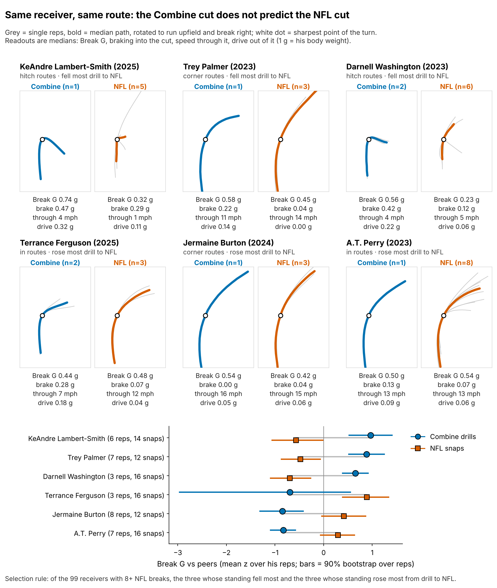
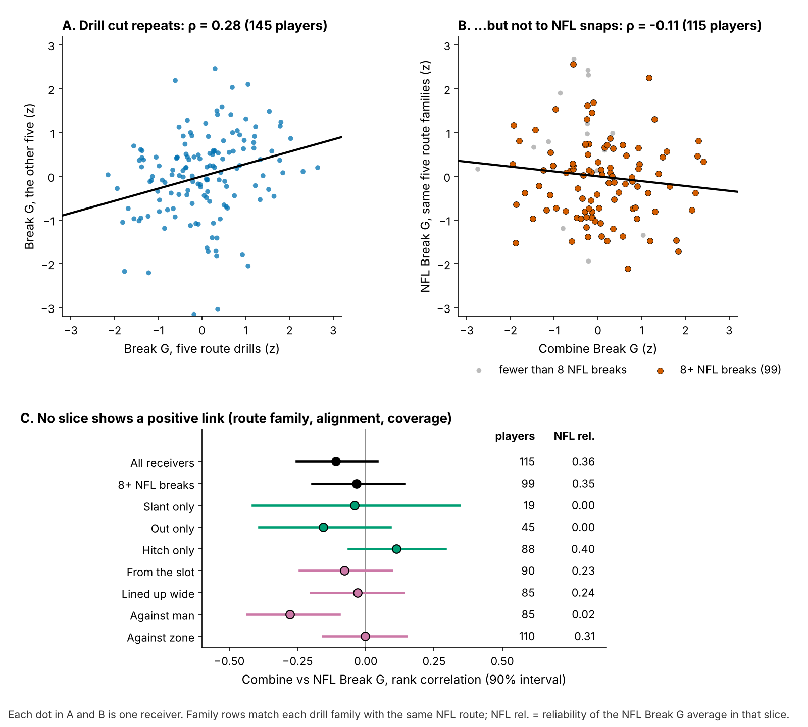
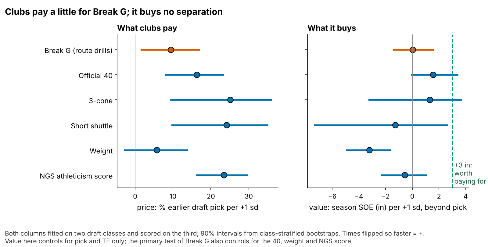
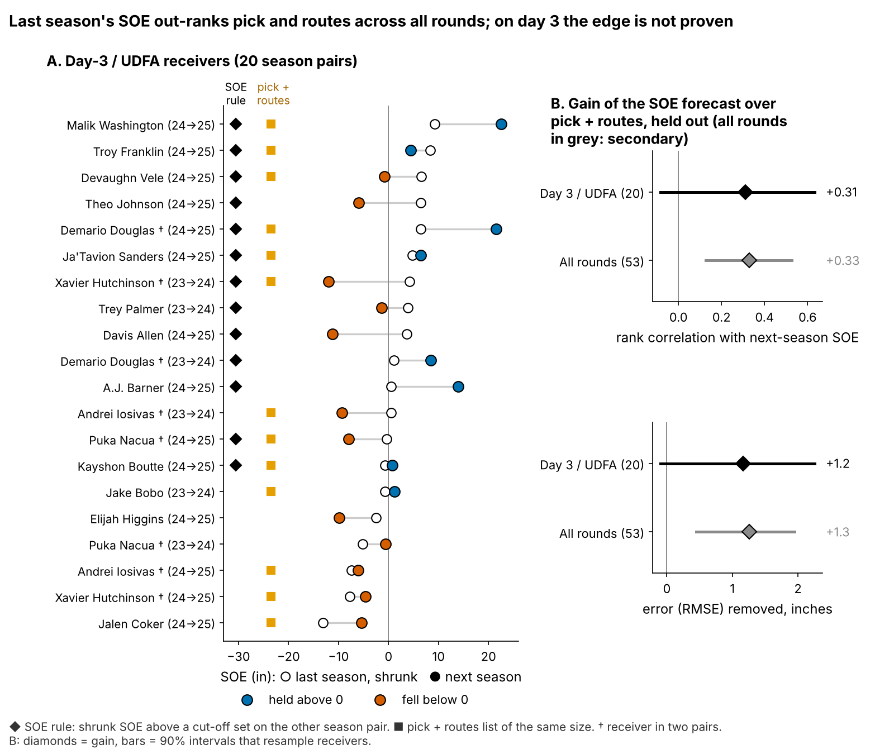

# Combine Cuts Don't Predict NFL Separation. Last Season's Separation Does, but for Day-3 Receivers It Only Edges Pick and Routes

**Combine cutting force (Break G) does not predict NFL separation: −1.2 inches per sd [−3.6, +1.0], for 116 WR/TE from draft classes the model had not seen. Among day-3 and undrafted receivers, last season's separation ranks next season better than pick and routes do (rank correlation 0.37 vs 0.06, 20 season pairs), but the gain is not proven [−0.08, +0.63] and as a yes/no list it nearly ties (7 of 13 vs 6 of 13).**

*Break G is the force, in g, that a receiver drives into the ground in the second around his cut. Separation over expected (SOE) is yards of space at the throw beyond what alignment, cushion and position predict (NGS, full season).*

## Why it matters

Getting open is the hardest receiver trait to grade off tape: every rep is tangled with the call, the coverage and the quarterback, so scouts fall back on "suddenness". The 2023 to 2025 Combine route drills were tracked at 10 Hz, so the cut can now be measured. Clubs already pay for it: +1 sd of Break G goes 9% earlier in the draft [2, 17] on held-out classes. If the cut does not become separation, those picks buy a drill trait, and a cheaper signal sits in last season's tracking.

## So what for a team

1. **Use last season's SOE as a tiebreaker for day-3 and undrafted receivers, not a replacement for pick and routes.** Shrink it by routes first; the 2026 list below gives each name a probability.
2. **Take Break G out of the price.** Its best case (+1.0 inch per sd) is worth less than a quarter of a catch a season.
3. **If you time cut drills anyway, run slant, dagger and comeback twice.** A single rep is 14% player; a second rep on those three lifts reliability from 0.53 to 0.62.

| Question (n) | Result, 90% interval | Verdict |
|---|---|---|
| Does Break G add season SOE on unseen classes? (116) | −1.2 in per sd [−3.6, +1.0] | No; +3 in ruled out |
| Does the drill cut show up on NFL snaps? (115) | ρ −0.11 [−0.25, 0.04] | Real drill trait, no visible transfer |
| Does last season's SOE beat pick and routes for day-3 receivers? (20 pairs) | rank correlation +0.31 [−0.08, +0.63] | Probably, not proven |

## The metric

Break G is the mean acceleration (1 g = the player's body weight) over the 1.0 s centred on the sharpest point of his first turn of 30° or more. Rounding scores low; sinking and driving out score high. The break is found on 96% of 926 drill reps. Reps are standardized within drill and Combine year and averaged over a player's route drills (median 7). NFL snaps on the same five route families (slant, out, hitch, in, corner) are graded with the same code.

## Drill to tape

- **The drill trait is real.** Break G on five drills predicts the other five at ρ = 0.28 [0.16, 0.40] (145 players). It is not a speed score: ρ with the 40 is −0.01.
- **It does not show up on NFL routes.** Across 115 players ρ = −0.11. The typical cut is softer in a game (median 0.57 g in drills, 0.42 g on NFL snaps), and the drill order is lost (Figure 1).
- **No slice rescues it.** Matching drill family to NFL family gives slant −0.04, out −0.16 and hitch 0.11. Slot and wide snaps agree (−0.08, −0.03), and slot cuts are only 0.02 g softer. One slice, man coverage (−0.28), is negative, but NFL Break G against man has reliability 0.02, so that is noise among nine rows.
- **What this sample cannot do.** Forty sampled plays cannot test the drill-to-game link. Single-family NFL averages have reliability 0.00 to 0.40, and even for the 99 receivers with 8+ NFL breaks the data favour "no link" over "some positive link" only 2.8 to 1.

## The test: season separation on unseen classes

The outcome is full-season SOE, route-weighted over each career (213 player-seasons, median 231 routes). The forecast without tracking, fixed before the test was first run, uses log pick, official 40, weight, NGS athleticism score and a TE flag; it is fitted on two draft classes and scored on the third, and Break G must explain what it misses.

| Version (n) | Season SOE per +1 sd of Break G, inches [90%] |
|---|---|
| **Primary: pre-specified forecast (116)** | **−1.2 [−3.6, +1.0]** |
| Ridge forecast instead | −0.4 [−2.2, +1.8] |
| Without Puka Nacua, the most influential player (115) | −0.5 [−2.7, +1.5] |
| SOE adjusted for route mix and depth at the throw | −1.8 [−4.3, +0.4] |
| SOE adjusted for quarterback | −1.2 [−3.6, +0.9] |

No version reaches +3 in; +3 in is worth 0.44 catches a season.

The 40 costs 16% of a pick per sd and returns +1.6 inches; Break G costs 9% and returns nothing. Weight costs separation (−3.2 inches per sd).

## The day-3 shortlist

**The 2026 list** (day-3 or undrafted, 100+ routes and SOE above zero in 2025). SOE is shrunk toward the mean by routes; the two columns give the chance of SOE above zero in 2026 from last season's SOE plus pick and routes, and from pick and routes alone.

| Receiver (class, pick) | 2025 routes | SOE, raw → shrunk (in) | P(2026 SOE > 0) | Pick + routes only | Break G, sd |
|---|---|---|---|---|---|
| Malik Washington (2024, 184) | 339 | +22.5 → +16.1 | 95% | 56% | −0.3 |
| Demario Douglas (2023, 210) | 220 | +21.6 → +13.4 | 91% | 56% | +0.5 |
| Tez Johnson (2025, 235) | 282 | +16.2 → +10.9 | 88% | 56% | −0.1 |
| Arian Smith (2025, 110) | 231 | +15.8 → +10.0 | 85% | 55% | +1.7 |
| Troy Franklin (2024, 102) | 461 | +4.4 → +3.4 | 71% | 55% | −0.1 |
| A.J. Barner, TE (2024, 121) | 330 | +14.0 → +9.9 | 71% | 36% | −0.1 |
| Gunnar Helm, TE (2025, 120) | 231 | +16.4 → +10.4 | 70% | 36% | 0.0 |
| Isaiah Bond (2025, UDFA) | 333 | +4.3 → +3.1 | 67% | 56% | −1.3 |
| Jaylin Lane (2025, 128) | 186 | +4.8 → +2.8 | 60% | 56% | +0.2 |
| Kayshon Boutte (2023, 187) | 357 | +0.8 → +0.6 | 58% | 55% | +1.8 |
| Mitch Tinsley (2023, UDFA) | 134 | +3.6 → +1.8 | 54% | 56% | +0.5 |
| Mitchell Evans, TE (2025, 163) | 123 | +13.9 → +6.7 | 50% | 37% | −0.1 |
| Ja'Tavion Sanders, TE (2024, 101) | 220 | +6.4 → +4.0 | 45% | 35% | −0.2 |

The top four are near-certain (85% or more); below Lane it is close to a coin flip. Seven of the 13 are soft drill cutters; the drill would have discounted Washington, the list's surest name.

**Where drill and tape disagree.**

| Receiver | Break G: drill → NFL | Read and action |
|---|---|---|
| Kayshon Boutte (2023, 187) | +1.8 → +0.1 sd; 0.62 → 0.48 g | Hardest drill cutter on the list, near-coin-flip SOE (58%). He enters NFL breaks at 5.7 yd/s against a league median of 5.3 and does not gear down. **Coach:** sink at the top of outs and hitches against off coverage. **Board:** the cut does not move him up |
| Isaiah Bond (2025, UDFA) | −1.3 → −0.5 sd; 0.59 → 0.38 g | Soft in drill and game, yet open (67%) on rounded breaks. **Keep him on corners and goes; do not grade him on speed-outs** |

**How the rule scored.** Each season pair (2023→24, 2024→25) was forecast from models fitted on the other pair; the yes/no cut-off on shrunk SOE was also chosen on the other pair.

| Day-3/UDFA list, held out (20 pairs, 16 receivers) | Next-season SOE above zero |
|---|---|
| Shrunk-SOE rule | 7 of 13 (54%) |
| Pick and routes, same list size | 6 of 13 (46%) |
| Passed over by the rule | 1 of 7 (14%) |

The yes/no gap is 8 points [−16, 27]. As a continuous forecast, last season's SOE removes 1.2 inches of error [−0.1, +2.3] and lifts the rank correlation by 0.31; it wins in 88% of receiver resamples, but in only 1 of the 2 season folds. Across all rounds (53 pairs, a secondary pool) the gain is firm: 0.33 [0.13, 0.53], in 2 of 2 folds, and each inch of SOE carries 0.59 inch beyond pick and routes [0.35, 0.74].

**Named cases.** Malik Washington (2024, pick 184; Break G −0.3 sd) posted +14.6 inches in 2024: the drill said discount, the rule kept him, and he posted +22.5 in 2025. Trey Palmer (2023, pick 191; +1.3 sd) had both signals after +5.0 in 2023 and fell to −1.3.

## Limitations

- **Not a blind test.** Earlier rounds saw all three classes. The primary forecast was fixed before the held-out test was run, but the SOE shortlist was built later. The 2026 class is the first true out-of-sample score (power 0.85 against a 3-inch gain).
- **The downside is open.** The primary interval excludes gains above +1.0 inch per sd, not losses down to −3.6.
- **The shortlist is small.** 20 day-3 pairs from 16 receivers, two folds, and 4 receivers in two pairs. The day-3 gain is likely but not proven.
- **Game tracking is a sample.** Up to 40 plays per player, half chosen for high EPA, with no defenders and no ball. That caps every drill-to-game correlation; it does not cap the season SOE test, which uses full-season NGS.
- **Route-family notes** rest on 10 to 16 sampled breaks per receiver: film-room leads, not grades.

## Appendix

**Shrinkage.** True SOE variance is the covariance of a receiver's SOE across consecutive seasons (76 pairs); noise falls with routes. At 200 routes, 0.60 of last season's SOE is kept; at 135 routes, half. **Cut-offs.** Youden's J on the other season pair: +0.5 in (for 2023→24) and −0.7 in (for 2024→25). **Probabilities.** Normal forecast over the residual sd, averaged over 1,000 receiver-clustered refits on all 53 pairs; held-out Brier score 0.225 against 0.257 for pick and routes (day 3). **Drill-to-game model.** Bayesian errors-in-variables: the observed r (−0.05, 99 receivers, median 17 breaks) is the true correlation times the square root of the two reliabilities (drill 0.35, NFL 0.30), with their bootstrap uncertainty; uniform prior. Posterior median −0.15 [−0.79, 0.55]; chance of a true link of 0.5 or more: 6%. **Slices.** Reliability within each route family, drill then NFL: slant 0.10 and 0.00, out 0.00 and 0.00, hitch 0.19 and 0.40. **Error.** Held-out day-3 RMSE 9.1 inches with last season's SOE, 10.3 without. **Chance.** Within-class shuffles: primary p = 0.37; one-sided test against +3 inches p = 0.001. **Football units.** 8.8 catch-rate points per yard of separation, 60 targets for a median 200-route receiver.

Reproduce: `uv run python writeup/candidates/round_14/revised/analysis.py` (about eight minutes). Every quoted number is in `numbers.json`, with `claims.json` naming the claim each backs.
