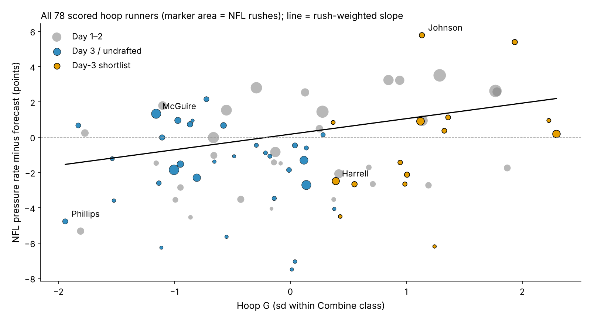
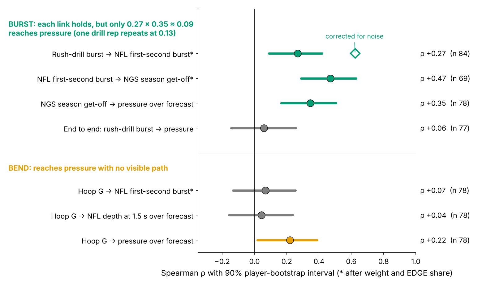

# Hoop G: A Free Day-3 Pass-Rush Tiebreaker

**Day-3 and undrafted linemen who bend hardest in the Combine's Run-the-Hoop drill matched their no-tracking pressure forecast ({{cal_sl_act}}% vs {{cal_sl_fc}}%); the rest of day 3 fell short ({{cal_re_act}}% vs {{cal_re_fc}}%). Clubs did not draft for it. Use it to break ties between cheap rushers, not to grade them. Combine get-off burst did not carry through to pressure.**

## The decision

Every April a club spends day-3 picks and undrafted money on its fourth and fifth pass rushers, and in August it cuts one of them. A pressure is what that player is for: on {{epa_n}} randomly sampled NFL pass plays involving these rookies, a pressured snap cost the offense {{epa_press}} more expected points than a clean one (90% interval {{epa_press_lo}} to {{epa_press_hi}}). {{pct_day3_hoop}}% of the linemen in this study went on day 3 or undrafted, so this is where most of the decisions are.

The usual agility evidence is missing exactly there: only {{n_three_cone}} of {{n_dl}} linemen in the 2023–25 classes ran the 3-cone. Since 2023, though, every lineman's position drills are tracked at 10 Hz, and nobody times them. The question is whether one of those drills sorts cheap rushers better than what the board already shows.

## The metric

**Hoop G is how hard a lineman pushes sideways while rounding the hoop, compared with his Combine class.** Run-the-Hoop is a figure-eight around two hoops that rewards bending the hips at speed. We take the hardest {{win_s}}-second window of sideways (centripetal) acceleration on the lap (median {{hoop_g_median}} g) and standardize it within Combine year, because drill conditions shift between years. {{n_hoop}} linemen have it, {{n_hoop_no3c}} with no 3-cone.

The contrast is **rush-drill burst**: yards covered in the first second of the pass-rush drill, standardized the same way.

Both are noisy. {{pct_one_run}}% of hoop runners have one run; among the {{rel_hoop_nrep}} with two, run-to-run reliability is {{rel_hoop1}}. One burst rep repeats at {{rel_d1_1}}.

## The test

**The yardstick** forecasts each lineman's NFL pressure rate from what a club already has: draft pick, Combine weight, NFL EDGE share, NGS athleticism score, and the official 10-yard split and 3-cone (missing times filled from weight, role and NGS score). We use the official split, not a tracked one: the tracked 40 clip starts before the laser, so the tracked split runs {{split_off}} s slow and agrees with the official at only r = {{split_r}} ({{split_n}} linemen). Each class is forecast by a model fit only on the other two; on held-out classes it ranks regulars' pressure rates at ρ = {{fc_rho}}.

**The rule**, fixed in round 13 and unchanged: shortlist = pick 103 or later (or undrafted) AND top third of Hoop G in his class. Nothing in it is fit on NFL data. A rusher with 30+ NFL rushes "hits" if his pressure rate beats his forecast.

**Result.** {{main_k1}} of {{main_n1}} shortlisted rushers hit, against {{main_k0}} of {{main_n0}} others: a gap of **+{{main_gap}} points**. The shortlist was ahead in {{cls_ahead}} of 3 classes. In a regular's season of 450 rushes that is +{{ex_gap}} pressures (90%: {{ex_gap_lo}} to {{ex_gap_hi}}), about {{ex_gap_epa}} expected points.

{{TABLE:robust}}

The pick-and-role-only row shows the gap is not cheap players beating a forecast anchored on draft slot. The bottom two rows are the honest ones. Scoring each class only with earlier classes, or reweighting for the {{n_unscored}} day-3 runners who never reached 30 rushes ({{n_unscored_sl}} shortlisted), shrinks the gap to +{{tf_gap}} or +{{ipw_gap}} points and the interval crosses zero. A selection model says Hoop G did not decide who got on the field (odds ratio {{sel_or_hoop}} per sd; 90%: {{sel_or_lo}} to {{sel_or_hi}}).

**Verdict: a small, uncertain edge, enough to break a tie, not enough to move a player up a board.** Calibration says what kind of edge: the forecast was right about the shortlist and too kind to the rest. Across all {{slope_n}} scored hoop runners (Figure 3), pressure over forecast rises {{slope}} points per sd of Hoop G (90%: {{slope_lo}} to {{slope_hi}}). But Hoop G was the best of 14 drill-and-outcome pairs screened in earlier rounds; priced for that search, p = {{scr_p}}.

## Get-off: drill burst reaches the snap, not the pressure

Each link of the get-off chain holds on its own (Figure 4). After weight and role, drill burst tracks how far a lineman travels in the first second of a sampled NFL rush: ρ = {{ch_bg}} (90%: {{ch_bg_lo}} to {{ch_bg_hi}}; {{ch_bg_n}} linemen), {{ch_bg_da}} once corrected for noise. That NFL first-second burst agrees with NGS season get-off ({{ch_gq}}), and season get-off predicts pressure over forecast ({{ch_gp}}).

Multiplied through, the chain leaves about {{ch_prod}}. Measured directly, drill burst moves pressure over forecast by {{bslope}} points per sd (90%: {{bslope_lo}} to {{bslope_hi}}; {{bslope_n}} rushers), which rules out anything larger than about two-thirds of a point. The bottleneck is the single drill rep.

Hoop G is the reverse: it moves pressure ({{ch_hp}}) but not first-second burst ({{ch_hg}}) or depth upfield at {{dep_s}} s ({{ch_hd}}). Our best guess is a rusher who keeps speed around the corner and through contact, which we cannot see without blockers in the data.

## Two real boards

**2024, around pick 215, EDGE.** Cedric Johnson (pick {{wcj_pick}}, {{wcj_wt}} lb, Hoop G +{{wcj_hz}}) and Javontae Jean-Baptiste (pick {{wjj_pick}}, {{wjj_wt}} lb, Hoop G {{wjj_hz}}) were the same price: rookie deals of ${{wcj_apy}}M a year each. The rule says Johnson. He pressured on {{wcj_pr}}% of rushes against a {{wcj_pb}}% forecast; Jean-Baptiste {{wjj_pr}}% against {{wjj_pb}}%.

**2025, around pick 124, EDGE.** Kyle Kennard (pick {{wkk_pick}}, Hoop G +{{wkk_hz}}) and Barryn Sorrell (pick {{wbs_pick}}, Hoop G +{{wbs_hz}}), ${{wkk_apy}}M and ${{wbs_apy}}M a year. The rule says Kennard, and so far it is wrong: {{wkk_pr}}% vs {{wkk_pb}}% on {{wkk_n}} rushes, while Sorrell was at {{wbs_pr}}% vs {{wbs_pb}}% on {{wbs_n}}.

Paired this way across every scored shortlisted rusher, the shortlist wins {{pair_k}} of {{pair_n}} boards. Any single call is close to a coin flip; the edge exists only on average, +{{ex_gap}} pressures a season at no extra cost. That is worth deciding the last roster spot, not a first-round grade.

## When drill and tape disagree

| Player (class, pick) | Hoop G call | Pressure vs forecast (rushes) | Scout action and film cue |
|---|---|---|---|
| **Jaylen Harrell** (2024, {{harrell_pick}}) | Shortlist, +{{harrell_hz}} sd | {{harrell_pr}}% vs {{harrell_pb}}% ({{harrell_n}}) | Drill said yes, the NFL said no on a large sample. He bends at the top of the arc; does he convert speed to power when the tackle sets short? If not, rotate him rather than build a sub package around him. |
| **Isaiah McGuire** (2023, {{mcguire_pick}}) | Bottom third, {{mcguire_hz}} sd | {{mcguire_pr}}% vs {{mcguire_pb}}% ({{mcguire_n}}) | The rule's miss: a power rusher who wins straight ahead. Low Hoop G is not a cut signal. |
| **Jordan Phillips** (2025, {{phillips_pick}}) | Bottom third, {{phillips_hz}} sd | {{phillips_pr}}% vs {{phillips_pb}}% ({{phillips_n}}) | Miami looped him on {{phillips_loop}}% of sampled rushes (interior median {{int_loop_med}}%). Grade the role before the player: does he redirect on stunts or only push the pocket? |

## So what for a team

1. **Break day-3 ties with Hoop G.** Top-third linemen went at a median pick of {{pick_t2}}, no earlier than the bottom third ({{pick_t0}}); per sd of Hoop G, clubs drafted {{price_later}}% later (90%: {{price_earlier}}% earlier to {{price_hi}}% later). The tiebreaker costs no draft capital.
2. **Match the role to the trait.** Shortlisted EDGEs get third-down snaps from wide alignments, where bend matters most; shortlisted interior players get the looper job on stunts.
3. **Do not draft on drill burst.** Time get-off on tape or in camp.
4. **2026 Combine protocol.** Ask for a second hoop run: reliability goes from {{rel_hoop1}} to {{rel_hoop2}} (three runs: {{rel_hoop3}}). Burst would need about {{burst_reps50}} reps to reach 0.5, so it is not worth asking for.

The 2025 shortlist, with games played as the availability check:

{{TABLE:card25}}

The same rule, unchanged, will score the 2026 class after the 2027 season.

## Limitations

- **One rule, chosen after looking.** Holding classes out checks the forecast, not the drill choice (search-adjusted p = {{scr_p}}). The time-forward and reweighted versions are weaker; the 2026 class is the clean test.
- **Small counts.** {{main_n1}} shortlisted vs {{main_n0}} comparison rushers; {{c2025_n1}} scored 2025 rookies have one season. Hoop G reliability rests on {{rel_hoop_nrep}} linemen with two runs.
- **Forecast level.** Fit on 100+ rush regulars, the forecast sits above most day-3 rushers, so the test compares day-3 rushers with each other, not with 50%.
- **Thin NFL tracking, no injuries or scheme labels.** About 20 random sampled rushes per player, no blockers, no ball. Sampled pressure barely repeats (split-half {{rel_prs}}), so pressure comes from season totals; scheme reads come from loop rates, and availability only from games played.

## Appendix

| Check | Result |
|---|---|
| Shortlist vs rest by class (2023, 2024, 2025) | {{c2023_k1}}/{{c2023_n1}} vs {{c2023_k0}}/{{c2023_n0}}; {{c2024_k1}}/{{c2024_n1}} vs {{c2024_k0}}/{{c2024_n0}}; {{c2025_k1}}/{{c2025_n1}} vs {{c2025_k0}}/{{c2025_n0}} |
| Class-stratified (Mantel-Haenszel) odds ratio, 90%; p; class homogeneity p | {{mh_or}} ({{mh_lo}} to {{mh_hi}}); {{mh_p}}; {{mh_homog_p}} |
| Primary gap: 90% Newcombe interval; flat-prior P(gap > 0); within-class relabelling p | {{main_lo}} to {{main_hi}} points; {{bayes_pgt0}}%; {{perm_p}} |
| Shrunken (ridge) forecast; without {{best_name}} | {{ridge_k1}}/{{ridge_n1}} vs {{ridge_k0}}/{{ridge_n0}}; {{drop_k1}}/{{drop_n1}} vs {{drop_k0}}/{{drop_n0}} |
| Reached 30 NFL rushes: shortlist vs rest | {{surv_k1}}/{{surv_n1}} vs {{surv_k0}}/{{surv_n0}} |
| Same rule on the official 3-cone (day 3, ran it) | {{t3_k1}}/{{t3_n1}} vs {{t3_k0}}/{{t3_n0}} |
| Top-third Hoop G on days 1–2 (not part of the rule) | {{d12_top_k}}/{{d12_top_n}} vs {{d12_rest_k}}/{{d12_rest_n}} |
| Hoop G slope 90% interval; drill burst → pressure ρ | {{slope_lo}} to {{slope_hi}}; {{ch_bp}} ({{ch_bp_lo}} to {{ch_bp_hi}}) |
| Reliability: burst over a lineman's reps; NFL first-second burst over 8+ sampled rushes | {{rel_d1}}; {{rel_game_d1}} |

*Reproduce: `uv run python writeup/candidates/round_15/cand_1/analysis.py` writes `numbers.json`, the board, the 2026 rule and all figures, and fills this text.*
