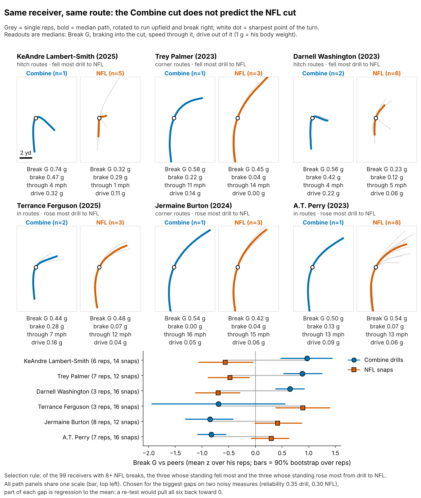
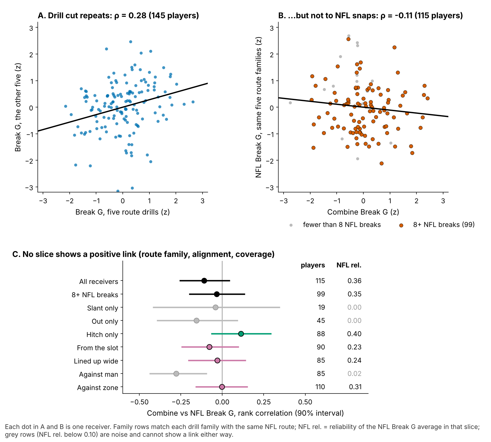
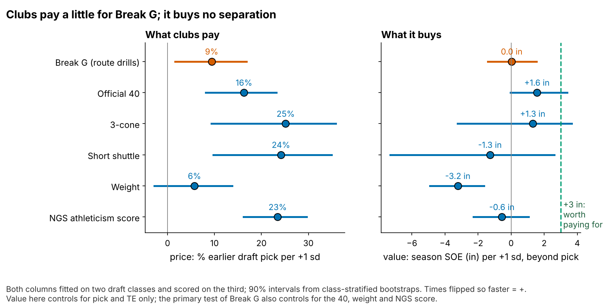
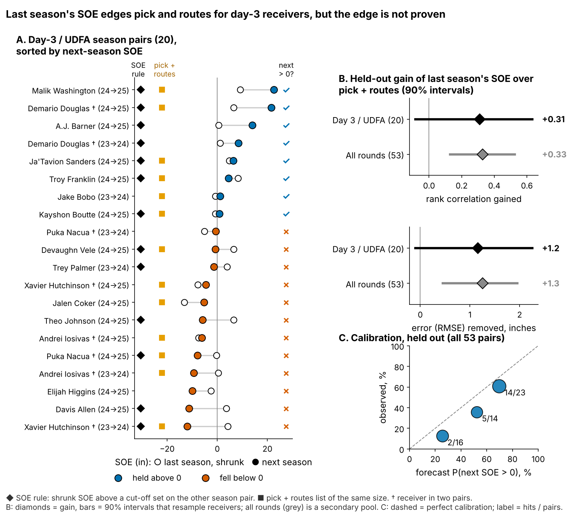

# Combine Cutting Force Doesn't Buy NFL Separation; Last Season's Separation Is a Small Edge for Day-3 Receivers

**How hard a receiver cuts in Combine route drills does not predict how open he gets in the NFL (−1.2 inches per sd [−3.6, +1.0], 116 WR/TE from unseen draft classes). For day-3 and undrafted receivers, last season's separation is the better tiebreaker. Stop paying for the drill cut.**

*Break G is the force, in g, that a receiver drives into the ground in the second around his cut. Separation over expected (SOE) is yards of space at the throw beyond what alignment, cushion and position predict (NGS, full season).*

## The roster decision

In August a club picks its sixth receiver from two day-3 players on minimum deals with similar draft slots and snap counts. Tape rarely settles who gets open, so scouts lean on Combine "suddenness". The 2023–2025 route drills were tracked at 10 Hz, so the cut can now be measured, and clubs already pay for it: +1 sd of Break G goes 9% earlier in the draft [2, 17]. Does the cut become NFL separation, and if not, what breaks the tie?

| Question (n) | Held-out result [90% interval] | Verdict |
|---|---|---|
| Does Break G add season SOE? (116 receivers) | −1.2 in per sd [−3.6, +1.0]; a +3 in effect rejected, p = 0.001 | **No** |
| Does the drill cut show up on NFL snaps? (115) | rank correlation −0.11 [−0.25, 0.04] | **No visible transfer** |
| Does last season's SOE out-rank pick and routes, day 3 / UDFA? (20 season pairs) | rank correlation 0.37 vs 0.06; gain +0.31 [−0.08, +0.63], shuffle p = 0.01; as a yes/no list 7 of 13 vs 6 of 13 | **Small edge: tiebreaker** |
| Same, all rounds (53 pairs, secondary) | gain 0.33 [0.13, 0.53], 2 of 2 season folds | Firm |

**Verdict:** last season's SOE carries real information beyond pick and routes, but on day 3 the size of the edge is uncertain. Use it only to break ties.

## What to do

1. **Break ties between day-3 receivers with last season's route-shrunk SOE** (2026 list below).
2. **Take Break G out of the price.** Its best case (+1.0 inch per sd) is worth less than a quarter of a catch a season.
3. **2026 Combine protocol.** If you time cut drills anyway, run slant, dagger and comeback twice: a single rep is 14% player, and a second rep on those three lifts reliability from 0.53 to 0.62. Read speed from the official 40, not the tracked clip, which starts about 0.3 s before the laser.

**Worked case** (the most divergent matched 2025 pair). Demario Douglas (2023, pick 210, 220 routes in 2025) and Ryan Flournoy (2024, pick 216, 265 routes) look identical to pick and routes: 57% and 56% chance of SOE above zero in 2026. Their drill cuts nearly tie too (+0.5 and +0.3 sd). Their 2025 SOE does not (+21.6 vs −7.9 in), and with it the forecast moves to 91% vs 32%. The forecast gap is 15.6 inches, worth 2.3 catches a season at the same cap cost (about $0.99M and $1.04M a year). Keep Douglas. The stake is small, hence a tiebreaker. SOE already nets out Douglas's slot role and Flournoy's wide one.

## Drill to tape

Break G is the mean acceleration (1 g = body weight) over the 1.0 s centred on the sharpest point of the first turn of 30° or more. It is found on 96% of 926 drill reps, standardized within drill and Combine year, and averaged over route drills (median 7). The same code grades NFL snaps on slant, out, hitch, in and corner routes.

- **The drill trait is real.** Break G on five drills predicts the other five at ρ = 0.28 [0.16, 0.40] (145 players), and it is not a speed score: ρ with the 40 is −0.01.
- **It does not reach NFL routes.** Game cuts are softer (median 0.57 g in drills, 0.42 g on NFL snaps) and drill order is lost. Hitch, the only family with usable NFL reliability (0.40), gives 0.11; slot and wide agree (−0.08, −0.03).
- **Forty sampled plays cannot settle the link alone:** for the 99 receivers with 8+ NFL breaks, the data favour "no link" only 2.8 to 1.

## Season separation on unseen classes

The outcome is full-season SOE, route-weighted over each career (213 player-seasons, median 231 routes). The forecast without tracking, fixed before the test was run, uses log pick, official 40, weight, NGS athleticism score and a TE flag; it is fitted on two draft classes and scored on the third, and Break G must explain what it misses. It does not: −1.2 in per sd [−3.6, +1.0]. Every variant in the appendix (ridge, no offset, re-weighted for survivorship, receiver random intercept, adjustments for quarterback and route mix) stays at or below +1.8 and rejects +3 inches (largest p = 0.006). A +3 in effect is worth 0.44 catches a season.

The 40 costs 16% of a pick per sd and returns +1.6 inches; Break G costs 9% and returns nothing. One wrinkle for coaches: given pick, hard cutters are more likely to reach 100 career routes (odds ratio 2.09 per sd [1.10, 4.52]). Staffs reward the cut with snaps, and the snaps do not produce separation.

## The 2026 day-3 shortlist

Day-3 or undrafted, 100+ routes and SOE above zero in 2025; SOE shrunk toward the mean by routes. Probabilities are for SOE above zero in 2026, with and without last season's SOE.

| Receiver (class, pick) | 2025: team, alignment, games | Routes | SOE, raw → shrunk (in) | P(2026 SOE > 0) | Pick + routes only | Break G, sd |
|---|---|---|---|---|---|---|
| Malik Washington (2024, 184) | MIA, wide, 17 | 339 | +22.5 → +16.1 | 95% | 56% | −0.3 |
| Demario Douglas (2023, 210) | NE, slot, 17 | 220 | +21.6 → +13.4 | 91% | 56% | +0.5 |
| Tez Johnson (2025, 235) | TB, wide, 16 | 282 | +16.2 → +10.9 | 88% | 56% | −0.1 |
| Arian Smith (2025, 110) | NYJ, wide, 16 | 231 | +15.8 → +10.0 | 85% | 55% | +1.7 |
| Troy Franklin (2024, 102) | DEN, wide, 17 | 461 | +4.4 → +3.4 | 71% | 55% | −0.1 |
| A.J. Barner, TE (2024, 121) | SEA, inline, 17 | 330 | +14.0 → +9.9 | 71% | 36% | −0.1 |
| Gunnar Helm, TE (2025, 120) | TEN, slot, 16 | 231 | +16.4 → +10.4 | 70% | 36% | 0.0 |
| Isaiah Bond (2025, UDFA) | CLE, wide, 16 | 333 | +4.3 → +3.1 | 67% | 56% | −1.3 |
| Jaylin Lane (2025, 128) | WAS, wide, 14 | 186 | +4.8 → +2.8 | 60% | 56% | +0.2 |
| Kayshon Boutte (2023, 187) | NE, wide, 14 | 357 | +0.8 → +0.6 | 58% | 55% | +1.8 |
| Mitch Tinsley (2023, UDFA) | CIN, wide, 17 | 134 | +3.6 → +1.8 | 54% | 56% | +0.5 |
| Mitchell Evans, TE (2025, 163) | CAR, inline, 17 | 123 | +13.9 → +6.7 | 50% | 37% | −0.1 |
| Ja'Tavion Sanders, TE (2024, 101) | CAR, slot, 12 | 220 | +6.4 → +4.0 | 45% | 35% | −0.2 |

Read the probabilities about 10 points high (see below). Below Lane it is a coin flip. Sanders played 12 games, so his sample is thin. Seven of the 13 are soft drill cutters, and the drill would have discounted Washington, the surest name.

**Where drill and tape disagree.** Kayshon Boutte is the list's hardest drill cutter (+1.8 sd; 0.62 g in drills, 0.48 g on NFL snaps) yet a near coin flip (58%): he enters NFL breaks at 5.7 yd/s against a league median of 5.3 and does not gear down. Coach him to sink at the top of outs against off coverage; do not move him up for the drill. Isaiah Bond is soft in drill and game (−1.3 sd; 0.38 g) yet open on rounded breaks (67%): keep him on corners and go routes.

## How the rule scored

Each season pair (2023→24, 2024→25) is forecast from models fitted on the other.

- **Ranking.** Last season's SOE lifts the day-3 rank correlation from 0.06 to 0.37 and removes 1.2 inches of error [−0.1, +2.3]. Shuffling it within folds rarely matches that (p = 0.01), so the signal is real, but the interval [−0.08, +0.63] leaves its size open, and it wins 1 of 2 day-3 folds.
- **Yes/no list.** 7 of 13 hits against 6 of 13 for pick and routes (shuffle p = 0.11). It passes over 7 pairs, and only 1 held up.
- **Repeat receivers.** A receiver random-intercept model keeps 0.63 inch of next-season SOE per inch of shrunk SOE [0.17, 1.09]; 0.51 [−0.23, 1.26] on day 3.
- **Calibration.** Forecasts near 70% came true 14 of 23 times, near 52% 5 of 14, near 25% 2 of 16: the slope is right (1.19 [0.47, 1.91]) but the level runs high (day 3: 50% forecast, 40% observed).

## Limitations

- **Not a blind test.** Earlier rounds saw all three classes; the SOE list was built after the primary forecast was fixed. The 2026 class is the first true out-of-sample score (power 0.85 against a 3-inch gain).
- **The downside is open.** The primary interval rules out gains above +1.0 inch per sd, not losses down to −3.6.
- **Small day-3 sample.** 20 pairs from 16 receivers, two folds, 4 receivers twice; probabilities run about 10 points high.
- **Survivorship.** 33 of 149 drill-scored receivers never logged NFL routes with separation. Re-weighting by a selection model changes little (−0.8 [−2.8, +1.3]), but receivers who never play cannot be scored.
- **Game tracking is a sample.** Up to 40 plays per player, half chosen for high EPA, no defenders, no ball. That caps the drill-to-game correlations, not the season SOE test. Games played is a rough injury proxy; scheme is only team and alignment.

## Appendix

**Break G slopes, inches of season SOE per sd, held out unless stated.**

| Version (n) | Slope [90%] | p against +3 in |
|---|---|---|
| **Pre-specified offset forecast, primary (116)** | **−1.2 [−3.6, +1.0]** | **0.001** |
| Ridge forecast (116) | −0.4 [−2.2, +1.8] | 0.003 |
| No offset: Break G beside the five inputs, all classes (116) | −0.6 [−2.5, +1.2] | 0.001 |
| Re-weighted by 1 / P(reaching the NFL sample) (116) | −0.8 [−2.8, +1.3] | 0.002 |
| Player-seasons, receiver random intercept, in-sample (167) | −0.5 [−2.8, +1.8] | 0.006 |
| Without Puka Nacua, most influential (115) | −0.5 [−2.7, +1.5] | 0.003 |
| SOE adjusted for route mix and depth (116) | −1.8 [−4.3, +0.4] | 0.001 |
| SOE adjusted for quarterback (116) | −1.2 [−3.6, +0.9] | 0.001 |

**Selection model.** Logistic regression of reaching the NFL sample on the five inputs and Break G (149 receivers); Break G odds ratio 0.76 [0.30, 1.69]; largest weight 4.2, refitted in every resample. **Mixed models** (statsmodels, REML): the receiver explains 0.42 of season SOE variance in 167 player-seasons with 50+ routes. **Shrinkage.** Skill variance = covariance of SOE across consecutive seasons (76 pairs); 0.60 of SOE is kept at 200 routes. **Cut-offs.** Youden's J on the other pair (+0.5 in, −0.7 in). **Probabilities.** Normal forecast over the residual sd, averaged over 1,000 receiver-clustered refits; held-out day-3 Brier score 0.225 against 0.257 for pick and routes. **Drill-to-game.** Bayesian errors-in-variables (99 receivers, median 17 breaks): r −0.05, reliabilities 0.35 and 0.30, posterior median −0.15 [−0.79, 0.55]. **Units.** 8.8 catch-rate points per yard, 60 targets a season.

Reproduce: `uv run python writeup/candidates/round_15/cand_2/analysis.py` (about eight minutes). Every quoted number is in `numbers.json`, and `claims.json` names the claim each backs.
