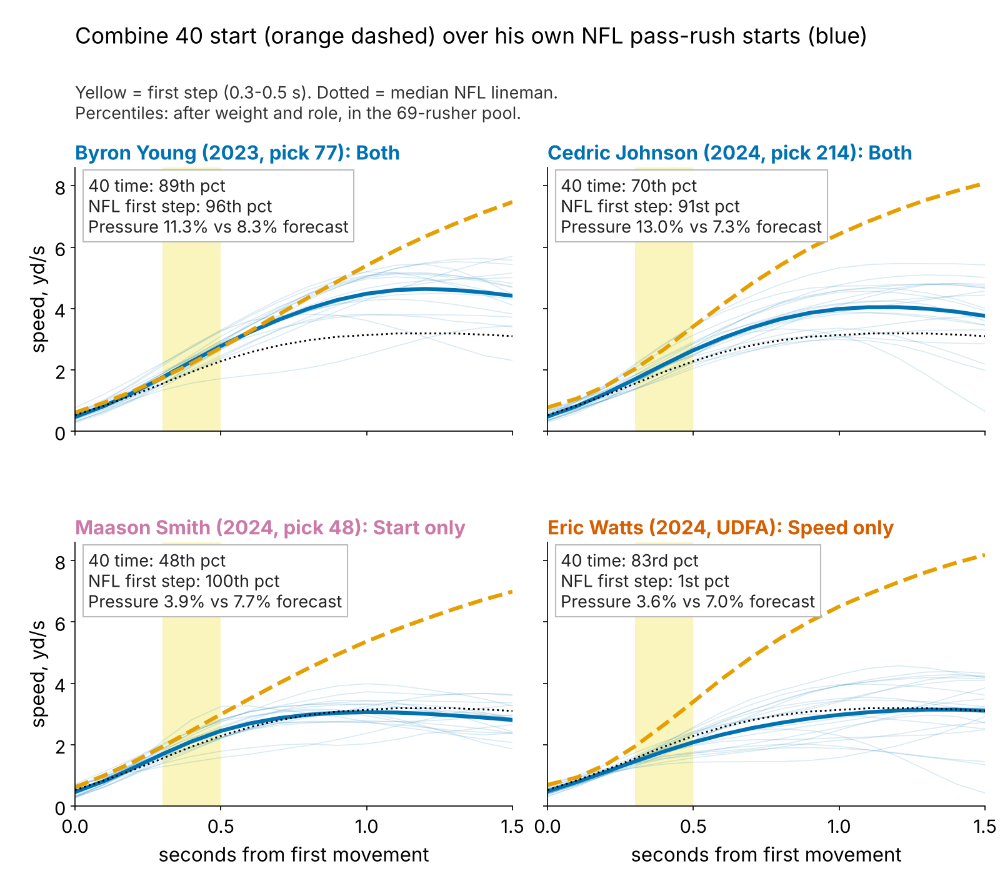
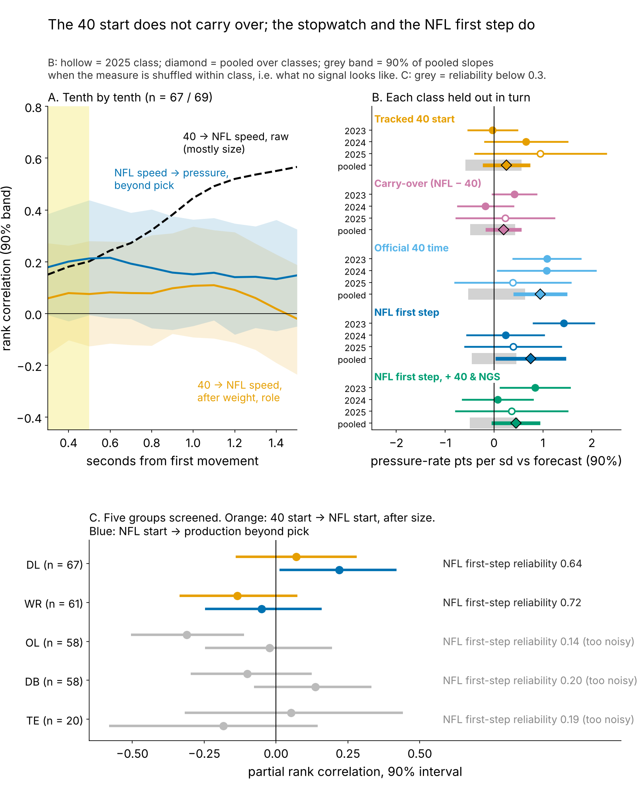
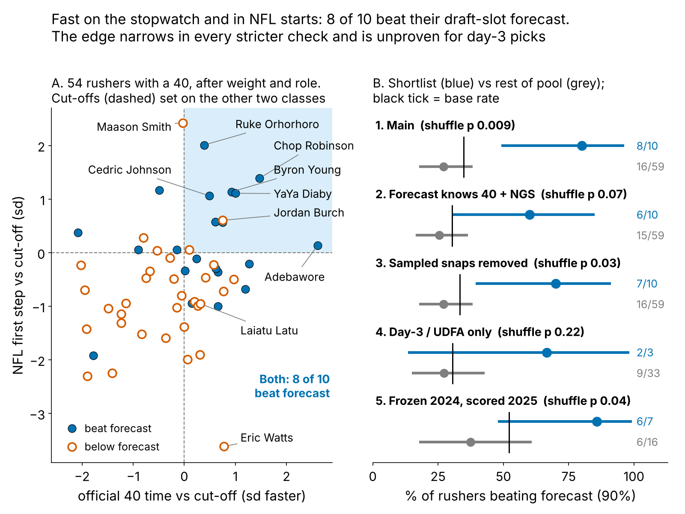
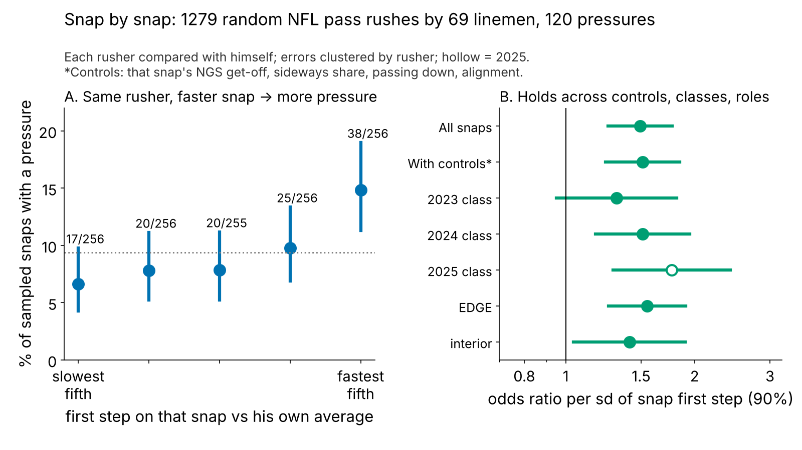

# Speed That Translates: Pass Rushers Fast on the Stopwatch and on Sundays

**A lineman's tracked Combine 40 start does not carry over to his NFL pass-rush start. Agreement does: rushers fast on the official 40 *and* in about 20 sampled NFL starts beat a draft-slot pressure forecast 8 times in 10 (rest: 16 in 59) on held-out classes. Use it to hand out passing-down snaps.**

## Why it matters

After a rookie season, a club decides which young rusher gets third-down snaps and whether to buy a veteran. That call is usually made on sacks: a few a season, mostly noise. The 2023–25 Combine 40s were tracked at 10 Hz, and NFL tracking shows the same lineman leaving a stance. If the two agree, a club can trust a short NFL sample sooner.

## So what for a team

1. **Pro personnel: rank young rushers by "Both"** (NFL first step in the top third and 40 time in the top half). On held-out classes that list produced +5.0 pressures a season over forecast; the rest, −1.4. The 2026 list is Table 4.
2. **Draft room: pay for the stopwatch, not the trace.** Only the official 40 adds pressure beyond draft slot (Table 1).
3. **Measurement: chart 24 or more random rushes per young rusher** before trusting his first step (reliability 0.7; 8 rushes give 0.44). Do not add Combine 40 reps for this: 90% of linemen already run two.

## The metric

**First step = a lineman's speed 0.3 to 0.5 s after he first moves.** In that window the 40 and a pass rush are the same movement; by 1.5 s they part (6.8 yd/s in the 40, 3.1 on a rush, because he meets a blocker). Both sides are in sd after weight and role (share of snaps at EDGE).

**Data.** Tracked Combine 40s, year-standardized; curves start at first movement, so the clip's ~0.3 s lead before the laser does not matter. NFL: random sampled pass rushes only, alignment-adjusted: 1563 starts by 85 linemen, median 19 each, reliability 0.64; it tracks NGS get-off snap by snap (ρ = 0.51). **Pool:** of 118 linemen, 33 have fewer than 8 sampled starts and 16 fewer than 100 rushes; 69 remain. Outcome: career pressures per rush. **Baseline without tracking:** draft pick, weight and role, fitted on the other two classes; a stronger one adds the official 40 time and season NGS get-off.

## Finding 1: the Combine start does not carry over

Raw, the 40 ranks NFL speed at 1.5 s at 0.57, but that is weight. After weight and role, the 40 first step previews the NFL first step at ρ = 0.07 [−0.14, 0.28] (n = 67). Noise is not the excuse: with two reps averaged the most a perfect link could show is 0.67, and a true translation of 0.5 or more has posterior probability 0.03. No per-player similarity score (gap, speed ratios, curve shape) exceeds 0.18 against pressure beyond pick.

DL is the clearest of five groups screened (Figure 2C). Receivers' NFL starts are readable (reliability 0.72) but do not pay (−0.05); OL, DB and TE starts are too noisy from about 20 snaps (0.14 to 0.20).

| Measure, one sd faster (DL) | n | Beyond pick, weight, role | Beyond that + official 40 + NGS get-off |
|---|---|---|---|
| Tracked 40 start (Combine clip) | 52 | 0.3 [−0.2, 0.7] | 0.2 [−0.4, 0.8] |
| Carry-over (NFL start minus 40 start) | 52 | 0.2 [−0.1, 0.5] | 0.2 [−0.3, 0.7] |
| Official 40 time (stopwatch) | 54 | 0.9 [0.4, 1.5] | in baseline |
| **NFL first step (game tracking)** | 69 | **0.8 [0.1, 1.4]** | **0.4 [0.0, 0.9]** |

*Table 1. Pressure-rate points per sd faster (DL average about 8%), 90% interval, each class held out in turn.*

## Finding 2: two signals that agree beat the forecast

The official 40 time and the NFL first step both carry (Table 1), so we ask: does the speed he showed in Indianapolis show up when he leaves his stance?

**The rule.** *Both* = NFL first step in the top third and 40 time in the top half, each class's cut-offs set on the other two classes. A rusher "hits" if his pressure rate beats the held-out forecast (base rate 35%).

| Check | Shortlist beat forecast | Everyone else | Gap, pts [90%] | Shuffle p |
|---|---|---|---|---|
| Main: pick, weight, role forecast; cut-offs from the other two classes | 8 of 10 | 16 of 59 | 53 [28, 75] | 0.009 |
| Forecast also knows the official 40 time and NGS get-off | 6 of 10 | 15 of 59 | 35 [8, 62] | 0.07 |
| All ~40 sampled snaps per rusher removed from the outcome | 7 of 10 | 16 of 59 | 43 [14, 71] | 0.03 |
| Day-3 picks and UDFAs only (pick 103+) | 2 of 3 | 9 of 33 | 39 [−26, 82] | 0.22 |
| Frozen after 2024, scored on 2025 vs his own 2023-24 pressure | 6 of 7 | 6 of 16 | 48 [15, 75] | 0.04 |

*Table 2. Five checks on one shortlist. Gap interval: rushers resampled within class; p: labels shuffled within class.*

**Verdict: a real but modest edge in the full pool, unproven for day-3 picks (three shortlisted).** The gap narrows in every stricter check and stays positive. Row 5 is the cleanest test: the call is frozen after 2024 from 2023–24 starts only and scored on 2025 against a forecast that knows each rusher's own past pressure. As a slope beyond that persistence forecast, the frozen first step adds +0.4 points per sd [−0.5, 1.3]: right direction, not proven. Survivorship does not drive it: the first step does not predict who reaches 100 rushes, and reweighting for who does leaves the gap at 53 points [27, 77].

## Why it works: the same rusher, faster snap

On 1279 random rushes by 69 linemen, a first step one sd faster than *his own* average multiplies that snap's odds of pressure by 1.49 [1.25, 1.77]: 14.8% for his fastest fifth of starts, 6.6% for his slowest. It holds with that snap's NGS get-off, sideways path, down and alignment fixed (1.51). The 40 says the speed exists; the NFL starts say he uses it from a stance.

## A worked decision: two day-3 edges, summer 2025

Cincinnati's Cedric Johnson and Washington's Javontae Jean-Baptiste: 2024 edge rushers picked eight slots apart, both on $1.04M-a-year rookie deals. The call uses 2024 data only.

| End of 2024 | Cedric Johnson (pick 214) | Javontae Jean-Baptiste (pick 222) |
|---|---|---|
| 40 time, percentile | 70 | 24 |
| 2024 sampled starts; call frozen after 2024 | 8; **Both** | 16; no call (middle first step, slow 40) |
| 2024 pressure rate (rushes) | 10.2% (59) | 5.5% (146) |
| **2025 result** | 14.0% (22 pressures, 9 games) | 2.9% (1 pressure, 3 games) |

*Table 3. Percentiles within the 69-rusher pool.*

**Action:** give Johnson the passing-down rotation before shopping for a veteran. The rule's held-out edge is about 6.4 pressures a season; 2025's 21st to 40th richest veteran edge contracts cost a median $5.5M a year ($3.2M to $8.5M). Johnson's 59 rookie rushes alone would not justify that; the agreeing signals do. Jean-Baptiste's 3-game 2025 cannot score the call either way.

**Where rule and tape disagree.** Maason Smith (Jacksonville, 2024, pick 48) has the pool's best NFL first step, a 48th-percentile 40 and 3.9% pressure against a 7.7% forecast. He arrives fast and does not win: grade hands and a counter before cutting his snaps. **The shortlist miss:** Jordan Burch (Arizona, 2025), 5.8% against 8.5% after one season.

## The 2026 list

The same rule, cut-offs from all three classes, applied to every lineman with 8+ sampled starts: the order for passing-down snaps.

| Rusher (class, pick, team) | Alignment | Games missed / possible | 40 time pct | NFL first step pct | Pressure to date vs forecast (rushes) |
|---|---|---|---|---|---|
| Ruke Orhorhoro (2024, 35, ATL) | interior | 9 / 34 | 69 | 99 | 8.2% vs 8.2% (498) |
| Chop Robinson (2024, 21, MIA) | hand-down end | 2 / 34 | 98 | 97 | 11.8% vs 10.1% (726) |
| Byron Young (2023, 77, LAR) | hand-down end | 0 / 51 | 89 | 96 | 11.3% vs 8.6% (1501) |
| YaYa Diaby (2023, 82, TB) | hand-down end | 0 / 51 | 93 | 94 | 10.5% vs 8.3% (1420) |
| Cedric Johnson (2024, 214, CIN) | hand-down end | 18 / 34 | 70 | 91 | 13.0% vs 7.4% (216) |
| Ty Robinson (2025, 111, PHI) | interior | 8 / 17 | 69 | 90 | 0.0% vs 7.2% (55) |
| Jordan Burch (2025, 78, ARI) | hand-down end | 0 / 17 | 85 | 88 | 5.8% vs 8.4% (344) |
| T'Vondre Sweat (2024, 38, TEN) | interior | 5 / 34 | 74 | 87 | 7.7% vs 7.0% (496) |
| Byron Murphy (2024, 16, SEA) | interior | 3 / 34 | 81 | 86 | 10.0% vs 9.0% (682) |
| Adetomiwa Adebawore (2023, 110, IND) | interior | 14 / 51 | 100 | 77 | 8.6% vs 7.0% (511) |
| Yasir Abdullah (2023, 136, JAX) | hand-down end | 33 / 51 | 54 | 72 | 6.0% vs 8.1% (149) |

*Table 4. Percentiles within the pool; forecast = pick, weight, role. Games missed = no recorded snap (injury, inactive or cut). Ty Robinson's 55 rushes are too few to judge; Abdullah is an availability question first.*

## Limitations

- **Not blind.** The two-signal form was chosen in an earlier round after seeing all three classes; only the cut-offs are held out. The time-forward row has 23 rushers and overlaps the main shortlist; 2026 is the first true test.
- **Small lists.** Ten rushers, nine from 2023–24, three on day 3. One new class gives the slope test 47% power.
- **Translation itself is a null.** Tracking contributes the NFL first step; the Combine contributes the stopwatch.
- **Sampled tape, no blockers or ball.** A slow start can be a two-gap call, a fast one a free rush; injuries enter only as missed games.

## Appendix

**Table 1 test.** The two-class forecast is a logit offset in a quasi-binomial model of held-out pressures per rush; class slopes pooled by random effects; p shuffles the measure within class: tracked 40 start 0.48, carry-over 0.48, official 40 0.004, NFL first step 0.01 (0.13 with the stronger baseline). Best of 11 windows under the same shuffle: p = 0.02. **Rusher random intercept.** On 137 player-seasons, Gauss-Hermite binomial model with the forecast as offset: 0.7 points per sd [0.2, 1.2], rusher sd 0.24 on the logit scale. **Selection.** P(in pool) from pick, weight, 40 time and class (AUC 0.85); among the 85 with 8+ starts, first step odds ratio 0.81 (p = 0.52). Stabilized inverse-probability weights (capped at the 95th percentile): slope 0.9 [0.4, 1.3]; shortlist 79% vs 27%. **Calibration.** Told from the other two classes, the shortlist expected 69% hits and got 80%; the rest expected 28% and got 27%; Brier 0.212 against 0.253 for the base rate. **Measurement.** Tracked 40 first-step repeatability 0.54 (n = 56), 0.70 for two reps.

*Reproduce: `uv run python writeup/candidates/round_15/cand_3/analysis.py` (about 3 minutes).*
