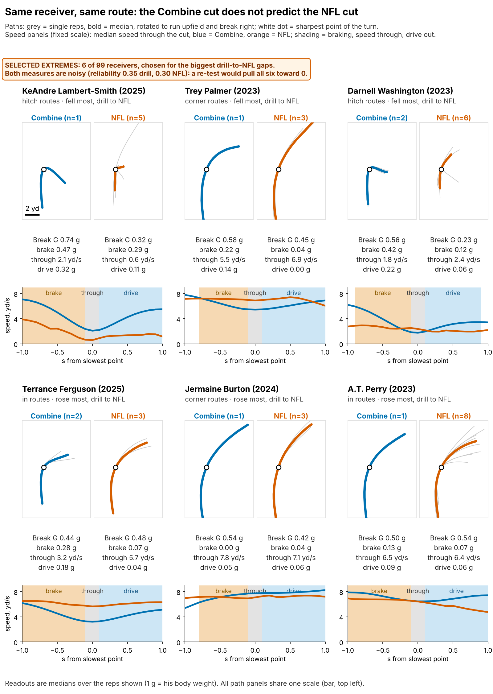
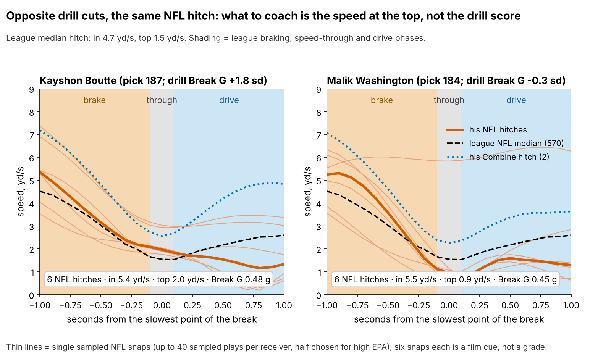
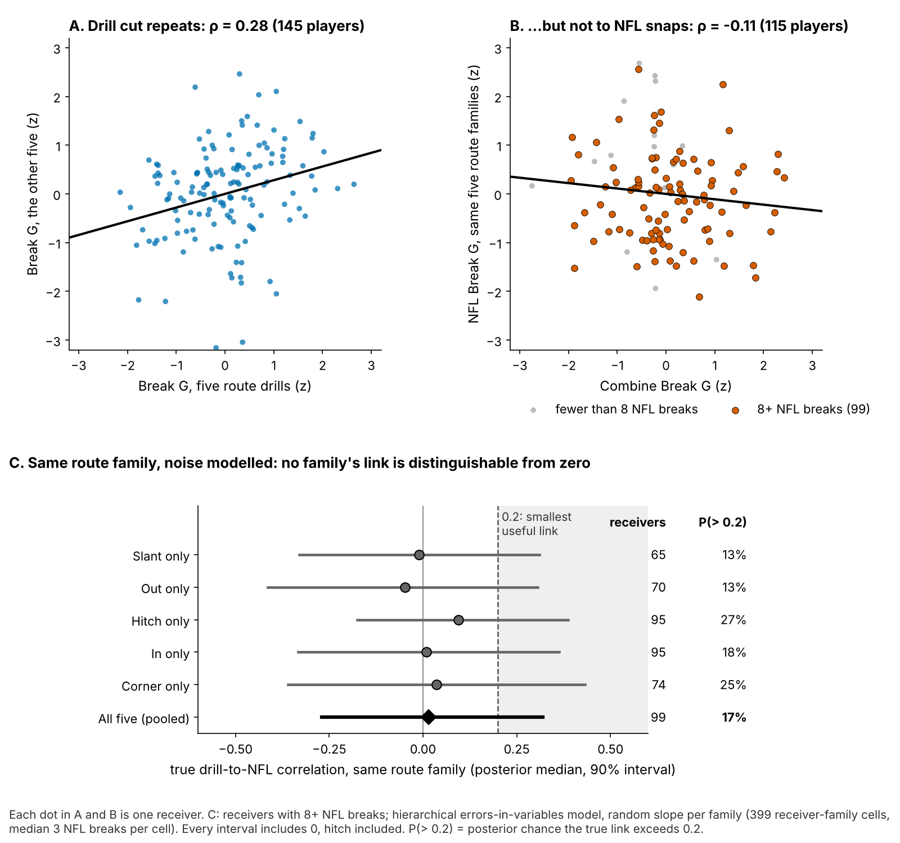
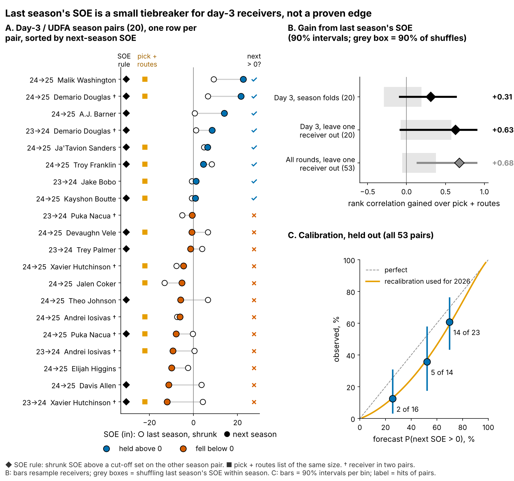

# Combine Cuts Don't Get Receivers Open

**A receiver's Combine cut does not predict how open he gets in the NFL. For day-3 receivers, last season's separation is a small tiebreaker, not a grade. Stop paying for the drill cut, and use the tracking on film to coach the break.**

*Break G is how hard a receiver pushes off the ground around his cut: mean acceleration in g (1 g = body weight) over the second centred on the sharpest point of the turn. One sd is the spread of true receiver Break G, {g_sd} g. Separation over expected (SOE) is the space at the throw beyond what alignment, cushion and position predict (NGS, full season).*

## The roster decision

In August a club picks its sixth receiver from day-3 players on minimum deals. Tape rarely settles who gets open, so scouts lean on Combine "suddenness". The 2023–2025 route drills were tracked at 10 Hz, so the cut can now be measured. Does it become NFL separation, and if not, what breaks the tie?

| Question (n) | Held-out result [90% interval] | Verdict |
|---|---|---|
| Does Break G add season SOE? ({n_main} receivers, unseen classes) | {prim_b} in per sd [{prim_lo}, {prim_hi}]; a +3 in effect rejected | **No** |
| Does the drill cut carry to the same NFL route family? ({fp_pool_n}) | true correlation {fp_pool_med} [{fp_pool_lo}, {fp_pool_hi}] | **No visible transfer** |
| Does last season's SOE beat pick and routes on day 3? ({ev_d3_n} pairs, {nx_np} receivers pooled) | rank-correlation gain {lo_d3_gain} [{lo_d3_lo}, {lo_d3_hi}], leaving one receiver out | **Not proven: tiebreaker only** |
| Same, all rounds ({ev_all_n} pairs) | gain {lo_all_gain} [{lo_all_lo}, {lo_all_hi}] | **Clearer in the larger pool** |

**Verdict.** On day 3 the edge is not statistically distinguished from zero: its interval includes 0, it wins {ev_d3_folds_won} of 2 season folds, and as a yes/no list it hits {r_d3_rule_hit} of {r_d3_rule_n} against {r_d3_pk_hit} of {r_d3_pk_n} for pick and routes. Separation persists at every pick, so on day 3, where little else is known, it is the best tiebreaker available.

## What to do

1. **Break ties between day-3 receivers with last season's route-shrunk SOE** (2026 list below).
2. **Take Break G out of the price.** Clubs draft +1 sd {price_bg}% earlier beyond position, {price_full}% beyond the 40, weight and NGS score, the figure quoted in earlier rounds. Its best case is worth {best_c} catches a season.
3. **Use the tracking on film, not on the board.** Read entry speed, speed at the top and drive out of the break by route family (Figure 3): a coachable cue, not a grade.
4. **2026 Combine protocol.** If you time cut drills, run slant, dagger and comeback twice: one rep is {vp_pct}% player, and a second rep on those three lifts reliability from {rel_mm1} to {rel_mm3}. Read speed from the official 40, not the tracked clip, which starts about 0.3 s before the laser.

## The worked case: a hard cutter and a soft one at the same pick

Kayshon Boutte (2023, pick {wk_kb_pick}) and Malik Washington (2024, pick {wk_mw_pick}) are chosen by their drill cuts, not by forecast: they are the two list names with the closest picks and opposite cuts ({l26_boutte_bg} and {l26_washington_bg} sd). Pick and routes ({wk_kb_routes} and {wk_mw_routes} in 2025) give both {l26_boutte_pc0}%. Their 2025 SOE does not tie ({l26_boutte_soe} vs {l26_washington_soe} in), and the recalibrated chance of SOE above zero in 2026 moves to {l26_boutte_pc1}% vs {l26_washington_pc1}%.

Context: Boutte played {wk_kb_games} games for New England with Drake Maye and saw man coverage on {wk_kb_man}% of routes; Washington played {wk_mw_games} for Miami with Tua Tagovailoa and saw man on {wk_mw_man}%. Both earn about $1M (${wk_kb_apy}M and ${wk_mw_apy}M), so the call is free. The forecast gap of {wk_dsoe} inches is worth {wk_dc} catches a season ({wk_dc_lo} to {wk_dc_hi} across the plausible range of {cr_lo} to {cr_hi} catch-rate points per yard and {tg_lo} to {tg_hi} targets). Keep Washington. A drill-priced board would have done the opposite.

This pair is not typical. Across the {mp_n} 2025 day-3 receiver pairs matched on pick and routes, the median gap is {mp_med} points; the largest is {mp_max}.

**The film cue.** On NFL hitches the two look alike: they enter at {film_kb_vin} and {film_mw_vin} yd/s, faster than the league's {film_lg_vin}, with similar Break G ({film_kb_bg} and {film_mw_bg} g). The difference is at the top: Boutte is still moving at {film_kb_vap} yd/s where Washington sinks to {film_mw_vap}. Coach Boutte to sink fully at the top of hitches and outs against off coverage. The drill score does not show this; six sampled snaps each make it a cue to check on film, not a grade.

## Drill to tape

Break G is found on {pct_found}% of {n_reps} drill reps, standardized within drill and Combine year, and averaged over route drills (median {drills_med}). The same code grades NFL snaps on slant, out, hitch, in and corner routes.

- **The drill trait is real.** Break G on five drills predicts the other five at ρ = {rel_split} ({rel_split_n} players), and it is not a speed score (ρ with the 40 is {rho_forty}).
- **It does not reach NFL routes.** Game cuts are softer (median {g_drill_med} g in drills, {g_nfl_med} g on NFL snaps), and drill order is lost.
- **It is the metric, not only thin data.** A route-family errors-in-variables model with a random slope per family ({fp_cells} receiver-family cells) models the noise of a few reps and a few snaps. Every family's interval includes zero, hitch included ({fp_hitch_med} [{fp_hitch_lo}, {fp_hitch_hi}]). The chance that the true link exceeds 0.2 is {fp_pool_p02}% pooled and at most {fp_max_p02}% for any family.

## Season separation on unseen classes

The outcome is full-season SOE, route-weighted over each career ({n_seasons} player-seasons, median {routes_med} routes). The forecast without tracking, fixed before the test, uses log pick, official 40, weight, NGS athleticism score and a TE flag. Fitted on two classes and scored on the third, it leaves nothing for Break G to explain (table above). Every variant in the appendix stays at or below +{t5_max_hi} inches per sd. A +3 inch effect would be worth only {sesoi_catch} catches a season ({sesoi_c_lo} to {sesoi_c_hi}).

## The 2026 day-3 shortlist

Day-3 or undrafted, 100+ routes and SOE above zero in 2025, with SOE shrunk toward the mean by routes. Probabilities are for SOE above zero in 2026, recalibrated on the held-out season pairs. § = Combine-discounted (NGS athleticism score below his class average).

{{SHORTLIST}}

Below Isaiah Bond it is a coin flip or worse. Sanders played {l26_sanders_games} games, so his sample is thin. Of the {l26_n}, {l26_soft} are soft drill cutters a drill-priced board would mark down, and {l26_disc} (§) were already discounted on the standard Combine.

## How the rule scored

- **Nested test.** All {ev_all_n} pairs share one model with a receiver random intercept; each receiver is forecast by models that never saw him. Last season's SOE persists at every pick: {nx_p200} inches per inch at pick 200 [{nx_p200_lo}, {nx_p200_hi}] and {nx_p40} at pick 40, with no pick-by-SOE interaction ({nx_int} [{nx_int_lo}, {nx_int_hi}]). Left-out pick-and-routes forecasts rank day-3 pairs badly ({lo_d3_r0}), which flatters that gain. Reading: SOE carries real information, and day 3 has too few pairs to show its own edge.
- **Calibration.** Raw held-out probabilities ran high (day 3: {cal_d3_pred}% forecast, {cal_d3_obs}% observed). Rescaling fitted on the held-out pairs brings the cross-fitted day-3 forecast to {rc_d3_pred}%; the 2026 list shows rescaled values.

## Limitations

- **Not a blind test, small day-3 sample.** Earlier rounds saw all three classes, and day 3 has {ev_d3_n} pairs. The 2026 class is the first true out-of-sample score (power {power26} against a 3-inch gain).
- **The downside is open.** The primary interval rules out gains above {prim_hi} inch per sd, not losses down to {prim_lo}.
- **Game tracking is a sample.** Up to 40 plays per player, half chosen for high EPA, with no defenders and no ball. That limits the film cue and the drill-to-game link, not the season SOE test. Games played is a rough injury proxy.
- **Survivorship.** {sel_out} of {sel_n} drill-scored receivers never logged NFL routes with separation; re-weighting changes little (appendix).

## Appendix

**Break G slopes, inches of season SOE per sd, held out unless stated.**

| Version (n) | Slope [90%] | p against +3 in |
|---|---|---|
| **Pre-specified offset forecast, primary ({n_main})** | **{prim_b} [{prim_lo}, {prim_hi}]** | **{t5_plain_p3}** |
| Ridge forecast ({n_main}) | {ridge_b} [{ridge_lo}, {ridge_hi}] | {t5_ridge5_p3} |
| No offset: Break G beside the five inputs, all classes ({n_main}) | {t5_nooff_b} [{t5_nooff_lo}, {t5_nooff_hi}] | {t5_nooff_p3} |
| Re-weighted by 1 / P(reaching the NFL sample) ({n_main}) | {t5_ipw_b} [{t5_ipw_lo}, {t5_ipw_hi}] | {t5_ipw_p3} |
| Player-seasons, receiver random intercept, in-sample ({mm_ps_n}) | {t5_mixed_b} [{t5_mixed_lo}, {t5_mixed_hi}] | {t5_mixed_p3} |
| Without Puka Nacua, most influential ({nn_n}) | {nn_b} [{nn_lo}, {nn_hi}] | {t5_nn5_p3} |
| SOE adjusted for route mix and depth ({n_main}) | {mix_b} [{mix_lo}, {mix_hi}] | {t5_mix5_p3} |
| SOE adjusted for quarterback ({n_main}) | {qb_b} [{qb_lo}, {qb_hi}] | {t5_qb5_p3} |

**Day-3 tests.** Season-fold rank correlation {ev_d3_m0_rho} for pick and routes vs {ev_d3_m1_rho} with SOE (gain {ev_d3_drho} [{ev_d3_drho_lo}, {ev_d3_drho_hi}]); within-fold shuffle p {perm_rho_p}; yes/no gap shuffle p {perm_gap_p}. Leave-one-receiver-out shuffle p {lo_d3_p} (day 3) and {lo_all_p} (all); RMSE removed {lo_d3_drmse} inches [{lo_d3_drmse_lo}, {lo_d3_drmse_hi}]. Intervals resample receivers and redo the leave-one-out loop. **Calibration.** Platt rescaling, intercept {rc_a}, slope {rc_b}; cross-fitted Brier {rc_brier_raw} raw, {rc_brier_cf} rescaled. **Selection model.** Logistic regression of reaching the NFL sample on the five inputs and Break G; Break G odds ratio {sel_or_in} [{sel_or_in_lo}, {sel_or_in_hi}]. **Family model.** Gibbs sampler, conjugate updates; within-cell rep and snap variances plug in the measurement noise; random family slopes around a pooled slope. **Shrinkage.** Skill variance = covariance of SOE across consecutive seasons ({eb_pairs} pairs); {eb_k200} of SOE is kept at 200 routes. **Units.** {cr_per_yd} catch-rate points per yard, {tg_season} targets a season.

Reproduce: `uv run python writeup/candidates/round_15/revised/analysis.py` (about ten minutes). It writes `numbers.json`, the figures and this text from `writeup_template.md`; `claims.json` names the claim behind each number.
