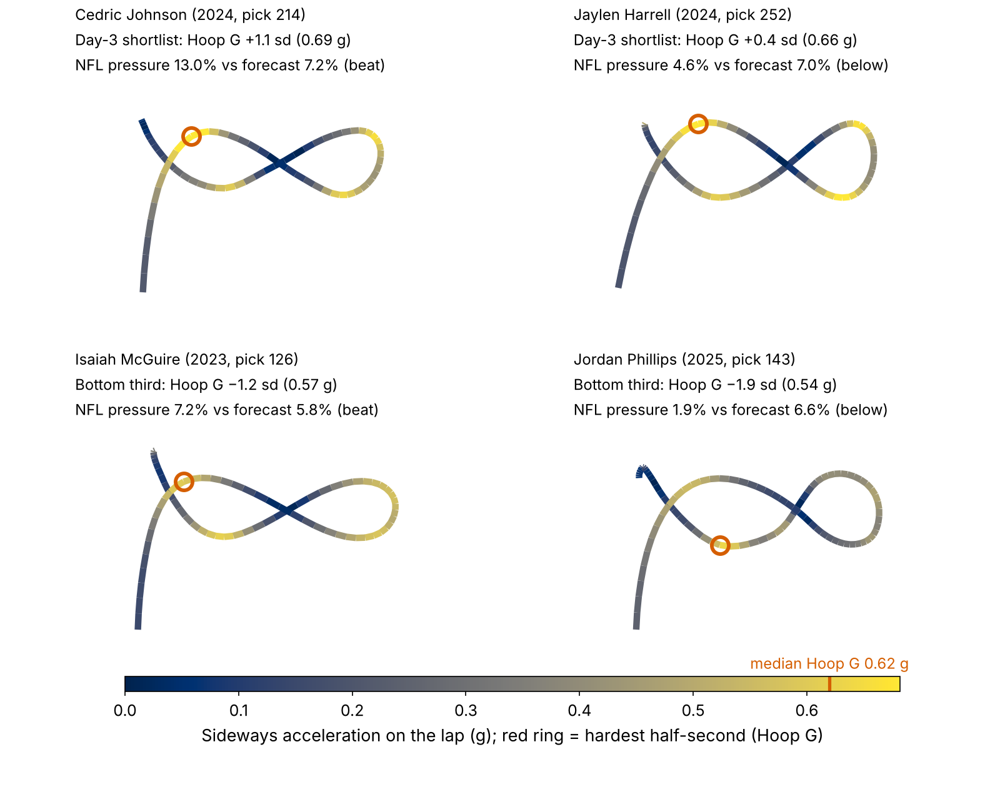
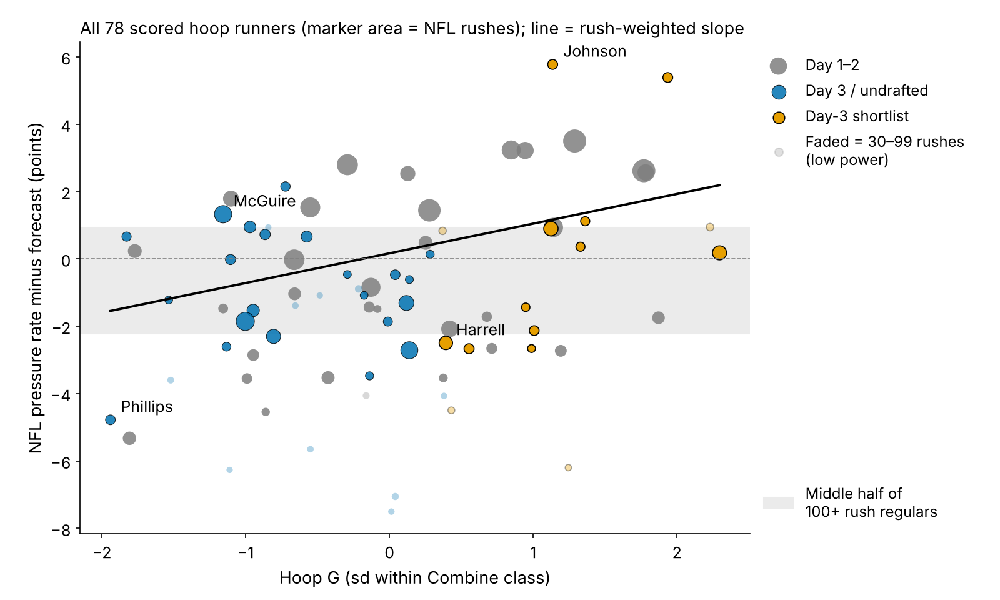
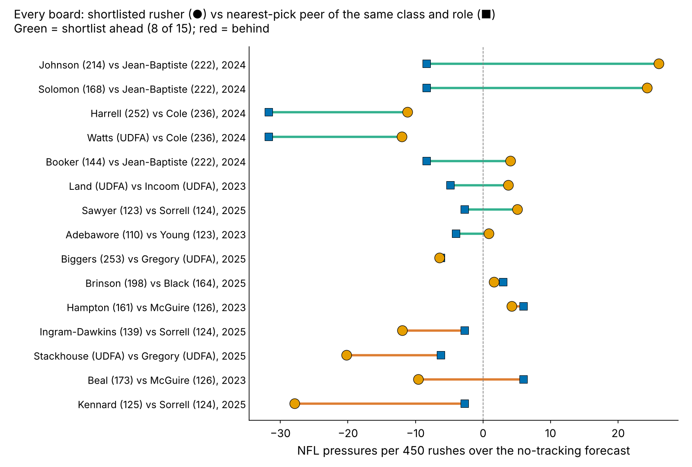
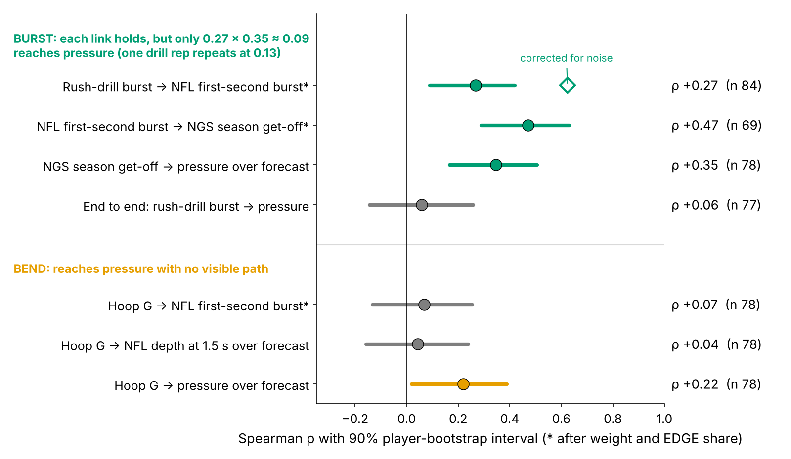

# Hoop G: A Free Day-3 Pass-Rush Tiebreaker

**Day-3 and undrafted linemen who bend hardest in the Combine's Run-the-Hoop drill beat their no-tracking pressure forecast 8 times in 15; the rest of day 3 did so 8 times in 32, a +28-point gap with a wide interval. Clubs did not draft for it. Use it to break ties between cheap rushers, not to grade them. Combine get-off burst does not carry through to pressure. For 2026 camps, act on Jack Sawyer, Warren Brinson and Ethan Downs.**

## Why pass rushers, why now

Every April a club spends day-3 picks and undrafted money on its fourth and fifth pass rushers, and in August it cuts one of them. 70% of the linemen in this study went on day 3 or undrafted, so this is where most rush decisions are made, and where the evidence is thinnest: only 43 of 118 linemen in the 2023–25 classes ran the 3-cone. A pressure is what that player is for: on 1655 randomly sampled NFL pass plays involving these rookies, a pressured snap cost the offense 0.52 more expected points than a clean one (90% interval 0.36 to 0.67).

Since 2023 every lineman's position drills are tracked at 10 Hz, and nobody times them. A lineman who skips the 3-cone still runs the hoop. So the question is narrow: does one tracked drill sort cheap rushers better than the board already does?

## The metric

**Hoop G is how hard a lineman pushes sideways, in g, during the hardest half-second of his Run-the-Hoop lap, ranked against his own Combine class.** Run-the-Hoop is a figure-eight around two hoops that rewards bending the hips at speed; the median Hoop G is 0.62 g. We standardize within Combine year because drill conditions shift between years. 109 linemen have it, 69 with no 3-cone.

The contrast is **rush-drill burst**: yards covered in the first second of the pass-rush drill, standardized the same way.

Both are noisy. 91% of hoop runners have one run; among the 10 with two, run-to-run reliability is 0.37. One burst rep repeats at 0.13.

## The test

**The yardstick** forecasts each lineman's NFL pressure rate from what a club already has: draft pick, Combine weight, NFL EDGE share, NGS athleticism score, and the official 10-yard split and 3-cone (missing times filled from weight, role and NGS score). We use the official split because the tracked 40 clip starts before the laser: the tracked split runs 0.28 s slow and agrees with the official at only r = 0.43 (93 linemen). Each class is forecast by a model fit only on the other two; on held-out classes it ranks regulars' pressure rates at ρ = 0.37.

**The rule**: shortlist = pick 103 or later (or undrafted) AND top third of Hoop G in his class. Nothing in it is fit on NFL data. A rusher with 30+ NFL rushes "hits" if his pressure rate beats his forecast.

**Result.** 8 of 15 shortlisted rushers hit, against 8 of 32 others: a gap of **+28 points**. In a regular's season of 450 rushes that is +5.4 pressures (90%: −0.5 to 11.9), about 2.8 expected points.

| Yardstick | Shortlist beat it | Rest of day 3 | Gap, points (90%) |
|---|---|---|---|
| **Primary: forecast fit on the other two classes** | 8 of 15 | 8 of 32 | +28 (4 to 50) |
| Pick-and-role-only forecast | 8 of 15 | 7 of 32 | +31 (7 to 53) |
| Time-forward: fit on earlier classes only (2024–25 scored) | 5 of 11 | 5 of 20 | +20 (−8 to 47) |
| Primary, reweighted for who reached 30 NFL rushes | weighted | weighted | +18 (−7 to 47) |

The pick-and-role-only row shows the gap is not cheap players beating a forecast anchored on draft slot. The bottom two rows are the honest ones: scoring each class only with earlier classes, or reweighting for the 29 day-3 runners who never reached 30 rushes, shrinks the gap and the interval crosses zero. Hoop G did not decide who got on the field (Appendix).

**Verdict: a small, uncertain edge, enough to break a tie, not enough to move a player up a board.** The forecast was right about the shortlist (7.3% actual vs 7.3% forecast) and too kind to the rest (5.7% vs 6.9%). Across all 78 scored hoop runners (Figure 3), pressure over forecast rises 0.88 points per sd of Hoop G (90%: 0.43 to 1.31). But Hoop G was the best of 14 drill-and-outcome pairs we screened; priced for that search, p = 0.10.

## Every board, not a chosen one

A tiebreaker is judged one decision at a time. We paired every scored shortlisted rusher with the non-shortlisted rusher of the same class and role drafted nearest to him (median 15 picks apart, rookie pay within $0.03M a year). The shortlisted player came out ahead on **8 of 15 boards (53%; 90%: 26 to 81)**, by a median of 4.8 pressures per 450 rushes (90%: −1.7 to 19.7). Figure 5 shows all of them; only 8 distinct peers fill the 15 boards, so intervals resample peers, not boards.

As an illustration, the board closest to that median: Adetomiwa Adebawore (pick 110, Hoop G +2.3) against Cameron Young (pick 123, Hoop G −0.2), 2023. The rule takes Adetomiwa Adebawore: 8.6% pressure against a forecast of 8.4%, vs 5.1% against 6.0% for Cameron Young.

A single call is close to a coin flip; the edge exists only on average. That decides a last roster spot, not a grade.

## Get-off: drill burst reaches the snap, not the pressure

Each link holds alone (Figure 4): after weight and role, drill burst tracks how far a lineman travels in the first second of a sampled NFL rush: ρ = 0.27 (90%: 0.09 to 0.42; 84 linemen), 0.62 once corrected for noise. That NFL first-second burst agrees with NGS season get-off (0.47), and season get-off predicts pressure over forecast (0.35).

Multiplied through, the chain leaves about 0.09. Measured end to end, drill burst against pressure over forecast is ρ = 0.06 (90%: −0.14 to 0.26). The bottleneck is the single drill rep.

Hoop G is the reverse: it reaches pressure (Figure 3) but not first-second burst (0.07) or depth upfield at 1.5 s (0.04). Our best guess is a rusher who keeps speed around the corner and through contact, which we cannot see without blockers in the data.

## When drill and tape disagree

| Player (class, pick) | Hoop G call | Pressure vs forecast (rushes) | Scout action and film cue |
|---|---|---|---|
| **Jaylen Harrell** (2024, 252) | Shortlist, +0.4 sd | 4.6% vs 7.0% (461) | Drill yes, NFL no, large sample. Does he convert speed to power when the tackle sets short? If not, rotate him. |
| **Isaiah McGuire** (2023, 126) | Bottom third, −1.2 sd | 7.2% vs 5.8% (824) | The rule's miss: a power rusher who wins straight ahead. Low Hoop G is not a cut signal. |
| **Jordan Phillips** (2025, 143) | Bottom third, −1.9 sd | 1.9% vs 6.6% (215) | Looped on 40% of sampled rushes (interior median 15%). Grade the role before the player. |

## So what for a team

1. **Break day-3 ties with Hoop G.** Top-third linemen went at a median pick of 158, no earlier than the bottom third (130); per sd of Hoop G, clubs drafted 3% later (90%: 11% earlier to 20% later). The tiebreaker costs no draft capital.
2. **Match the role to the trait.** Shortlisted EDGEs get third-down snaps from wide alignments, where bend matters most; shortlisted interior players get the looper job on stunts.
3. **Do not draft on drill burst.** Time get-off on tape or in camp.
4. **Ask for a second hoop run.** Reliability goes from 0.37 to 0.54. Burst would need about 7 reps to reach 0.5; skip it.

**The rule's record.** 2023 shortlist hits: Nick Hampton, Isaiah Land, Adetomiwa Adebawore; misses: Robert Beal. 2024 hits: Cedric Johnson, Javon Solomon, Austin Booker; misses: Jaylen Harrell, Eric Watts.

**The 2025 shortlist**, with the 3 players to act on first (2 on a reserve list: clear the medical first). "Widen role" = beat his rookie forecast; "camp audition" = Hoop G +2 sd or more and too few rushes to judge, so the drill is all the evidence there is; "watch" = unscored, ordinary shortlist Hoop G; "hold" = below forecast, let tape decide. Lateral rushes = share of sampled rushes moving 2+ yards sideways by 1.5 s (stunts, loops, wide arcs).

| 2025 shortlist (pick, team) | Call | Hoop G (sd) | Role note: EDGE share; lateral rushes (sampled) | Availability: 2025 games; status | Rookie pressure vs forecast (rushes) |
|---|---|---|---|---|---|
| **Jack Sawyer** (123, PIT) | **Act: widen role** | +1.4 | 89%; 55% (20) | 17; active | 9.7% vs 8.5% (176) |
| **Warren Brinson** (198, GB) | **Act: widen role** | +1.3 | 4%; 17% (18) | 11; **reserve list** | 6.9% vs 6.6% (173) |
| **Ethan Downs** (UDFA, KC) | **Act: camp audition** | +2.3 | 100%; too few | 1; **reserve list** | under 30 (7) |
| **Jah Joyner** (UDFA, FA) | Watch: second hoop run | +1.5 | none; too few | 0; unsigned | under 30 (0) |
| **Antwaun Powell-Ryland** (209, CIN) | Watch: second hoop run | +1.1 | none; too few | 0; practice squad | under 30 (0) |
| **Tim Smith** (190, IND) | Watch: second hoop run | +0.4 | none; too few | 0; active | under 30 (0) |
| **Kyle Kennard** (125, LAC) | Hold | +1.2 | 95%; 13% (15) | 5; active | 2.0% vs 8.2% (50) |
| **Tyrion Ingram-Dawkins** (139, MIN) | Hold | +1.0 | 64%; 30% (20) | 14; active | 5.3% vs 8.0% (113) |
| **Zeek Biggers** (253, MIA) | Hold | +0.9 | 24%; 50% (18) | 9; active | 4.9% vs 6.4% (142) |
| **Nazir Stackhouse** (UDFA, TEN) | Hold | +0.4 | 1%; 6% (18) | 13; active | 1.4% vs 5.9% (71) |

**Pre-registered 2026 test.** The rule and forecast are frozen in `frozen_rule.json` and `frozen_shortlist.json` (SHA-256 prefix `45f98175833d`): one-sided Fisher test at 10%, scored after the 2027 season. A class supplies about 5 shortlisted and 11 other scored rushers. If the observed gap is true, power is 26% for 2026 alone, 45% pooled with 2027 and 63% over three classes (29% if the true gap is half as large). Even three classes stay under two-thirds power, so treat 2026 as a check on direction, not a verdict.

## Limitations

- **One rule, chosen after looking.** Holding classes out checks the forecast, not the drill choice (search-adjusted p = 0.10). Stricter versions are weaker; future classes are the clean test, underpowered one at a time.
- **Small counts.** 15 shortlisted vs 32 comparison rushers; 2025 rookies have one season. Hoop G reliability rests on 10 linemen with two runs.
- **Forecast level.** Fit on 100+ rush regulars, the forecast sits above most day-3 rushers, so day-3 rushers are compared with each other, not with 50%.
- **Thin NFL tracking, no injuries or scheme labels.** About 20 random sampled rushes per player, no blockers, no ball. Sampled pressure barely repeats (split-half 0.04), so pressure comes from season totals; scheme notes come from loop rates, availability from games played and roster status.

## Appendix

| Check | Result |
|---|---|
| Shortlist vs rest by class (2023, 2024, 2025) | 3/4 vs 2/12; 3/5 vs 3/7; 2/6 vs 3/13 |
| Selection model: odds of reaching 30 rushes per sd of Hoop G (90%) | 1.18 (0.68 to 2.07) |
| Class-stratified (Mantel-Haenszel) odds ratio (90%); p | 2.8 (1.0 to 7.6); 0.16 |
| Flat-prior P(gap > 0); within-class relabelling p | 97%; 0.037 |
| Shrunken (ridge) forecast; without Cedric Johnson | 8/15 vs 6/32; 7/14 vs 8/32 |
| Same rule on the official 3-cone (day 3, ran it) | 1/3 vs 3/13 |

*Reproduce: `uv run python writeup/candidates/round_16/cand_1/analysis.py` writes `numbers.json`, the board, the frozen 2026 rule and all figures, and fills this text.*
