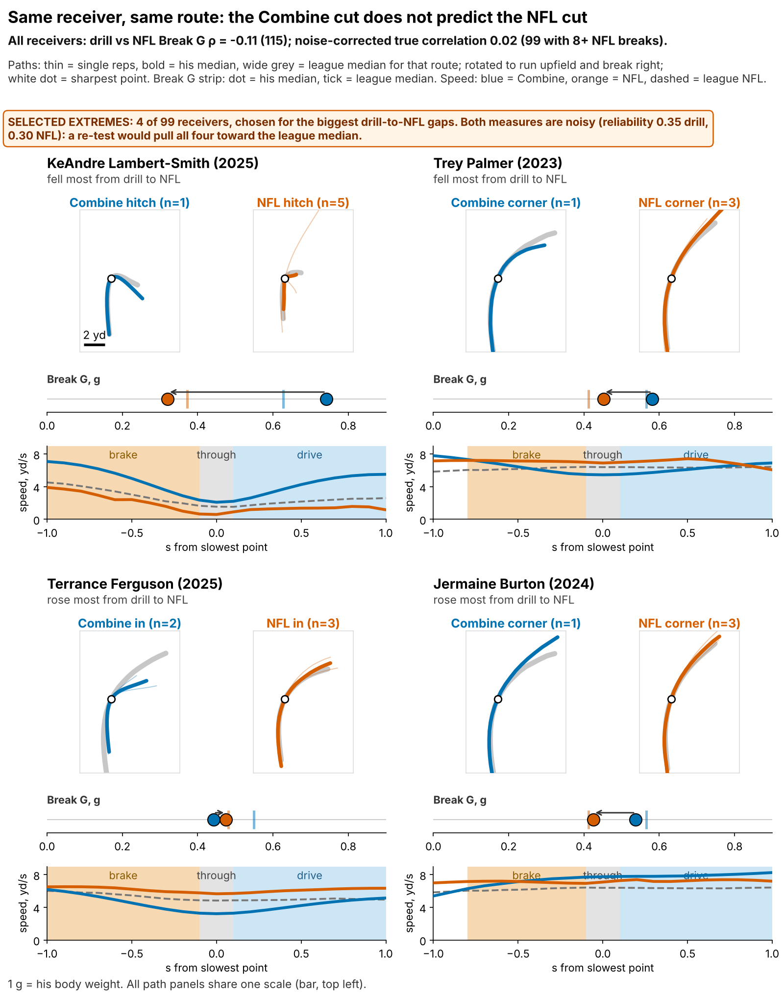
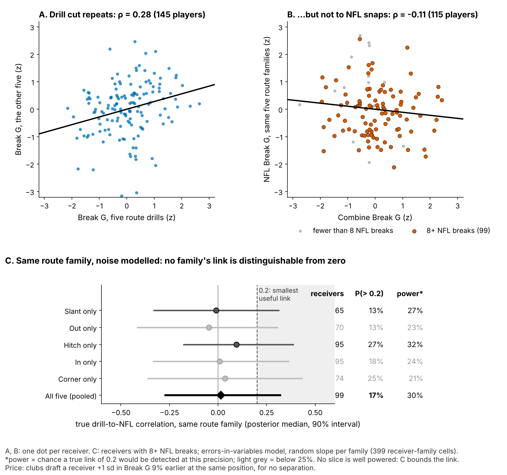
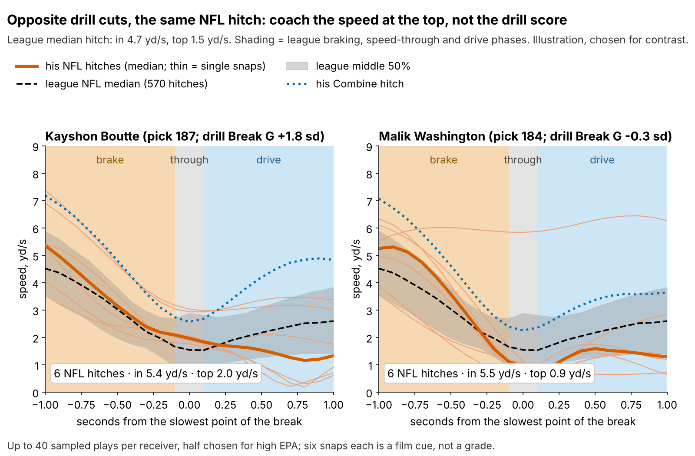
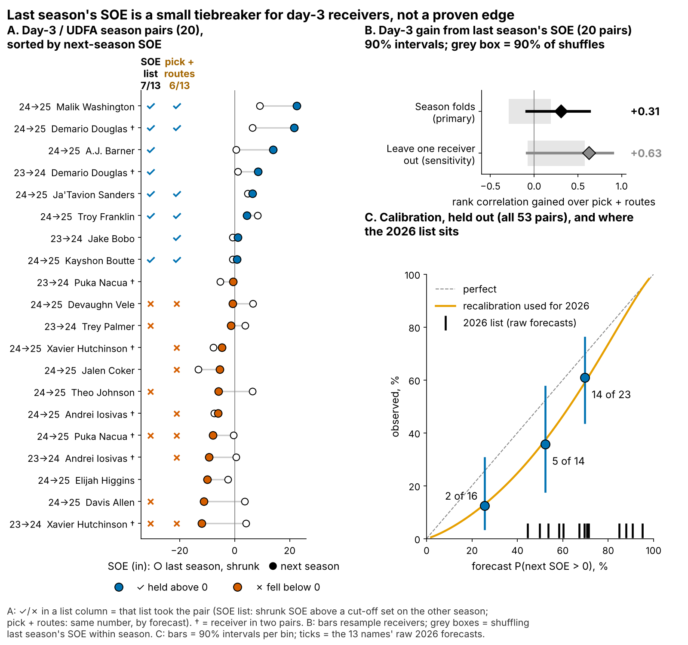

# Combine Cuts Don't Get Receivers Open

**A receiver's Combine cut does not predict how open he gets in the NFL. For day-3 receivers, last season's separation is a small tiebreaker, not a grade. Stop paying for the drill cut, and use the tracking on film to coach the break.**

*Break G is how hard a receiver pushes off the ground at the sharpest point of his cut.¹ Separation over expected (SOE) is the space he has at the throw beyond what his alignment and cushion predict (NGS, full season).*

## Why now, why receivers

Scouts grade receivers on "suddenness" in the gauntlet and route drills, but the Combine stopwatch only times straight lines and cones. Since 2023 those route drills have been tracked at 10 Hz, so the cut itself can be measured, with the same code a club can run on its own game tracking. Receivers are where this matters most. Getting open is the job, and the sixth receiver spot goes to day-3 players on minimum deals, whose college tape rarely settles who separates. Public audits find that tracking adds about nothing to the 40. This study asks a narrower question: does the same cut carry to the same NFL route, and if not, what breaks the tie?

## The roster decision

| Question (n) | Held-out result [90% interval] | Verdict |
|---|---|---|
| Does Break G add season SOE? (116 receivers, unseen classes) | −1.2 in per sd [−3.6, +1.0]; a +3 in effect rejected | **No** |
| Does the drill cut carry to the same NFL route family? (99 receivers with 8+ NFL breaks) | noise-corrected correlation 0.02 [−0.27, 0.32] | **No visible transfer** |
| Does last season's SOE beat pick and routes on day 3? (20 pairs, 16 receivers) | rank-correlation gain 0.31 [−0.08, 0.63], each season forecast from the other | **Not proven: tiebreaker only** |

**Verdict.** On day 3 the edge is not distinguished from zero: its interval includes 0, and as a yes/no list it hits 7 of 13 against 6 of 13 for pick and routes. Separation persists at every pick, so where little else is known it is the best tiebreaker available. The appendix lists each estimate beside its alternatives.

## What to do

1. **Break ties between day-3 receivers with last season's route-shrunk SOE.** Act first on Malik Washington (MIA, 95%), Demario Douglas (NE, 89%), Tez Johnson (TB, 85%), Arian Smith (NYJ, 81%).
2. **Take Break G out of the price.** At the same position, clubs draft a receiver 1 sd harder in the cut 9% earlier [2, 17] and get no separation for it. Its best case is worth 0.14 catches a season.
3. **Use the tracking on film, not on the board.** Read entry speed, speed at the top and drive out of the break by route family (Figure 3). It is a coaching cue, not a grade.
4. **2026 Combine protocol.** If you time cut drills, run slant, dagger and comeback twice. One rep is 14% player; a second rep on those three lifts reliability from 0.53 to 0.62. Read speed from the official 40, not from the tracked clip, which starts about 0.3 s before the laser.

## Drill to tape

Break G is found on 96% of 926 drill reps. It is standardized within drill and Combine year and averaged over route drills (median 7). The same code grades NFL snaps on slant, out, hitch, in and corner routes.

- **The drill trait is real.** Break G on five drills predicts the other five at ρ = 0.28 (145 players). It is not a speed score: its ρ with the 40 is −0.01.
- **It does not reach NFL routes.** Game cuts are softer (median 0.57 g in drills, 0.42 g on NFL snaps), and drill order is lost.
- **It is the metric, not only thin data.** Once the noise of a few reps and a few snaps is modelled, every route family's interval includes zero, hitch included.

## Season separation on unseen classes

The outcome is full-season SOE, route-weighted over each career (213 player-seasons, median 231 routes). The forecast without tracking was fixed before the test: log pick, official 40, weight, NGS athleticism score and a TE flag. Fitted on two classes and scored on the third, it leaves nothing for Break G to explain. Every variant in the appendix stays at or below +1.8 inches per sd. A +3 inch effect would be worth only 0.44 catches a season.

## The 2026 day-3 shortlist

Day-3 or undrafted, 100+ routes and SOE above zero in 2025. SOE is shrunk toward the mean according to routes run. Probabilities are for SOE above zero in 2026. **Bold** = act on: the top four among receivers who played 14+ games. ⚑ = 13 or fewer games in 2025 (availability). § = Combine-discounted (NGS athleticism score below his class average).

| Receiver (class, pick) | 2025 role: team, alignment, % vs man, QB | Games | Routes | Shrunk SOE, in | P(2026 SOE > 0) | Break G, sd |
|---|---|---|---|---|---|---|
| **Malik Washington** (2024, 184) | MIA, wide, 19%, Tagovailoa | 17 | 339 | +16.1 | 95% | −0.3 |
| **Demario Douglas** (2023, 210) | NE, slot, 25%, Maye | 17 | 220 | +13.4 | 89% | +0.5 |
| **Tez Johnson** § (2025, 235) | TB, wide, 29%, Mayfield | 16 | 282 | +10.9 | 85% | −0.1 |
| **Arian Smith** (2025, 110) | NYJ, wide, 25%, Taylor | 16 | 231 | +10.0 | 81% | +1.7 |
| Troy Franklin § (2024, 102) | DEN, wide, 20%, Nix | 17 | 461 | +3.4 | 61% | −0.1 |
| A.J. Barner, TE § (2024, 121) | SEA, inline, 23%, Darnold | 17 | 330 | +9.9 | 60% | −0.1 |
| Gunnar Helm, TE § (2025, 120) | TEN, slot, 24%, Ward | 16 | 231 | +10.4 | 59% | 0.0 |
| Isaiah Bond (2025, UDFA) | CLE, wide, 32%, Sanders | 16 | 333 | +3.1 | 56% | −1.3 |
| Jaylin Lane (2025, 128) | WAS, wide, 33%, Daniels | 14 | 186 | +2.8 | 47% | +0.2 |
| Kayshon Boutte § (2023, 187) | NE, wide, 27%, Maye | 14 | 357 | +0.6 | 44% | +1.8 |
| Mitch Tinsley § (2023, UDFA) | CIN, wide, 28%, Flacco | 17 | 134 | +1.8 | 39% | +0.5 |
| Mitchell Evans, TE § (2025, 163) | CAR, inline, 18%, Young | 17 | 123 | +6.7 | 34% | −0.1 |
| Ja'Tavion Sanders, TE § (2024, 101) | CAR, slot, 27%, Young | 12 ⚑ | 220 | +4.0 | 29% | −0.2 |

**What a hit rate means in names.** The same rule, fitted on the other season, listed these day-3 receivers before (✓ = SOE stayed above zero): 2023→24: Douglas ✓, Palmer ✗, Hutchinson ✗; 2024→25: Washington ✓, Douglas ✓, Barner ✓, Sanders ✓, Franklin ✓, Boutte ✓, Vele ✗, Johnson ✗, Nacua ✗, Allen ✗.

**Pre-registered.** The 2026 rule, its coefficients and these names and probabilities are frozen in `frozen_rule_2026.json` (sha256 5c1beda70454…, 24 October 2026). The 2026 season is under way, but no full-season SOE exists yet. Primary test: day-3 rank-correlation gain over pick and routes on an expected 18 pairs (61% of day-3 receivers keep 100+ routes). Its power is only 0.37 if the true gain equals the observed one, and 0.61 once pooled with 2023–25. The list's hit rate needs 9 of 13 to beat the base rate (power 0.20), so 2026 alone cannot settle the claim.

## Matched contrasts and one illustration

**The pre-specified contrast.** We compared every pair of day-3 receivers in the same season (106 contrasts). In the 53 pairs whose pick-and-routes forecasts were closest (gap under 1.4 in), the receiver with the higher shrunk SOE separated more the next season 62% of the time [41, 80]. Across all contrasts, SOE ordered 62% correctly [48, 76], against 59% for pick and routes: a small, uncertain edge, which is what a tiebreaker should look like.

**An illustration, chosen for contrast.** Kayshon Boutte (2023, pick 187) and Malik Washington (2024, pick 184) have opposite drill cuts (+1.8 and −0.3 sd). Pick and routes give both 42%. Their 2025 SOE (+0.8 vs +22.5 in) moves that to 44% vs 95%. Boutte played 14 games with Drake Maye (27% man); Washington played 17 with Tua Tagovailoa (19% man). Both earn about $1M. The gap is worth 2.0 catches a season (1.1 to 3.3), a lean toward Washington, not a verdict. On NFL hitches they look alike until the top, where Boutte still moves at 2.0 yd/s and Washington sinks to 0.9 (league 1.5). Coach Boutte to sink fully at the top of hitches against off coverage. The drill score does not show this.

## How the rule scored

Held-out probabilities ran high (day 3: 50% forecast, 40% observed), so the 2026 list shows rescaled values.

## Limitations

- **Not blind, small day-3 sample.** All three classes were seen while building this, and day 3 has 20 pairs. The 2026 season is the first true test, and it is underpowered (above).
- **The downside is open.** The primary interval rules out gains above +1.0 inch per sd, not losses down to −3.6.
- **Game tracking is a sample.** Up to 40 plays per player, half chosen for high EPA, with no defenders and no ball. That limits the film cue and the drill-to-game link, not the season SOE test.
- **Availability and survivorship.** Games played is a rough injury proxy. 33 of 149 drill-scored receivers never logged NFL routes with separation; re-weighting for this changes little.

## Appendix

**One estimate per claim, and its alternatives.**

| Claim | Estimate used in the text (n) | Alternative estimate (n) | Why they differ |
|---|---|---|---|
| Day-3 gain of SOE over pick and routes | season folds: 0.31 [−0.08, 0.63] (20 pairs) | leave one receiver out, with pick × SOE term: 0.63 [−0.08, 0.90] (same pairs) | Leaving one receiver out trains on more pairs, but its pick-and-routes baseline ranks day-3 pairs at −0.43, which flatters the gain |
| Drill cut to NFL cut | noise-corrected, same route family: 0.02 [−0.27, 0.32] (99, 8+ NFL breaks) | raw ρ, all families: −0.11 [−0.25, 0.04] (115, any NFL breaks) | Raw ρ mixes route families and carries one-rep and few-snap noise |

**Break G slopes, inches of season SOE per sd, held out unless stated.**

| Version (n) | Slope [90%] | p against +3 in |
|---|---|---|
| **Pre-specified offset forecast, primary (116)** | **−1.2 [−3.6, +1.0]** | **0.001** |
| Ridge forecast (116) | −0.4 [−2.2, +1.8] | 0.003 |
| Re-weighted by 1 / P(reaching the NFL sample) (116) | −0.8 [−2.8, +1.3] | 0.002 |
| Player-seasons, receiver random intercept, in-sample (167) | −0.5 [−2.8, +1.8] | 0.006 |
| Without Puka Nacua, most influential (115) | −0.5 [−2.7, +1.5] | 0.003 |
| SOE adjusted for quarterback (116) | −1.2 [−3.6, +0.9] | 0.001 |

**Methods.** ¹Break G = mean acceleration in g (1 g = body weight) over the 1.0 s centred on the sharpest point of the first turn; 1 sd = 0.021 g, the spread of true receiver Break G. *Family model:* errors-in-variables, random slope per route family, Gibbs sampler (399 receiver-family cells); chance the true link exceeds 0.2 is 17% pooled, at most 27% per family. *Persistence:* receiver random intercept, no pick × SOE interaction (0.11 [−0.35, 0.57]). *Calibration:* Platt rescaling fitted on held-out pairs. *Shrinkage:* 0.60 of SOE kept at 200 routes. *Units:* 8.8 catch-rate points per yard, 60 targets a season. Intervals resample receivers.

Reproduce: `uv run python writeup/candidates/round_16/cand_2/analysis.py` (about ten minutes). It writes `numbers.json`, the figures, `frozen_rule_2026.json` and this text from `writeup_template.md`.
