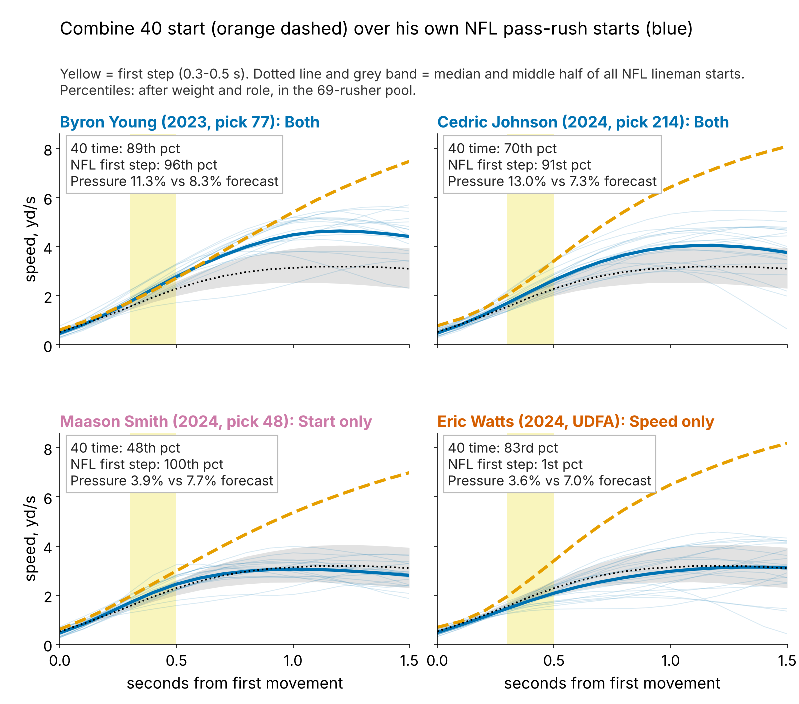
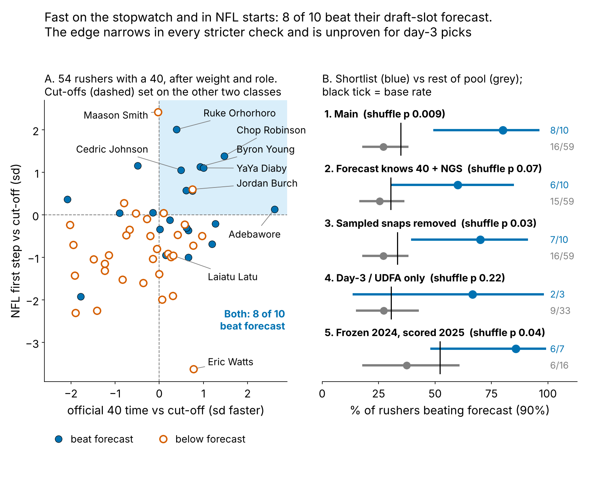
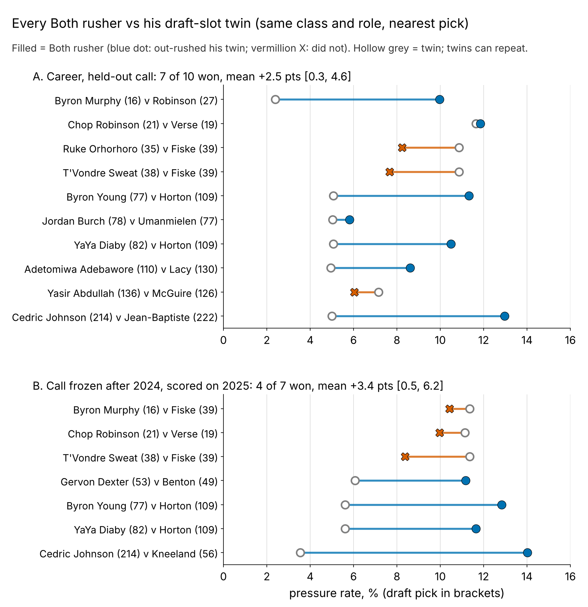

# Speed That Translates: Pass Rushers Fast on the Stopwatch and on Sundays

**A lineman's tracked Combine 40 start does not carry over to his NFL pass-rush start. Agreement does: rushers fast on the official 40 *and* in about 20 sampled NFL starts beat a draft-slot pressure forecast {{sl_ks}} times in {{sl_ns}} (rest: {{sl_ko}} in {{sl_no}}) on held-out classes. Use it to hand out passing-down snaps.**

## Why pass rushers, and why now

A pass rush starts like a 40: from a stance, straight ahead, before anyone touches him. No other position repeats a Combine movement so closely, so if Combine tracking translates anywhere, it is here. Receivers' NFL starts are readable but do not pay; linemen, backs and tight ends start too inconsistently to read from 20 snaps (Figure 2C). After a rookie season a club decides who gets third-down snaps and whether to buy a veteran, usually on a handful of sacks.

## So what for a team

1. **Act on three names (Table 3): extend Byron Young (LAR) and YaYa Diaby (TB); give Chop Robinson (MIA) a full passing-down role, re-scored at midseason because he missed his 2025 check.** All three meet the frozen act-on rule: on the list, {{act_minrush}}+ rushes, pressure a point or more over forecast, under {{avail_cut}}% of games missed.
2. **Pro personnel: rank young rushers by "Both"** (NFL first step in the top third, 40 time in the top half). On held-out classes the list produced {{wc_rule_season}} more pressures a season over forecast than everyone else.
3. **Draft room: pay for the stopwatch, not the trace.** The tracked 40 start adds nothing beyond draft slot; the official 40 time does (Table 1).
4. **Measurement: chart {{snaps_for_07}}+ random rushes per young rusher** before trusting his first step (reliability 0.7; 8 give {{rel_8snaps}}).

## The metric

**First step = a lineman's speed 0.3 to 0.5 s after he first moves, in sd after weight and role.** In that window the 40 and a pass rush are the same movement; by 1.5 s they part ({{dr_med_40}} yd/s in the 40, {{dr_med_sunday}} on a rush, because he meets a blocker).

**Data.** Tracked Combine 40s, year-standardized, curves starting at first movement (so the clip's ~0.3 s lead before the laser does not matter). NFL: random sampled pass rushes only, alignment-adjusted: {{n_snaps_dl}} starts by {{n_gplayer}} linemen, median {{snaps_med}} each, reliability {{rel_fs_game}}; it tracks NGS get-off snap by snap (ρ = {{rho_fs_ngs_snap}}). **Pool:** of {{x_all}} linemen, {{x_nostarts}} have fewer than 8 sampled starts and {{x_lowrush}} fewer than 100 rushes; {{x_pool}} remain. Outcome: career pressures per rush. **Baseline without tracking:** draft pick, weight and role (share of snaps at EDGE), fitted on the other two classes; a stronger one adds the official 40 time and season NGS get-off.

## Finding 1: the Combine start does not carry over

Raw, the 40 ranks NFL speed at 1.5 s at {{tr_raw_15}}, but that is weight. After weight and role, the 40 first step previews the NFL first step at ρ = {{tr_fs}} [{{tr_fs_lo}}, {{tr_fs_hi}}] (n = {{n_tr}}). Noise is not the excuse: with two reps averaged the most a perfect link could show is {{ceil_2rep}}, and a true translation of 0.5 or more has posterior probability {{tr_post05}}. No per-player similarity score (gap, speed ratios, curve shape) exceeds {{sim_absmax}} against pressure beyond pick.

{{TABLE:ledger}}

*Table 1. Pressure-rate points per sd faster (DL average about 8%), 90% interval, each class held out in turn. One effect size per measure.*

## Finding 2: two signals that agree beat the forecast

**The rule.** *Both* = NFL first step in the top third and 40 time in the top half, each class's cut-offs set on the other two classes. A rusher "hits" if his pressure rate beats the held-out forecast (base rate {{sl_base}}%).

{{TABLE:robust}}

*Table 2. Five checks on one shortlist. Gap interval: rushers resampled within class; p: labels shuffled within class.*

**Verdict: a real but modest edge in the full pool, unproven for day-3 picks (three shortlisted).** The gap narrows in every stricter check and stays positive. Row 5 is the cleanest: called from 2023–24 starts only, scored on 2025 against a forecast that knows each rusher's own past pressure. Survivorship does not drive it: the first step does not predict who reaches 100 rushes, and reweighting for who does leaves the gap at {{ipw_gap}} points [{{ipw_gap_lo}}, {{ipw_gap_hi}}].

## Every matched pair, not one chosen case

Each Both rusher faces the non-Both rusher of his class and role nearest in draft slot (median {{mp_pickgap}} picks apart) on raw pressure rate: no model. Career: Both won {{mp_w}} of {{mp_n}} pairs, by {{mp_diff}} points on average [{{mp_diff_lo}}, {{mp_diff_hi}}]; sign test p = {{mp_p}}. Frozen after 2024 and scored on 2025: {{mpf_w}} of {{mpf_n}}, {{mpf_diff}} points [{{mpf_diff_lo}}, {{mpf_diff_hi}}], p = {{mpf_p}}. Wins are larger than losses; the win count alone proves nothing.

**One pair as an illustration.** Cincinnati's Cedric Johnson (pick {{wc_cj_pick}}) and Washington's Javontae Jean-Baptiste (pick {{wc_jjb_pick}}) are a career pair: 2024 day-3 edges, both on ${{wc_cj_apy}}M-a-year rookie deals. After 2024, Johnson was Both on {{wc_cj_n24}} sampled starts and {{wc_cj_rate24}}% pressure in {{wc_cj_rs24}} rushes; Jean-Baptiste had a slow 40 and {{wc_jjb_rate24}}% in {{wc_jjb_rs24}}. In 2025 Johnson pressured on {{wc_cj_rate25}}% ({{wc_cj_pr25}} pressures, {{wc_cj_g25}} games); Jean-Baptiste played {{wc_jjb_g25}} games, which cannot score the call. The alternative, a mid-tier veteran edge, cost a median ${{vet_apy}}M a year in 2025.

## Why it works: the same rusher, faster snap

On {{sn_n}} random rushes by {{sn_players}} linemen, a first step one sd faster than *his own* average multiplies that snap's odds of pressure by {{sn_or}} [{{sn_or_lo}}, {{sn_or_hi}}]: {{sn_top5}}% for his fastest fifth of starts, {{sn_bot5}}% for his slowest. It holds with that snap's NGS get-off, sideways path, down and alignment fixed ({{sn_or_ctl}}). The 40 says the speed exists; the NFL starts say he uses it from a stance.

**Where rule and tape disagree.** Maason Smith (Jacksonville, 2024, pick 48) has the pool's best NFL first step, a {{b_smith_t}}th-percentile 40 and {{b_smith_rate}}% pressure against a {{b_smith_fc}}% forecast: fast off the ball, no win. Grade hands and a counter before cutting his snaps.

## The 2026 list, frozen

The same rule, cut-offs from all three classes, applied to every lineman with 8+ sampled starts. Bold = act now.

{{TABLE:list26}}

*Table 3. Percentiles within the pool; forecast = pick, weight, role, fitted on the other two classes (as everywhere in the text). Availability flag = {{avail_cut}}%+ of possible games without a recorded snap (injury, inactive or cut). Last column: the rule frozen after 2024, scored on 2025 against each rusher's own past pressure.*

**Track record.** Of the list names called in 2024 and scored in 2025, {{rec_hit}} hit and {{rec_miss}} missed (Robinson, below his own strong rookie rate); the seventh 2024 call, Gervon Dexter, also hit. Jordan Burch, the 2025 class's only scored call, is {{l26_jordanburch_rate}}% against {{l26_jordanburch_fc}}% after one season. Cedric Johnson and Adetomiwa Adebawore are availability questions first; Ty Robinson's 55 rushes are too few to judge.

**Pre-registration.** The rule, these {{pre_nlist}} names, the act-on three and the test are frozen in `frozen_rule.json` (sha256 `{{rule_hash}}…`, 24 October 2026, no 2026 data used). Test: in 2026, list members with 100+ rushes beat a persistence forecast more often than the other {{pre_nrest}} pool rushers (one-sided Fisher p < {{alpha}}); the matched-pair share is secondary. At the 2025 time-forward rates ({{pre_pa}}% vs {{pre_pb}}%) power is {{pre_pow_obs}}%; at half that gap, {{pre_pow_half}}%. A miss at half the gap is likely and will be reported.

## Limitations

- **Not blind until 2026.** The two-signal form was chosen after seeing all three classes; only the cut-offs are held out. The frozen-2024 row has {{tf_n}} rushers and overlaps the main shortlist.
- **Small lists.** Ten rushers, three on day 3; matched-pair sign tests are not significant.
- **Sampled tape, no blockers or ball.** A slow start can be a two-gap call, a fast one a free rush; injuries enter only as missed games.

## Appendix

**Estimands.** Table 1's held-out slope (NFL first step {{ht_nfl_pp}} points per sd) is the headline. Two re-fits of the same estimand: a rusher random-intercept binomial model on {{mm_seasons}} player-seasons, {{mm_pp}} [{{mm_lo}}, {{mm_hi}}]; inverse-probability weighting for reaching the pool (P from pick, weight, 40, class; AUC {{sel_auc}}), {{ipw_pp}} [{{ipw_lo}}, {{ipw_hi}}]. A different estimand: beyond each rusher's own 2023–24 pressure, the frozen first step adds +{{tf_pp}} [{{tf_pp_lo}}, {{tf_pp_hi}}] in 2025. **Table 1 test.** Two-class forecast as logit offset, quasi-binomial, class slopes pooled by random effects; p shuffles the measure within class: tracked 40 start {{ht_c40_p}}, carry-over {{ht_carry_p}}, official 40 {{x_f40_pick_p}}, NFL first step {{ht_nfl_p}} ({{x_nfl_full_p}} with the stronger baseline); best of {{ht_nwin}} windows, p = {{ht_nfl_p_adj}}. **Selection.** Among the {{sel8_n}} with 8+ starts, first step odds ratio for reaching the pool {{sel_fs_or}} (p = {{sel_fs_p}}). **Calibration.** Shortlist expected {{calib_ps}}% hits, got {{calib_os}}%; Brier {{brier_rule}} vs {{brier_base}} for the base rate. **Measurement.** Tracked 40 first-step repeatability {{rel40_fs}} (n = {{rel40_n}}), {{rel40_2rep}} for two reps.

*Reproduce: `uv run python writeup/candidates/round_16/cand_3/analysis.py` (about 3 minutes).*
