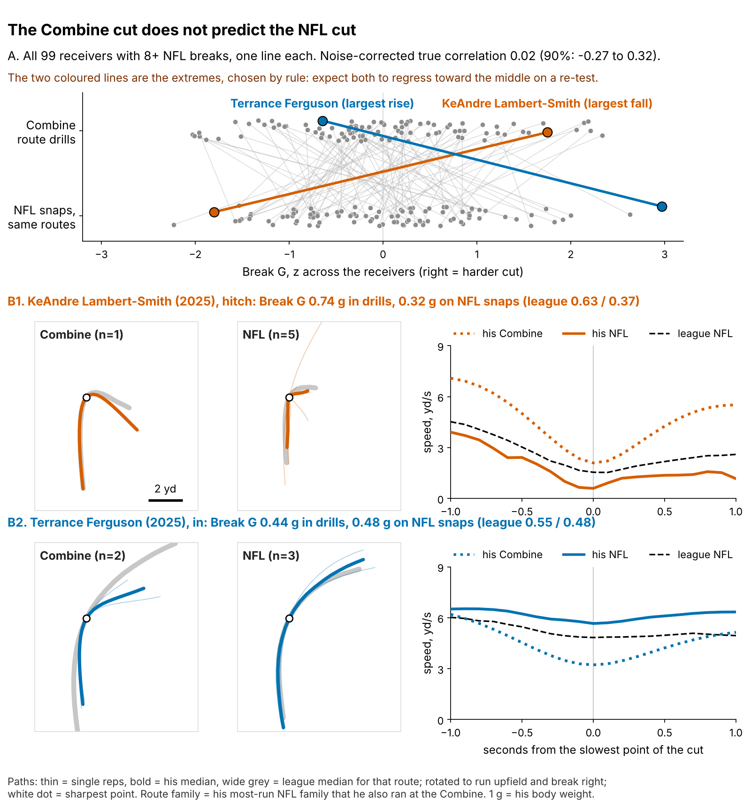
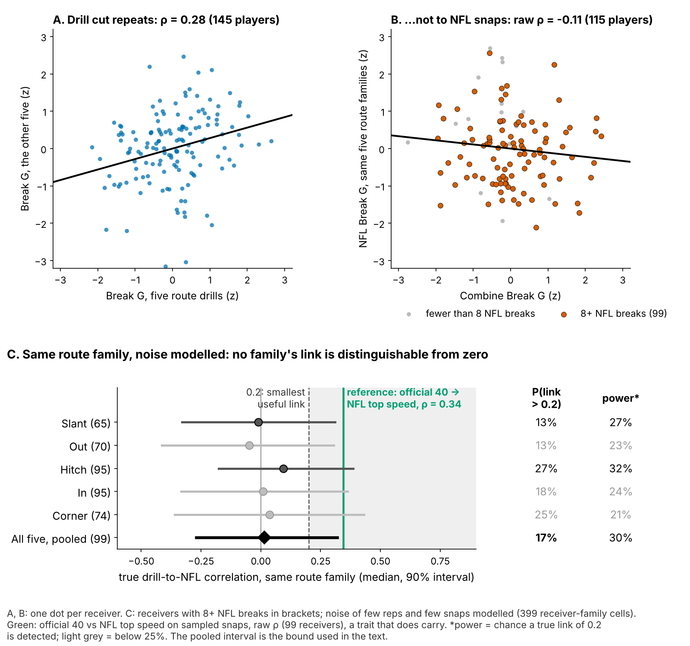
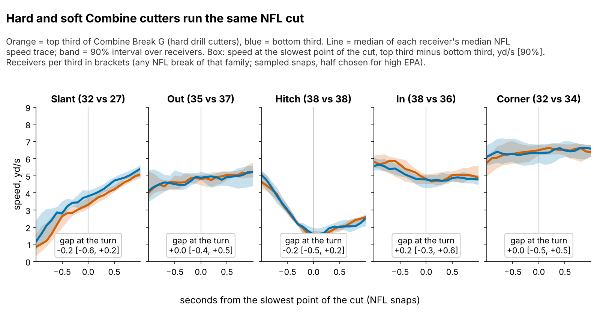
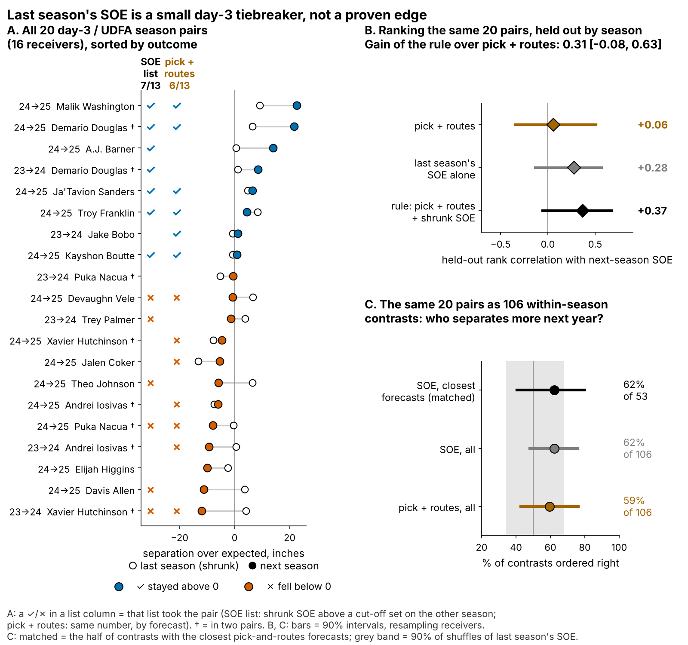

# Combine Cuts Don't Predict NFL Separation

**A receiver's Combine cut does not predict how open he gets in the NFL. On 116 receivers from classes the model never saw, 1 sd of Break G is worth −1.2 inches of separation [90%: −3.6 to +1.0], so a gain above +1 inch is ruled out. For day-3 receivers, last season's separation is a small tiebreaker, not a grade.**

*Break G is how hard a receiver pushes off the ground at the sharpest point of his cut. Separation over expected (SOE) is the space he has at the throw beyond what his alignment and cushion predict (NGS, full season).*

## Why receivers, why now

The sixth receiver spot goes to day-3 players who cost about $1.08M a year, and the bet is on one skill: getting open. The evidence is thin. The Combine shows a scout a median of 7 graded route-drill cuts per receiver, and 91% of drill-receiver cells hold a single rep. Separation is noisy even in the NFL: a 200-route season keeps only 0.60 of its weight once shrunk for sample size. A college season, against different coverage and without tracking, settles less. Since 2023 the route drills are tracked at 10 Hz, so the cut can be measured with code a club can also run on game tracking. Straight-line speed does carry: the official 40 tracks NFL top speed (ρ = 0.34, 99 receivers). The question is whether the cut carries too, and if not, what breaks the tie.

## The roster decision

| Question (n) | Held-out result [90% interval] | Verdict |
|---|---|---|
| Does Break G add season SOE? (116 receivers, unseen classes) | −1.2 in per sd [−3.6, +1.0] | **No** |
| Does the drill cut carry to the same NFL route? (99 with 8+ NFL breaks) | true correlation 0.02 [−0.27, 0.32] | **No visible transfer** |
| Does last season's SOE beat pick and routes on day 3? (20 pairs, 16 receivers) | rank-correlation gain 0.31 [−0.08, 0.63] | **Not proven: tiebreaker only** |
| Closest forecasts: does the higher-SOE receiver separate more next year? (53 contrasts) | 62% [41, 80]; shuffle p = 0.14 | **A lean, not proof** |

- **Do not pay for the drill cut.** No version of the test finds a gain worth a roster spot.
- **The Combine cut is not the NFL cut.** The same receiver on the same route shows no visible link.
- **Last season's SOE is the best day-3 tiebreaker available, and it is small.** Its interval includes zero.

## What to do

1. **Break ties between day-3 receivers with last season's route-shrunk SOE.** Act first on Malik Washington (MIA, 95%), Demario Douglas (NE, 89%), Tez Johnson (TB, 85%), Arian Smith (NYJ, 81%).
2. **Take Break G out of the price.** At the same position, clubs draft a receiver 1 sd harder in the cut 9% earlier [2, 17] and get no separation for it.
3. **Use the tracking on film, not on the board.** On a hitch, Break G is the stop: the typical NFL receiver enters at 4.7 yd/s, sinks to 1.5 yd/s at the top and drives back to the ball. On slants, outs and corners the NFL cut is taken at speed (median 3.6, 4.8 and 6.4 yd/s at the turn), so Break G there is mostly turn, not brake (Figure 3). Hard and soft drill cutters run the same NFL hitch (gap at the turn −0.2 yd/s [−0.5, +0.2]), and how deep a receiver sinks does not track his separation (ρ = 0.01, 92 receivers). Coaching a full sink against off coverage is a hypothesis to check on film, not a trait to draft.
4. **2026 Combine protocol.** If you time cut drills, run slant, dagger and comeback twice: a second rep on those three lifts reliability from 0.53 to 0.62. Read speed from the official 40, not from the tracked clip, which starts about 0.3 s before the laser.

## Drill to tape

Break G is found on 96% of 926 drill reps. It is standardized within drill and Combine year and averaged over route drills (median 7). The same code grades NFL snaps on slant, out, hitch, in and corner routes.

- **The drill trait is real.** Break G on five drills predicts the other five at ρ = 0.28 (145 players). It is not a speed score: its ρ with the 40 is −0.01.
- **It does not reach NFL routes.** Once the noise of a few reps and a few snaps is modelled, every family's interval includes zero. The pooled true correlation is below 0.32 with 90% probability, under the 40's raw 0.34.
- **The null is bounded, not proven.** 72% of the pooled posterior lies within ±0.2, so a small link cannot be excluded; a useful one is unlikely (17%).

## Season separation on unseen classes

The outcome is full-season SOE, route-weighted over each career (213 player-seasons, median 231 routes). The forecast without tracking was fixed before the test: log pick, official 40, weight, NGS athleticism score and a TE flag. Fitted on two classes and scored on the third, it leaves nothing for Break G to explain. Against the pre-set margin of ±3 inches per sd, the upside is rejected (p = 0.001) and the downside is not (p = 0.10): Break G may cost a little and cannot add much. A +3 inch effect would be worth 0.44 catches a season.

## The 2026 day-3 shortlist

Pool: day-3 or undrafted, 100+ routes and SOE above zero in 2025; SOE shrunk by routes run. P = chance of SOE above zero in 2026. Act on = the top four among receivers who played 14+ games.

| Act on (class, pick) | 2025: team, QB, games, routes | Shrunk SOE; P | Why |
|---|---|---|---|
| **Malik Washington** (2024, 184) | MIA, Tagovailoa, 17 g, 339 | +16.1 in; 95% | Faced man on 19% of 2025 routes. Hitch 19% and cross 19% of 26 sampled routes, 23% slot. Too few sampled snaps to split man and zone: check on film. |
| **Demario Douglas** (2023, 210) | NE, Maye, 17 g, 220 | +13.4 in; 89% | Faced man on 25% of 2025 routes. Go 22% and cross 22% of 9 sampled routes, 67% slot. Too few sampled snaps to split man and zone: check on film. |
| **Tez Johnson** (2025, 235) | TB, Mayfield, 16 g, 282 | +10.9 in; 85% | Faced man on 29% of 2025 routes. Go 22% and post 15% of 40 sampled routes, 35% slot. SOE vs man +4 in (14 snaps), vs zone +3 in. Risk: one NFL season. |
| **Arian Smith** (2025, 110) | NYJ, Taylor, 16 g, 231 | +10.0 in; 81% | Faced man on 25% of 2025 routes. Go 32% and cross 15% of 40 sampled routes, 42% slot. SOE vs man −9 in (11 snaps), vs zone +14 in. Risk: one NFL season. |

Route mix and coverage splits come from up to 40 sampled snaps; a man-minus-zone split has a split-half reliability of −0.06, so read it as a film prompt. Each QB is the 2025 starter; a QB change resets the read. **Watch:** Troy Franklin (61%), A.J. Barner, TE (60%), Gunnar Helm, TE (59%), Isaiah Bond (56%). Full list in the appendix. The rule is frozen in `frozen_rule_2026.json`; 2026 alone is underpowered.

**How earlier lists did.** The same rule, fitted on the other season, listed these day-3 receivers (hit = SOE stayed above zero):

| List (season → next) | Hits | Misses |
|---|---|---|
| 2023 → 24 (1 of 3) | Demario Douglas | Trey Palmer, Xavier Hutchinson |
| 2024 → 25 (6 of 10) | Malik Washington, Demario Douglas, A.J. Barner, Ja'Tavion Sanders, Troy Franklin, Kayshon Boutte | Devaughn Vele, Theo Johnson, Puka Nacua, Davis Allen |

The rule ranks next-season SOE at 0.37 against 0.06 for pick and routes. Most of that is last season's SOE itself: the rule beats raw last-season SOE by only 0.09 [−0.19, 0.40]. Over all 106 within-season contrasts, SOE orders +3 points more of them right than pick and routes [−19, +24].

## Limitations

- **Not blind, small day-3 sample.** All three classes were seen while building this, and day 3 has 20 pairs. The 2026 season is the first true test, and it is underpowered (appendix).
- **The downside is open.** The primary interval rules out gains above +1.0 inch per sd, not losses down to −3.6.
- **Game tracking is a sample.** Up to 40 plays per player, half chosen for high EPA, with no defenders and no ball. That limits the film cues and the drill-to-game link, not the season SOE test.
- **Availability and survivorship.** Games played is a rough injury proxy. 33 of 149 drill-scored receivers never logged NFL routes with separation; re-weighting for this changes little.
- **The freeze is late.** The 2026 rule was frozen on 24 October 2026, after the season began but before any full-season SOE existed.

## Appendix

**Pre-registration.** `frozen_rule_2026.json` holds the coefficients, shrinkage, threshold, names and probabilities (sha256 5c1beda70454…). Primary test: day-3 rank-correlation gain over pick and routes on an expected 18 pairs (61% of day-3 receivers keep 100+ routes). Power is 0.37 at the observed gain and 0.61 pooled with 2023–25; the list needs 9 of 13 hits to beat the base rate (power 0.20).

**Every estimate and its alternatives** (90% intervals; receivers resampled).

| Claim | Primary (n) | Alternatives |
|---|---|---|
| Break G slope, in of SOE per sd | offset forecast −1.2 [−3.6, +1.0] (116) | re-weighted for survival −0.8 [−2.8, +1.3]; without Puka Nacua −0.5 [−2.7, +1.5]; QB-adjusted −1.2 [−3.6, +0.9] |
| Drill cut to NFL cut | true correlation, same family 0.02 [−0.27, 0.32] (99) | raw ρ, any family: −0.11 [−0.25, 0.04] (115); raw ρ mixes families and keeps the noise |
| Day-3 gain over pick and routes | season folds 0.31 [−0.08, 0.63] (20 pairs) | shrinkage refitted inside each fold 0.31 [−0.08, 0.65]; draft-class folds 0.15 [−0.10, 0.39] |

Class folds cannot be crossed with season folds: 2024 rookies have no 2023 season. P (chance of SOE above zero) is rescaled to held-out hit rates (day 3: 50% forecast, 40% observed). Shrinkage keeps 0.60 of SOE at 200 routes. The true correlation comes from an errors-in-variables model with a slope per route family (399 receiver-family cells). 1 sd of Break G = 0.021 g; catches use 8.8 catch-rate points per yard and 60 targets.

**Rest of the 2026 list** (class, pick; team; games; shrunk SOE; P): Troy Franklin (2024, 102; DEN; 17 g; +3.4 in; 61%); A.J. Barner, TE (2024, 121; SEA; 17 g; +9.9 in; 60%); Gunnar Helm, TE (2025, 120; TEN; 16 g; +10.4 in; 59%); Isaiah Bond (2025, UDFA; CLE; 16 g; +3.1 in; 56%); Jaylin Lane (2025, 128; WAS; 14 g; +2.8 in; 47%); Kayshon Boutte (2023, 187; NE; 14 g; +0.6 in; 44%); Mitch Tinsley (2023, UDFA; CIN; 17 g; +1.8 in; 39%); Mitchell Evans, TE (2025, 163; CAR; 17 g; +6.7 in; 34%); Ja'Tavion Sanders, TE (2024, 101; CAR; 12 g ⚑; +4.0 in; 29%). ⚑ = 13 or fewer games in 2025.

Reproduce: `uv run python writeup/candidates/round_16/revised/analysis.py` (about eight minutes) writes every number, figure and this text.
