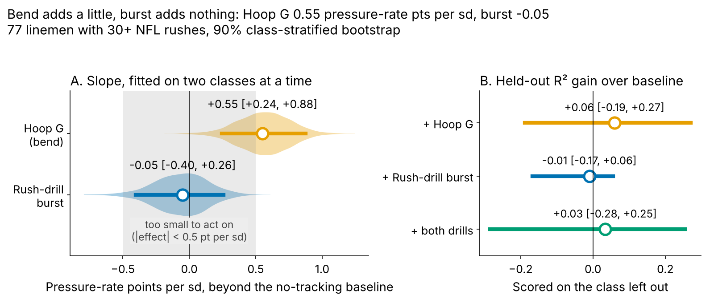
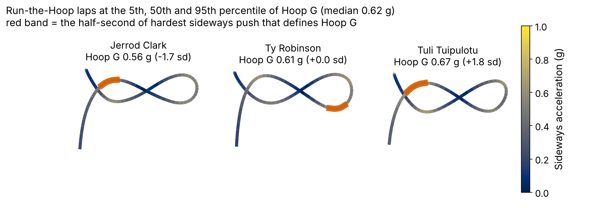
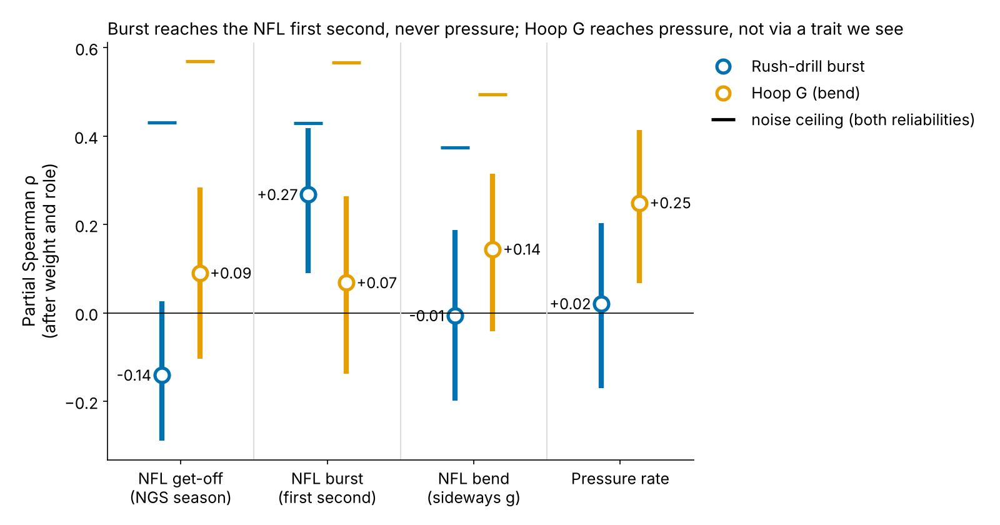
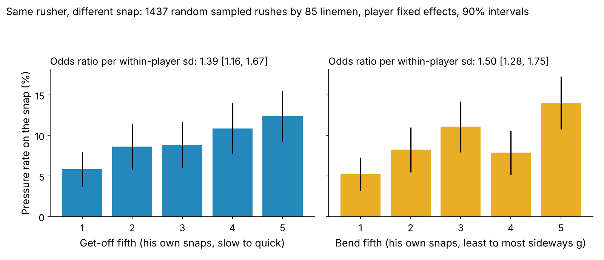
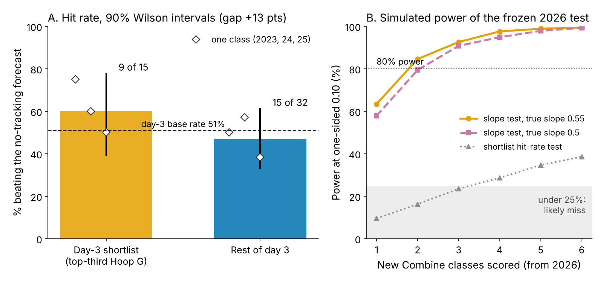

# Bend, Not Burst: What the Combine's Pass-Rush Drills Say About NFL Pressure

**Hoop G** is how hard a lineman pushes sideways while rounding the Combine's Run-the-Hoop drill; **burst** is how far he travels in the first second of the pass-rush drill. Against a no-tracking forecast of NFL pressure rate, burst adds −0.05 points per sd: ruled out. Hoop G adds 0.55, about 2.5 pressures a season, but its held-out gain is unproven. Use it to break day-3 ties, not to grade.

## Why pass rushers, and why these drills

A pressure is what a rusher is paid for. On 1655 randomly sampled NFL pass plays involving these rookies, a pressured snap cost the offense 0.52 more expected points than a clean one (90% interval 0.36 to 0.67).

Most of these decisions are cheap ones: 69% of the 118 linemen in the 2023–25 classes went on day 3 or undrafted. The agility test clubs trust, the 3-cone, was run by only 43 of them. Every lineman, though, runs the position drills under 10 Hz tracking. Two of those drills copy a rush: the pass-rush drill starts from a stance (get-off), and Run-the-Hoop asks him to lean around a circle at speed (bend).

**One margin, set before fitting.** An effect matters if it is at least 0.5 pressure-rate points per sd. That is one extra pressure every 200 rushes, or 2.25 in a 450-rush season (about 1.2 expected points). The DL average is 8.1%.

## The two drill metrics

- **Hoop G**: the hardest half-second of sideways (centripetal) acceleration on the hoop lap, in g (median 0.62 g). We standardize within Combine year because drill conditions shift between years. 109 linemen have it, 69 of them with no 3-cone.
- **Burst**: yards covered in the first second after he starts moving in the pass-rush drill (median 2.45 yd), standardized the same way, 117 linemen.

Both are noisy single reps. 91% of hoop runners have one lap; among the 10 with two, lap-to-lap reliability is 0.37. One burst rep repeats at 0.13 (101 linemen with 2+ reps).

## The baseline and the test

**Baseline without tracking:** draft pick (log), Combine weight, NFL EDGE share, NGS athleticism score, and the official 10-yard split and 3-cone. Missing times are filled from weight, role and NGS score. We use the official split because the tracked 40 clip starts before the laser.

**Outcome:** career pressure rate, shrunk toward the mean by 117 rushes of prior, for the 77 linemen with both drills and 30+ NFL rushes.

**Out of class:** each Combine class is forecast by a model fit on the other two. All intervals resample players within class and refit every fold.

| Model (held-out) | R² | RMSE (pts) | Rank ρ | R² gain over baseline [90%] |
|---|---|---|---|---|
| Pick only | 0.10 | 1.63 | 0.31 | — |
| Baseline | −0.02 | 1.74 | 0.28 | — |
| + Hoop G | 0.04 | 1.69 | 0.37 | 0.06 [−0.19, 0.27] |
| + Rush-drill burst | −0.03 | 1.75 | 0.28 | −0.01 [−0.17, 0.06] |
| + both drills | 0.01 | 1.71 | 0.35 | 0.03 [−0.28, 0.25] |

*Table 1. Leave-one-class-out fit, n = 77. RMSE in pressure-rate points.*

The no-tracking baseline is weak. Its held-out R² of −0.02 is below pick and role alone (0.10): with 77 rushers, the extra Combine times cost more in fitting noise than they add. Hoop G gives the largest improvement on all three held-out measures, and burst alone improves none. Rank agreement rises from 0.28 to 0.37, but the R² gain, 0.06 [−0.19, 0.27], still includes zero.

## Finding 1: burst reaches the snap, not the pressure

Burst does carry over to the NFL as a movement (Figure 3). After weight and role, drill burst tracks how far a lineman travels in the first second of a sampled NFL rush: partial ρ = 0.27 [0.09, 0.42], n = 84. Given the noise in both measures, the most that link could show is 0.43.

The NFL first second matters for pressure too (0.33). But drill burst against pressure is 0.02 [−0.17, 0.20]. Beyond the baseline, its slope is −0.05 points per sd [−0.40, 0.26]. That is inside the ±0.5 margin with 98% bootstrap probability, so we rule it out. It is also not a stand-in for the official split (ρ = 0.05, n = 93).

## Finding 2: Hoop G adds a little, consistently

Fitted on two classes at a time, a lineman one sd higher in Hoop G pressures 0.55 points more often than the baseline expects [0.24, 0.88]. That is 2.5 pressures in a 450-rush season [1.1, 3.9]. The bootstrap puts 64% probability on the effect clearing the 0.5-point margin.

Scored strictly on the held-out class, Hoop G ranks what the baseline missed at ρ = 0.16 [−0.04, 0.35], positive in 3 of 3 classes. Clubs do not draft for it: top-third linemen went at a median pick of 158, bottom-third at 130.

**How it works is only partly visible.** Hoop G barely moves NFL get-off or the first second (0.09, 0.07). It moves sideways push on NFL rushes a little (0.14 [−0.04, 0.31]), and that NFL bend does predict pressure (0.36). The chain through the trait we can see is too weak to explain the whole effect. Our guess is speed kept through contact, which needs blockers in the data to see.

## What wins on a snap

Within the same rusher, on 1437 random sampled rushes by 85 linemen, both traits pay. A quicker NGS get-off than his own average raises the odds of pressure by 1.39 per sd [1.16, 1.67]. More sideways push in the first two seconds raises it by 1.50 [1.28, 1.75]. Both are adjusted for down and alignment. The bend window is a fixed two seconds, and only on plays that lasted that long, so longer pressured plays do not inflate it.

Bend on a snap may partly be the result of beating the tackle, not its cause. It still tells the film room what to grade:

| Film check (wide rushes, third down) | What a yes looks like |
|---|---|
| Get-off | Moving with the snap, first step gaining ground, not lifting |
| Dip at the top of the arc | Shoulder under the tackle's hands within two steps of contact |
| Flatten | Path turns to the quarterback without drifting upfield |
| Speed kept | No visible slow-down through the turn |

*Table 2. What Figure 4 says to grade, for any Hoop G shortlist name.*

## The decision: a day-3 tiebreaker

**Rule (frozen, sha256 `48512deeddaa…`):** pick 103 or later (or undrafted) and top third of Hoop G in his class. A rusher "hits" if his pressure rate beats the out-of-class baseline forecast.

**Record against the base rate.** 9 of 15 shortlisted day-3 rushers hit (60%, 90% Wilson 39–78%). The rest of day 3 hit 15 of 32 (47%). The base rate for all day-3 rushers is 51%, which shows the forecast is calibrated for them. The gap of +13 points [−12, 35] is in the right direction in 3 of 3 classes, worth about 2.7 pressures a season. It is not proven on its own.

Past shortlist hits include Cedric Johnson (pick 214, 11.2% pressure vs 7.2% forecast, 216 rushes), Javon Solomon, Adetomiwa Adebawore, Nick Hampton, Austin Booker, Isaiah Land; misses: Robert Beal, Jaylen Harrell, Eric Watts.

**2025 shortlist, calls for 2026:**

| Rusher (pick, team) | Role | Hoop G (sd) | NFL rushes | Pressure vs forecast | Call |
|---|---|---|---|---|---|
| **Jack Sawyer** (123, PIT) | EDGE | +1.4 | 176 | 9.0% vs 8.4% | Go |
| **Warren Brinson** (198, GB) | interior | +1.3 | 173 | 7.4% vs 6.5% | Go |
| **Zeek Biggers** (253, MIA) | interior | +0.9 | 142 | 6.4% vs 6.2% | Go |
| **Tyrion Ingram-Dawkins** (139, MIN) | EDGE | +1.0 | 113 | 6.7% vs 7.9% | No-go |
| **Nazir Stackhouse** (UDFA, TEN) | interior | +0.4 | 71 | 5.6% vs 5.8% | Watch |
| **Kyle Kennard** (125, LAC) | EDGE | +1.2 | 50 | 6.3% vs 8.2% | Watch |
| **Ethan Downs** (UDFA, KC) | EDGE | +2.3 | 7 | under 30 rushes | Audition |
| **Tim Smith** (190, IND) | interior | +0.4 | 0 | under 30 rushes | Audition |
| **Antwaun Powell-Ryland** (209, CIN) | EDGE | +1.1 | 0 | under 30 rushes | Audition |
| **Jah Joyner** (UDFA, FA) | EDGE | +1.5 | 0 | under 30 rushes | Audition |

*Table 3. Go = 100+ rushes and above forecast; No-go = 100+ and below; Watch = 30–99; Audition = under 30.*

1. **Go: Jack Sawyer (PIT).** An EDGE at +1.4 sd with 9.0% pressure vs 8.4% forecast in 176 rushes. Give him more third-down snaps from wide alignments, where bend matters most.
2. **Go: Warren Brinson (GB).** An interior lineman at +1.3 sd, 7.4% vs 6.5% in 173 rushes. Make him the looper on interior stunts.
3. **No-go for now: Tyrion Ingram-Dawkins (MIN).** He is +1.0 sd but at 6.7% vs 7.9% in 113 rushes. Hold his snaps until the film checks in Table 2 come back yes.

**What would change the call.** The 2026 test fits the Hoop G slope on the 2026 class against its frozen baseline, one-sided at 0.10. At the observed slope one class gives 60% power and three give 94%. The shortlist hit-rate test alone would have 9% power, so the slope is the pre-registered primary. A 2026 slope at or below zero means dropping Hoop G as a tiebreaker. A slope above 0.5 justifies asking every lineman for a second hoop lap, which would lift reliability from 0.37 to 0.54.

## Limitations

- **Small and noisy.** 77 rushers, single drill reps, and a Hoop G reliability that rests on only 10 linemen with two laps. The held-out R² gain includes zero; the case for Hoop G is consistency across classes, not size.
- **Chosen after looking.** Hoop G was the strongest of several drill measures screened in earlier work on these classes. Holding classes out checks the forecast, not that choice; 2026 is the first clean test.
- **Thin NFL tracking.** About 17 random sampled rushes per lineman, with no blockers and no ball. NFL bend may be an effect of winning rather than a cause.
- **Survivorship.** Hit rates need 30+ rushes. Shortlisted rushers reached that as often as the rest (15 of 24 vs 32 of 52), but injuries and roster moves are not modelled.

## Appendix

**Reliability.** NFL first-second burst 0.83 and NFL bend 0.63 (split-half, 85 linemen with 8+ random rushes); NGS season get-off 0.84 season to season (40 pairs). Burst averaged over its reps: 0.22. Hoop G vs 3-cone ρ = 0.42 (n = 40); Hoop G vs burst 0.11.

**Transfer details.** Drill burst vs NGS season get-off −0.14 [−0.29, 0.03]. Burst vs NFL bend −0.01. NGS get-off vs pressure beyond weight and role 0.41 [0.27, 0.54]. Hoop G vs pressure after weight and role only, 0.25 [0.07, 0.41].

**Shortlist tests.** One-sided Fisher p = 0.30; binomial vs the day-3 base rate p = 0.33. Top-third Hoop G on days 1–2 (outside the rule): 7 of 12 vs 7 of 19. Burst slope positive in 1 of 3 classes. Power assumes 26 scored linemen per class, residual sd 1.69 points.

*Reproduce: `uv run python writeup/candidates/round_17/cand_1/analysis.py` (about 6 minutes) writes numbers.json, the figures, frozen_rule.json and this text.*
