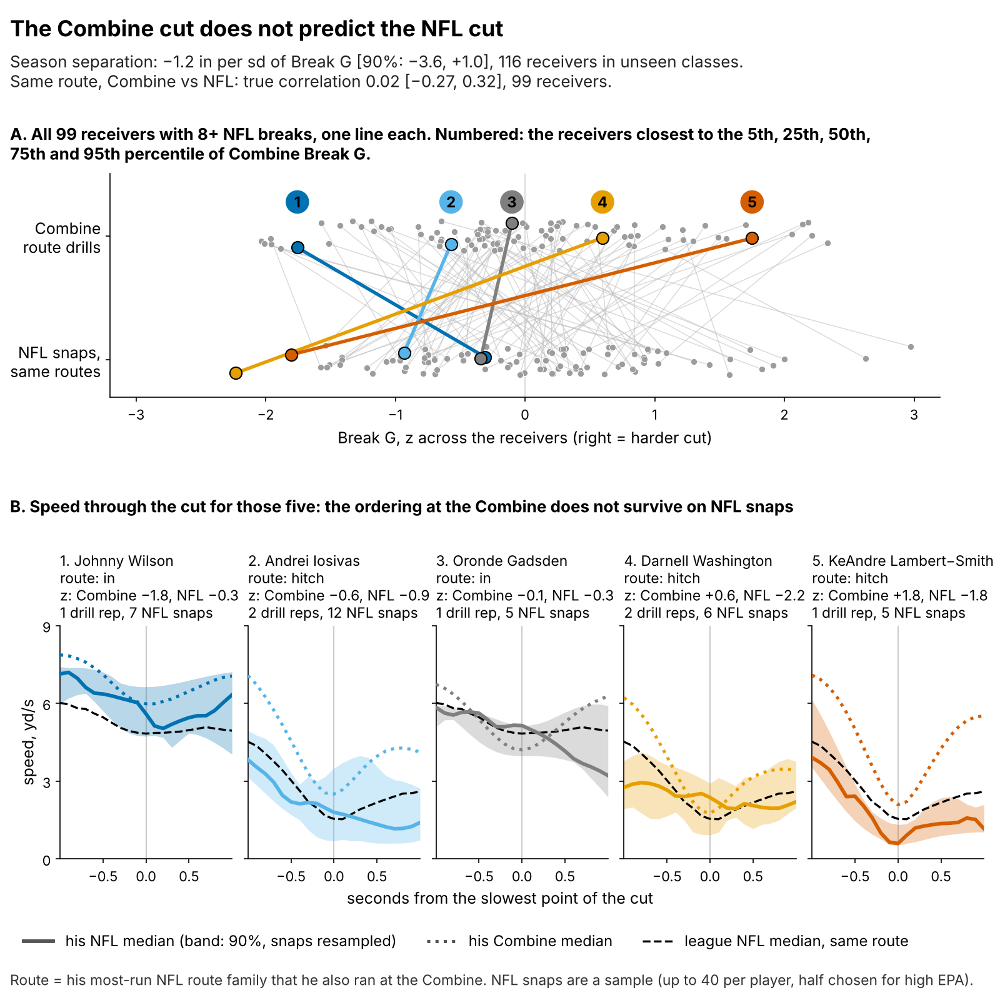
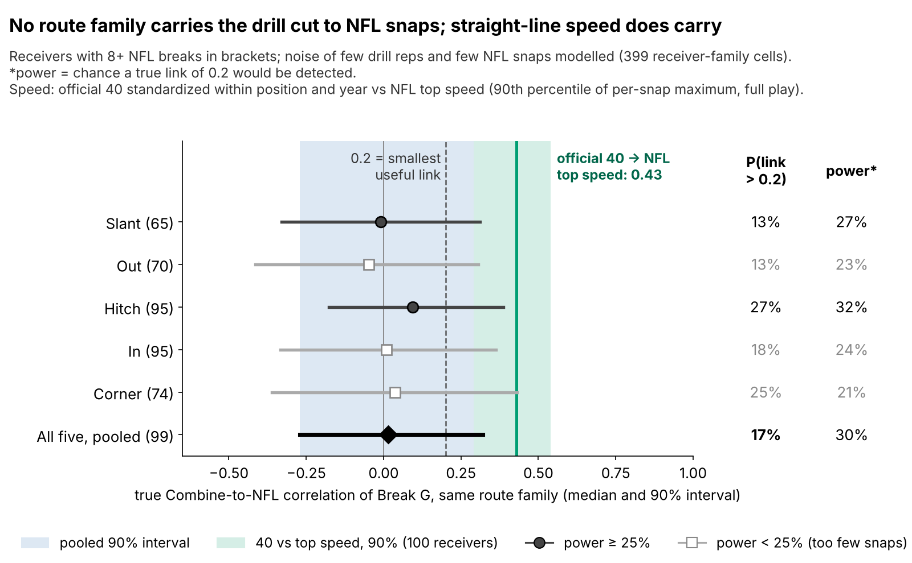
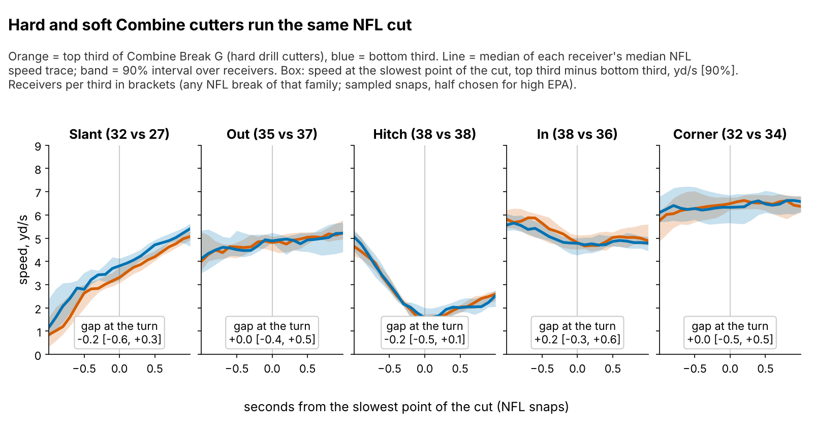
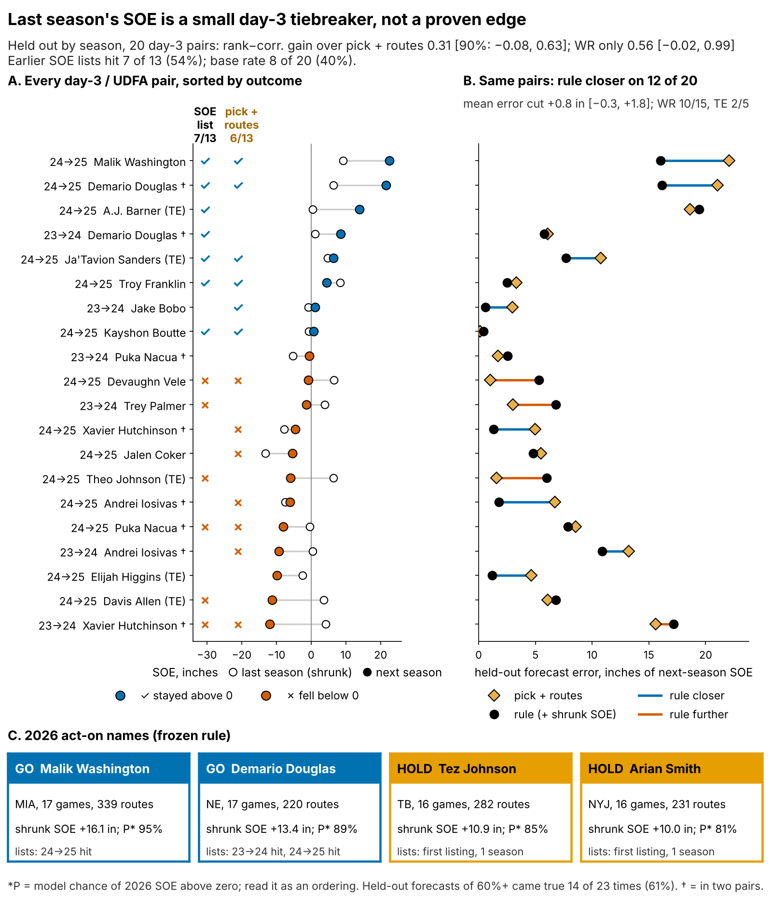

# Combine Cuts Don't Predict NFL Separation

*Break G* is how hard a receiver pushes off the ground at the sharpest point of a route cut, measured at 10 Hz in the Combine route drills. *Separation over expected (SOE)* is how open he is when the ball is thrown, beyond what his alignment and cushion predict (Next Gen Stats, full season).

**On {n_main} receivers from draft classes the model never saw, one sd of Break G is worth {prim_b} inches of season SOE (90% interval {prim_lo} to {prim_hi}). The best case, {prim_hi} inch, is {hi_catch} catches a season. To break ties between day-3 receivers, use last season's SOE instead.**

## Why receivers, why now

Clubs usually keep five or six wide receivers. The last spot goes to a day-3 or undrafted player, and the choice is repeated every summer. The 2025 day-3 and undrafted receivers and tight ends who ran 100+ routes earn a median ${why_apy}M a year. Each mistake is cheap, but it also blocks a younger player who might get open.

The evidence on getting open is thin. A scout sees a median of {why_reps} graded route-drill cuts per receiver at the Combine, and {why_single}% of drill-receiver cells hold one rep. NFL separation is noisy too: a 200-route season keeps {eb_k200} of its weight once shrunk for sample size. Since 2023 the route drills are tracked at 10 Hz, so the same code can grade the cut on Combine and game tracking. Straight-line speed carries from the Combine to the NFL: within position and class, the official 40 tracks NFL top speed over the full play (ρ = {spdf_rho} [{spdf_lo}, {spdf_hi}], {spdf_n} receivers). Does the cut carry too? And if not, what breaks the tie?

## The roster decision

| Question (n) | Held-out result [90% interval] | Verdict |
|---|---|---|
| Does Break G add season SOE beyond pick, 40, weight and NGS score? ({n_main} receivers, unseen classes) | {prim_b} in per sd [{prim_lo}, {prim_hi}]; R² change {dr2} [{dr2_lo}, {dr2_hi}] | **No** |
| Does the drill cut carry to the same NFL route? ({fp_pool_n} with 8+ NFL breaks) | true correlation {fp_pool_med} [{fp_pool_lo}, {fp_pool_hi}] | **No visible transfer** |
| Does last season's SOE rank day-3 receivers better than pick and routes? ({ev_d3_n} pairs, {ev_d3_np} receivers) | rank-correlation gain {ev_d3_drho} [{ev_d3_drho_lo}, {ev_d3_drho_hi}]; closer on {pp_d3_win} of {pp_d3_n} | **Not proven; tiebreaker only** |
| Did earlier day-3 SOE lists beat the base rate? | {lh_k} of {lh_n} hit ({lh_pct}% [{lh_lo}, {lh_hi}]) vs {lb_k} of {ev_d3_n} ({lb_pct}% [{lb_lo}, {lb_hi}]) | **A lean, not proof** |

## What to do

1. **Break ties between day-3 receivers with last season's route-shrunk SOE, and only ties.** The edge is not proven, but a tie is otherwise a coin flip, and the SOE forecast was closer on {pp_d3_win} of {pp_d3_n} day-3 pairs. Go now on {{ACTON}}.
2. **Take Break G out of the price.** At the same position, clubs draft a receiver 1 sd harder in the cut {price_bg}% earlier [{price_bg_lo}, {price_bg_hi}] and get no separation for it.
3. **Finding: hard and soft drill cutters run the same NFL cut** (Figure 3). At the top of a hitch the gap is {f3_hitch} yd/s [{f3_hitch_lo}, {f3_hitch_hi}]. On slants, outs and corners the NFL cut is taken at speed (median {vap_slant}, {vap_out} and {vap_corner} yd/s at the turn), so Break G there measures the turn more than the brake.
4. **Film hypothesis, not a draft trait:** against off coverage, a full sink at the top of the hitch wins. A typical receiver enters at {film_lg_vin} yd/s and sinks to {f3_h_lg}. How deep a receiver sinks does not track his season SOE (ρ = {f3_h_rho}, {f3_h_n} receivers), so check it on film before coaching it.
5. **2026 Combine protocol.** If you time cut drills, run slant, dagger and comeback twice: a second rep lifts reliability from {rel_mm1} to {rel_mm3}. Read speed from the official 40, not from the tracked clip, which starts about 0.3 s before the laser.

## Drill to tape

Break G is found on {pct_found}% of {n_reps} drill reps. It is standardized within drill and Combine year and averaged over route drills (median {drills_med}). NFL snaps are graded on slant, out, hitch, in and corner routes. The drill trait is real: Break G on five drills predicts the other five at ρ = {rel_split} ({rel_split_n} players), and it is not a speed score (ρ with the 40: {rho_forty}).

It does not reach NFL routes. The pooled true correlation is below {fp_pool_hi} with 90% probability, far under the 40's {spdf_rho} for speed. A small link cannot be excluded; a useful one (above 0.2) has {fp_pool_p02}% probability.

## Season separation on unseen classes

The outcome is full-season SOE, route-weighted over each career ({n_seasons} player-seasons, median {routes_med} routes). The forecast without tracking was fixed before the test: log pick, official 40, weight, NGS athleticism score and a TE flag. Fitted on two classes and scored on the third, it is weak: held-out R² {bl_r2} [{bl_r2_lo}, {bl_r2_hi}], error {bl_rmse} inches, rank correlation {bl_rho}. Adding Break G changes R² by {dr2} [{dr2_lo}, {dr2_hi}], and what little it adds comes through a negative slope. Even at the upper bound, {prim_hi} inch per sd, Break G is worth {hi_catch} catches a season ({hi_catch_hi} for a heavily targeted receiver).

## The 2026 day-3 shortlist

Pool: day-3 or undrafted receivers with 100+ routes and SOE above zero in 2025 (SOE shrunk by routes). **GO**: listed again after an earlier list hit. **HOLD**: first listing, one season. P: model chance of 2026 SOE above zero.

{{SHORTLIST}}

**Read P as an ordering, not as odds.** Held-out forecasts of 60% or more (mean {cal_hi_pred}%) came true {cal_hi_hit} of {cal_hi_n} times ({calh_pct}% [{calh_lo}, {calh_hi}]). Earlier day-3 lists hit {lh_k} of {lh_n} against a {lb_pct}% base rate.

**Film checklist before the GO call** (sampled snaps are too few for coverage splits):
- Does he win at the top against man on third down, not only against zone?
- Does he keep speed through slants and outs (league {vap_slant} and {vap_out} yd/s at the turn)?
- Is his 2025 quarterback starting in 2026? A change resets the read.

**Watch:** {{WATCH}}. The full list is in the appendix.

**What would change the call.** The 2026 test alone has simulated power {sim_pow} ({pw_n26} expected pairs); even with a real edge, the 2026 gain is negative in {sim_neg}% of simulated seasons. Keep the tiebreaker while the pooled 2023–26 gain stays positive. Drop it if the pooled gain turns negative or the GO names both fall below zero.

## Limitations

- **Not blind, small day-3 sample.** All three classes were seen while building this, and day 3 has {ev_d3_n} pairs ({pp_te_n} of them tight ends, too few to judge alone; wide receivers only: gain {wr_g} [{wr_g_lo}, {wr_g_hi}]).
- **The downside is open.** The interval rules out gains above {prim_hi} inch per sd, not losses down to {prim_lo}.
- **Game tracking is a sample.** Up to 40 plays per player, half chosen for high EPA, without defenders or ball. That limits the film cues and the drill-to-game link, not the season SOE test.
- **Availability and survivorship.** Games played is a rough injury proxy. {sel_out} of {sel_n} drill-scored receivers never logged NFL routes with separation; re-weighting for this changes little.
- **The freeze is late.** The 2026 rule was frozen on {freeze_date}, after the season began but before any full-season SOE existed.

## Appendix

**Pre-registration.** `frozen_rule_2026.json` holds the coefficients, shrinkage, threshold, names and probabilities (sha256 {sha26}…). Primary test: day-3 rank-correlation gain over pick and routes, {pw_n26} expected pairs ({pw_keep}% of day-3 receivers keep 100+ routes). Analytic power is {pw_g} alone and {pw_pool} pooled with 2023–25; the list needs {pw_hit_k} of {l26_n} hits to beat the base rate (power {pw_hit}).

**Every estimate and its alternatives** (90% intervals; receivers resampled).

| Claim | Primary (n) | Alternatives |
|---|---|---|
| Break G slope, in of SOE per sd | offset forecast {prim_b} [{prim_lo}, {prim_hi}] ({n_main}) | re-weighted for survival {t5_ipw_b} [{t5_ipw_lo}, {t5_ipw_hi}]; without Puka Nacua {nn_b} [{nn_lo}, {nn_hi}]; QB-adjusted {qb_b} [{qb_lo}, {qb_hi}]; within-class shuffle p {prim_p} |
| Drill cut to NFL cut | true correlation, same family {fp_pool_med} [{fp_pool_lo}, {fp_pool_hi}] ({fp_pool_n}) | raw ρ, any family {pl_rho} [{pl_lo}, {pl_hi}] ({pl_n}); posterior within ±0.2: {fp_pool_pin}% |
| Day-3 gain over pick and routes | season folds {ev_d3_drho} [{ev_d3_drho_lo}, {ev_d3_drho_hi}] ({ev_d3_n} pairs) | shrinkage refitted in each fold {ns_g} [{ns_lo}, {ns_hi}]; draft-class folds {nc_g} [{nc_lo}, {nc_hi}]; rule vs raw last-season SOE {nv_g} [{nv_lo}, {nv_hi}]; mean error cut {pp_d3_d} in [{pp_d3_lo}, {pp_d3_hi}] |
| Matched within-season contrasts | higher SOE separates more next year: {ct_m}% of {ct_n} [{ct_m_lo}, {ct_m_hi}] | shuffle p {ctp_p} |

**Notes.** The pre-set equivalence margin was ±3 inches per sd ({sesoi_catch} catches); the upper bound sits inside it (one-sided p {prim_up_p}). Class folds cannot be crossed with season folds: 2024 rookies have no 2023 season. P is rescaled to held-out hit rates (day 3: {cal_d3_pred}% forecast, {cal_d3_obs}% observed). Man-minus-zone snap splits have a split-half reliability of {sc_rel}, so they are not shown. Top speed is the 90th percentile of per-snap maximum speed over every tracked frame of 8+ sampled snaps. With the raw 40, WR and TE pooled, ρ = {spdr_rho} ({spdr_n}), mostly the position gap. Snap-to-throw frames of breaking snaps only, where short routes cap speed: ρ = {spd_rho} ({spd_n}). The true correlation uses an errors-in-variables model, one slope per route family ({fp_cells} receiver-family cells). 1 sd of Break G = {g_sd} g; catches use {cr_per_yd} catch-rate points per yard and {tg_season} targets.

**Rest of the 2026 list** (class, pick; team; games; shrunk SOE; P): {{REST}}

Reproduce: `uv run python writeup/candidates/round_17/cand_2/analysis.py` (about nine minutes) writes every number, figure and this text.
