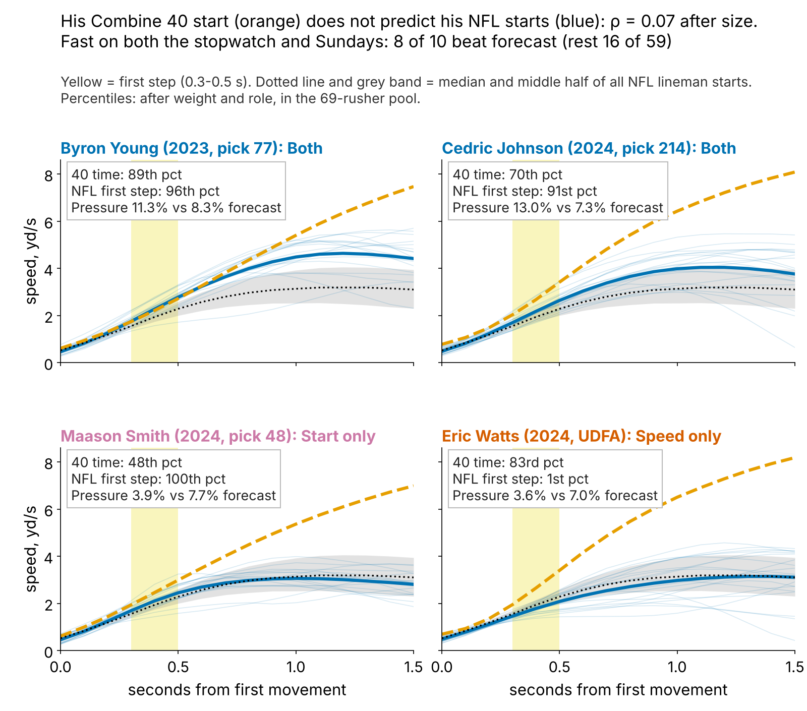
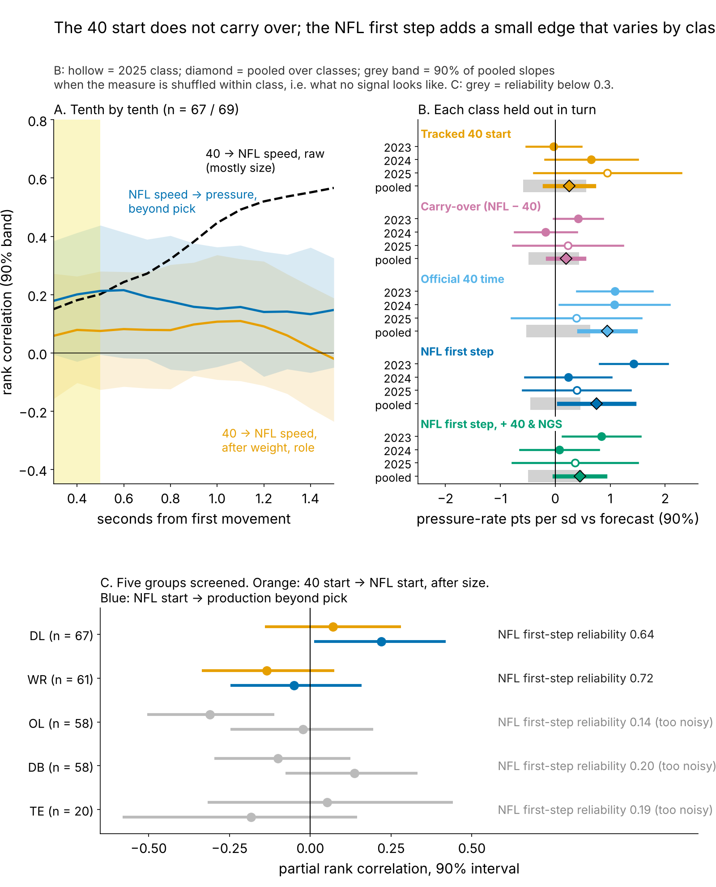
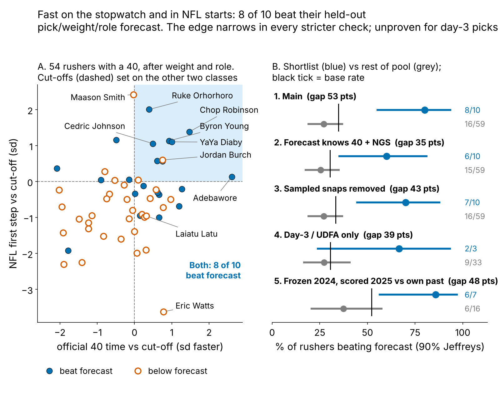
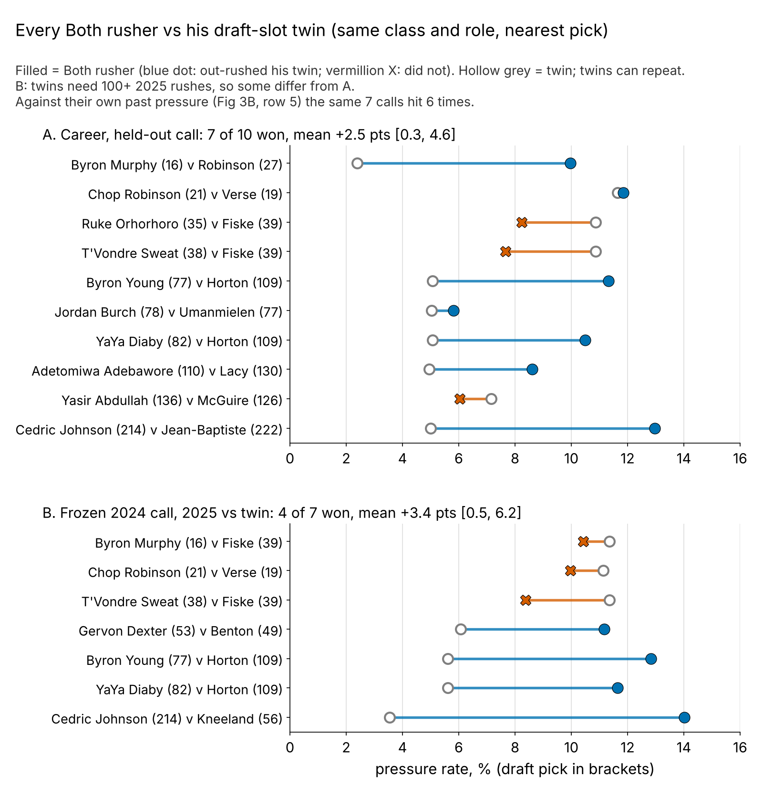

# Speed That Translates: The Combine Start Doesn't Carry Over, Rushers Fast on Both Clocks Do

**First step** = a lineman's speed 0.3–0.5 s after he first moves. **Both** = NFL first step in the top third *and* official 40 time in the top half, cut-offs set on other classes. A lineman's tracked Combine start does not predict his NFL start (ρ = 0.07). But Both rushers beat a held-out draft-slot pressure forecast 8 of 10 times; everyone else 16 of 59.

## Why pass rushers, and why now

A pass rush starts like a 40: from a stance, straight ahead, before anyone touches him. If Combine movement translates anywhere, it is here; of five groups screened, only DL starts are both readable from 20 snaps and linked to production (Figure 2C). After a rookie season a club decides who gets third-down snaps and whether to buy a veteran, usually on a handful of sacks. A hit is worth money: the alternative, a mid-tier veteran edge, cost a median $5.5M a year in 2025, against about $1.04M for a day-3 rookie.

## So what for a team

1. **Act on three names (Table 3): extend Byron Young (LAR) and YaYa Diaby (TB); give Chop Robinson (MIA) a full passing-down role, re-scored at midseason because he missed his 2025 check.** All three meet the frozen act-on rule: on the list, 300+ rushes, pressure a point or more over forecast, under 25% of games missed.
2. **Pro personnel: use Both as a ranking, not a regression input.** On held-out classes the list produced 6.4 more pressures a season over forecast than everyone else; as a continuous feature no speed measure, official 40 included, improves held-out R² (Table 1).
3. **Draft room: do not price the tracked 40 start.** It adds nothing beyond draft slot in any test (Table 1); the official 40 time carries the speed signal and clubs already pay for it.
4. **Chart 24+ random rushes per young rusher** before trusting his first step (8 give reliability 0.44).

## The metric

First step is measured in sd after weight and role. In that window the 40 and a pass rush are the same movement; by 1.5 s they part (6.8 yd/s in the 40, 3.1 on a rush, because he meets a blocker).

**Data.** Tracked Combine 40s, year-standardized, curves starting at first movement (removing the clip's pre-laser lead). NFL: random sampled pass rushes only, alignment-adjusted: 1563 starts by 85 linemen, median 19 each, reliability 0.64; it tracks NGS get-off snap by snap (ρ = 0.51). **Pool:** of 118 linemen, 33 have fewer than 8 sampled starts and 16 fewer than 100 rushes; 69 remain. Outcome: career pressures per rush. **Baseline without tracking:** draft pick, weight and role (share of snaps at EDGE), fitted on the other two classes: held-out R² 0.43 [0.24, 0.61], RMSE 2.1 pressure-rate points (class mean alone: 2.8), rank correlation 0.45. A stronger baseline adds the official 40 time and season NGS get-off: R² 0.48, RMSE 2.0, ρ 0.51.

## Finding 1: the Combine start does not carry over

Raw, the 40 ranks NFL speed at 1.5 s at 0.57, but that is weight. After size, the 40 first step previews the NFL first step at ρ = 0.07 [−0.14, 0.28] (n = 67). Noise is not the excuse: with two reps averaged a perfect link could show 0.67. Per-player translation scores (gap, speed ratios, curve shape) never exceed 0.18 against pressure beyond pick, and the carry-over score lowers held-out R² (−0.08 [−0.17, 0.01]). **Translation does not explain production beyond pick.**

| Measure, one sd faster (DL) | n | Pts beyond pick, weight, role | Pts beyond that + 40 + NGS get-off | Held-out ΔR² |
|---|---|---|---|---|
| Tracked 40 start (Combine clip) | 52 | 0.3 [−0.2, 0.7] | 0.2 [−0.4, 0.8] | −0.07 [−0.17, 0.03] |
| Carry-over (NFL start minus 40 start) | 52 | 0.2 [−0.1, 0.5] | 0.2 [−0.3, 0.7] | −0.08 [−0.17, 0.01] |
| Official 40 time (stopwatch) | 54 | 0.9 [0.4, 1.5] | in baseline | 0.00 [−0.11, 0.11] |
| **NFL first step (game tracking)** | 69 | **0.8 [0.1, 1.4]** | **0.4 [0.0, 0.9]** | −0.06 [−0.21, 0.05] |
| Both flag (rule, 0/1) | 69 | Table 2 | Table 2 | 0.04 [−0.04, 0.14] |

*Table 1. Pressure-rate points per sd faster (DL average about 8%), 90% interval, each class held out in turn; last column: change in held-out R² when the measure is added to the pick, weight, role regression.*

**Reading Table 1.** Slopes for the official 40 and NFL first step are positive but small next to rusher-to-rusher noise, so refitting with them gains nothing in held-out R², as public audits found. Any value is at the top of the ranking: Finding 2.

## Finding 2: two signals that agree beat the forecast

A rusher "hits" if his pressure rate beats the held-out forecast (base rate 35% [26, 45]).

| Check | Shortlist beat forecast [90%] | Everyone else [90%] | Gap, pts [90%] |
|---|---|---|---|
| Main: pick, weight, role forecast | 8 of 10 [55–94%] | 16 of 59 [19–37%] | 53 [28, 75] |
| Forecast adds official 40 time, NGS get-off | 6 of 10 [35–81%] | 15 of 59 [17–36%] | 35 [8, 62] |
| Sampled snaps removed from the outcome | 7 of 10 [44–88%] | 16 of 59 [19–37%] | 43 [14, 71] |
| Day 3 and UDFA only (pick 103+) | 2 of 3 [24–94%] | 9 of 33 [16–41%] | 39 [−26, 82] |
| Frozen after 2024, scored on 2025 vs own past pressure | 6 of 7 [56–97%] | 6 of 16 [20–58%] | 48 [15, 75] |

*Table 2. Five checks on one shortlist. Hit-rate intervals: Jeffreys; gap interval: rushers resampled within class.*

**Verdict: a real but modest edge in the full pool, unproven for day-3 picks (three shortlisted).** The list's hit rate, 80% [55, 94], sits above the base rate's interval; the gap narrows in every stricter check and stays positive. Row 5 is the cleanest: called from 2023–24 starts only, scored on 2025 against a forecast that knows each rusher's own past pressure. Reweighting for who reaches 100 rushes leaves the gap at 53 points [27, 77].

## Every matched pair, not one chosen case

Each Both rusher faces the non-Both rusher of his class and role nearest in draft slot (median 9 picks apart) on raw pressure rate. Career: Both won 7 of 10 pairs, by 2.5 points on average [0.3, 4.6]; sign test p = 0.17. Frozen after 2024 and scored on 2025: 4 of 7, 3.4 points [0.5, 6.2], p = 0.50. The win count alone proves nothing. Panel B and Table 2 row 5 score the same seven 2024 calls two ways: against a twin (4 of 7) and against the rusher's own past pressure (6 of 7).

## Why it works: the same rusher, faster snap

On 1279 random rushes by 69 linemen, a first step one sd faster than *his own* average multiplies that snap's odds of pressure by 1.49 [1.25, 1.77]: 14.8% for his fastest fifth of starts, 6.6% for his slowest. It holds with that snap's NGS get-off, sideways path, down and alignment fixed (1.51). *Film hypothesis, untested:* fast-start losses should be rushes that win the edge but have no counter.

**Where rule and tape disagree.** Maason Smith (Jacksonville, 2024, pick 48) has the pool's best NFL first step, a 48th-percentile 40 and 3.9% pressure against a 7.7% forecast: fast off the ball, no win. Grade hands and a counter before cutting his snaps.

## The 2026 list, frozen

Same rule, cut-offs from all three classes, every lineman with 8+ sampled starts. Bold = act now.

| Rusher (class, pick, team) | Role | Availability (games missed) | 40 / first step pct | Pressure vs forecast (rushes) | 2024 call scored on 2025 |
|---|---|---|---|---|---|
| **Byron Young** (2023, 77, LAR) | hand-down end | ok (0/51) | 89 / 96 | 11.3% vs 8.3% (1501) | **hit** (12.8% vs 10.5%) |
| **YaYa Diaby** (2023, 82, TB) | hand-down end | ok (0/51) | 93 / 94 | 10.5% vs 8.0% (1420) | **hit** (11.6% vs 9.6%) |
| **Chop Robinson** (2024, 21, MIA) | hand-down end | ok (2/34) | 98 / 97 | 11.8% vs 10.0% (726) | **miss** (10.0% vs 12.6%) |
| Cedric Johnson (2024, 214, CIN) | hand-down end | flag (18/34) | 70 / 91 | 13.0% vs 7.3% (216) | **hit** (14.0% vs 8.7%) |
| Adetomiwa Adebawore (2023, 110, IND) | interior | flag (14/51) | 100 / 77 | 8.6% vs 6.8% (511) | untested (<100 rushes) |
| Byron Murphy (2024, 16, SEA) | interior | ok (3/34) | 81 / 86 | 10.0% vs 9.0% (682) | **hit** (10.4% vs 9.3%) |
| T'Vondre Sweat (2024, 38, TEN) | interior | ok (5/34) | 74 / 87 | 7.7% vs 7.2% (496) | **hit** (8.4% vs 6.9%) |
| Ruke Orhorhoro (2024, 35, ATL) | interior | flag (9/34) | 69 / 99 | 8.2% vs 8.2% (498) | untested (<100 rushes) |
| Yasir Abdullah (2023, 136, JAX) | hand-down end | flag (33/51) | 54 / 72 | 6.0% vs 7.8% (149) | untested (<100 rushes) |
| Jordan Burch (2025, 78, ARI) | hand-down end | ok (0/17) | 85 / 88 | 5.8% vs 8.5% (344) | 2025 class |
| Ty Robinson (2025, 111, PHI) | interior | flag (8/17) | 69 / 90 | 0.0% vs 7.4% (55) | 2025 class |

*Table 3. Percentiles within the pool; forecast = pick, weight, role, held out by class. Flag = 25%+ of games without a recorded snap. Last column: frozen 2024 call vs own past pressure.*

**Track record.** Listed 2024 calls scored in 2025: 5 hits, 1 miss (Robinson, below his own strong rookie rate). Johnson and Adebawore are availability questions first.

**Pre-registration and what would change the call.** Rule, 11 names and test are frozen in `frozen_rule.json` (sha256 `e3079960bd2d…`, 24 October 2026, no 2026 data used). Test: in 2026, list members with 100+ rushes beat a persistence forecast more often than the other 59 pool rushers (one-sided Fisher p < 0.05). At the 2025 time-forward rates (86% vs 38%) power is 90%; at half that gap, 32%. Passing needs 8 of 11 list hits if the rest hit 22 of 59. **We drop the rule if list members do no better than the rest**: 6% likely if half the edge is real, 50% if none is.

## Limitations

- **Not blind until 2026.** The two-signal form was chosen after seeing all three classes; only the cut-offs are held out. The frozen-2024 row has 23 rushers and overlaps the main shortlist.
- **No regression gain.** No speed measure, nor the Both flag, reliably raises held-out R²; the edge is a ranking edge in a pool of 69.
- **Small lists.** Ten rushers, three on day 3; matched-pair sign tests are not significant.
- **Sampled tape, no blockers or ball.** A slow start can be a two-gap call, a fast one a free rush; injuries enter only as missed games.

## Appendix

**Estimands.** Table 1's held-out slope (NFL first step 0.8 points per sd) is the headline; a rusher random-intercept binomial re-fit gives 0.7 [0.2, 1.2]. Beyond each rusher's own 2023–24 pressure, the frozen first step adds +0.4 [−0.5, 1.3] in 2025. **Table 1 shuffle p** (measure shuffled within class): tracked 40 start 0.48, official 40 0.004, NFL first step 0.01; best of 11 windows, p = 0.02. **Shuffle p (labels within class), Table 2 rows 1–5:** 0.009, 0.07, 0.03, 0.22, 0.04. **ΔR² beyond the stronger baseline:** NFL first step −0.10 [−0.24, 0.00], Both −0.04 [−0.11, 0.03]. **Calibration.** Shortlist expected 69% hits, got 80%; Brier 0.212 vs 0.253 for the base rate.

*Reproduce: `uv run python writeup/candidates/round_17/cand_3/analysis.py` (about 5 minutes).*
