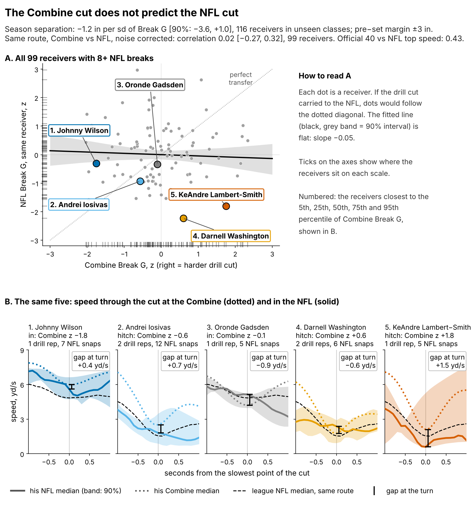
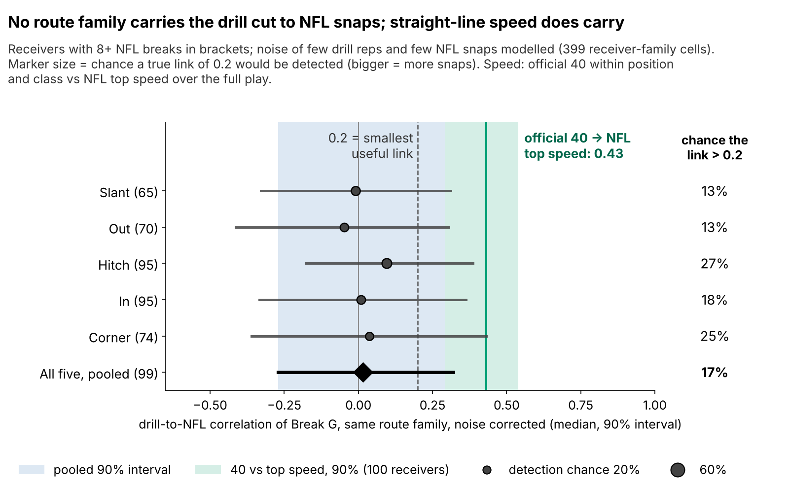
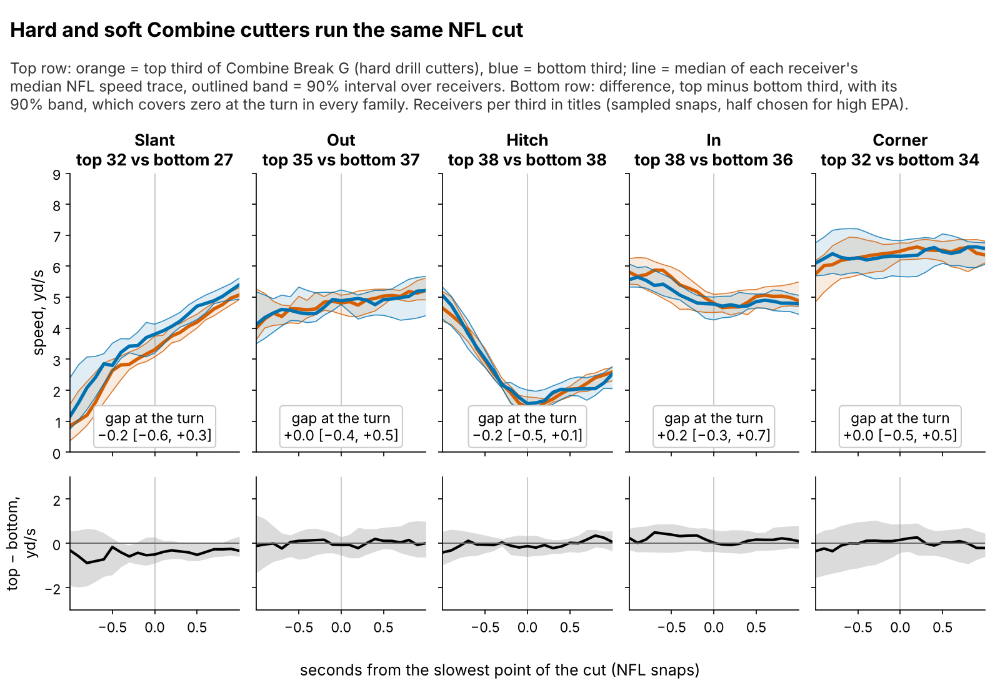
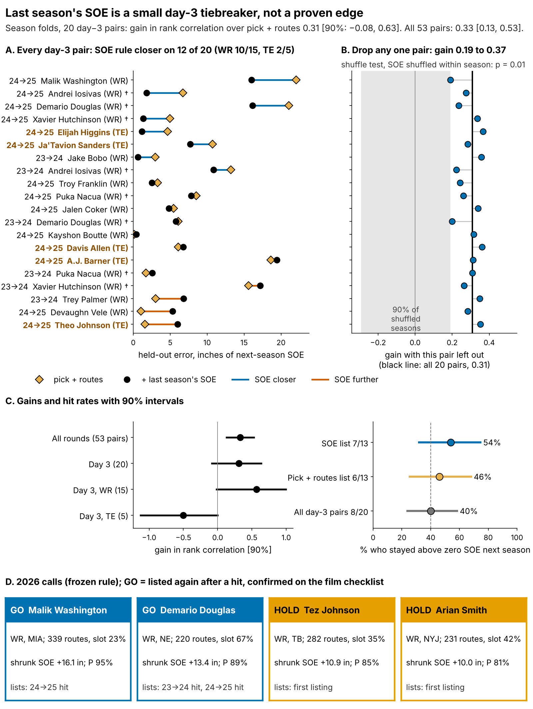

# Combine Cuts Don't Predict NFL Separation

*Break G* is how hard a receiver pushes off the ground at the sharpest point of a route cut, measured at 10 Hz in the Combine route drills. *Separation over expected (SOE)* is how open he is when the ball is thrown, beyond what his alignment and cushion predict (Next Gen Stats, full season).

**On {n_main} receivers from draft classes the model never saw, one sd of Break G is worth {prim_b} inches of season SOE (90% interval {prim_lo} to {prim_hi}). The best case, {prim_hi} inch ({hi_catch} catches a season), sits inside the ±3 inch margin ({sesoi_catch} catches) set before testing. Speed carries from Combine to NFL (ρ = {spdf_rho}); the cut does not. Between day-3 receivers, lean on last season's SOE, then check the film.**

## Why receivers, why now

The last receiver spot usually goes to a day-3 or undrafted player, every summer. The 2025 day-3 and undrafted receivers and tight ends who ran 100+ routes earn a median ${why_apy}M a year. A miss is cheap but blocks a younger player.

The scout's evidence on getting open is thin. At the Combine he sees a median of {why_reps} graded route-drill cuts per receiver, and {why_single}% of drill-receiver cells hold a single rep. In the NFL, one 200-route season of SOE is about {eb_sig}% signal and {eb_noise}% noise.

Since 2023 the route drills are tracked at 10 Hz, so one piece of code grades the cut on Combine and NFL tracking. Straight-line speed carries: over the full play, the official 40 ranks NFL top speed at ρ = {spdf_rho} [{spdf_lo}, {spdf_hi}] within position and class ({spdf_n} receivers). Does the cut carry the same way? If not, what breaks the tie?

## The roster decision

| Question (n) | Held-out result [90% interval] | Verdict |
|---|---|---|
| Does Break G add season SOE beyond pick, 40, weight and NGS score? ({n_main} receivers, unseen classes) | {prim_b} in per sd [{prim_lo}, {prim_hi}]; inside the ±3 in margin | **No** |
| Does the drill cut carry to the same NFL route? ({fp_pool_n} with 8+ NFL breaks) | correlation {fp_pool_med} [{fp_pool_lo}, {fp_pool_hi}], noise corrected | **No visible transfer** |
| Does last season's SOE rank receivers better than pick and routes? | all rounds, {ev_all_n} pairs: gain {ev_all_drho} [{ev_all_drho_lo}, {ev_all_drho_hi}]; day 3, {ev_d3_n} pairs: {ev_d3_drho} [{ev_d3_drho_lo}, {ev_d3_drho_hi}] | **Yes overall; day 3 same size, unproven** |
| Did earlier day-3 SOE lists beat the base rate? | {lh_k} of {lh_n} hit ({lh_pct}% [{lh_lo}, {lh_hi}]) vs {lb_k} of {ev_d3_n} ({lb_pct}% [{lb_lo}, {lb_hi}]) | **Intervals overlap: a lean** |

The gain is the rank correlation of the held-out forecast with next-season SOE when last season's SOE is added, minus the same without it. Folds are season pairs (fit on 2024→25, score 2023→24, and the reverse); receivers are resampled. An earlier brief quoted {lo_d3_gain} [{lo_d3_lo}, {lo_d3_hi}] from leave-one-receiver-out folds, where the pick-and-routes forecast itself scored {lo_d3_r0}, inflating the gain.

## What to do

1. **If you must choose between two day-3 receivers with similar pick and routes, lean to the one with higher last-season SOE.** On day 3 the gain matches the {ev_all_n}-pair result but its interval includes zero, so a lean is all it supports. For 2026: Malik Washington and Demario Douglas, if the film checklist confirms them.
2. **Use it for wide receivers, not tight ends.** WR only, the day-3 gain is {wr_g} [{wr_g_lo}, {wr_g_hi}] on {pp_wr_n} pairs; on the {pp_te_n} tight-end pairs it is {te_g} [{te_g_lo}, {te_g_hi}].
3. **Take Break G out of the price.** At the same position, clubs draft a receiver 1 sd harder in the cut {price_bg}% earlier [{price_bg_lo}, {price_bg_hi}] and get no separation for it.
4. **2026 Combine protocol.** If you time cut drills, run slant, dagger and comeback twice: a second rep lifts reliability from {rel_mm1} to {rel_mm3}.

## The drill cut does not show up in NFL routes

Break G is found on {pct_found}% of {n_reps} drill reps, standardized within drill and Combine year and averaged over a median of {drills_med} drills. It is a real drill trait: Break G on five drills predicts the other five at ρ = {rel_split} ({rel_split_n} players). It is not a speed score (ρ with the 40: {rho_forty}). NFL snaps are graded with the same code on slant, out, hitch, in and corner routes.

After correcting for that noise, the drill-to-NFL correlation for the same receiver on the same route is {fp_pool_med}, and below {fp_pool_hi} with 90% probability, against {spdf_rho} for the 40 and top speed. A useful link (above 0.2) has a {fp_pool_p02}% chance.

Hard and soft drill cutters reach the same speed at the top of the NFL cut: on the hitch the gap is {f3_hitch} yd/s [{f3_hitch_lo}, {f3_hitch_hi}], and all {f3_cover} families' intervals include zero. On slants, outs and corners the NFL cut is taken at speed (median {vap_slant}, {vap_out} and {vap_corner} yd/s at the turn), so a drill brake has little to transfer to.

## Break G adds nothing to season separation

The outcome is full-season SOE, route-weighted over each career ({n_seasons} player-seasons, median {routes_med} routes). The forecast without tracking was fixed before the test: log pick, official 40, weight, NGS athleticism score and a TE flag. Fitted on two classes and scored on the third, it is weak: held-out R² {bl_r2} [{bl_r2_lo}, {bl_r2_hi}], error {bl_rmse} inches, rank correlation {bl_rho}. A ridge version gives R² {rdg_r2} [{rdg_r2_lo}, {rdg_r2_hi}], so the near-zero baseline is not a fitting accident. Adding Break G changes R² by {dr2} [{dr2_lo}, {dr2_hi}], and what little it adds comes through a negative slope.

`reproduce_baseline.py` rebuilds season SOE from `player_season_stats.parquet` (`soe_season.csv`) and, with `baseline_inputs.csv`, re-derives R² {bl_r2}, error {bl_rmse} inches and the {prim_b} inch slope in seconds.

## The 2026 day-3 shortlist

Pool: day-3 or undrafted receivers with 100+ routes and SOE above zero in 2025. **GO**: listed again after an earlier hit, and confirmed on film. **HOLD**: first listing. P: model chance of 2026 SOE above zero, an ordering.

{{SHORTLIST}}

**Base rates for reading P.** Earlier day-3 lists hit {lh_k} of {lh_n} ({lh_pct}% [{lh_lo}, {lh_hi}]) against {lb_k} of {ev_d3_n} for all day-3 pairs ({lb_pct}% [{lb_lo}, {lb_hi}]); the intervals overlap. Held-out forecasts of 60% or more came true {cal_hi_hit} of {cal_hi_n} times ({calh_pct}% [{calh_lo}, {calh_hi}]). Slot share is shown, but 20 pairs cannot separate slot from wide alignment.

**Film checklist for the GO names** (picked by rule from sampled 2025 snaps: slowest hitch turn, fastest slant or out turn, most open snap against man; league hitch median {vap_hitch} yd/s):
{{CLIPS}}

GO flips to HOLD if his full 2025 tape shows no sink at the top of hitches, or if his 2026 SOE is below zero after 150 routes.

**What would change the call** (pre-registered): drop the tiebreaker if the 2026 day-3 gain is negative and the 2026 list hits no better than the base rate; upgrade it from a lean to a rule if the list hits {pw_hit_k} of {l26_n}. Power is low ({sim_pow} for the gain, {pw_hit} for the list).

## Limitations

- **Not blind, small day-3 sample.** All three classes were seen while building this; day 3 has {ev_d3_n} pairs from {ev_d3_np} receivers. Dropping any one pair leaves the gain between {lopo_min} and {lopo_max}, and a test that shuffles last season's SOE within season gives p = {perm_rho_p}; still, the bootstrap interval includes zero.
- **The downside is open.** The interval rules out gains above {prim_hi} inch per sd, not losses down to {prim_lo}.
- **Game tracking is a sample.** Up to 40 plays per player, half chosen for high EPA, without defenders or ball. That limits the clips and the drill-to-NFL link, not the season test.
- **Availability and survivorship.** {sel_out} of {sel_n} drill-scored receivers never logged NFL routes with separation; re-weighting for this changes little.
- **The freeze is late.** The 2026 rule was frozen on {freeze_date}, after the season began but before any full-season SOE existed.

## Appendix

**Pre-registration.** `frozen_rule_2026.json` holds coefficients, threshold, names and probabilities (sha256 {sha26}…). Primary test: day-3 gain over pick and routes, {pw_n26} expected 2026 pairs ({pw_keep}% of day-3 receivers keep 100+ routes).

| Speed benchmark: official 40 vs NFL top speed (90th percentile of per-snap maximum) | ρ (receivers) |
|---|---|
| Full play, 40 standardized within position and class (used in the text) | {spdf_rho} ({spdf_n}) |
| Full play, raw 40, WR and TE pooled (mostly the WR–TE speed gap) | {spdr_rho} ({spdr_n}) |
| Snap to throw on breaking snaps only (short routes cap top speed) | {spd_rho} ({spd_n}) |

**Every estimate and its alternatives** (90% intervals; receivers resampled).

| Claim | Primary (n) | Alternatives |
|---|---|---|
| Break G slope, in of SOE per sd | offset forecast {prim_b} [{prim_lo}, {prim_hi}] ({n_main}) | re-weighted for survival {t5_ipw_b} [{t5_ipw_lo}, {t5_ipw_hi}]; without Puka Nacua {nn_b} [{nn_lo}, {nn_hi}]; QB-adjusted {qb_b} [{qb_lo}, {qb_hi}] |
| Day-3 gain over pick and routes | season folds {ev_d3_drho} [{ev_d3_drho_lo}, {ev_d3_drho_hi}] ({ev_d3_n} pairs) | shrinkage refitted in each fold {ns_g} [{ns_lo}, {ns_hi}]; draft-class folds {nc_g} [{nc_lo}, {nc_hi}]; rule vs raw last-season SOE {nv_g} [{nv_lo}, {nv_hi}]; mean error cut {pp_d3_d} in [{pp_d3_lo}, {pp_d3_hi}] |

**Notes.** P is rescaled to held-out hit rates (day 3: {cal_d3_pred}% forecast, {cal_d3_obs}% observed). The noise-corrected correlation uses an errors-in-variables model, one slope per route family ({fp_cells} receiver-family cells). 1 sd of Break G = {g_sd} g; catches use {cr_per_yd} catch-rate points per yard and {tg_season} targets.

**Rest of the 2026 list** (team; shrunk SOE; P): {{REST}}

Reproduce: `uv run python writeup/candidates/round_17/revised/analysis.py` (about nine minutes) writes every number, figure and this text.
