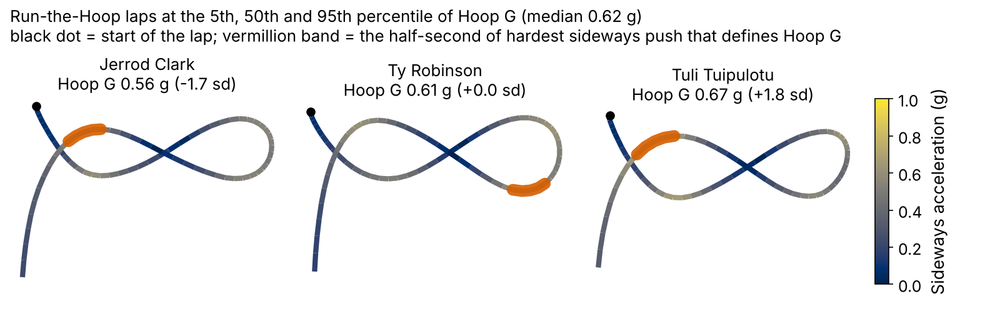
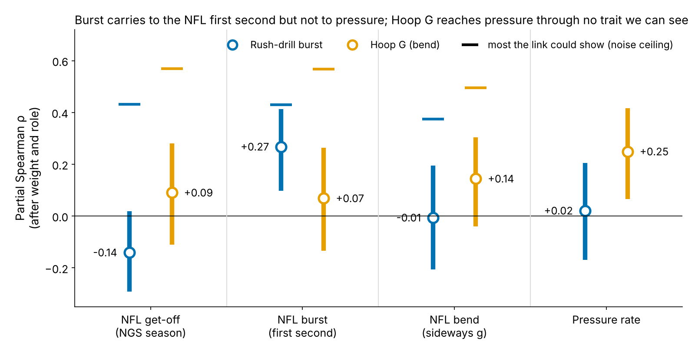
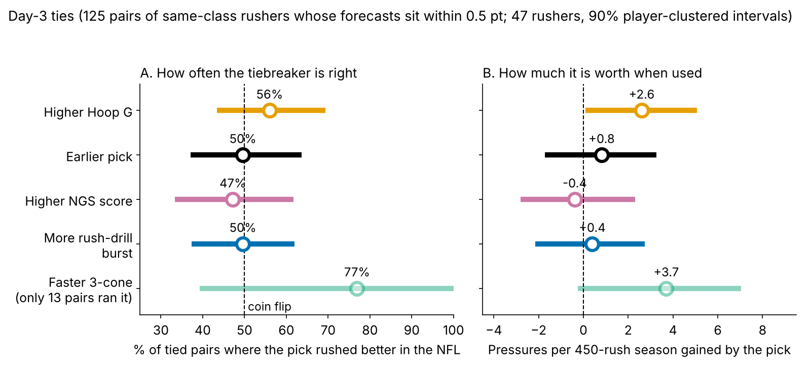

# Bend Breaks Day-3 Ties: What Run-the-Hoop Says About NFL Pressure

**Hoop G** measures how hard a defensive lineman pushes sideways while rounding the Combine's Run-the-Hoop drill. Scored only on Combine classes the model never saw, one sd of Hoop G is worth **1.8 extra pressures per season** [0.2, 3.4] beyond a forecast built without tracking. That is a positive signal (shuffle p = 0.02) but probably below the line where we would grade on it. Burst out of a stance in the pass-rush drill is worth nothing. Use Hoop G for one job: **breaking day-3 ties**. Our Go calls for 2026 are **Jack Sawyer** (PIT) and **Warren Brinson** (GB).

## Why pass rushers, and why these drills

A pressure is what a rusher is paid for. On 1655 randomly sampled NFL pass plays involving these rookies, a pressured snap cost the offense 0.52 more expected points than a clean one (90% interval 0.35 to 0.67).

Most of these decisions are cheap ones: 69% of the 118 linemen in the 2023–25 classes went on day 3 or undrafted. Only 43 of them ran the 3-cone, the agility test clubs trust. All of them run position drills under 10 Hz tracking, and two of those drills copy a rush. The pass-rush drill starts from a stance (get-off), and Run-the-Hoop makes him lean around a circle at speed (bend).

**One margin, set before fitting.** An effect is worth acting on at 2.25 pressures per 450-rush season per sd. That is one pressure every 200 rushes, about 1.2 expected points a season. The DL average pressure rate is 8.1%.

## The two drill metrics

- **Hoop G** is the hardest half-second of sideways (centripetal) acceleration on the hoop lap, in g (median 0.62 g). 109 linemen have it, and 69 of them never ran the 3-cone.
- **Burst** is the yards covered in the first second after he starts moving in the pass-rush drill (median 2.45 yd), for 117 linemen.

Both are standardized within Combine year, because drill conditions shift between years. Both are noisy single reps. 91% of hoop runners have one lap; among the 10 with two, lap-to-lap reliability is 0.37. One burst rep repeats at 0.13.

## The baseline and the test

**Baseline without tracking:** draft pick (log), Combine weight, NFL EDGE share, NGS athleticism score, and the official 10-yard split and 3-cone. Missing times are filled from weight, role and NGS score. We use the official split because the tracked 40 clip starts about 0.3 s before the laser, which corrupts any tracked split.

**Outcome:** career pressure rate through 2025, shrunk toward the mean by 117 rushes of prior, for the 77 linemen with both drills and 30+ NFL rushes.

**Out of class:** each Combine class (27/23/27 linemen) is forecast by a model fit on the other two. The headline is one estimand: the slope of the held-out miss (actual minus forecast) on the drill. Its interval resamples players within class and refits every fold. Its p-value shuffles the drill within class. Players are the independent units throughout.

| Model (held-out) | R² | RMSE (pts) | Rank ρ | R² gain over baseline [90%] |
|---|---|---|---|---|
| Pick only | 0.10 | 1.63 | 0.31 | — |
| Baseline | −0.02 | 1.74 | 0.28 | — |
| + Hoop G | 0.04 | 1.69 | 0.37 | 0.06 [−0.20, 0.25] |
| + Rush-drill burst | −0.03 | 1.75 | 0.28 | −0.01 [−0.17, 0.05] |
| + both drills | 0.01 | 1.71 | 0.35 | 0.03 [−0.30, 0.24] |

*Table 1. Leave-one-class-out fit, n = 77. RMSE in pressure-rate points.*

The baseline is weak. With 77 rushers, its extra Combine times cost more in fitting noise than they add, so it scores below pick and role alone. Hoop G improves all three held-out measures, though its R² gain still includes zero. Burst improves none.

## Finding 1: burst reaches the snap, not the pressure

Burst does carry over as a movement (Figure 3). After weight and role, drill burst tracks how far a lineman travels in the first second of a sampled NFL rush (partial ρ = 0.27 [0.10, 0.41], n = 84). It does not track NGS season get-off (−0.14).

The NFL first second matters for pressure (0.33). Drill burst does not reach it: out of class it is worth −0.5 pressures per sd [−2.3, 1.3]. The bootstrap puts 1% probability on a gain above the margin. A formal equivalence test (TOST) gives p = 0.06: it cannot rule out a small negative effect, but it rules out a useful positive one.

## Finding 2: Hoop G adds a little, out of class

A lineman one sd higher in Hoop G beats his held-out forecast by 1.8 pressures a season [0.2, 3.4]. The within-class shuffle gives p = 0.02, and 96% of bootstrap draws are positive, so the test and the interval agree. The size is the open question. Only 33% of draws clear the action line, and the effect holds in 2023 and 2024 but is flat in 2025 (−0.02 points per sd).

Clubs do not draft for it. Top-third Hoop G linemen went at a median pick of 158, bottom-third at 130.

**How it works is only partly visible.** Hoop G barely moves NFL get-off or the first second (0.09, 0.07). It moves sideways push on NFL rushes a little (0.14 [−0.04, 0.30]), and that NFL bend predicts pressure (0.36). Within the same rusher, on 1437 sampled rushes, one sd more sideways push raises the odds of pressure by 1.50 [1.28, 1.75]; a quicker get-off by 1.39. Bend on a snap may partly be the result of beating the tackle rather than its cause, and the data have no blockers.

## The decision: a day-3 tiebreaker

**Rule (frozen, sha256 `f55a9b189ab6…`).** On day 3 or among undrafted rushers, when two rushers' no-tracking forecasts sit within 0.5 points of each other (the 2.25-pressure action margin), take the higher Hoop G. Otherwise follow the forecast.

**Why a tie, not a pick gap.** In these ties the median pick gap is 54 slots, and the earlier pick was the better NFL rusher 50% of the time. Late-round pick order does not separate rushers, so a pick-gap threshold would not define a real tie.

**The record.** There are 125 such pairs among 47 rushers (66% same role). The effective sample is the 47 rushers, and all intervals resample rushers, not pairs.

- **How often:** Higher Hoop G picked the better NFL rusher in 56% of ties [43, 69], shuffle p = 0.20. As a hit rate, it is unproven. NGS score (47%) and burst (50%) do no better than a coin.
- **How much:** When Hoop G is right, its pick out-rushes the other by 8.7 pressures a season; when wrong, it gives up 5.2. The net is **2.6 pressures per decision** [0.1, 5.1], shuffle p = 0.03.
- **Cost of being wrong:** If Hoop G were pure noise, the rule would override the forecast's lean in 39% of ties, by 1.0 pressures on average. The worst-case expected cost is 0.4 pressures per decision, against the 2.6 upside.

Where both rushers ran the 3-cone, it did better still (77%, only 13 pairs). Use the 3-cone first; Hoop G is the stand-in for the 69 hoop runners without one.

Among 2023–24 day-3 rushers in the top third of Hoop G, the best case is Cedric Johnson (pick 214, +1.1 sd): 11.2% pressure vs a 7.2% forecast over 216 rushes. Others who beat the forecast: Javon Solomon, Adetomiwa Adebawore, Nick Hampton. Misses: Robert Beal, Jaylen Harrell, Eric Watts.

## 2025 class: calls for the 2026 season

Of the 10 day-3 rushers in the top third of Hoop G, two have earned more snaps. **Go** means 100+ rushes and at least 0.5 points above forecast, and **No-go** means at least 0.5 below. The flip rate is the 2026 pressure rate that would move his career rate onto the forecast at his 2025 volume. **Decision date: after the 2026 regular season.**

| Rusher (pick, team) | Role | Hoop G (sd) | NFL rushes | Pressure vs forecast | Call | 2026 flip rate |
|---|---|---|---|---|---|---|
| **Jack Sawyer** (123, PIT) | EDGE | +1.4 | 176 | 9.0% vs 8.4% | **Go** | 7.4% |
| **Warren Brinson** (198, GB) | interior | +1.3 | 173 | 7.4% vs 6.5% | **Go** | 5.1% |
| **Tyrion Ingram-Dawkins** (139, MIN) | EDGE | +1.0 | 113 | 6.7% vs 7.9% | **No-go** | 10.2% |
| **Zeek Biggers** (253, MIA) | interior | +0.9 | 142 | 6.4% vs 6.2% | **Hold** | 5.9% |
| **Nazir Stackhouse** (UDFA, TEN) | interior | +0.4 | 71 | 5.6% vs 5.8% | **Hold** | needs 100 rushes |
| **Kyle Kennard** (125, LAC) | EDGE | +1.2 | 50 | 6.3% vs 8.2% | **Hold** | needs 100 rushes |

*Table 2. Career pressure rate is shrunk; forecast is the frozen no-tracking baseline.*

1. **Go: Jack Sawyer (PIT).** EDGE, +1.4 sd: 9.0% vs 8.4% forecast in 176 rushes, 2.7 pressures a season ahead. Give him third-down snaps from wide alignments, where bend matters most. The call flips if he rushes below 7.4% in 2026 (2025: 9.7% raw).
2. **Go: Warren Brinson (GB).** Interior, +1.3 sd: 7.4% vs 6.5% in 173 rushes. Make him the looper on interior stunts. The call flips below 5.1% (2025: 6.9% raw).
3. **No-go: Tyrion Ingram-Dawkins (MIN).** +1.0 sd, but 6.7% vs 7.9%. It would take 10.2% in 2026 to reach the forecast. Hold his snaps unless film shows him flattening at the top of the arc.

Hold names stay on film only. Auditions (under 30 rushes): Ethan Downs (UDFA, KC), Tim Smith (190, IND), Antwaun Powell-Ryland (209, CIN), Jah Joyner (UDFA, FA).

**What would change the rule.** The frozen 2026 test is the Hoop G slope against the frozen forecast for the 2026 class after its first season (one-sided, p < 0.10). Simulated power is 43% for one class and 77% for three. A slope at or below zero drops Hoop G as a tiebreaker. A slope above the margin justifies asking every lineman for a second hoop lap, which would lift reliability from 0.37 to 0.54.

## Limitations

- **Small and noisy.** 77 rushers in the model and 47 in the ties, single drill reps, and a Hoop G reliability that rests on 10 linemen with two laps.
- **Chosen after looking.** Hoop G was the strongest of several drill measures screened in earlier work on these classes, and the tie analysis was built on them too. Holding out classes checks the forecast, not that choice. The 2026 class is the first clean test.
- **Hit rate versus size.** The tie rule wins by margin, not by frequency (56%, p = 0.20). A few big wins drive the gain, so one injury could move it.
- **Thin NFL tracking.** About 17 random sampled rushes per lineman, with no blockers and no ball.
- **Survivorship.** Rates need 30+ rushes. Top-third day-3 rushers reached that as often as the rest of day 3 (15 of 24 vs 32 of 52), but injuries and roster moves are not modelled.

## Reproduce

`uv run python writeup/candidates/round_18/cand_1/analysis.py` (about 4 minutes) rebuilds every number, figure and this text. `verify.py` recomputes Table 1, both held-out slopes, the forecasts and the tie results from `inputs.csv` in under a second and diffs them against `numbers.json`. Column definitions are in `inputs_schema.json`.
