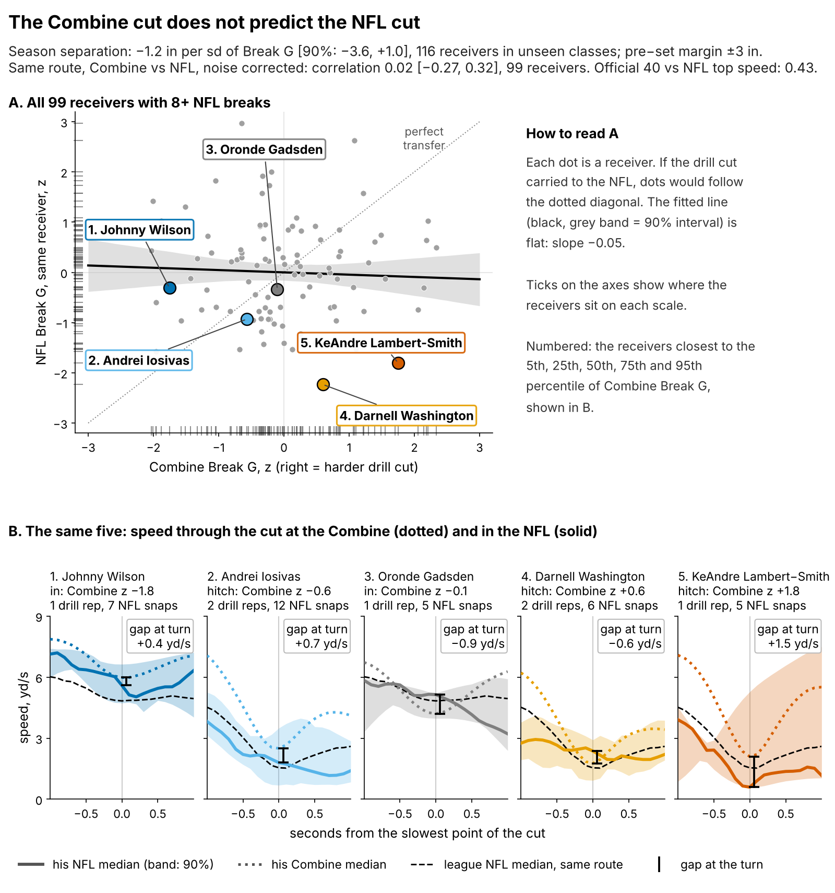
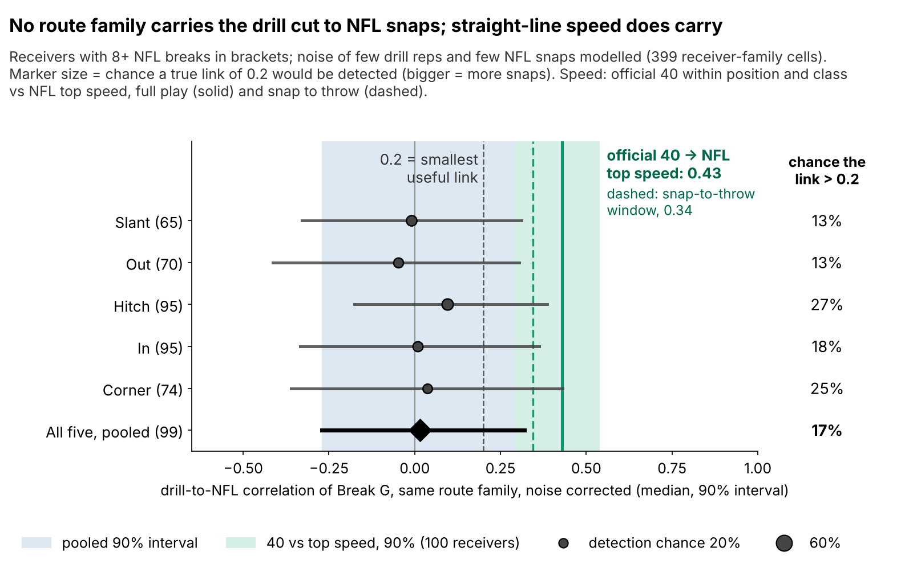
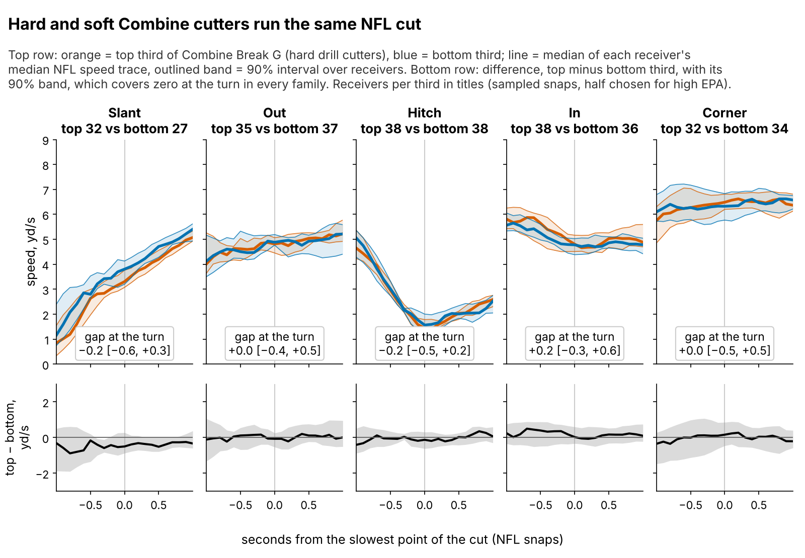
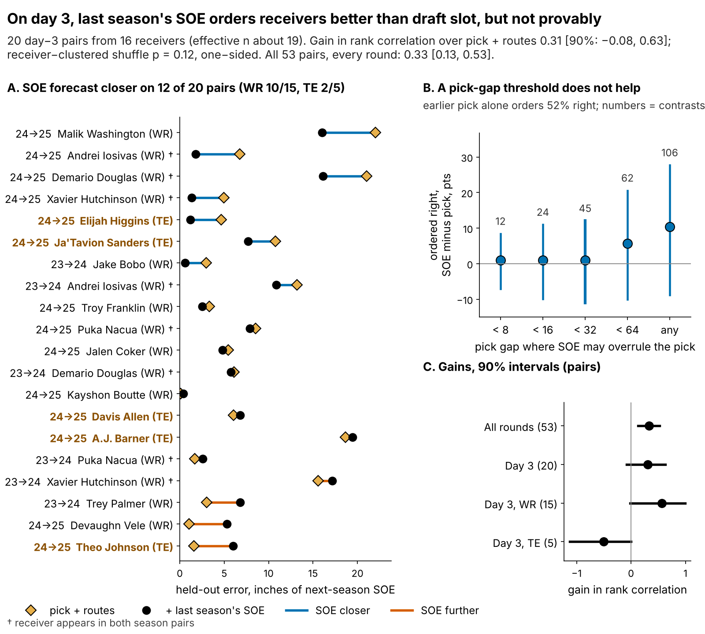
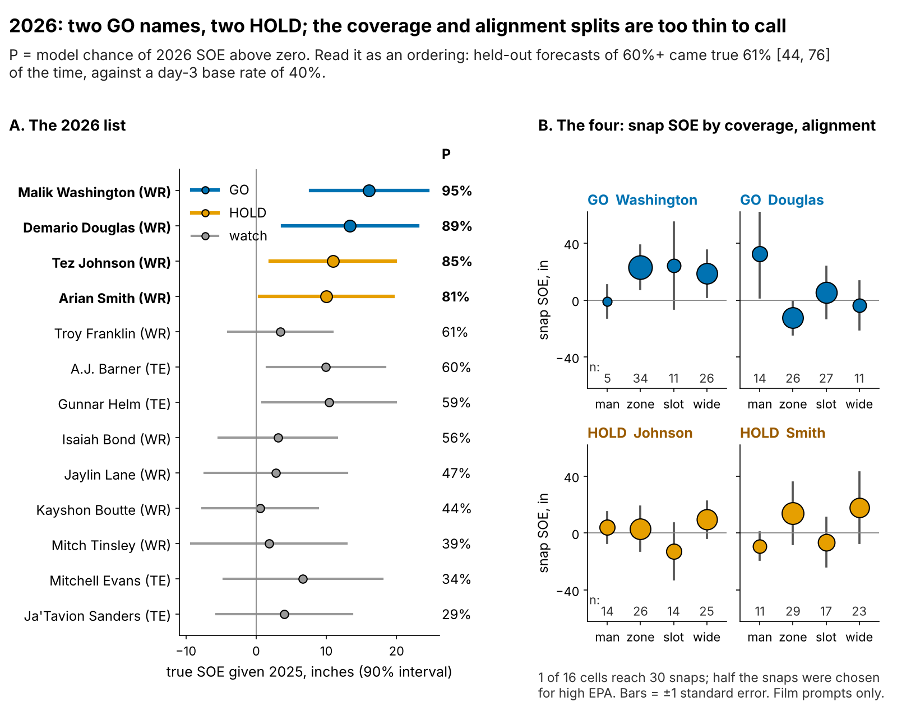

# Combine Cuts Don't Predict NFL Separation

*Break G* is how hard a receiver pushes off the ground at the sharpest point of a route cut, measured at 10 Hz in the Combine route drills. *Separation over expected (SOE)* is how open he is when the ball is thrown, beyond what his alignment and cushion predict (Next Gen Stats, full season), in inches.

**Combine cut sharpness does not predict NFL separation: {prim_b} inches of SOE per sd of Break G [90%: {prim_lo}, {prim_hi}], {n_main} receivers from draft classes the model never saw. Straight-line speed does carry (ρ = {spdf_rho}). Between day-3 receivers, rank by last season's SOE, not draft slot: a lean, not a proof.**

## Why receivers, why now

Every summer the last receiver spot goes to a day-3 or undrafted player. In 2025 those who ran 100+ routes earned a median ${why_apy}M, close to the league minimum. The money is small; the cost of a wrong call is the roster spot and practice reps a better receiver never gets.

The evidence on getting open is thin on both ends. At the Combine a scout sees a median of {why_reps} graded route-drill cuts per receiver, and {why_single}% of drill-receiver cells hold one rep. In the NFL, one 200-route season of SOE is about {eb_sig}% signal: if two receivers differ by 10 inches this year, expect about {eb_sig}% of that gap to persist next year, and the other {eb_noise}% to wash out.

Since 2023 the route drills are tracked, so one piece of code grades the cut at the Combine and on NFL snaps. Straight-line speed is the benchmark: the official 40 ranks NFL top speed at ρ = {spdf_rho} [{spdf_lo}, {spdf_hi}] within position and class ({spdf_n} receivers). Does the cut carry the same way? If not, what should break a day-3 tie?

## The roster decision

| Question (n) | Held-out result [90% interval] | Verdict |
|---|---|---|
| Does Break G add season SOE beyond pick, 40, weight and NGS score? ({n_main} receivers, unseen classes) | {prim_b} in per sd [{prim_lo}, {prim_hi}]. A benefit of +3 in is ruled out (p = {eq_up_p}); harm of −3 in is not (equivalence p = {eq_tost}) | **No benefit** |
| Does the drill cut carry to the same NFL route? ({fp_pool_n} with 8+ NFL breaks) | correlation {fp_pool_med} [{fp_pool_lo}, {fp_pool_hi}], noise corrected | **No visible transfer** |
| Does last season's SOE rank day-3 receivers better than pick and routes? ({ev_d3_n} pairs, {ev_d3_np} receivers) | gain in rank correlation {ev_d3_drho} [{ev_d3_drho_lo}, {ev_d3_drho_hi}], p = {d3c_p}; every round ({ev_all_n} pairs): {ev_all_drho} [{ev_all_drho_lo}, {ev_all_drho_hi}] | **Lean** |
| Does the pick gap matter? ({tb_n} same-season day-3 contrasts) | earlier pick orders {tb_pick_right}% right, SOE {tb_all_right}%; overruling only within {tb_gap} picks adds {tb_d_right} pt | **No: use SOE at any gap** |

## What to do

1. **Take Break G out of the price.** At the same position, clubs draft a receiver 1 sd harder in the cut {price_bg}% earlier [{price_bg_lo}, {price_bg_hi}] and get no separation for it.
2. **Fix the Combine measurement.** If you time cut drills, run slant, dagger and comeback twice: a second rep lifts reliability from {rel_mm1} to {rel_mm3}.
3. **Between two day-3 wide receivers, keep the one with higher last-season SOE, whatever the pick gap.** When this rule is wrong, the receiver kept runs {tb_all_cost} inches of SOE [{tb_all_cost_lo}, {tb_all_cost_hi}] worse than the one cut, about {tb_all_catch} catches a season; when keeping the earlier pick is wrong, the loss is {tb_cost_pick} inches ({tb_pick_catch} catches). Averaged over all decisions, the rule saves {tb_reg_d} inches per call [{tb_reg_d_lo}, {tb_reg_d_hi}]. Not for tight ends: {pp_te_n} pairs, gain {te_g}.
4. **2026: GO on Malik Washington and Demario Douglas.** Review each at 150 routes (Figure 5) and decide before the March 2027 league year.

## The drill cut does not show up in NFL routes

Break G is found on {pct_found}% of {n_reps} drill reps, standardized within drill and Combine year and averaged over a median of {drills_med} drills. It is a real drill trait: Break G on five drills predicts the other five at ρ = {rel_split} ({rel_split_n} players). It is not a speed score (ρ with the 40: {rho_forty}). NFL snaps are graded with the same code on slant, out, hitch, in and corner routes.

After correcting for that noise, the drill-to-NFL correlation for the same receiver on the same route is {fp_pool_med}, and below {fp_pool_hi} with 90% probability. A useful link (above 0.2) has a {fp_pool_p02}% chance. Speed, measured in the same snap-to-throw window as the cut, still carries ({spd_rho}).

Hard and soft drill cutters reach the same speed at the top of the NFL cut: on the hitch the gap is {f3_hitch} yd/s [{f3_hitch_lo}, {f3_hitch_hi}], and all {f3_cover} families' intervals include zero. On slants, outs and corners the NFL cut is taken at speed (median {vap_slant}, {vap_out} and {vap_corner} yd/s at the turn), so a drill brake has little to transfer to.

## Break G adds nothing to season separation

The outcome is full-season SOE, route-weighted over each career ({n_seasons} player-seasons, median {routes_med} routes). The forecast without tracking was fixed before the test: log pick, official 40, weight, NGS athleticism score and a TE flag. Fitted on two classes and scored on the third, it is weak: held-out R² {bl_r2} [{bl_r2_lo}, {bl_r2_hi}], error {bl_rmse} inches. Adding Break G changes R² by {dr2} [{dr2_lo}, {dr2_hi}], through a negative slope.

The ±3 inch margin ({sesoi_catch} catches a season) was set before testing. The data rule out a Break G benefit that large but not an equally large harm: {eq_in}% of resamples fall inside ±3, and the 90% interval reaches {prim_lo}. For pricing, that is enough: no evidence supports paying for the cut.

## Day 3: last season beats the draft slot, narrowly

The gain is the rank correlation of the held-out forecast with next-season SOE when last season's SOE is added, minus the same without it; models are fitted on one season pair and scored on the other. The 20 day-3 pairs come from {ev_d3_np} receivers; four appear twice, and resampling receivers rather than pairs puts the effective sample at about {d3_neff} independent pairs.

There is one test. The interval resamples receivers; its one-sided p is the share of resamples at or below zero ({d3_boot_p}). A shuffle that keeps the fitted models and swaps whole receivers' last-season SOE among day-3 receivers agrees: p = {d3c_p}. An earlier shuffle across all 53 pairs gave p = {perm_rho_p}, but it also erased the all-rounds signal the model learns from, so it asked whether SOE carries any signal (it does), not whether it helps on day 3.

Inside day 3 the earlier pick is close to a coin flip ({tb_pick_right}% of {tb_n} contrasts ordered right). We first set the tiebreak at a pick gap under {tb_gap}: SOE overrules the pick in {tb_switch} contrasts and gains {tb_d_right} pt [{tb_d_right_lo}, {tb_d_right_hi}]. At any gap it gains {tb_gall_d} pts [{tb_gall_d_lo}, {tb_gall_d_hi}] and lifts the share of kept receivers with positive next-season SOE by {tb_gall_h} pts [{tb_gall_h_lo}, {tb_gall_h_hi}]. Every interval includes zero.

## The 2026 calls

Pool: day-3 or undrafted receivers with 100+ routes and SOE above zero in 2025. **GO** = listed again after an earlier hit. **HOLD** = first listing. True SOE = 2025 SOE shrunk for routes. P = model chance of 2026 SOE above zero; read it as an ordering, since held-out forecasts of 60% or more came true {calh_pct}% of the time [{calh_lo}, {calh_hi}] against a day-3 base rate of {lb_pct}%.

{{SHORTLIST}}

Splits come from up to 40 sampled snaps per player; {sp_big_cells} of 16 cells reaches 30 snaps, so they are film prompts. Washington's case rests on zone ({sp_washington_zone_n} snaps); Douglas's on man ({sp_douglas_man_n} snaps): snap SOE {sp_douglas_man} inches against man, {sp_douglas_zone} against zone. 2025 film to pull, picked by rule (league hitch median {vap_hitch} yd/s at the top):
{{CLIPS}}

Douglas's sampled hitch shows no sink; check his other hitches before the March decision.

## Limitations

- **Not blind, small day-3 sample.** All three classes were seen while building this; the day-3 test has about {d3_neff} effective pairs and p = {d3c_p}. Dropping any one pair leaves the gain between {lopo_min} and {lopo_max}.
- **The harm side is open.** The Break G interval reaches {prim_lo} inches per sd; only a benefit is ruled out.
- **Game tracking is a sample.** Up to 40 plays per player, half chosen for high EPA, without defenders or ball. That limits the clips, splits and the drill-to-NFL link, not the season tests.
- **The 40.** The tracked 40 clip starts before the laser, so every speed number uses the official time.
- **Survivorship.** {sel_out} of {sel_n} drill-scored receivers never logged NFL routes with separation; re-weighting for this changes little.
- **The freeze is late.** The 2026 rule was frozen on {freeze_date}, after the season began, before any full-season SOE existed. The 2026 test has power {sim_pow}.

## Appendix

**Every estimate and its alternatives** (90% intervals; receivers resampled).

| Claim | Primary (n) | Alternatives |
|---|---|---|
| Break G slope, in of SOE per sd | offset forecast {prim_b} [{prim_lo}, {prim_hi}] ({n_main}) | re-weighted for survival {t5_ipw_b} [{t5_ipw_lo}, {t5_ipw_hi}]; without Puka Nacua {nn_b} [{nn_lo}, {nn_hi}]; QB-adjusted {qb_b} [{qb_lo}, {qb_hi}]; ridge baseline R² {rdg_r2} |
| Day-3 gain over pick and routes | season folds {ev_d3_drho} [{ev_d3_drho_lo}, {ev_d3_drho_hi}] ({ev_d3_n} pairs) | shrinkage refitted in each fold {ns_g} [{ns_lo}, {ns_hi}]; draft-class folds {nc_g} [{nc_lo}, {nc_hi}]; rule vs raw last-season SOE {nv_g} [{nv_lo}, {nv_hi}]; WR only {wr_g} [{wr_g_lo}, {wr_g_hi}] |

**Speed, one definition.** Top speed = 90th percentile of a receiver's per-snap maximum. The text uses the full play with the 40 standardized within position and class ({spdf_rho}); pooling WR and TE on the raw 40 gives {spdr_rho}, mostly the position gap; the snap-to-throw window gives {spd_rho}.

**Notes.** 1 sd of Break G = {g_sd} g; catches use {cr_per_yd} catch-rate points per yard and {tg_season} targets. Pre-registration: `frozen_rule_2026.json` (sha256 {sha26}…).

**Reproduce.** `analysis.py` (about nine minutes) writes every number, figure and this text. `verify.py` recomputes the baseline R², ΔR², Break G slope, the three speed correlations and the day-3 gains from `data/processed` and three CSVs in seconds and diffs them against `all_numbers.json`; `columns.json` documents every CSV column.
