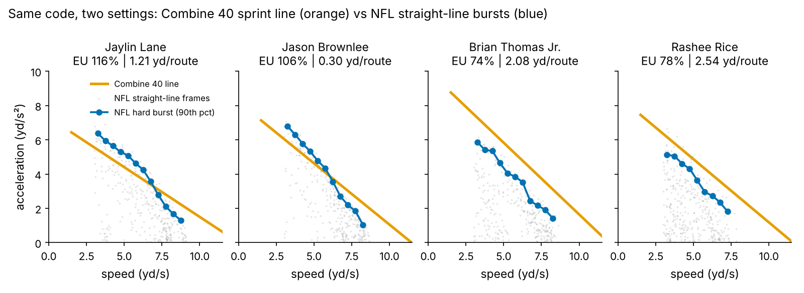
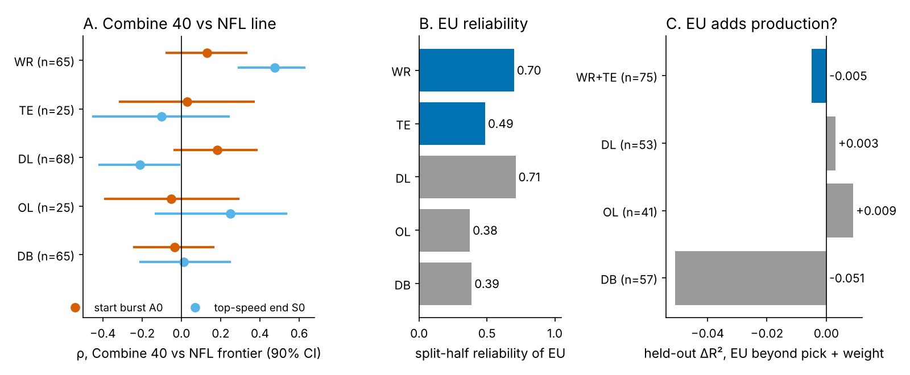
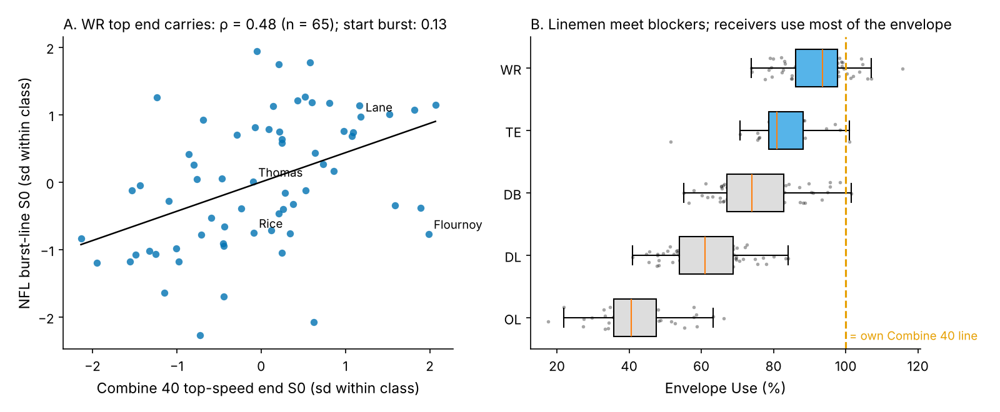
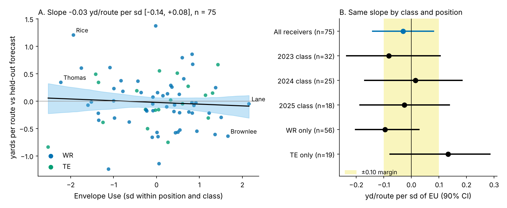

# Receivers Bring Their 40 to Sundays; How Much They Use Doesn't Predict Yards

**Envelope Use (EU)** is how hard a receiver speeds up on NFL snaps, as a share of what his own Combine 40 says he can do at the same speed. The same code grades both the Combine and the NFL tracking.

**EU is readable from 20 random snaps (reliability 0.70), and the top end of the 40 shows up in games (ρ = 0.48). But on 75 receivers from draft classes the model never saw, one sd of EU is worth −0.03 yards per route (90% interval −0.14 to +0.08). A benefit of +0.10 (50 yards a season) is ruled out. Do not mark a receiver down because he "plays slower than his 40."**

## Why this question, why receivers

Every spring a scout writes some version of "fast in shorts, plays slower" or "plays faster than he times." Both claims compare a Combine movement with a game movement, but until 2023 nobody could measure the same movement in both places. Now the Combine 40 and every regular-season snap are tracked at 10 Hz. We ask three questions. Does the drill profile show up in games? Can we read each player's translation from a small sample? Does translation explain production beyond draft slot?

We screened all five position groups (Figure 2). Receivers give the clearest test. A receiver's release and stem are straight-line bursts with nobody on his body, so the 40 and his NFL burst are the same movement. Linemen meet a blocker inside a second: they use 61% (DL) and 41% (OL) of their Combine envelope against 94% for wide receivers. Their game curves measure the contact, not the sprinter.

## The metric

**Combine side.** On each 40 attempt we regress acceleration on speed, from 1.5 yd/s to top speed. The result is a straight line, the standard sprint acceleration–speed profile. Its intercept *A0* is the start burst and its speed-axis end *S0* is the top-speed ceiling (median 7.7 yd/s² and 11.2 yd/s). The fit starts at 1.5 yd/s, so the clip's ~0.3 s lead before the laser does not enter it. The start burst is still noisy rep to rep (0.52 between a player's two runs; top end 0.91). Each player's line is therefore shrunk toward his position-class mean by its reliability, so one wild rep cannot set his envelope.

**NFL side.** We use random sampled pass plays only, never the top-EPA half, which is selected on outcomes. We keep frames after the snap where the player runs straight (under 20° of turn in 0.4 s) and is speeding up. In each 0.5 yd/s speed band from 3 yd/s we take his 90th-percentile acceleration: his hard burst at that speed. Across 91 receivers that is 31,511 frames, a median of 20 snaps each.

**EU** is the median, across speed bands, of NFL hard burst ÷ Combine line. 100% means he accelerates in games exactly as his 40 says he can. Receivers run from 79% (10th percentile) to 100% (90th). It is self-referenced, which the tracking requires: there is no ball and no defender in the game frames.

**Outcome and baseline.** The outcome is career yards per route run (YPRR) for 75 receivers with 100+ routes (56 WR, 19 TE; median 351 routes). The baseline without tracking uses log draft pick, official 40 time, weight, NGS athleticism score and a TE flag. Every model is fit on two draft classes and scored on the third. Intervals come from a class-stratified bootstrap that refits every fold.

## The decision table

| Question (n) | Result [90% interval] | Verdict |
|---|---|---|
| Does the 40 profile show up in NFL bursts? (65 WR) | top end S0: ρ 0.48 [0.29, 0.63], noise ceiling 0.68; start burst A0: 0.13 [−0.07, 0.33], ceiling 0.37 | **Top end yes; start burst unproven** |
| Can EU be read from ~20 random snaps? (WR) | split-half reliability 0.70 | **Yes** |
| Does EU add yards per route beyond the baseline? (75, unseen classes) | −0.03 yd/route per sd [−0.14, +0.08]; ΔR² −0.002 [−0.175, 0.076] | **No** |
| Does higher EU break ties between similar forecasts? (362 pairs, 73 receivers) | higher-EU receiver better 45% [37, 53]; −36 yd a season [−86, +17] | **No** |
| Does EU add production for DL, OL or DB? | held-out ΔR² +0.003, +0.009, −0.051 | **No** |

*Table 1. Effective n is the number of receivers, not pairs; tie intervals resample receivers.*

## Finding 1: the 40's top end carries, its start does not

For wide receivers, the speed where a player's 40 acceleration runs out ranks the same quantity in his NFL bursts at ρ = 0.48 [0.29, 0.63]. Given the noise on both sides, the most we could observe is 0.68, so after correcting for noise the link is about 0.7. The start burst is weaker: 0.13 [−0.07, 0.33] against a ceiling of 0.37. Half of a single 40 rep's start is noise, and only a quarter of the NFL start is signal in 20 snaps (0.27). No other group shows a positive link with an interval clear of zero. DL top end is negative (−0.21 [−0.41, −0.01]): heavier, faster linemen reach a blocker sooner.

**So what:** the 40's top end is real game speed. Clubs already pay for it through the official time. The tracked start (or the tracked 10-yard split) is not worth a separate price.

## Finding 2: Envelope Use is reliable, and it does not predict yards

EU is a stable trait. Two random halves of the same receiver's snaps agree at 0.70 for WR and 0.49 for TE. It is not just route mix: among WRs it barely tracks the share of vertical routes (ρ 0.13; median 40% of sampled routes) or slot alignment (−0.01). It runs against his Combine start (−0.33): receivers with the biggest 40 burst rarely reproduce it on a route.

It does not predict production. The baseline itself is weak: held-out R² 0.06 [−0.44, 0.17], no better than pick and the TE flag alone (0.06). These are the public audits' findings again. Adding EU leaves R² at 0.06. The held-out slope is −0.03 yards per route per sd [−0.14, +0.08], with a within-class shuffle p of 0.58. That holds in every class: 2023 −0.08 (n 32), 2024 0.01 (25), 2025 −0.03 (18). The Combine line alone (ΔR² −0.033) and the NFL burst line alone (−0.091) add nothing either.

**How sure is "no"?** Before the production test we set a margin of ±0.10 yards per route per sd, about 50 yards over a 500-route season. A benefit that size is ruled out: one-sided p 0.025, and 2% of bootstrap refits exceed it. A null of the same size is not proven. The lower end of the interval (−0.14) passes the margin, so the equivalence test fails (TOST p 0.15; 82% of refits fall inside). Among wide receivers alone the lean is negative (−0.10 [−0.20, 0.03]). If anything, using more of the envelope goes with fewer yards, not more.

## Finding 3: the names say the same thing

| Receiver (class, pick) | Combine 40 | EU | NFL yd/route | Forecast (no tracking) | Gap |
|---|---|---|---|---|---|
| Jaylin Lane (WR, 2025, #128) | 4.34 | 116% | 1.21 | 1.26 | −0.05 |
| Jason Brownlee (WR, 2023, UDFA) | 4.59 | 106% | 0.30 | 0.94 | −0.64 |
| Ronnie Bell (WR, 2023, #253) | 4.54 | 105% | 0.74 | 1.04 | −0.30 |
| Demario Douglas (WR, 2023, #210) | 4.44 | 79% | 1.68 | 1.08 | 0.60 |
| Rashee Rice (WR, 2023, #55) | 4.51 | 78% | 2.54 | 1.34 | 1.20 |
| Brian Thomas Jr. (WR, 2024, #23) | 4.33 | 74% | 2.08 | 1.74 | 0.34 |

*Table 2. Highest and lowest EU among receivers with 150+ NFL routes. Forecast = held-out no-tracking baseline. EU from a median of 20 random snaps.*

The three receivers who use the most of their Combine envelope all fall short of their forecast. The three who use the least all beat it, two of them by more than half a yard per route. That pattern is the scout's "plays slower than his 40" in reverse. It is six players chosen at the extremes, so it is an illustration, not evidence: the middle third of EU did worst (−0.12 yd/route against forecast; bottom third +0.03, top +0.01). One reading is that good route runners do not redline: Rice and Thomas Jr. get open by controlling speed into the break. That is a film hypothesis we did not test.

## What a club should do

1. **Scouting reports: drop "plays slower than his 40" as a downgrade.** On these data the receivers who looked slowest relative to their Combine were among the most productive. An EU-based fade would have cost yards, not saved them.
2. **Do not use EU as a tiebreaker.** Between same-class receivers whose no-tracking forecasts are within 0.15 yards per route, the higher-EU player was better only 45% of the time [37, 53]. That is −36 yards a season per call [−86, +17]. The typical gap between two tied receivers is 202 yards, so a wrong rule is expensive.
3. **Price the 40's top end, not its start.** The top end carries into games; the tracked start is noise-limited on both sides. The official 40 time already holds the useful part.
4. **Keep EU as a descriptor.** It is cheap, reliable from 20 snaps and needs no ball or opponent data. That makes it a usable monitor of how hard a player is moving (for example, after a soft-tissue injury). That use is untested here.

## Limitations

- **Small samples.** There are 75 receivers in the production test and 18–32 per held-out class. The intervals are wide, and the baseline R² interval reaches −0.44. Three classes are not many folds.
- **Concurrent, not predictive.** EU and yards per route come from the same 2023–2025 seasons. The random snaps are a small fraction of each receiver's routes, but this is not a forecast of next season.
- **Twenty snaps, no context.** With no ball or defenders in the frames, we cannot tell a receiver throttling down by design (a timing route) from one who cannot reach top gear. The straight-line filter keeps comparable frames but does not separate intent.
- **Outcome.** Yards per route depends on quarterback, scheme and target share. Survivorship matters too: only receivers with 100+ routes enter.
- **Combine line noise.** A single 40's start burst repeats at only 0.52. Shrinkage limits extreme envelopes but cannot recover the missing signal.
- **Selection.** We screened five groups and chose receivers for reliability and translation, not production. All five production tests are null. The ±0.10 margin is our judgement of a meaningful effect, and equivalence at that margin is not shown.

**Reproducibility.** `analysis.py` reads `data/processed/` only and runs in under 30 seconds. It rebuilds every number in this text (`numbers.json`), all four figures, `board.csv` (every receiver's EU, forecast and gap) and `inputs.csv` (the model inputs per receiver).
