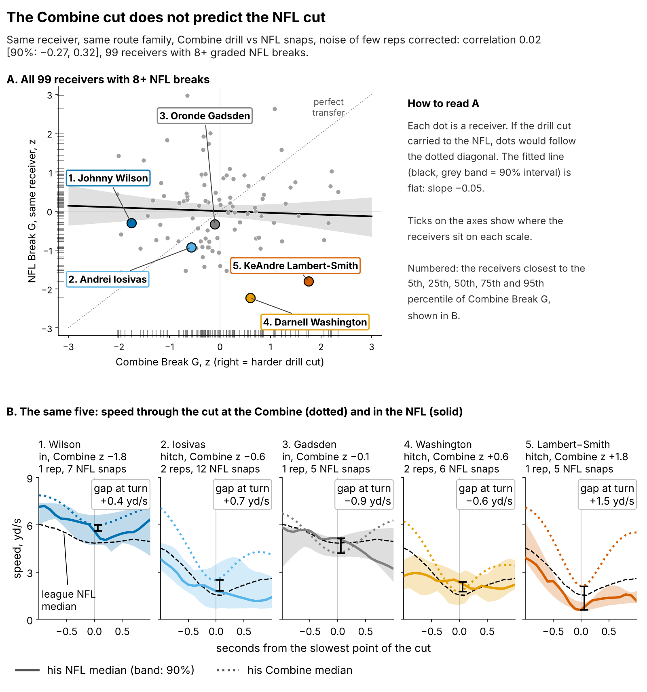
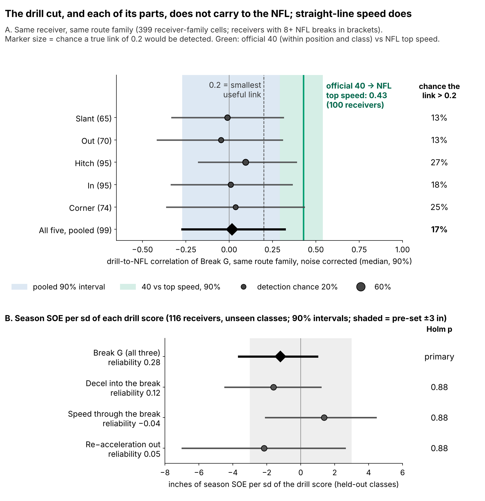
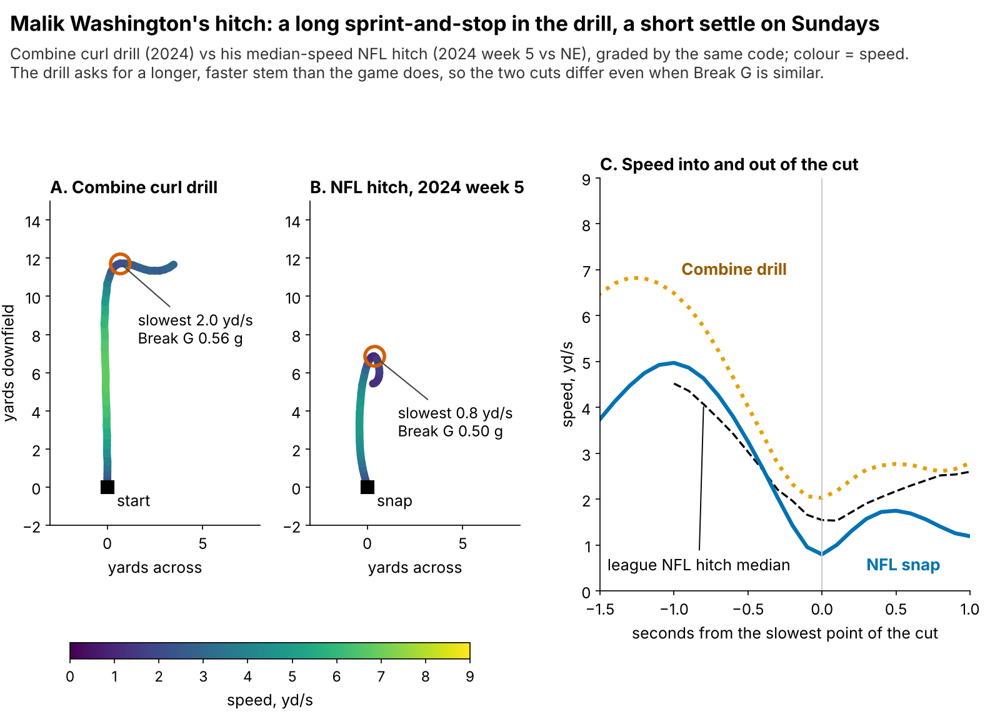
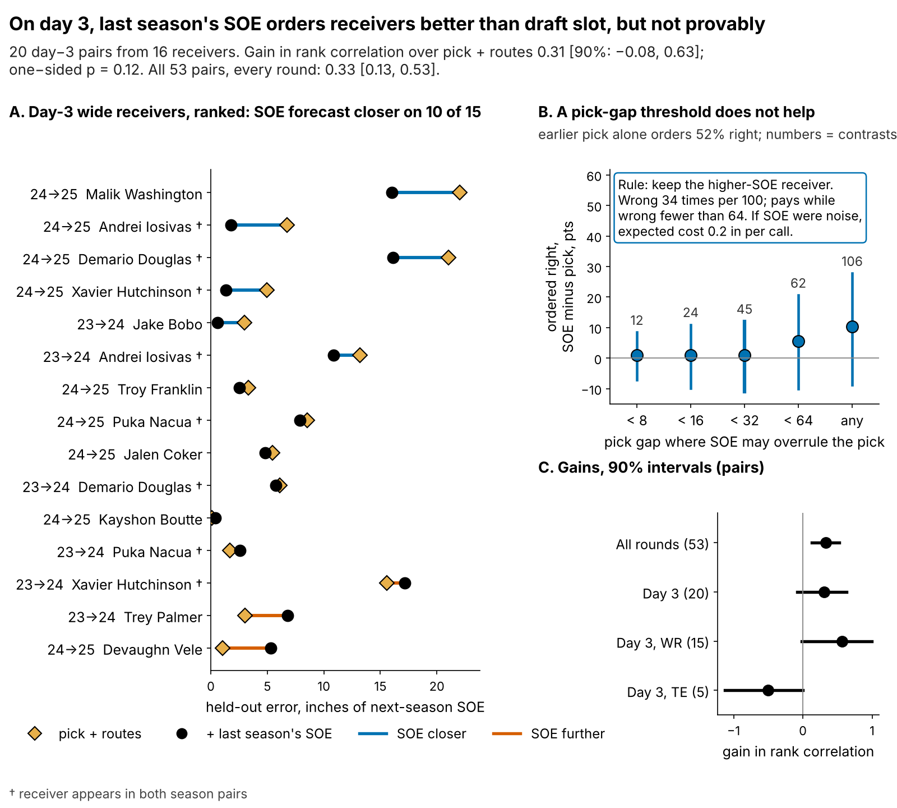
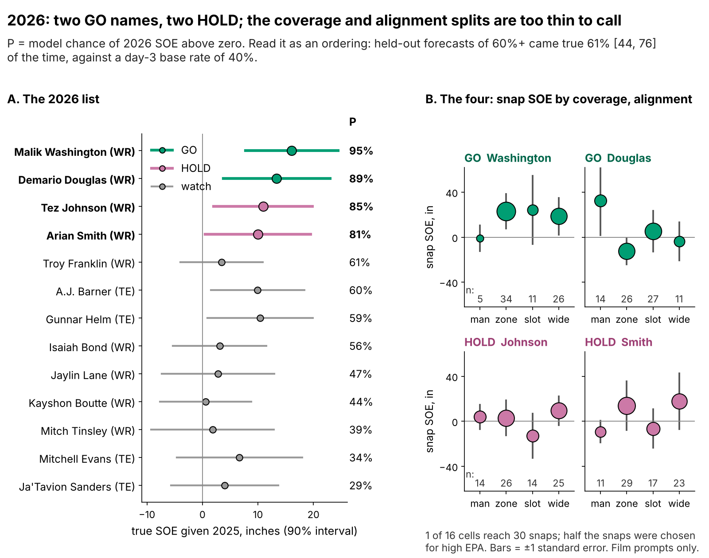

# Combine Cuts Show Little Sign of Carrying to NFL Separation

*Break G* grades a receiver's route cut from 10 Hz tracking. *Separation over expected (SOE)* is how open he is when the ball is thrown, beyond what his alignment and cushion predict (Next Gen Stats, full season), in inches.

**Receivers who cut hardest in Combine route drills are not more open in the NFL: about 1 inch less per sd of Break G, with a 90% range from 4 inches less to 1 inch more. For the last roster spot, keep the day-3 receiver with better last-season separation; the evidence is suggestive, not proven.**

## What Break G measures

Acceleration is force divided by body mass, so a receiver's acceleration in g is the horizontal push he puts into the turf as a share of his body weight. Break G averages that push over the one second centred on the sharpest point of his first route break: braking into the cut, turning, and driving out, in one number. A typical drill cut runs at 0.57 g, a push of about 57% of body weight held for a second. One sd between receivers is 0.021 g, about 4% of a typical cut, and it is a real trait: Break G on five drills predicts the other five at ρ = 0.28 (145 players), and it is not a speed score (ρ with the 40: −0.01). The same code grades NFL slants, outs, hitches, ins and corners.

## Why receivers, why now

Every summer the last receiver spot goes to a day-3 or undrafted player. In 2025 those who ran 100+ routes earned a median $1.08M, close to the league minimum. Both candidates cost the same; a wrong call costs the production a better receiver never gets.

A scout sees a median of 7 graded route-drill cuts per receiver, and 91% of drill-receiver cells hold one rep. In the NFL, one 200-route season of SOE is about 60% signal: if two receivers differ by 10 inches this year, expect about 60% of that gap to persist next year. Straight-line speed is the benchmark: the official 40 ranks NFL top speed at ρ = 0.43 [0.29, 0.54] within position and class (100 receivers). Does the cut carry the same way?

## The roster decision

| Question (n) | Held-out result [90% interval] | Verdict |
|---|---|---|
| Does Break G add season SOE beyond pick, 40, weight and NGS score? (116 receivers, unseen classes) | −1.2 in per sd [−3.6, +1.0] | **No benefit; harm not ruled out** |
| Does the drill cut carry to the same NFL route? (99 receivers) | correlation 0.02 [−0.27, 0.32], noise corrected | **No visible transfer** |
| Does last season's SOE rank day-3 receivers better than pick and routes? (20 pairs, 16 receivers) | gain in rank correlation 0.31 [−0.08, 0.63], one-sided p = 0.12 | **Lean** |

## What to do

1. **Take Break G out of the price.** At the same position, clubs draft a receiver 1 sd harder in the cut 9% earlier [2, 17] and get no separation for it.
2. **Change the drill before timing it.** Combine stems are run faster than NFL cuts are entered: 6.9 vs 4.7 yd/s into the hitch, 6.9 vs 5.4 into the out, 8.0 vs 6.2 into the in. Cap the stem at game entry speed (a shorter, timed stem) and run slant, dagger and comeback twice: a second rep lifts reliability from 0.53 to 0.62.
3. **Tiebreak only: between two day-3 wide receivers the staff rate as even, keep the one with higher last-season SOE.** SOE orders 62% of 106 same-season day-3 contrasts right. Where it disagrees with the earlier pick (35 contrasts), it gained 17.2 inches of next-season SOE when right and lost 9.9 when wrong, so it pays while wrong on fewer than 64 of 100 such calls; it was wrong on 34. If SOE were pure noise, the expected cost is 0.2 inches per call (0.03 catches a season), because the draft slot it replaces orders day-3 receivers right only 52% of the time. Not for tight ends: 5 pairs, gain −0.50.
4. **2026: GO on Malik Washington and Demario Douglas.** Review each at 150 routes (Figure 5) and decide before the March 2027 league year.

## The drill cut does not show up in NFL routes

After correcting for the noise of few reps and few snaps, the drill-to-NFL correlation for the same receiver on the same route is 0.02, and a useful link (above 0.2) has a 17% chance. Splitting Break G into its three mechanics does not find a hidden carrier (Figure 2B): decel into the break −1.6 in per sd [−4.5, +1.2], speed through it +1.4 [−2.1, +4.4], re-acceleration −2.2 [−7.0, +2.6]; the smallest Holm-adjusted p is 0.88. The parts are noisier than the whole (split-half reliability 0.12, −0.04 and 0.05).

We also tried the NFL-style reading of the drill: speed carried through the turn on slants and outs, where NFL cuts are taken at speed. Drill speed at the turn does not predict NFL speed at the turn (ρ = −0.06 [−0.27, 0.14], 68 receivers).

Figure 3 shows why. Washington's curl drill is a long sprint (entry 6.5 yd/s) into a stop; his typical NFL hitch is a shorter stem (entry 5.0 yd/s) that settles to 0.8 yd/s. The Break G values are close (0.56 and 0.50 g), but the two cuts ask different things of the legs.

**The null in names.** The eight hardest and eight softest drill cutters with 200+ career routes and 5+ graded NFL breaks (64 eligible). Turn speed is the median of his NFL breaks minus the league median for the same route.

| Receiver (class, pick) | Drill Break G, z | NFL turn speed vs league, yd/s (breaks) | Career SOE, in (routes) |
|---|---|---|---|
| ***Hardest eight*** | | | |
| Kayshon Boutte (2023, 187) | +1.8 | +0.6 (16) | +0.5 (873) |
| Adonai Mitchell (2024, 52) | +1.7 | +0.5 (23) | −0.6 (486) |
| Arian Smith (2025, 110) | +1.7 | 0.0 (12) | +15.8 (231) |
| Tre Tucker (2023, 100) | +1.7 | −0.4 (13) | +0.5 (1388) |
| Puka Nacua (2023, 177) | +1.6 | 0.0 (25) | −5.8 (1287) |
| Trey Palmer (2023, 191) | +1.3 | +0.1 (12) | +3.3 (601) |
| Ricky Pearsall (2024, 31) | +1.2 | −0.5 (27) | −0.1 (560) |
| Pat Bryant (2025, 74) | +1.1 | −0.2 (14) | −5.6 (282) |
| ***Softest eight*** | | | |
| Jayden Higgins (2025, 34) | −0.7 | 0.0 (19) | −1.9 (349) |
| Dont'e Thornton (2025, 108) | −0.7 | −0.1 (15) | −7.4 (228) |
| Cedric Tillman (2023, 74) | −0.7 | −0.7 (17) | −7.6 (904) |
| Xavier Legette (2024, 32) | −0.8 | +0.1 (15) | −8.6 (785) |
| Jalin Hyatt (2023, 73) | −0.9 | −0.1 (18) | +2.6 (679) |
| Tucker Kraft, TE (2023, 78) | −1.0 | −0.5 (17) | +9.1 (853) |
| Isaiah Bond (2025, UDFA) | −1.3 | +0.5 (10) | +4.3 (333) |
| Jake Bobo (2023, UDFA) | −1.4 | +0.2 (25) | −0.8 (306) |

The hardest eight average −0.5 inches of career SOE, the softest eight −1.2; their NFL turn speed is the same (0.0 and 0.0 yd/s against the league).

## Break G adds nothing to season separation

The outcome is full-season SOE, route-weighted over each career (213 player-seasons, median 231 routes). The forecast without tracking was fixed before the test: log pick, official 40, weight, NGS athleticism score and a TE flag. Fitted on two classes and scored on the third, it is weak: held-out R² 0.00 [−0.51, 0.14], error 8.6 inches. Adding Break G changes R² by 0.013 [−0.157, 0.085].

How small an effect can these data rule out? Benefits above +1.0 inch per sd and harms beyond −3.6 inches are each excluded at the 5% level; equivalence inside the pre-set ±3 inch margin (0.44 catches a season) is not shown, so the result is "no benefit", not "no effect". The minimum detectable effect at 80% power is 3.5 inches (0.5 catches). Rebuilding the drill score's shrinkage inside every resample, so the uncertainty in its reliability (0.09 to 0.24 per drill) reaches the slope, gives −1.2 [−3.9, +1.0].

## Day 3: last season beats the draft slot, narrowly

The gain is how much adding last season's SOE improves the held-out forecast's rank correlation with next-season SOE; models are fitted on one season pair and scored on the other. The interval resamples receivers; the p shuffles whole receivers' last-season SOE.

Two checks on the split. Training on a random half of receivers and scoring the other half's day-3 pairs, 1000 times, the gain has median 0.29 (5th–95th percentile −0.18 to 0.73) and is positive in 85% of splits. 6 of the 20 pairs include a season of 13 or fewer games; without them the gain is 0.44 (14 pairs). Inside day 3 the earlier pick is close to a coin flip (52% of 106 contrasts ordered right), and limiting SOE to small pick gaps does not help (Figure 4B).

## The 2026 calls

Pool: day-3 or undrafted receivers with 100+ routes and SOE above zero in 2025. **GO** = listed again after an earlier hit; **HOLD** = first listing. True SOE = 2025 SOE shrunk for routes, with its 90% interval.

| Receiver (class, round-pick; 2025 team) | Call | True SOE, in [90%] | What flips it (at 150 routes in 2026) |
|---|---|---|---|
| **Malik Washington**, WR (2024, R6-184; MIA) | **GO** | +16.1 [+7.7, +24.4] | SOE below 0 → HOLD |
| **Demario Douglas**, WR (2023, R6-210; NE) | **GO** | +13.4 [+3.7, +23.0] | SOE below 0 → HOLD |
| Tez Johnson, WR (2025, R7-235; TB) | **HOLD** | +10.9 [+2.0, +19.8] | SOE above 0 → GO |
| Arian Smith, WR (2025, R4-110; NYJ) | **HOLD** | +10.0 [+0.5, +19.5] | SOE above 0 → GO |

Arian Smith is also one of the hardest drill cutters above; his case rests on SOE, not on the cut. The coverage and alignment splits in Figure 5B come from up to 40 sampled snaps per player and only 1 of 16 cells reaches 30 snaps, so they direct film study, not the call.

## Limitations

- **Not blind, small day-3 sample.** All three classes were seen while building this; the day-3 test has 20 pairs and p = 0.12. Dropping any one pair leaves the gain between 0.19 and 0.37.
- **The harm side is open.** The Break G interval reaches −3.6 inches per sd; only a benefit is ruled out.
- **Game tracking is a sample.** Up to 40 plays per player, half chosen for high EPA, without defenders or ball. That limits Figure 3, the splits and the drill-to-NFL link, not the season tests.
- **The 40.** The tracked 40 clip starts before the laser, so every speed number uses the official time.
- **Survivorship.** 33 of 149 drill-scored receivers never logged NFL routes with separation; re-weighting for this changes little.
- **One snapshot of the drill.** Where receivers ran a drill twice, test-retest ICC has median 0.05 over 6 drills (59 repeat pairs).

## Appendix

**Robustness.** The Break G slope barely moves when survivors are re-weighted (−0.8), Puka Nacua is dropped (−0.5) or season SOE is adjusted for the quarterback (−1.2); the day-3 gain holds with the shrinkage refitted in each fold (0.31) but halves with draft-class folds (0.15). Every draft slot matches the nflverse record (116 receivers). 1 sd of Break G = 0.021 g; catches use 8.8 catch-rate points per yard and 60 targets.

**Reproduce.** `analysis.py` writes every number, figure and this text; `verify.py` re-checks the headline numbers in seconds.
