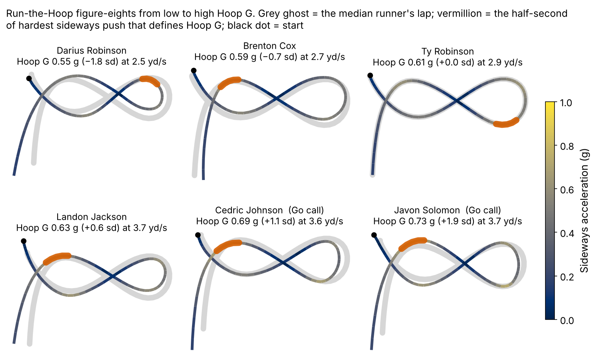
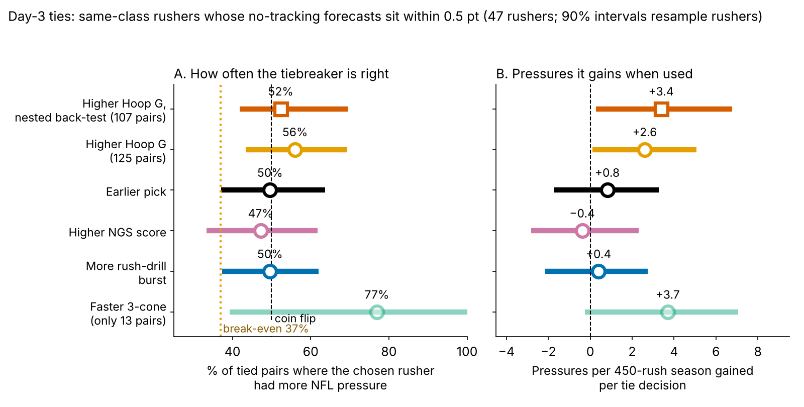
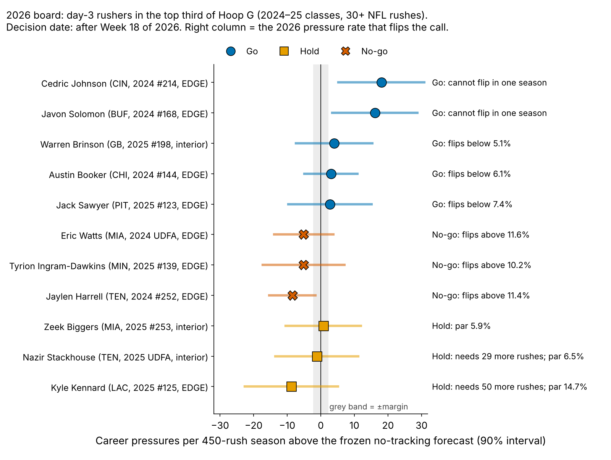

# Bend Breaks Day-3 Ties: Run-the-Hoop and NFL Pass-Rush Pressure

**Hoop G is how hard a lineman leans into the turn on the Combine's figure-eight hoop.** It is the most sideways g he holds for half a second. We scored it only on Combine classes the model never saw. There, one sd of Hoop G is worth **{{ho_hoop_season}} extra pressures per 450-rush season** [90%: {{ho_hoop_season_lo}}, {{ho_hoop_season_hi}}] beyond a forecast built without tracking (shuffle p = {{ho_hoop_p}}). That is real, but probably below our {{margin_season}}-pressure action line. Burst out of a stance in the pass-rush drill is worth {{ho_burst_season}} [{{ho_burst_season_lo}}, {{ho_burst_season_hi}}], so it is out. Use it for one job only: **breaking day-3 ties**. Go calls for 2026 from the day-3 Hoop G shortlist: {{T:go}}.

## Why pass rushers, and why these drills

On {{epa_n}} randomly sampled NFL pass plays involving these rookies, a pressured snap cost the offense {{epa_press}} more expected points than a clean one ({{epa_press_lo}} to {{epa_press_hi}}).

Of the {{n_dl}} linemen in the 2023–25 classes, {{pct_day3_dl}}% went on day 3 or undrafted, and only {{n_three_cone}} ran the 3-cone. All ran position drills under 10 Hz tracking, and two copy a rush: the pass-rush drill (get-off from a stance) and Run-the-Hoop (bend at speed).

**One margin, set before fitting:** {{margin_season}} pressures per 450-rush season per sd, which is one pressure every 200 rushes and about {{margin_epa}} expected points a season.

## The two drill metrics, and how much to trust them

- **Hoop G** (median {{hoop_g_median}} g) exists for {{n_hoop}} linemen, and {{n_hoop_no3c}} of them never ran the 3-cone.
- **Burst** is the yards covered in the first second of the pass-rush drill (median {{burst_median}} yd), for {{n_burst}} linemen.

Both are standardized within Combine year.

| Measure | Repeatability | How measured | n |
|---|---|---|---|
| Hoop G, one lap | {{rel_hoop1}} ({{rel_hoop2}} with two laps) | lap to lap | {{rel_hoop_nrep}} |
| Rush-drill burst, one rep | {{rel_burst1}} | rep to rep | {{rel_burst_nrep}} |
| NFL bend (sideways g, first 2 s) | {{rel_game_bend}} | split-half, sampled rushes | {{rel_game_n}} |
| NFL first-second burst | {{rel_game_burst}} | split-half, sampled rushes | {{rel_game_n}} |
| NGS get-off | {{rel_getoff_season}} | season to season | {{rel_getoff_n}} |
| Pressure rate (100+ rushes) | {{rel_press_season}} | season to season | {{rel_press_n}} |

*Table 1. Reliability of every measure used. {{pct_one_run}}% of hoop runners have one lap.*

The Combine half is the weak link: the NFL traits repeat well, the single drill reps do not.

## The baseline and the test

**Baseline without tracking:** draft pick (log), Combine weight, NFL EDGE share, NGS athleticism score, and the official 10-yard split and 3-cone. Missing times are filled from weight, role and NGS score inside each fold. We use the official split because the tracked 40 clip starts about 0.3 s before the laser.

**Outcome:** career pressure rate through 2025, shrunk toward the {{press_mean}}% mean by {{eb_prior_rushes}} rushes of prior, for the {{n_an}} linemen with both drills and 30+ NFL rushes.

**Out of class:** each Combine class ({{ho_n_per_class}} linemen) is forecast by a model fit on the other two. The headline estimand is the slope of the held-out miss (actual minus forecast) on the drill. Intervals resample players within class and refit every fold; p-values shuffle the drill within class.

| Model (held-out) | R² | RMSE (pts) | Rank ρ | R² gain over baseline [90%] |
|---|---|---|---|---|
{{TAB1}}

*Table 2. Leave-one-class-out fit, n = {{n_an}}.*

The baseline is weak: with {{n_an}} rushers, its extra Combine times cost more in fitting noise than they add. Hoop G improves all three held-out measures, though its R² gain includes zero.

## Finding 1: burst reaches the snap, not the pressure

After weight and role, drill burst tracks how far a lineman travels in the first second of a sampled NFL rush (partial ρ = {{tr_burst_g_d1}} [{{tr_burst_g_d1_lo}}, {{tr_burst_g_d1_hi}}], n = {{tr_burst_g_d1_n}}; ceiling {{tr_burst_g_d1_ceil}}). That NFL first second matters for pressure ({{gp_g_d1}}). But drill burst itself does not reach pressure: {{ho_burst_season}} pressures per sd out of class, with {{ho_burst_pabove}}% of bootstrap draws above the margin. An equivalence test (TOST) against ±{{margin_season}} gives p = {{ho_burst_tost}}.

## Finding 2: Hoop G adds a little, out of class

A lineman one sd higher in Hoop G beats his held-out forecast by {{ho_hoop_season}} pressures a season. {{ho_hoop_ppos}}% of bootstrap draws are positive, but only {{ho_hoop_pabove}}% clear the margin. The effect holds in 2023 and 2024 and is flat in 2025 ({{ho_hoop_2025}} points per sd). Clubs do not draft for it: top-third Hoop G linemen went at a median pick of {{pick_top_third}}, bottom-third at {{pick_bot_third}}.

Hoop G tracks NFL bend only weakly ({{tr_hoop_g_bend}} [{{tr_hoop_g_bend_lo}}, {{tr_hoop_g_bend_hi}}]), so the path from drill to sack stays hidden.

Across shrinkage, rush minimum and tie width (Table 3), the slope stays between {{sens_slope_min}} and {{sens_slope_max}} pressures per sd, and the tie gain stays between {{sens_gain_min}} and {{sens_gain_max}}.

| Setting | n | Slope (pressures/sd) | Shuffle p | Day-3 ties | Hoop G right | Gain per tie |
|---|---|---|---|---|---|---|
{{SENS}}

*Table 3. Sensitivity. Each row reruns the whole held-out pipeline.*

## The decision: a day-3 tiebreaker

**Rule (frozen, sha256 `{{T:hash}}…`):** two day-3 or undrafted rushers from the same class are tied when their no-tracking forecasts are within {{margin}} points (the action margin). In a tie, take the higher Hoop G. Otherwise, follow the forecast.

Ties are defined by forecast, not pick gap, because late-round draft order does not break them: split by pick gap (under 30, 30–80, 80+ slots; median {{tie_pick_gap_med}}), the earlier pick won {{gap_a_pick}}%, {{gap_b_pick}}% and {{gap_c_pick}}%.

| Over {{tie_pairs}} tied pairs ({{tie_players}} rushers) | Higher Hoop G | Earlier pick |
|---|---|---|
| Picked the better NFL rusher | {{tie_hoop_win}}% [{{tie_hoop_lo}}, {{tie_hoop_hi}}] | {{tie_pick_win}}% [{{tie_pick_lo}}, {{tie_pick_hi}}] |
| Error rate | {{tie_err}}% [{{tie_err_lo}}, {{tie_err_hi}}] | {{tie_pick_err}}% |
| Pressures a season: gained when right / lost when wrong | +{{tie_gain_right}} / −{{tie_cost_wrong}} | |
| Break-even hit rate | {{tie_breakeven}}% | |
| Net pressures per decision | +{{tie_hoop_gain}} [{{tie_hoop_gain_lo}}, {{tie_hoop_gain_hi}}], p = {{tie_hoop_gain_p}} | +{{tie_pick_gain}} [{{tie_pick_gain_lo}}, {{tie_pick_gain_hi}}] |
| By class 2023 / 2024 / 2025 | {{tie_hoop_2023}} / {{tie_hoop_2024}} / {{tie_hoop_2025}}% | {{tie_pick_2023}} / {{tie_pick_2024}} / {{tie_pick_2025}}% |
| Nested back-test (tie width re-chosen out of class) | {{bt_hoop_win}}% [{{bt_hoop_win_lo}}, {{bt_hoop_win_hi}}], +{{bt_hoop_gain}} | {{bt_pick_win}}% [{{bt_pick_win_lo}}, {{bt_pick_win_hi}}], +{{bt_pick_gain}} |

*Table 4. Decision arithmetic. Intervals resample rushers within class and rebuild the pairs. The p-value shuffles Hoop G across rushers within class.*

**Reading it.** Hoop G wins by margin, not frequency: a right call gains more than a wrong one costs, so even the low end of its hit rate ({{tie_hoop_lo}}%) clears the {{tie_breakeven}}% break-even. But it is not proven better than a coin (p = {{tie_hoop_p}}), and its edge over draft order is not robust: with the tie width re-chosen out of class ({{bt_widths}} points), earlier pick is right more often ({{bt_pick_win}}% vs {{bt_hoop_win}}%) and both gain +{{bt_hoop_gain}}. Without its five biggest wins, the Hoop G gain falls to +{{tie_gain_drop5}}. So: use the 3-cone first where both ran it ({{tie_cone_win}}% on {{tie_cone_n}} pairs), then Hoop G, and never let Hoop G override a forecast gap larger than the margin.

## 2026 board

For snap decisions in 2026 we take every day-3 rusher from the 2024–25 classes in the top third of Hoop G. **Go** means 100+ rushes and at least {{margin}} points above the forecast. **No-go** means at least {{margin}} below. Everyone else is **Hold**. The flip rate is the 2026 pressure rate that would put his career rate back on the forecast, at his 2025 volume. **Decision date: after Week 18 of 2026.**

- **Go:** {{T:go}}. Johnson ({{go0_pr}}% vs {{go0_fc}}% forecast over {{go0_rush}} rushes) and Solomon ({{go1_pr}}% vs {{go1_fc}}%) are so far ahead that no single 2026 season can flip them. Give both third-down snaps from wide alignments, where bend shows up. Brinson is the interior case (make him the looper on stunts) and flips below {{go2_flip}}%; Booker flips below {{go3_flip}}%, Sawyer below {{go4_flip}}%.
- **No-go:** {{T:nogo}}. Each needs a 2026 rate of at least {{nogo_flip_min}}% to reach his forecast. Hold their snaps unless film shows them flattening at the top of the arc.
- **Hold:** {{T:hold}}. Stackhouse and Kennard first need 100 rushes.
- **Auditions (under 30 rushes):** {{T:aud}}.

**What would change the rule.** The frozen test is the Hoop G slope against the frozen forecast for the 2026 class after its first season (one-sided, p < {{alpha_test}}). Its simulated power is {{pws_obs_1}}% for one class and {{pws_obs_3}}% for three. A slope at or below zero drops Hoop G as a tiebreaker. A slope above the margin justifies a second hoop lap for every lineman, which would lift reliability from {{rel_hoop1}} to {{rel_hoop2}}.

## Limitations

- **Small and noisy.** {{n_an}} rushers in the model, {{tie_players}} in the ties, single drill reps; Hoop G reliability rests on {{rel_hoop_nrep}} linemen with two laps.
- **Chosen after looking.** Hoop G was the strongest of several drill measures screened in earlier work on these same classes. Holding out classes checks the forecast, not that choice; 2026 is the first clean test.
- **Hit rate vs size.** The tie rule wins on a few large gaps, does not beat draft order once the tie width is tuned out of class, and is flat in 2025.
- **Thin NFL tracking.** A median of {{median_random_rushes}} random sampled rushes per lineman, with no blockers and no ball. NFL bend on a snap may be a result of beating the tackle, not its cause.
- **Survivorship.** Rates need 30+ rushes. Top-third day-3 rushers reached that as often as the rest of day 3 ({{reach_sl_k}} of {{reach_sl_n}} vs {{reach_rest_k}} of {{reach_rest_n}}). Injuries and roster moves are not modelled.

## Reproduce

`analysis.py` (about 4 minutes) rebuilds every number, figure and this text. `verify.py` recomputes the shrunk rates from raw counts, Table 2, the held-out slopes, the ties and the back-test from `inputs.csv` in seconds and diffs them against `numbers.json`.
