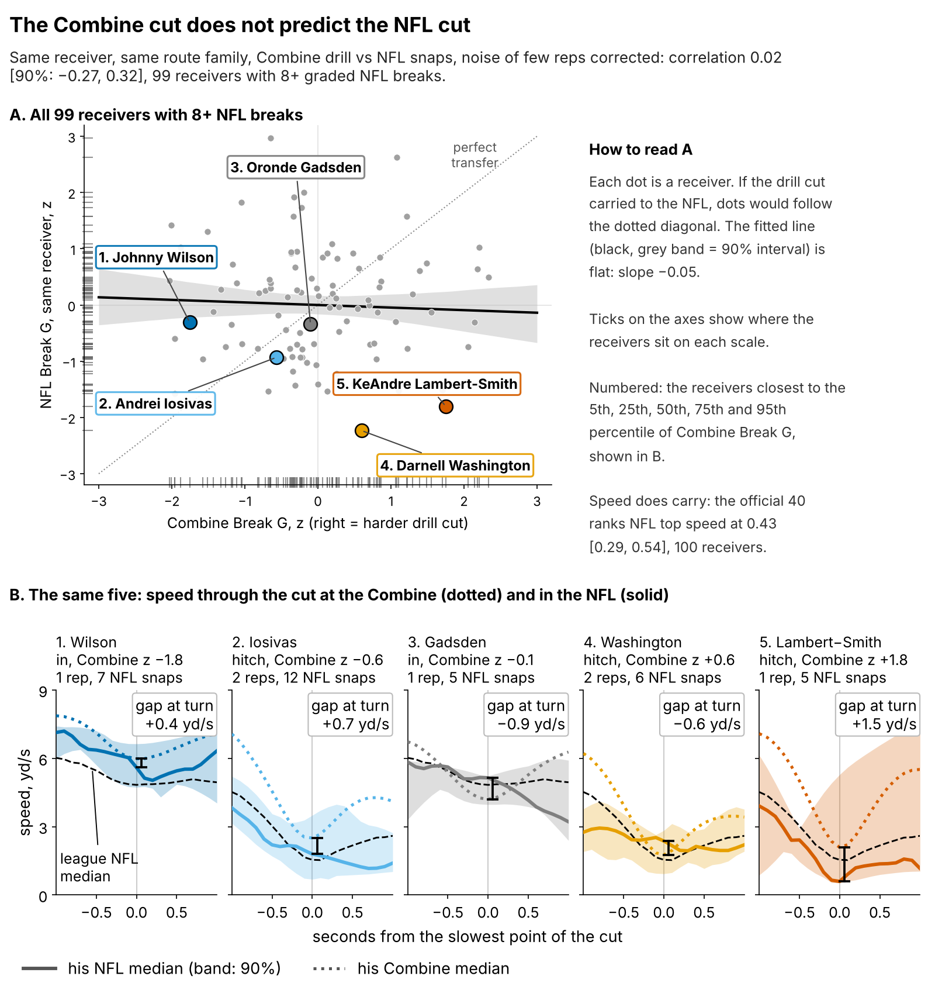
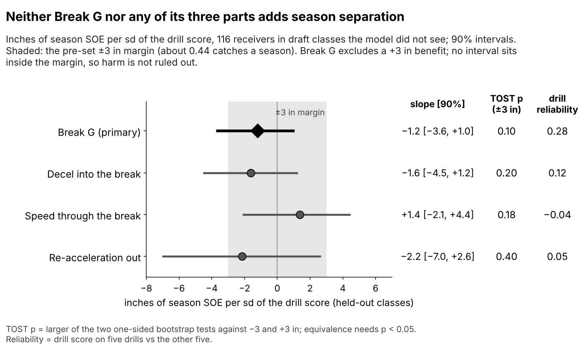
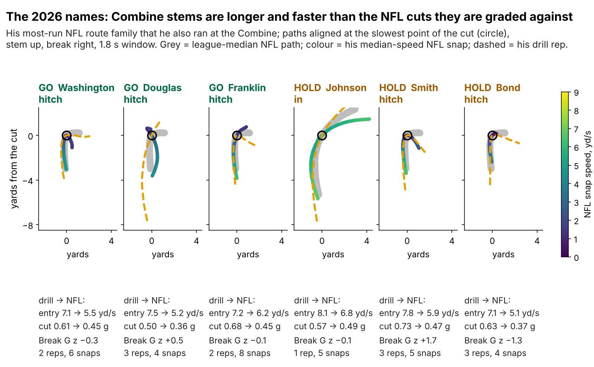
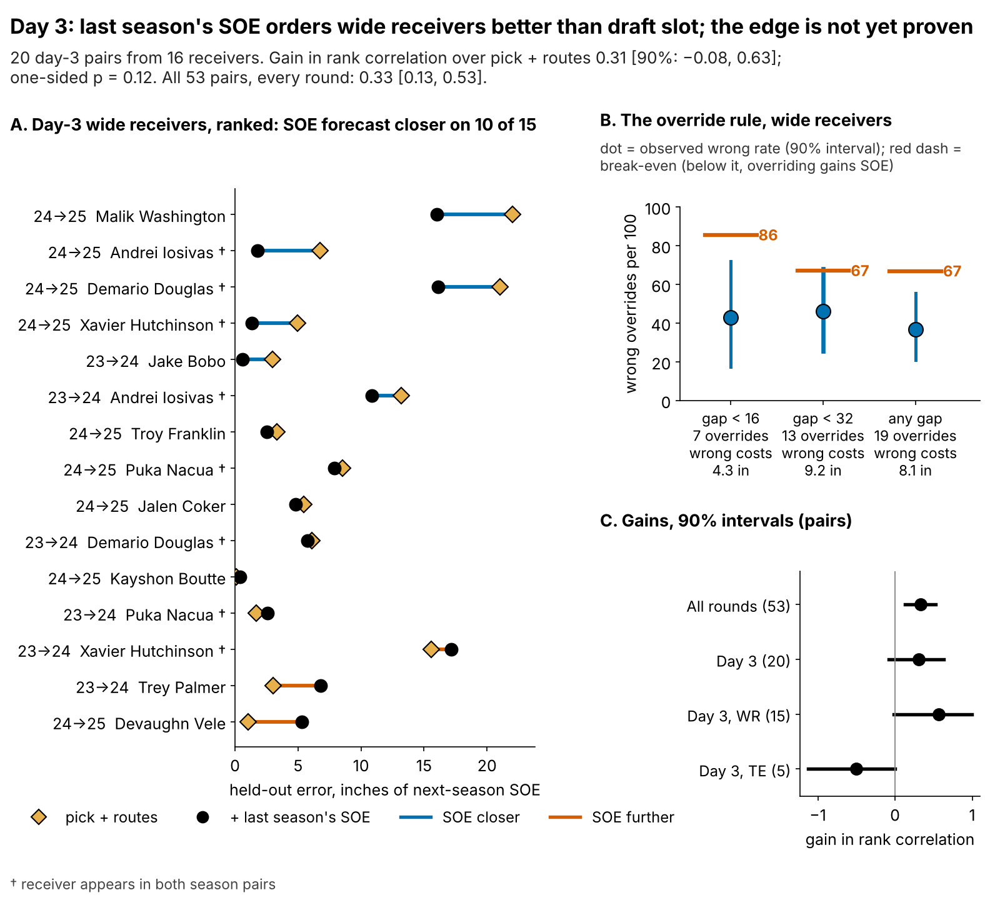
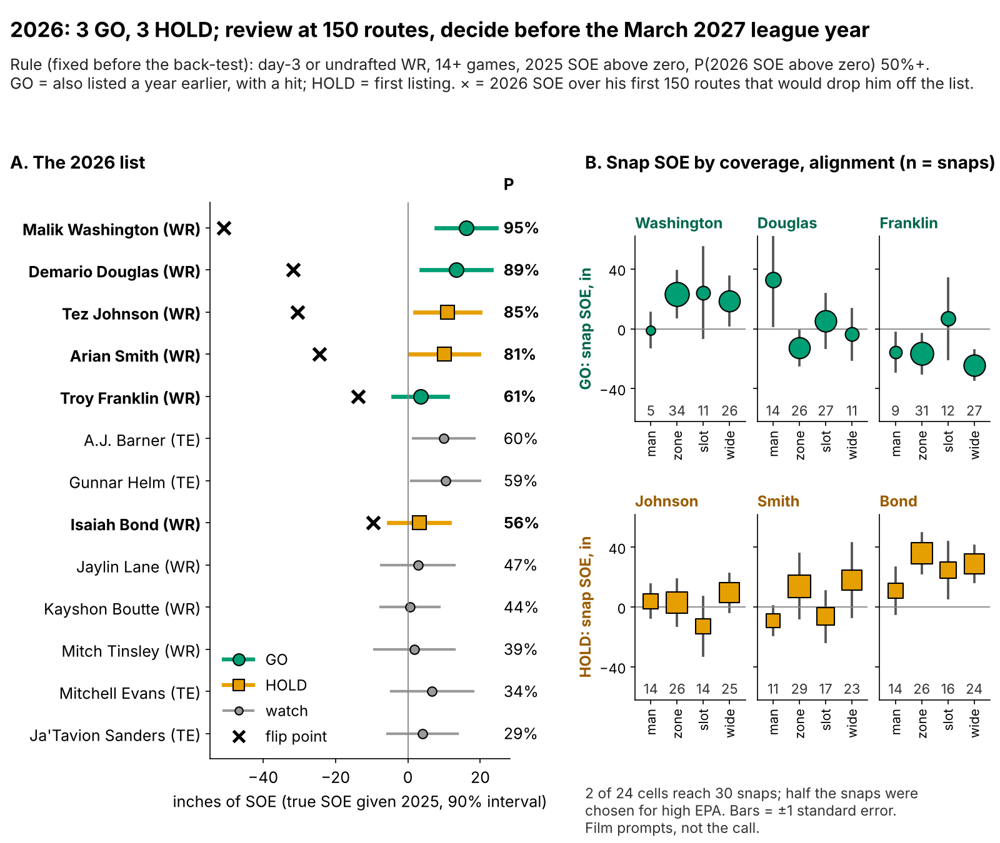

# Sharper Combine Route Cuts Don't Make NFL Receivers More Open; Use Last Season's Separation to Pick the Last Roster Spot

*Break G* grades a receiver's route cut from 10 Hz tracking. *Separation over expected (SOE)* is how open he is when the ball arrives, beyond what alignment and cushion predict (Next Gen Stats, full season), in inches.

**One sd of Combine Break G is worth {prim_b} inches of season SOE (90% interval {prim_lo} to {prim_hi}) on {n_main} receivers from draft classes the model never saw. Between day-3 receivers, letting last season's SOE overrule the draft slot gained {ovall_net} inches of next-season SOE per override ({ovall_net_lo} to {ovall_net_hi}).**

## What Break G measures

Break G is how violently a receiver brakes, turns and drives out of his sharpest route cut, as a share of body weight. It averages tracked acceleration over the second around the slowest point of the first break, so it covers decel into the break, speed through it and re-acceleration out. One sd between receivers is {g_sd} g. The same code grades NFL slants, outs, hitches, ins and corners, so drill and game cuts sit on one scale.

## Why receivers, why now

The last receiver spot goes to a day-3 or undrafted player who costs about the minimum (2025 median ${why_apy}M), so a wrong call costs production, not cap. Combine tracking now grades every route-drill cut, but a scout sees a median of {why_reps} graded cuts per receiver and {why_single}% of drill cells hold one rep. To price a player, the cut must be a stable trait that carries to Sundays. Table 1 sets it against straight-line speed.

| Measure (n) | Reliability or transfer [90%] | Reading |
|---|---|---|
| Official 40 → NFL top speed ({spdf_n} receivers) | ρ = {spdf_rho} [{spdf_lo}, {spdf_hi}] | Speed carries |
| Break G, five drills vs the other five ({rel_split_n}) | ρ = {rel_split} | A weak trait |
| Break G, same drill run twice ({iccd_pairs} pairs, {iccd_n} drills) | median ICC {iccd_med} | One rep is mostly noise |
| Route-drill battery, one rep → second rep on three drills | {rel_mm1} → {rel_mm3} | Reps help |
| Drill cut → same NFL route family ({fp_pool_n}), noise corrected | r = {fp_pool_med} [{fp_pool_lo}, {fp_pool_hi}] | **No transfer** |
| One 200-route season of SOE | {eb_sig}% signal | Last season informs |

## What to do

1. **Take Break G out of the price.** At the same position, clubs draft a receiver 1 sd harder in the cut {price_bg}% earlier [{price_bg_lo}, {price_bg_hi}] and get no separation for it.
2. **Run the drill at game speed before timing it.** Combine stems are entered faster than NFL cuts: {vin_d_hitch} vs {vin_n_hitch} yd/s into the hitch, {vin_d_out} vs {vin_n_out} into the out, {vin_d_in} vs {vin_n_in} into the in. Cap the stem at game entry speed and run slant, dagger and comeback twice.
3. **Day-3 tiebreak: between two day-3 wide receivers the staff grade even, keep the one with higher last-season SOE, whatever the pick gap.** Confidence: likely but unproven (p = {d3c_p}).
4. **Not for tight ends** ({pp_te_n} pairs, gain {te_g}).
5. **2026: GO on Malik Washington, Demario Douglas and Troy Franklin; HOLD on Tez Johnson, Arian Smith and Isaiah Bond.** Review at 150 routes; decide before the March 2027 league year.

## The drill cut does not show up in NFL routes

After correcting for few reps and few snaps, a receiver's drill and NFL cut on the same route family correlate at {fp_pool_med}; a useful link (above 0.2) has a {fp_pool_p02}% chance. Splitting Break G into its three mechanics finds no hidden carrier (Figure 2), and the NFL-style reading, speed carried through the turn on slants and outs, does not transfer either (ρ = {vs_rho} [{vs_lo}, {vs_hi}], {vs_n} receivers).

Figure 3 shows why, for the six 2026 names. The drill asks for a long, fast stem into the cut; the same NFL route is entered slower and shorter. The drill grades a different movement from the one it should predict.

**The null in names.** Wide receivers with 200+ career routes and 5+ graded NFL breaks ({ex_pool} eligible). Turn speed is his median NFL break minus the league median for the route.

{{EXTREMES}}

Across the eight hardest and eight softest drill cutters, career SOE averages {ex_top_soe} and {ex_bottom_soe} inches, and NFL turn speed is the same ({ex_top_v} and {ex_bottom_v} yd/s against the league).

## Break G adds nothing to season separation

The outcome is route-weighted career SOE ({n_seasons} player-seasons, median {routes_med} routes). The baseline without tracking was fixed before the test: log pick, official 40, weight, NGS athleticism score and a TE flag, fitted on two classes and scored on the third. It is weak (held-out R² {bl_r2}, error {bl_rmse} inches), and adding Break G changes R² by {dr2} [{dr2_lo}, {dr2_hi}].

A benefit of +3 inches per sd (about {sesoi_catch} catches a season) is excluded: the upper bound is {prim_hi}. Equivalence is not shown: the TOST against ±3 inches gives p = {tost19_p}, because the harm side reaches {prim_lo}. The reading is "no benefit", not "no effect". Across the sensitivity grid (shrinkage, the 8-break and 100-route cut-offs; {sens_rows} variants) the slope stays between {sbg_min} and {sbg_max}.

## Day 3: last season beats the draft slot, narrowly

The pre-registered test adds shrunk last-season SOE to a pick-and-routes forecast, fitted on one season pair and scored on the other. On {ev_d3_n} day-3 pairs ({ev_d3_np} receivers) it lifts the rank correlation with next-season SOE by {ev_d3_drho} [{ev_d3_drho_lo}, {ev_d3_drho_hi}]; shuffling whole receivers' SOE gives one-sided p = {d3c_p}. Across the sensitivity grid the gain runs from {sd3_min} (50+ routes) to {sd3_max}.

Table 2 turns that into the decision on {cw_n} same-season contrasts between day-3 wide receivers. An override is a contrast where last-season SOE and the earlier pick disagree; it pays while the wrong rate stays under break-even.

| Override allowed when | Overrides | Wrong per 100 [90%] | Break-even wrong per 100 | Cost of a wrong override | Net SOE per override, in [90%] |
|---|---|---|---|---|---|
| Pick gap under 16 | {ov16_n} | {ov16_wr} [{ov16_wr_lo}, {ov16_wr_hi}] | {ov16_be} | {ov16_loss} in ({ov16_lossc} catches) | {ov16_net} [{ov16_net_lo}, {ov16_net_hi}] |
| Pick gap under 32 (pre-set) | {ov32_n} | {ov32_wr} [{ov32_wr_lo}, {ov32_wr_hi}] | {ov32_be} | {ov32_loss} in ({ov32_lossc} catches) | {ov32_net} [{ov32_net_lo}, {ov32_net_hi}] |
| **Any gap (the rule)** | {ovall_n} | {ovall_wr} [{ovall_wr_lo}, {ovall_wr_hi}] | {ovall_be} | {ovall_loss} in ({ovall_lossc} catches) | {ovall_net} [{ovall_net_lo}, {ovall_net_hi}] |

A pick-gap threshold does not lower the wrong rate, so the rule has none. Inside day 3 the earlier pick orders receivers right only {tb_pick_right}% of the time; that is why overriding it costs little.

## The 2026 calls

Rule, written before the back-test: day-3 or undrafted wide receiver, 14+ games and SOE above zero in 2025, model chance of 2026 SOE above zero of 50% or more. **GO** = also listed a year earlier, with a hit; **HOLD** = first listing; a HOLD becomes GO with a 2026 hit. True SOE = 2025 SOE shrunk for routes. The drop-off point is the 2026 SOE over his first 150 routes that would pull that estimate below zero.

{{SHORTLIST}}

**What flips each name.** {{FLIPS}} Washington and Douglas would need a collapse to drop; Franklin and Bond would drop after an ordinary bad stretch. Only {sp_big_cells} of {sp_cells} coverage and alignment cells reach 30 snaps, so the splits steer film, not the call. Arian Smith is one of the hardest drill cutters; his case rests on SOE, not the cut.

**Back-test.** Applied unchanged to the 2023 and 2024 lists, with forecasts fitted on the other season, the rule's names hit (next-season SOE above zero) {bt_act_k} of {bt_act_n} times ({bt_act_pct}% [{bt_act_lo}, {bt_act_hi}]); the same number of earliest-picked day-3 receivers hit {bt_pick_k} of {bt_pick_n}. On this few names the back-test cannot separate the rule from the draft slot; the support for the calls is the pair-level test above.

## Limitations

- **Not blind, small day-3 sample.** All three classes were seen while building this; the day-3 test has {ev_d3_n} pairs, the override table {ovall_n} overrides that share receivers.
- **Harm is not ruled out.** The Break G interval reaches {prim_lo} inches per sd.
- **Game tracking is a sample.** Up to 40 plays per player, half chosen for high EPA, without defenders or ball. That limits Figure 3, the splits and the drill-to-NFL link, not the season tests, which use full-season NGS separation.
- **The 40.** The tracked clip starts before the laser, so speed numbers use the official time.
- **Survivorship.** {sel_out} of {sel_n} drill-scored receivers never logged NFL routes with separation; the back-test scores only receivers with 100+ routes the next season.
- **The protocol change is inferred** from entry-speed gaps; no drill was run at game speed.

## Appendix

`analysis.py` writes every number, figure and this text from `data/processed`; `verify.py` rebuilds season SOE from the raw NGS separation in `player_season_stats` and re-checks the headline numbers in seconds. Robustness checks and the sensitivity grid are in `robustness.csv` and `sensitivity.csv`. Catches use {cr_per_yd} catch-rate points per yard and {tg_season} targets.
