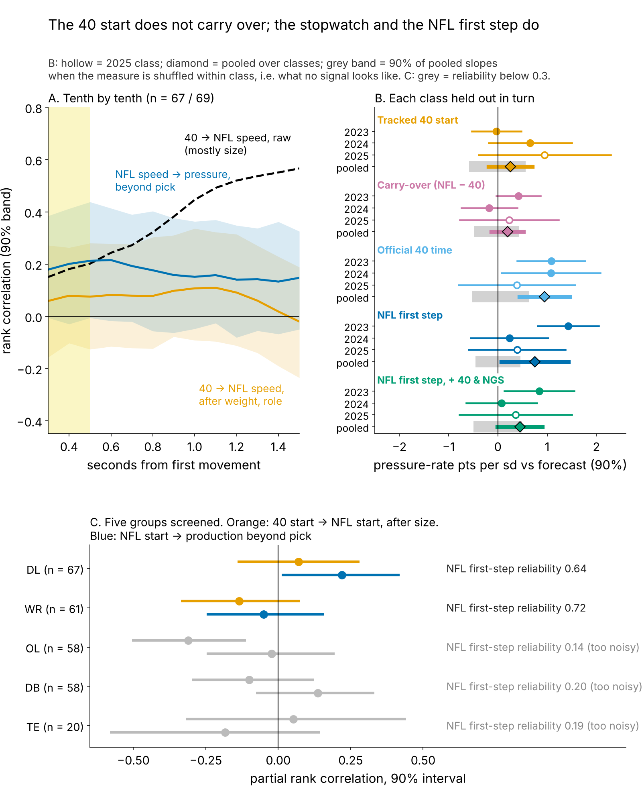
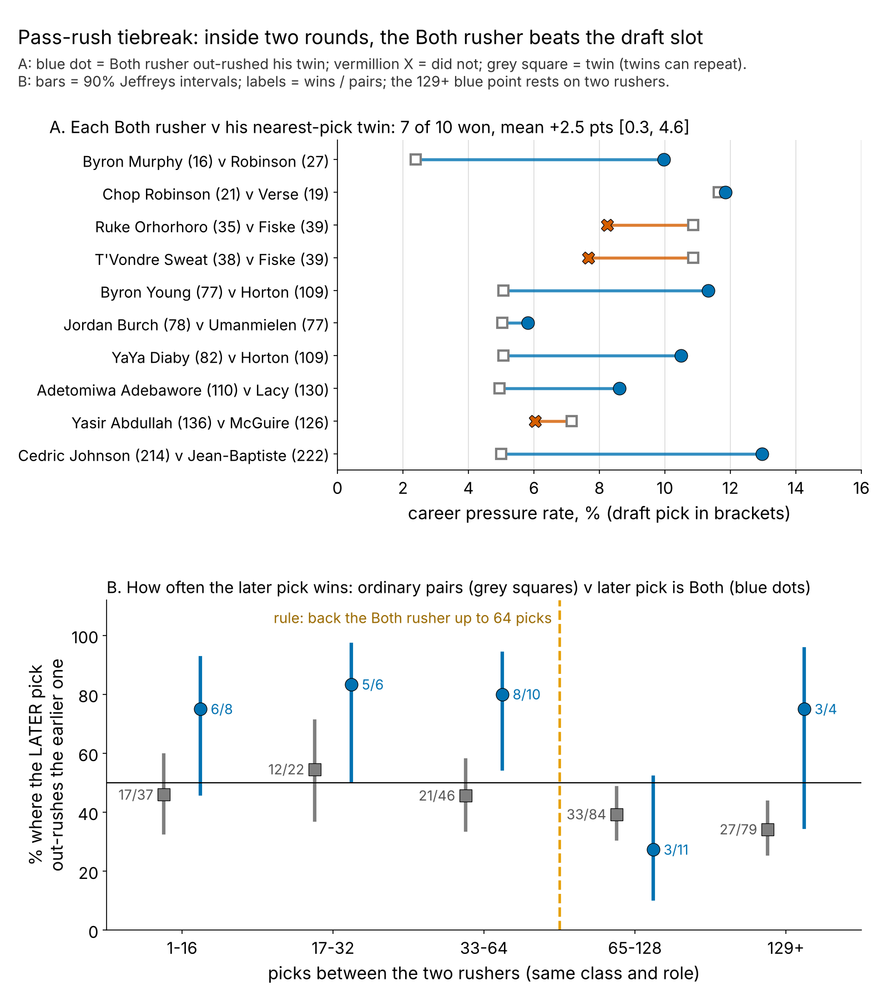

# The Combine Start Doesn't Translate; the Stopwatch Plus 20 NFL Rushes Breaks Pass-Rush Ties

**We compared each lineman's Combine 40 start with his own NFL pass-rush starts, using five per-player similarity scores plus the tracked start itself. No estimate exceeds 0.3 pressure-rate points per sd beyond draft slot, and 4 of the 6 are formally equivalent to zero within ±1.0 point. Agreement between two speed readings does carry: rushers fast on the official 40 *and* in about 20 sampled NFL starts ("Both") beat a draft-slot forecast 8 times in 10 on held-out classes. Within 64 picks, a later-drafted Both rusher out-rushed the earlier pick 19 times in 24.**

## Why pass rushers

A pass rush starts like a 40: from a stance, straight ahead, before anyone touches him. If Combine tracking translates anywhere, it is here. The other groups fail earlier (Figure 2C). Receivers' starts are readable but do not pay off, and linemen, backs and tight ends start too inconsistently to read from 20 snaps.

## What to do

1. **Tiebreak rule.** Between two rushers of the same class and role, if the later pick is Both, give him the passing-down snaps unless the other went more than 64 picks earlier. Inside that gap the rule was wrong 21% of the time [4, 36]. The draft slot was wrong in 19 of the same 24 pairs.
2. **Act on three names (Table 3).** Extend Byron Young (LAR) and YaYa Diaby (TB). Give Chop Robinson (MIA) a full passing-down role, re-scored at midseason because he missed his 2025 check.
3. **Draft room.** Pay for the stopwatch, not the trace: the official 40 time adds 0.9 points per sd beyond slot, and the tracked 40 start adds nothing.
4. **Measurement.** Chart 24+ random rushes before trusting a first step (8 rushes give reliability 0.44).

## The metric and the baseline

**First step = a lineman's speed 0.3 to 0.5 s after he first moves, in sd after weight and role.** In that window the 40 and a pass rush are the same movement. By 1.5 s they part (6.8 yd/s in the 40, 3.1 on a rush).

**Data.** Tracked Combine 40s, year-standardized, aligned at first movement (so the clip's lead before the laser does not matter). NFL: random sampled pass rushes only, alignment-adjusted, 1563 starts by 85 linemen (median 19; reliability 0.64; ρ = 0.51 with NGS get-off snap by snap). **Pool:** 69 of 118 linemen have 8+ sampled starts and 100+ rushes. Outcome: career pressures per rush.

**Baseline without tracking:** draft pick, weight and role (EDGE snap share), fitted on the other two classes, with held-out R² 0.43. Adding the official 40 and season NGS get-off gives 0.48. One unit throughout: **pressure-rate points per sd**. The DL average is about 8%, and 1 point is 2.9 pressures over a 292-rush season.

## Finding 1: translation does not explain pressure beyond pick

After weight and role, the 40 first step previews the NFL first step at ρ = 0.07 [−0.14, 0.28] (n = 67). The raw 0.57 at 1.5 s is mostly body weight. Noise is not the reason: a perfect link would still show up to 0.67. We ran every per-player translation score through the same held-out test. Each was scored against a margin of ±1.0 point per sd, about what the official 40 is worth.

| Per-player measure, one sd higher | Pressure pts per sd beyond pick [90%] | Inside ±1 pt? (TOST p) |
|---|---|---|
| Gap: NFL first step minus 40 first step | 0.3 [−0.2, 0.8] | yes (0.006) |
| Speed ratio, first step (NFL / 40) | −0.1 [−0.7, 0.5] | yes (0.007) |
| Speed ratio at 1.3-1.5 s (NFL / 40) | 0.0 [−1.0, 1.0] | not shown (0.06) |
| Curve-shape correlation, 0.3-1.5 s | 0.1 [−0.4, 0.6] | yes (0.002) |
| Curve closeness (minus mean distance) | 0.1 [−1.0, 1.3] | not shown (0.10) |
| Tracked 40 first step alone | 0.3 [−0.2, 0.7] | yes (0.006) |
| *Official 40 time (stopwatch, no tracking)* (n = 54) | *0.9 [0.4, 1.5]* | *contrast* |
| *NFL first step alone (game tracking)* (n = 69) | *0.8 [0.1, 1.4]* | *contrast* |

*Table 1. n = 52 rushers with a tracked 40 and 100+ rushes. Each class held out in turn, slopes pooled. TOST = two one-sided tests, 5%. Italic rows: the two readings that do carry over.*

4 of the 6 Combine-side measures are proven to sit inside ±1.0. The two curve-level scores are too noisy to prove it either way. The NFL first step alone has a slope (0.8). Used continuously, it does not raise held-out R² (−0.113 [−0.328, 0.025]), so it is a ranking signal to pair with the stopwatch.

## Finding 2: two signals that agree beat the forecast

**The rule.** *Both* = NFL first step in the top third and official 40 time in the top half, with each class's cut-offs set on the other two classes. A rusher "hits" if he beats the held-out forecast (base rate 35%).

| Check | Shortlist beat forecast | Everyone else | Gap, pts [90%] | Shuffle p |
|---|---|---|---|---|
| Main: pick, weight, role forecast | 8 of 10 | 16 of 59 | 53 [28, 75] | 0.009 |
| Forecast adds official 40 time, NGS get-off | 6 of 10 | 15 of 59 | 35 [8, 62] | 0.07 |
| Sampled snaps removed from the outcome | 7 of 10 | 16 of 59 | 43 [14, 71] | 0.03 |
| Day 3 and UDFA only (pick 103+) | 2 of 3 | 9 of 33 | 39 [−26, 82] | 0.22 |
| Frozen after 2024, scored on 2025 vs own past pressure | 6 of 7 | 6 of 16 | 48 [15, 75] | 0.04 |

*Table 2. Gap interval: rushers resampled within class. p: labels shuffled within class.*

**Verdict: a modest edge, unproven for day 3 (3 shortlisted).** The gap narrows in every stricter check but stays positive, and it ranges from 44 to 62 points across cut-offs and pool rules (Table 4). Row 5 is the cleanest test: called on 2023–24 starts and scored on 2025 against each rusher's own past pressure.

**Against a pick-only list, on raw pressure** (top third of his class, no model), Both landed 6 of 10 (35–81%). The same number of earliest picks also landed 6 of 10, at a median pick of 18 against 78. Both does not find more production than the top of the draft. It finds the same production about two rounds later.

## The tiebreak as a decision rule

The pool has 375 same-class, same-role pairs. Without tracking, the earlier pick out-rushes the later one 54% of the time within 64 picks and 66% beyond. When the later pick is Both (39 pairs, 9 rushers), he wins 19 of 24 within 64 picks and 6 of 15 beyond. A logistic fit puts break-even at 126 picks. A label shuffle within class, clustered by rusher, gives p = 0.02.

**Held out, the edge is smaller.** We chose the threshold on two classes (64–200 picks) and scored it on the third. The rule made 20 correct calls of 39, against 14 for "always the earlier pick": +15 points [−15, 52], an interval that includes zero. Against his nearest-pick twin, each Both rusher won 7 of 10 career pairs by 2.5 points [0.3, 4.6]. The call frozen after 2024 went 4 of 7 in 2025.

**Why it works.** Within a rusher, a snap with a first step one sd faster than his own average has 1.49 times the odds of pressure [1.25, 1.77] (1279 rushes; 1.51 with NGS get-off, down and alignment fixed). **Where rule and tape disagree:** Maason Smith (JAX, pick 48) has the pool's best NFL first step, a 48th-percentile 40, and 3.9% pressure against a 7.7% forecast. Grade his hands before cutting his snaps.

## The 2026 list, frozen

Same rule, with cut-offs from all three classes. Bold = act now (300+ rushes, 1+ point over forecast, under 25% of games missed).

| Rusher (class, pick, team) | Role | 40 / first step pct | Pressure vs forecast (rushes) | 2024 call scored on 2025 | First step over cut, sd |
|---|---|---|---|---|---|
| **Byron Young** (2023, 77, LAR) | hand-down end | 89 / 96 | 11.3% vs 8.3% (1501) | **hit** (12.8% vs 10.5%) | 1.2 |
| **YaYa Diaby** (2023, 82, TB) | hand-down end | 93 / 94 | 10.5% vs 8.0% (1420) | **hit** (11.6% vs 9.6%) | 1.2 |
| **Chop Robinson** (2024, 21, MIA) | hand-down end | 98 / 97 | 11.8% vs 10.0% (726) | **miss** (10.0% vs 12.6%) | 1.4 |
| Cedric Johnson (2024, 214, CIN) | hand-down end; availability flag | 70 / 91 | 13.0% vs 7.3% (216) | **hit** (14.0% vs 8.7%) | 1.0 |
| Adetomiwa Adebawore (2023, 110, IND) | interior; availability flag | 100 / 77 | 8.6% vs 6.8% (511) | untested (<100 rushes) | 0.2 |
| Byron Murphy (2024, 16, SEA) | interior | 81 / 86 | 10.0% vs 9.0% (682) | **hit** (10.4% vs 9.3%) | 0.5 |

*Table 3. Percentiles within the pool. Forecast = pick, weight and role, fitted on the other two classes. Last column: first-step margin over the list cut-off (the 40 time cannot change). Not shown: T'Vondre Sweat, Ruke Orhorhoro, Yasir Abdullah, Jordan Burch, Ty Robinson.*

**What flips each name.** The 40 time is fixed, so only the first step can move, and one 20-rush sample carries about 0.6 sd of noise. Robinson (1.4), Young (1.2) and Diaby (1.2) sit two noise-widths clear. Adebawore (0.2) and Abdullah (0.1) would drop on one slow sample. Murphy is 0.98 points over forecast, just short of the 1-point act-on bar. Of the 2024 calls scored on 2025, 5 hit and 1 missed.

**Pre-registration.** The rule, all 11 names and the test are hashed in `frozen_rule.json` (sha256 `e3079960bd2d…`; no 2026 data). The test: 2026 list members with 100+ rushes beat a persistence forecast more often than the other 59 (one-sided Fisher p < 0.05). Power is 90% at 2025 rates and 32% at half the gap.

## Limitations

- **Not blind until 2026.** The two-signal form and the 64-pick threshold were chosen after seeing all three classes. Only the cut-offs and the threshold check are held out, and the held-out tiebreak gain crosses zero.
- **Small, overlapping samples.** Ten Both rushers, 3 on day 3. Pairs share rushers (Yasir Abdullah carries most losses), so intervals are wide.
- **Sampled tape, no blockers or ball.** A slow start can be a two-gap assignment, and a fast one a free rush. Injuries enter only as missed games.

## Appendix

| Variation | Shortlist beat forecast | Everyone else | Gap, pts |
|---|---|---|---|
| Main (first step top third, 40 top half) | 8 of 10 | 16 of 59 | 53 |
| First step top half | 13 of 16 | 11 of 53 | 60 |
| First step top quarter | 7 of 8 | 17 of 61 | 60 |
| 40 time top third | 8 of 9 | 16 of 60 | 62 |
| 40 time: any recorded time | 11 of 16 | 13 of 53 | 44 |
| 18+ sampled starts | 6 of 8 | 11 of 48 | 52 |
| 200+ career rushes | 8 of 9 | 13 of 40 | 56 |

*Table 4. Shortlist sensitivity; each row re-derives held-out cut-offs.* Re-fits of the 0.8-point slope: rusher random intercepts 0.7 [0.2, 1.2]; weighting for reaching the pool 0.9 [0.4, 1.3]; best of 11 windows, p = 0.02.

*Reproduce: `uv run python writeup/candidates/round_19/cand_3/analysis.py` (about 3 minutes).*
