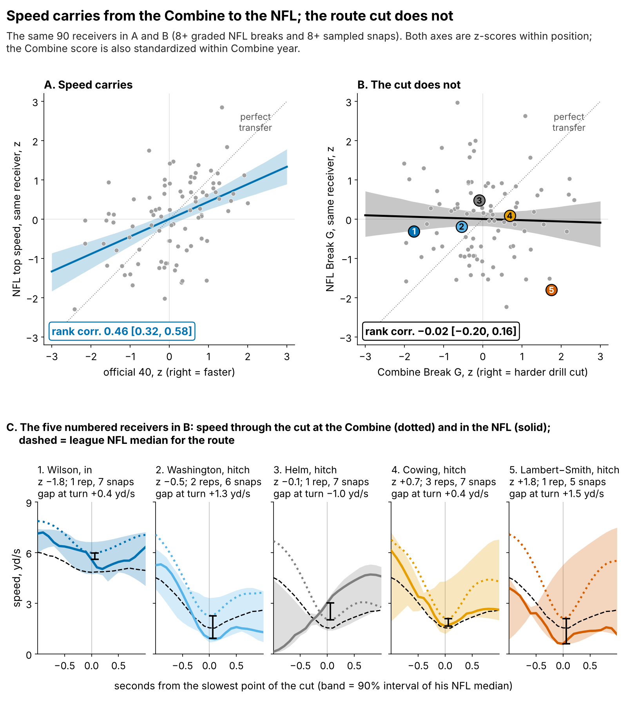
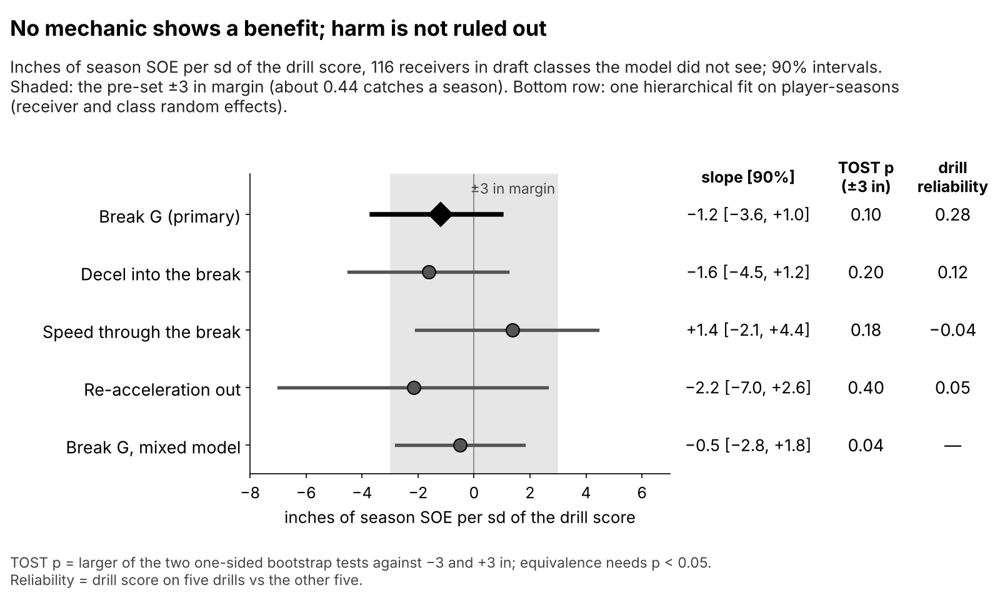
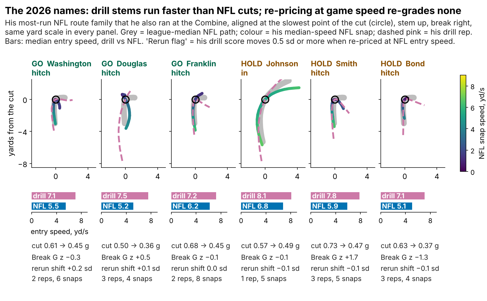
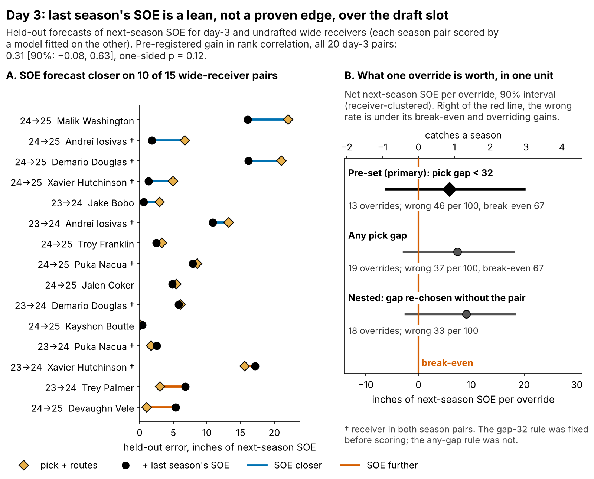
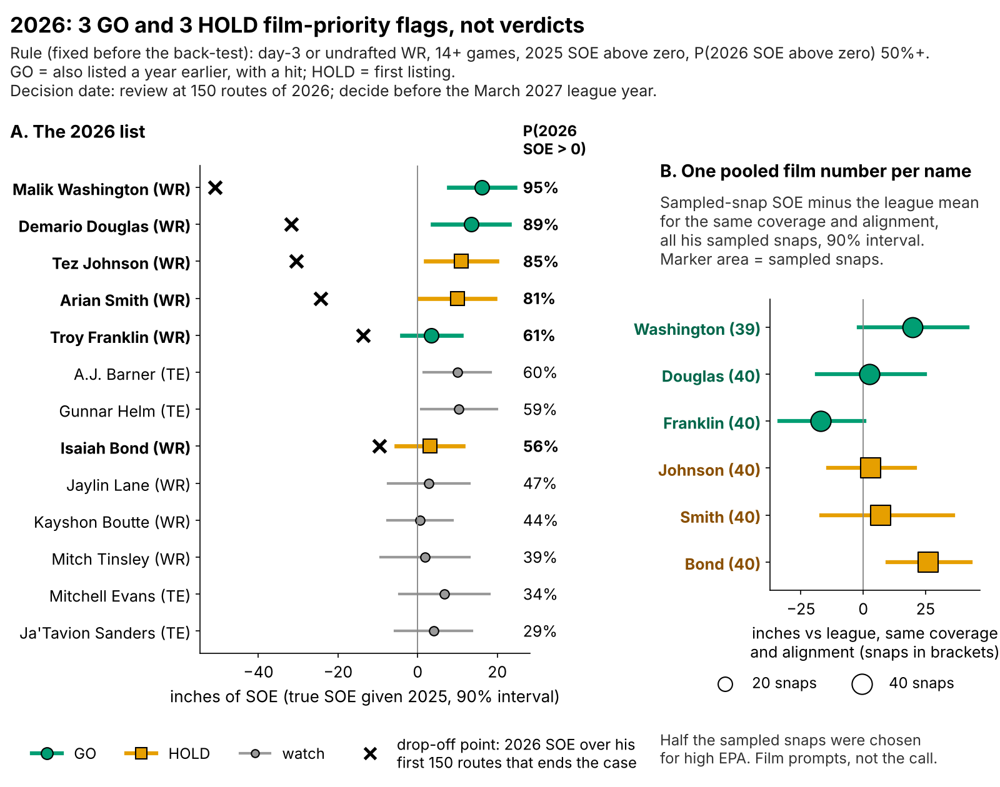

# Combine Route Cuts Don't Predict NFL Separation; Last Season's Separation Is Only a Day-3 Lean

*Break G* is how hard a receiver brakes into and drives out of his sharpest cut, as a share of body weight, measured at 10 Hz. *Separation over expected (SOE)* is how open he is when the ball arrives, beyond what alignment and cushion predict (Next Gen Stats, full season), in inches.

**A receiver who cuts one sd harder at the Combine is not more open in the NFL: −1.2 inches of season SOE (90% interval −3.6 to +1.0), 116 receivers from draft classes the model never saw.** Straight-line speed carries to Sundays; the cut does not (Figure 1).

## Why receivers, why now

The last receiver spot goes to a day-3 or undrafted player on about the minimum (2025 median $1.08M), so a wrong call costs production, not cap. A scout sees a median of 7 graded drill cuts per receiver, and 91% of drill cells hold one rep. One sd of Break G is 0.021 g; the same code grades Combine drills and NFL slants, outs, hitches, ins and corners. To price the cut, it must be stable and carry to Sundays.

| Measure | Reliability or transfer [90%] | Reading |
|---|---|---|
| Official 40 → NFL top speed, same 90 receivers | ρ = 0.46 [0.32, 0.58] | Speed carries |
| Break G, five drills vs the other five (145) | ρ = 0.28 | A weak trait |
| Break G, same drill run twice (59 pairs) | median ICC 0.05 | One rep is mostly noise |
| Combine → NFL Break G, same 90 receivers | ρ = −0.02 [−0.20, 0.16] | No transfer |

Pooling raw WR and TE times gives a speed correlation of 0.73, because tight ends run the 40 0.23 s slower and top out 1.1 yd/s slower in games; that measures position as much as speed. Within position and Combine year, the scale Break G is on, it is 0.46 (raw, wide receivers only: 0.49).

## The drill cut does not show up in NFL routes

Matching route families and correcting for few reps and few snaps does not rescue it: drill and NFL cut correlate at 0.02 [−0.27, 0.32] (99 receivers), and a useful link (above 0.2) has a 17% chance. Splitting Break G into its three mechanics finds no hidden carrier (Figure 2), and speed carried through the turn on slants and outs does not transfer either (ρ = −0.06 [−0.27, 0.14], 68 receivers).

Combine stems are entered a median 1.4 yd/s faster than the same NFL route (Figure 3). That is not why the cut fails to carry: re-pricing every rep at NFL entry speed barely reorders receivers (ρ = 0.91 with the current score), still does not predict the NFL cut (ρ = −0.05 [−0.23, 0.13]), and would re-grade none of the six 2026 names by 0.5 sd.

**The null in names.** Wide receivers with 200+ career routes and 5+ graded NFL breaks (49 eligible). Turn speed is his median NFL break minus the league median for the route.

| Wide receiver (class, pick) | Drill Break G, z | NFL turn speed vs league, yd/s (breaks) | Career SOE, in (routes) |
|---|---|---|---|
| ***Three hardest*** | | | |
| Kayshon Boutte (2023, 187) | +1.8 | +0.6 (16) | +0.5 (873) |
| Adonai Mitchell (2024, 52) | +1.7 | +0.5 (23) | −0.6 (486) |
| Arian Smith (2025, 110) | +1.7 | 0.0 (12) | +15.8 (231) |
| ***Three softest*** | | | |
| Jalin Hyatt (2023, 73) | −0.9 | −0.1 (18) | +2.6 (679) |
| Isaiah Bond (2025, UDFA) | −1.3 | +0.5 (10) | +4.3 (333) |
| Jake Bobo (2023, UDFA) | −1.4 | +0.2 (25) | −0.8 (306) |

The eight hardest and eight softest drill cutters average −0.5 and −2.3 inches of career SOE, with the same NFL turn speed (0.0 and +0.1 yd/s).

## Break G adds nothing to season separation

The outcome is route-weighted career SOE (213 player-seasons, median 231 routes). The baseline without tracking, fixed before the test, is log pick, official 40, weight, NGS athleticism score and a TE flag, fitted on two classes and scored on the third. It is weak (held-out R² 0.00, error 8.6 inches), and adding Break G changes R² by 0.013 [−0.157, 0.085].

One hierarchical model replaces the separate resampling checks: 167 player-seasons of 91 receivers, the same baseline, random effects for receiver and draft class. It gives −0.5 inches per sd [−2.8, +1.8]; class explains none of the variance. A benefit of +3 inches per sd (about 0.44 catches a season) is excluded by both fits, a harm of 3 inches only by the hierarchical one.

## Day 3: last season's SOE is a lean, not proven

The pre-registered test adds shrunk last-season SOE (60% of a 200-route season is signal) to a pick-and-routes forecast, fitted on one season pair and scored on the other. On all 20 day-3 and undrafted pairs (16 receivers) it lifts the rank correlation with next-season SOE by 0.31 [−0.08, 0.63]; a receiver-level shuffle gives one-sided p = 0.12. The smallest gain this sample could reliably detect is 0.55.

Back-test on the same pairs: each season's top half by the SOE forecast hit (next-season SOE above zero) 5 of 10 times, the top half by pick alone 5 of 10. The difference, 0 points [−33, +21], sits far below the detectable minimum of 42.

Table 2 prices the lean on 51 same-season contrasts between day-3 wide receivers. An override is a contrast where last-season SOE and the earlier pick disagree; the primary rule, fixed before scoring, allows it when the pick gap is under 32.

| Rule | Overrides | Wrong per 100 (break-even) | Net next-season SOE per override, in [90%] | One-sided p |
|---|---|---|---|---|
| **Pick gap under 32 (pre-set, primary)** | 13 | 46 (67) | +5.9 [−6.1, +20.0] | 0.22 |
| Any gap (chosen after seeing data) | 19 | 37 (67) | +7.4 [−2.9, +18.1] | 0.12 |
| Gap re-chosen without the pair's receivers | 18 | 33 | +9.1 [−2.5, +18.2] | 0.11 |

Every interval crosses zero. The pre-set rule gains +5.9 inches (0.9 catches a season) per override; the nested check re-chooses the gap for each contrast on contrasts sharing neither receiver. Inside day 3 the earlier pick orders receivers right only 52% of the time, so a wrong override costs little.

## The 2026 calls

Rule, written before the back-test: day-3 or undrafted wide receiver, 14+ games and SOE above zero in 2025, model chance of 2026 SOE above zero of 50%+. **GO** = also listed a year earlier, with a hit; **HOLD** = first listing. True SOE = 2025 SOE shrunk for routes; the drop-off point is the 2026 SOE over his first 150 routes that would pull it below zero. Film SOE: sampled snaps against the league mean for the same coverage and alignment.

| Receiver (class, round-pick; 2025 team) | Call | True SOE, in [90%] | Drops off if first 150 routes of 2026 below | Film SOE vs league, in [90%] (snaps) |
|---|---|---|---|---|
| **Malik Washington** (2024, R6-184; MIA) | **GO** | +16.1 [+7.7, +24.4] | −51 in | +20 [−2, +42] (39) |
| **Demario Douglas** (2023, R6-210; NE) | **GO** | +13.4 [+3.7, +23.0] | −32 in | +2 [−19, +25] (40) |
| **Troy Franklin** (2024, R4-102; DEN) | **GO** | +3.4 [−4.0, +10.9] | −14 in | −17 [−34, 0] (40) |
| Tez Johnson (2025, R7-235; TB) | **HOLD** | +10.9 [+2.0, +19.8] | −30 in | +3 [−14, +21] (40) |
| Arian Smith (2025, R4-110; NYJ) | **HOLD** | +10.0 [+0.5, +19.5] | −24 in | +7 [−17, +36] (40) |
| Isaiah Bond (2025, UDFA; CLE) | **HOLD** | +3.1 [−5.3, +11.5] | −10 in | +26 [+10, +43] (40) |

Applied unchanged to the 2023 and 2024 lists, the rule's names hit 3 of 5 times, and so did the same number of earliest picks. The back-test does not separate the rule from the pick order, so these are film-priority flags, not verdicts. Only 2 of 24 coverage and alignment splits reach 30 snaps, so film them rather than read them. Arian Smith is one of the hardest drill cutters; his case rests on SOE, not the cut.

## Bottom line

1. **Take Break G out of the price.** At the same position, clubs draft a receiver 1 sd harder in the cut 9% earlier [2, 17] and get no separation for it.
2. **If the drill is kept, add reps before speed.** Cap the stem at NFL entry speed (hitch 6.9 vs 4.7 yd/s, out 6.9 vs 5.4) and repeat slant, dagger and comeback. The cap alone barely re-orders receivers; the repeat lifts reliability from 0.53 to 0.62, so a real drill-to-NFL link would read 8% stronger.
3. **Between two day-3 receivers the staff grade even, lean to the higher last-season SOE, then check film.** The gain is suggestive, not proven (0.31, p = 0.12).
4. **Not for tight ends** (5 pairs, gain −0.50).
5. **2026 film priority: GO on Malik Washington, Demario Douglas and Troy Franklin; HOLD on Tez Johnson, Arian Smith and Isaiah Bond.** Review at 150 routes; decide before the March 2027 league year.

## Limitations

- **Not blind, small day-3 sample.** All three classes were seen while building this; the day-3 test has 20 pairs, the pre-set rule 13 overrides that share receivers.
- **Harm is not ruled out in the held-out test.** Its interval reaches −3.6 inches per sd.
- **Game tracking is a sample.** Up to 40 plays per player, half chosen for high EPA, no defenders or ball. This limits Figure 3, film SOE and the drill-to-NFL link, not the season tests (full-season NGS).
- **Survivorship.** 33 of 149 drill-scored receivers never logged NFL routes with separation; the back-tests score only receivers with 100+ routes in both seasons.
- **The game-speed rerun is simulated** from the entry-speed slope within drills; no drill was run at game speed.

## Appendix

`analysis.py` writes every number, figure and this text from `data/processed`; `verify.py` rebuilds season SOE from the raw NGS separation and re-checks the headline numbers. Equivalence: the TOST of the held-out Break G slope against ±3 inches gives p = 0.10; the hierarchical fit gives 0.04. Sensitivity grid (`sensitivity.csv`, 13 variants: shrinkage, break and route cut-offs): the Break G slope stays between −1.3 and −0.9; the day-3 gain runs from 0.11 (50+ routes) to 0.40. Robustness checks: `robustness.csv`. Catches use 8.8 catch-rate points per yard and 60 targets.
