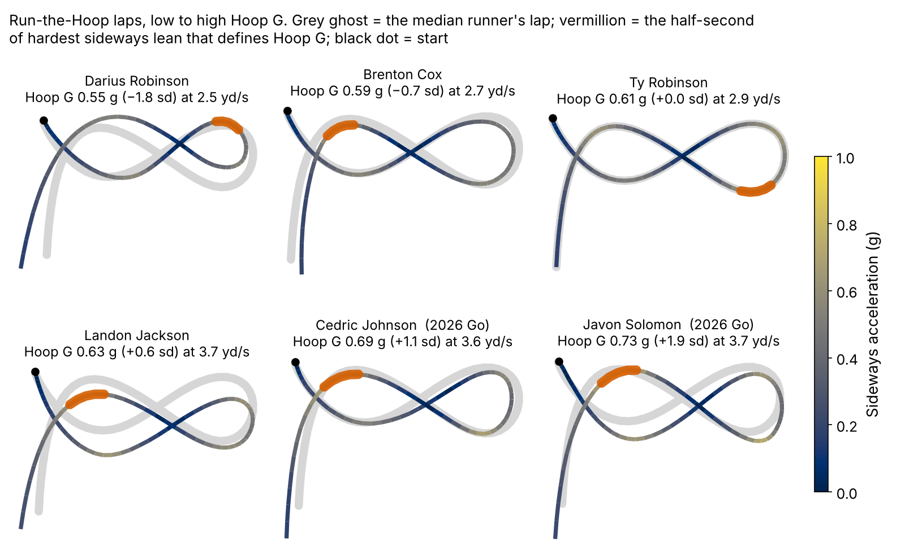
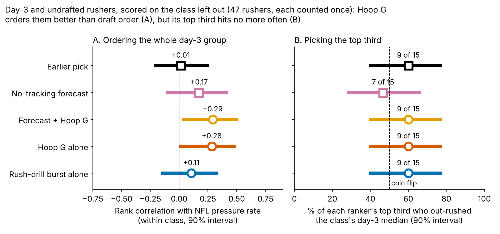
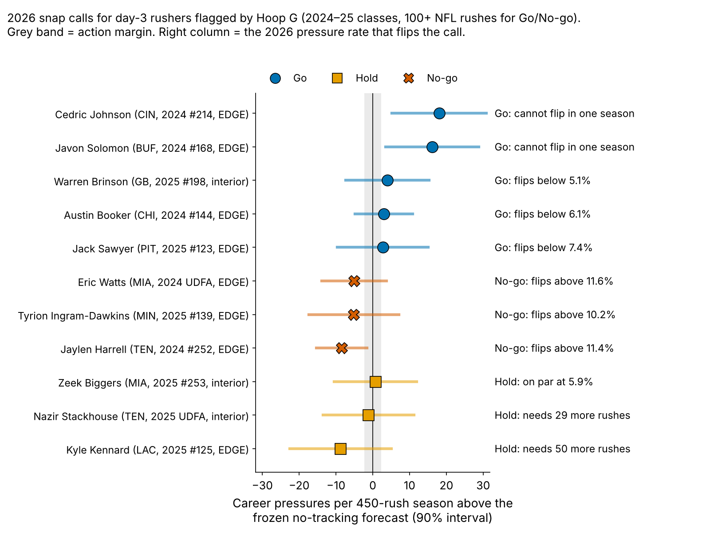

# Bend Shows, Burst Doesn't: What Combine Pass-Rush Drills Say About NFL Pressure

**The plain answer: the Combine's pass-rush drill cannot see get-off, and Run-the-Hoop sees bend only faintly.** We tracked all {{n_dl}} defensive linemen from the 2023–25 classes at 10 Hz. We then scored each drill only on a Combine class the model had not seen ({{n_an}} rushers). One sd of **Hoop G**, the hardest lean around the hoop, was worth **{{ho_hoop_season}} pressures per 450-rush season** [90%: {{ho_hoop_season_lo}}, {{ho_hoop_season_hi}}]. That is on top of a forecast built from pick, weight, role, NGS score, 10-yard split and 3-cone. Burst out of a stance was worth {{ho_burst_season}} [{{ho_burst_season_lo}}, {{ho_burst_season_hi}}]. We tested six drill measures, though, and Hoop G does not survive that screen (family-wise p = {{ho_hoop_pfw}}).

**Recommendation:** use Hoop G only to decide which day-3 edge rushers' film to watch first. Never move a name on the board for it, and drop drill burst.

## Two drill numbers a coach can repeat

- **Hoop G:** take the tightest half-second of the figure-eight, then divide speed squared by turn radius and express it in g. The median lineman leans at {{hoop_g_median}} g, which is {{hoop_speed_median}} yd/s on a {{hoop_radius_median}}-yard radius. A faster lap through a tighter circle scores higher. {{n_hoop}} linemen ran it, and {{n_hoop_no3c}} of them never ran the 3-cone.
- **Burst:** yards covered in the first second after he moves in the pass-rush drill (median {{burst_median}} yd; {{n_burst}} linemen).

Both are standardized within Combine year, because drill medians shift between years.

**Why it matters.** On {{epa_n}} randomly sampled NFL pass plays involving these linemen, a pressured snap cost the offense {{epa_press}} expected points more than a clean one ({{epa_press_lo}} to {{epa_press_hi}}). Before fitting anything, we set one action margin: {{margin_season}} pressures per 450-rush season per sd. That is one pressure every 200 rushes, or about {{margin_epa}} expected points a season.

## Get-off wins NFL snaps, but the drill rep cannot measure it

We followed each drill along a chain: does it repeat, does it show up in the matching NFL movement, and does that movement produce pressure? The NFL movements come from a median of {{median_random_rushes}} randomly sampled rushes per lineman, measured against his own position (the tracking has no blockers or ball). The NFL links control for weight and EDGE share.

| Link in the chain | ρ [90%] | n | Most it could be |
|---|---|---|---|
| Drill burst, rep to rep | {{rel_burst1}} | {{rel_burst_nrep}} | — |
| Hoop G, lap to lap (two laps) | {{rel_hoop1}} ({{rel_hoop2}}) | {{rel_hoop_nrep}} | — |
| Drill burst → NGS get-off | {{tr_burst_quick}} [{{tr_burst_quick_lo}}, {{tr_burst_quick_hi}}] | {{tr_burst_quick_n}} | {{tr_burst_quick_ceil}} |
| Drill burst → NFL first-second burst | {{tr_burst_g_d1}} [{{tr_burst_g_d1_lo}}, {{tr_burst_g_d1_hi}}] | {{tr_burst_g_d1_n}} | {{tr_burst_g_d1_ceil}} |
| Hoop G → NFL bend (sideways g, first 2 s) | {{tr_hoop_g_bend}} [{{tr_hoop_g_bend_lo}}, {{tr_hoop_g_bend_hi}}] | {{tr_hoop_g_bend_n}} | {{tr_hoop_g_bend_ceil}} |
| NGS get-off → pressure rate | {{gp_quick}} [{{gp_quick_lo}}, {{gp_quick_hi}}] | {{gp_quick_n}} | — |
| NFL first-second burst → pressure rate | {{gp_g_d1}} [{{gp_g_d1_lo}}, {{gp_g_d1_hi}}] | {{gp_g_d1_n}} | — |
| NFL bend → pressure rate | {{gp_g_bend}} [{{gp_g_bend_lo}}, {{gp_g_bend_hi}}] | {{gp_g_bend_n}} | — |

*Table 1. Partial Spearman ρ with class-stratified bootstrap intervals. "Most it could be" is the ceiling set by the two measures' repeatability. The NFL measures repeat well: NGS get-off season to season {{rel_getoff_season}} (n = {{rel_getoff_n}}), NFL burst {{rel_game_burst}} and NFL bend {{rel_game_bend}} split-half (n = {{rel_game_n}}), pressure rate {{rel_press_season}}.*

The NFL end of the chain is strong. Linemen who get off quicker generate more pressure ({{gp_quick}}), and so do linemen who bend harder ({{gp_g_bend}}). The Combine end breaks. One pass-rush rep repeats at only {{rel_burst1}}, because a stance start depends on a single first step. Drill burst does show up in how far he travels in his first NFL second ({{tr_burst_g_d1}}), but not in NGS get-off ({{tr_burst_quick}}). Hoop G reaches NFL bend only weakly ({{tr_hoop_g_bend}}).

## Only Hoop G adds anything past the baseline, and not past the screen

**Baseline without tracking:** log draft pick, Combine weight, NFL EDGE share, NGS athleticism score, and the official 10-yard split and 3-cone. Missing times are filled inside each fold. **Outcome:** career pressure rate through 2025, shrunk toward the {{press_mean}}% mean by {{eb_prior_rushes}} rushes of prior, for linemen with 30+ rushes. **Out of class:** each Combine class ({{ho_n_per_class}} rushers) is forecast by a model fit on the other two.

To answer the charge that Hoop G was picked after looking, we listed six drill measures (three per drill), gave each the same held-out test, and shuffled all six together within class. That gives the size the best of six random measures reaches by chance.

| Model (held-out, n = {{n_an}}) | R² | RMSE (pts) | Rank ρ | R² gain [90%] |
|---|---|---|---|---|
| Pick + role only | {{r2_pick}} | {{rmse_pick}} | {{rho_pick}} | — |
| No-tracking baseline | {{r2_base}} | {{rmse_base}} | {{rho_base}} | — |
| Baseline + Hoop G | {{r2_hoop}} | {{rmse_hoop}} | {{rho_hoop}} | {{dr2_hoop}} [{{dr2_hoop_lo}}, {{dr2_hoop_hi}}] |
| Baseline + drill burst | {{r2_burst}} | {{rmse_burst}} | {{rho_burst}} | {{dr2_burst}} [{{dr2_burst_lo}}, {{dr2_burst_hi}}] |

*Table 2. Leave-one-class-out fit. With {{n_an}} rushers, the extra Combine times cost more in fitting noise than they add.*

- **Burst is out.** Its slope is {{ho_burst_season}}. {{ho_burst_pinside}}% of bootstrap draws fall inside the margin (equivalence p = {{ho_burst_tost}}), and it is negative in two of three classes.
- **Hoop G is the only measure with a held-out signal** (p = {{ho_hoop_p2}} on its own). The signal holds in 2023 and 2024 ({{ho_hoop_2023}}, {{ho_hoop_2024}}) and is flat in 2025 ({{ho_hoop_2025}}). Across shrinkage and rush minimums it stays between {{sens_slope_min}} and {{sens_slope_max}}. But it sits inside the ±{{fw95_season}} chance range for six measures, and only {{ho_hoop_pabove}}% of draws clear the margin.
- **Clubs do not pay for bend.** Top-third Hoop G linemen went at a median pick of {{pick_top_third}}, and bottom-third linemen at {{pick_bot_third}}.

## Within day 3, Hoop G orders rushers better than the draft did, but does not pick better

{{pct_day3_dl}}% of these linemen went on day 3 or undrafted, and that is where the board needs help. We scored five ways to rank the {{d3_n}} day-3 and undrafted rushers with 30+ rushes ({{d3_n_per_class}} by class). Each rusher counts once. The Hoop G weight added to the forecast is estimated on the other two classes.

- **Ordering the whole group:** forecast + Hoop G ρ = {{dr_fch}} [{{dr_fch_lo}}, {{dr_fch_hi}}], against {{dr_pick}} for draft order. The gap is {{dd_fch_pick}} [{{dd_fch_pick_lo}}, {{dd_fch_pick_hi}}]. Against the forecast alone ({{dr_fc}}), Hoop G adds {{dd_fch_fc}} [{{dd_fch_fc_lo}}, {{dd_fch_fc_hi}}].
- **Picking a top third:** Hoop G and draft order both hit {{tt_hoop_k}} of {{tt_hoop_n}} ({{tt_hoop_pct}}% [{{tt_hoop_lo}}, {{tt_hoop_hi}}]), so neither beats the other.
- **As a flag against the forecast:** {{fl_k}} of {{fl_n}} top-third Hoop G rushers beat their forecast. That is an error rate of {{fl_err}}% [{{fl_err_lo}}, {{fl_err_hi}}], against {{rs_k}} of {{rs_n}} for everyone else. On average the flagged group still beat its forecast by {{fl_over_season}} pressures a season more than the rest, but that comes from a few big hits.

So Hoop G improves the order but not the cut line. That is why the recommendation is film order, not board order.

## 2026 calls for the day-3 rushers Hoop G flags

The list below covers every day-3 rusher from the 2024–25 classes in his class's top third of Hoop G. **Go** means 100+ rushes and at least 0.5 rate points above forecast; **No-go** means at least 0.5 below; everyone else is **Hold**. Hoop G only chose who is on the list. The calls themselves come from NFL pressure against the frozen forecast. **Decision date: after Week 18 of 2026.**

- **Go:** {{T:go}}. Johnson ({{go0_pr}}% against a {{go0_fc}}% forecast over {{go0_rush}} rushes) and Solomon ({{go1_pr}}% against {{go1_fc}}%) cannot flip in one season, so give both third-down snaps from wide alignments, where bend shows. Brinson is the interior case: use him as the looper on stunts. He flips below {{go2_flip}}%, Booker below {{go3_flip}}% and Sawyer below {{go4_flip}}%.
- **No-go:** {{T:nogo}}. Each needs a 2026 rate of at least {{nogo_flip_min}}% to reach his forecast.
- **Hold:** {{T:hold}}. Stackhouse and Kennard first need 100 rushes.
- **Film queue (under 30 rushes):** {{T:aud}}.

**The frozen test** (sha256 `{{T:hash}}…`): after the 2026 class's first season, regress pressure-over-forecast on Hoop G (one-sided p < 0.10). A slope at or below zero retires the flag. Simulated power at the observed slope is {{pws_obs_1}}% for one class and {{pws_obs_3}}% for three.

## Limitations

- **Small samples.** The model uses {{n_an}} rushers and the day-3 test {{d3_n}}, with single drill reps. Hoop G's repeatability rests on {{rel_hoop_nrep}} linemen with two laps, and {{pct_one_run}}% ran one.
- **Selection.** Earlier work screened drill measures on these same classes. The six-measure correction covers our list, not every idea tried before, so 2026 is the first clean test.
- **Thin NFL tracking.** A median of {{median_random_rushes}} sampled rushes per lineman, with no blockers or ball. Bend on a snap may follow from beating the tackle rather than cause it.
- **Weak baseline.** Pick + role alone beats the full no-tracking model out of class (R² {{r2_pick}} vs {{r2_base}}), so gains over it look larger than gains over a scout.
- **Survivorship and roles.** Rates need 30+ rushes. Injuries, scheme and roster moves are not modelled.

## Reproduce

`analysis.py` (about 3 minutes) rebuilds every number, figure and this text from `data/processed`, and writes `numbers.json`, `board.csv` and `frozen_rule.json`.
