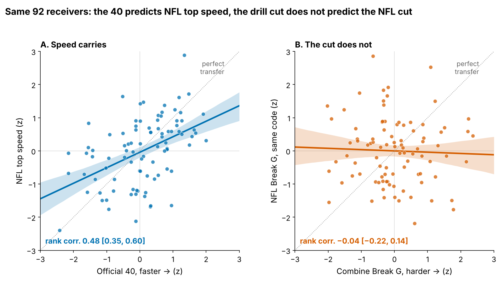
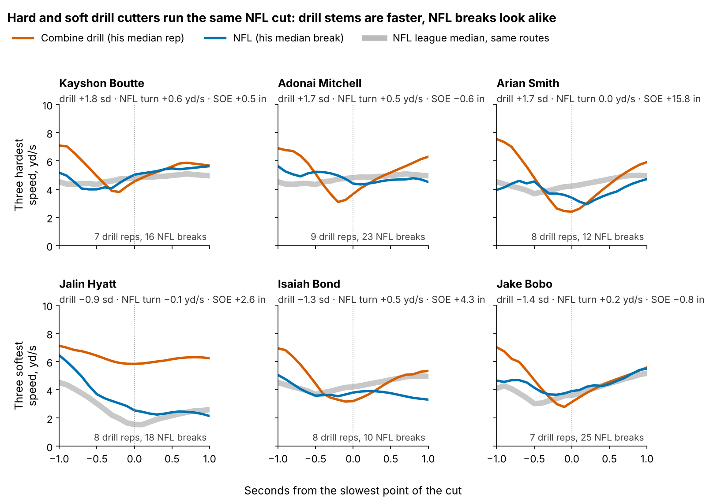
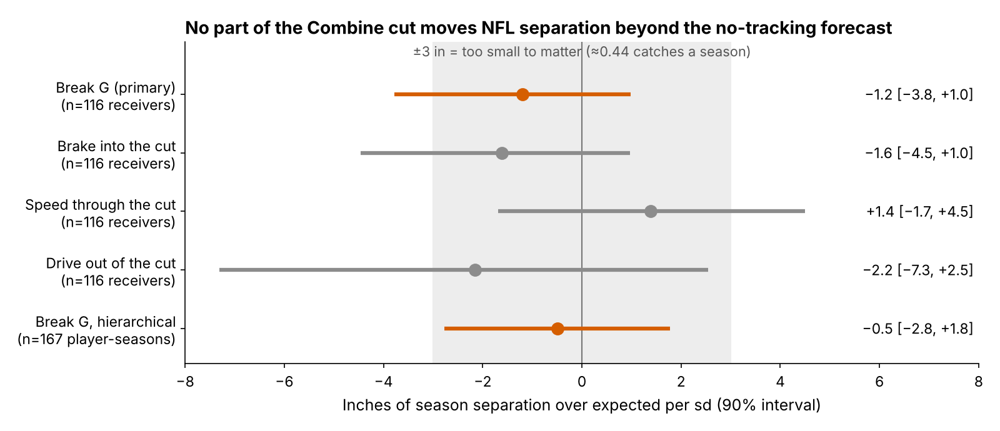
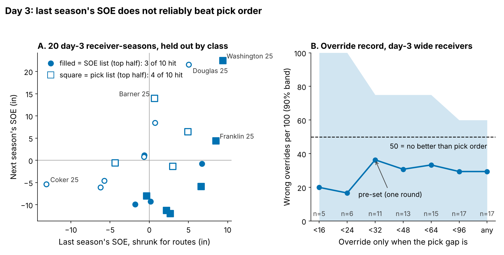
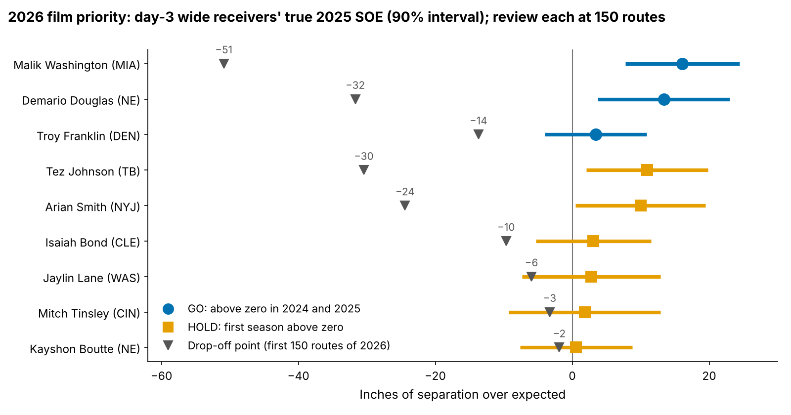

# Combine Route Cuts Don't Buy NFL Separation, and Last Season's Separation Doesn't Beat Draft Order

**A receiver who cuts one standard deviation harder in Combine route drills is no more open in the NFL: −1.2 inches of separation per sd (90% interval −3.8 to +1.0), across 116 receivers from draft classes the model never saw.**

- **Break G**, in a sentence a coach can repeat: on the first real cut of a route, how hard the receiver pushes into the ground over the one second around the break (braking, turning and driving out), in g, i.e. as a share of his body weight. One sd is 0.021 g. The same code grades Combine route drills and NFL slants, outs, hitches, ins and corners from 10 Hz tracking.
- **Separation over expected (SOE)**: how many inches more open he is at the throw than Next Gen Stats separation predicts from his alignment, cushion and season, over full regular seasons.

Straight-line speed carries from the Combine to Sundays; the cut does not. On day 3, last season's SOE does not beat draft order either, so the 2026 list at the end is a film queue, not a verdict.

## Speed carries to Sundays; the drill cut does not

A scout sees a median of 7 graded drill cuts per receiver, and 91% of receiver-drill cells hold one rep. Table 1 puts every reliability and transfer check on one scale (rank correlation, both measures within position).

| What is compared | Rank corr. [90%] | n | Reading |
|---|---|---|---|
| Official 40 → NFL top speed | 0.48 [0.35, 0.60] | 92 receivers | Speed carries |
| Combine → NFL Break G, same receivers | −0.04 [−0.22, 0.14] | 92 receivers | No transfer |
| Combine → NFL Break G, same route family | −0.07 [−0.15, 0.02] | 114 receivers | No transfer |
| Break G, five drills vs the other five | 0.28 [0.15, 0.40] | 145 receivers | A weak trait |
| Break G, same drill run twice | median ICC 0.05 | 70 pairs | One rep is mostly noise |
| NFL Break G, odd vs even snaps | 0.23 | 113 receivers | Weak in games too |

NFL top speed is the 90th percentile of a receiver's per-snap maximum on sampled plays; NFL Break G averages his graded breaks (8+ required in the first two rows).

Combine stems are entered a median 1.4 yd/s faster than the same NFL route (hitch: 6.9 vs 4.7 yd/s), so the drill grades a cut the NFL rarely asks for. The names show it: the hardest drill cutters turn at league speed on Sundays.

| Wide receiver (class, pick) | Drill Break G, z | NFL turn speed vs league, yd/s (breaks) | Career SOE, in (routes) |
|---|---|---|---|
| ***Three hardest*** | | | |
| Kayshon Boutte (2023, 187) | +1.8 | +0.6 (16) | +0.5 (873) |
| Adonai Mitchell (2024, 52) | +1.7 | +0.5 (23) | −0.6 (486) |
| Arian Smith (2025, 110) | +1.7 | 0.0 (12) | +15.8 (231) |
| ***Three softest*** | | | |
| Jalin Hyatt (2023, 73) | −0.9 | −0.1 (18) | +2.6 (679) |
| Isaiah Bond (2025, UDFA) | −1.3 | +0.5 (10) | +4.3 (333) |
| Jake Bobo (2023, UDFA) | −1.4 | +0.2 (25) | −0.8 (306) |

Turn speed is the receiver's median speed at the slowest point of his NFL breaks minus the league median for the route; eligible: wide receivers with 200+ career routes and 5+ graded breaks (49). The eight hardest and eight softest drill cutters average +1.0 and −2.3 inches of career SOE, with the same NFL turn speed (0.0 and +0.1 yd/s).

## Break G adds nothing to season separation

The outcome is route-weighted career SOE (213 player-seasons, median 231 routes). The baseline without tracking, fixed before the test, is log pick, official 40, weight, NGS athleticism score and a tight-end flag, fitted on two draft classes and scored on the third. It is weak (held-out R² 0.00, error 8.6 inches); adding Break G changes R² by 0.013 [−0.141, 0.079].

One hierarchical model (167 player-seasons of 91 receivers, receiver and class random effects; class explains 0% of the variance) gives −0.5 [−2.8, +1.8]. Both intervals exclude a benefit of 3 inches per sd, the margin set before testing and worth about 0.44 catches a season (8.8 catch-rate points per yard, 60 targets). None of the three mechanics carries it either (Figure 3). Clubs still draft a receiver 1 sd harder in the cut 9% earlier [1, 17] at the same position.

## Day 3: last season's SOE does not beat pick order

The obvious replacement for the drill is last season's SOE, shrunk for routes (a 200-route season keeps 0.60 of its value). The test uses every eligible day-3 or undrafted receiver: 20 pairs of consecutive seasons with 100+ routes each, from 16 receivers, forecast leave-one-draft-class-out and resampled by receiver.

**Back-test.** Each season, the top half by the SOE forecast and the top half by pick order: next-season SOE above zero for 3 of 10 and 4 of 10 (all receivers: 8 of 20). Difference −10 points [−36, +12], receiver-level permutation p = 0.81.

**The one rule a staff would use.** Between two day-3 wide receivers less than a round apart (pick gap under 32, fixed before scoring), take the higher last-season SOE. Across 51 same-season contrasts it overrode the pick 11 times and was wrong 4 times: 36 per 100 [0, 75]. Pick order is wrong exactly when the override is right, so an interval spanning 50 means the rule does not beat pick order; the net gain is +8.1 inches per override [−3.9, +22.7]. It is not a rule. It orders film.

## 2026: a film queue, not a verdict

Rule (round 19's, minus its model-probability filter, since the forecast did not beat pick order): day-3 or undrafted wide receiver, 14+ games, 100+ routes and SOE above zero in 2025. **GO** = also above zero over 100+ routes in 2024; **HOLD** = first such season. True SOE = 2025 SOE shrunk for routes. Splits are sampled snaps against the league in the same coverage or alignment; only 5 of 36 cells reach 30 snaps, so they point film, not grades. "Off below" is the 2026 SOE over his first 150 routes that pulls his true SOE under zero.

| Receiver (class, pick; 2025 team) | Call | True SOE, in [90%] | Man / zone, in (snaps) | Slot / wide, in (snaps) | What flips it |
|---|---|---|---|---|---|
| **Malik Washington** (2024, R6-184; MIA) | **GO** | +16.1 [+7.7, +24.4] | −1 (5) / +23 (34) | +24 (11) / +19 (26) | Off below −51 in |
| **Demario Douglas** (2023, R6-210; NE) | **GO** | +13.4 [+3.7, +23.0] | +33 (14) / −13 (26) | +5 (27) / −4 (11) | Off below −32 in |
| **Troy Franklin** (2024, R4-102; DEN) | **GO** | +3.4 [−4.0, +10.9] | −16 (9) / −17 (31) | +7 (12) / −24 (27) | Off below −14 in |
| Tez Johnson (2025, R7-235; TB) | HOLD | +10.9 [+2.0, +19.8] | +4 (14) / +3 (26) | −13 (14) / +9 (25) | Off below −30 in; GO if 2026 > 0 |
| Arian Smith (2025, R4-110; NYJ) | HOLD | +10.0 [+0.5, +19.5] | −9 (11) / +14 (29) | −6 (17) / +18 (23) | Off below −24 in; GO if 2026 > 0 |
| Isaiah Bond (2025, UDFA; CLE) | HOLD | +3.1 [−5.3, +11.5] | +11 (14) / +36 (26) | +25 (16) / +29 (24) | Off below −10 in; GO if 2026 > 0 |
| Jaylin Lane (2025, R4-128; WAS) | HOLD | +2.8 [−7.4, +12.9] | −4 (19) / −13 (21) | +3 (13) / −17 (25) | Off below −6 in; GO if 2026 > 0 |
| Mitch Tinsley (2023, UDFA; CIN) | HOLD | +1.8 [−9.2, +12.9] | +8 (14) / +4 (26) | +29 (7) / 0 (33) | Off below −3 in; GO if 2026 > 0 |
| Kayshon Boutte (2023, R6-187; NE) | HOLD | +0.6 [−7.6, +8.8] | −7 (9) / +2 (30) | −10 (4) / +1 (35) | Off below −2 in; GO if 2026 > 0 |

Troy Franklin is GO by rule but below the league in every coverage cell, so his film comes first. Arian Smith is one of the three hardest drill cutters; his case rests on separation, not the cut. Day-3 tight ends are left off (4 cleared zero in 2025): the rule has only 5 tight-end pairs behind it.

## Bottom line

1. **Take Break G out of the price.** Clubs pay 9% in pick position per sd of it and get no separation.
2. **Keep the route drill only with more reps.** Two reps per drill lift Break G reliability from 0.53 to 0.69.
3. **On day 3, the draft order stands.** Last season's SOE does not beat it (3 vs 4 of 10); use it to order film, never to override the board.
4. **Film first: Malik Washington, Demario Douglas, Troy Franklin; then Tez Johnson, Arian Smith, Isaiah Bond, Jaylin Lane, Mitch Tinsley and Kayshon Boutte.** Re-check each at 150 routes, before the March 2027 league year.

## Limitations

- **Not blind.** All three classes were seen while building this; the ±3 inch margin, the baseline and the gap of 32 were fixed before testing.
- **Small day-3 sample.** 20 pairs, and 11 overrides among 11 wide receivers, cannot separate SOE from pick order in either direction.
- **Harm is not excluded** by the held-out test (lower bound −3.8 inches per sd).
- **Game tracking is a sample**: up to 40 plays per player, half chosen for high EPA, no defenders or ball. This limits Table 1's NFL rows, Figure 2 and the splits, not the season tests (full-season NGS).
- **Survivorship.** Of 149 drill-scored receivers, 116 logged NFL routes with separation.

## Appendix

`core.py` builds every table; `analysis.py` writes every number, figure and this text; `appendix.py` holds the robustness checks; `verify.py` recomputes from the raw tables the season and career SOE, baseline R² and ΔR², the held-out slope and interval, the TOST, the speed correlation and interval, both day-3 tests, the override break-even (64 wrong per 100) and the sensitivity ranges. Equivalence at ±3 inches: TOST p = 0.11 held out, 0.04 hierarchical. Held-out slope across 6 outcome builds (route cut-offs, no cushion term, unweighted, wide receivers only): −3.0 to −0.7. Override wrong rate across route cut-offs and raw SOE: 33 to 48 per 100.
