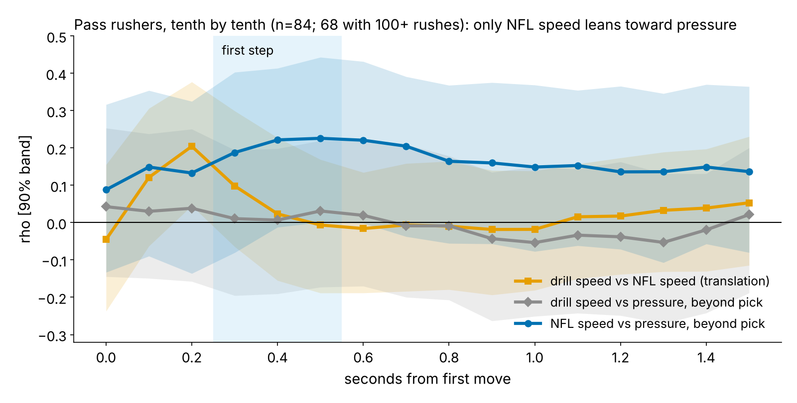

# Playing Like You Tested Is Not a Pass-Rush Skill: Combine-to-NFL Carry-over Adds Nothing Beyond the Pick

**Some pass rushers move on Sundays exactly as they did in the Combine pass-rush drill. Others look nothing like it. We call that match Carry-over. On draft classes the model never saw, one sd of Carry-over is worth {{ho_carry_b}} pressure-rate points (90% interval {{ho_carry_lo}} to {{ho_carry_hi}}; {{dl_pool}} rushers). That is inside a ±1-point margin fixed before the held-out run (equivalence p = {{ho_carry_tost}}). All {{n_equiv}} Combine-side versions we tried are equivalent to zero. None ranks same-class rushers better than the draft pick, which gets {{acc_pick}}% of pairs right.**

**Carry-over, in one sentence a coach can repeat:** take his pass-rush drill rep and about 20 of his random NFL rushes. Every tenth of a second for 1.5 s from his first move, score his speed and acceleration against rushers of the same weight and role. Carry-over is the average gap between the two curves, in sd, where 0 means he plays exactly as he tested. *Pressure rate* is pressures per pass rush (DL average {{dl_mean_prate}}%). One point is about 3 pressures over a 300-rush season.

## Pass rushers are the one group where the test is fair

We first ran the comparison for every group against the drill that starts from the same stance: OL pass-set drill, WR go route, TE in route, DB backpedal-and-break, plus the 40 for everyone (Figure 2). The data are {{n_drill_reps_all}} tracked Combine reps and {{n_snaps_all}} random sampled NFL pass snaps. We never use the top-EPA half of the sample, because it over-represents pressures.

A translation test only means something if both curves can be measured. The *noise ceiling* is the largest correlation a perfect drill-to-NFL link could show, given rep-to-rep and snap-to-snap noise. For the pass-rush drill it is {{scr_dl_m_ceil}}. For the OL pass-set drill it is {{scr_ol_m_ceil}}, because a lineman's two reps do not agree. The WR, TE and DB position drills mostly have one rep, so they have no ceiling at all. Only for pass rushers would a null result be informative.

No group's position drill carries over positively. Matched-drill correlations run from {{scr_tr_min}} (DB, one rep) to {{scr_tr_max}} (TE, with 21 players, left aside). In {{scr_n_sig}} of {{scr_n_cells}} production checks, Carry-over clears a within-class shuffle at p < 0.05. Both are 40-yard-dash cells (DL p = {{scr_dl_40_p}}; TE p = {{scr_te_40_p}}, {{scr_te_40_ny}} players), about what chance predicts. Held out by class, the DL one shrinks to {{ho_carry40_b}} [{{ho_carry40_lo}}, {{ho_carry40_hi}}].

## The drill get-off does not carry over; the NFL get-off leans toward pressure

**First step** means mean speed 0.3–0.5 s after first movement. From drill to NFL it translates at ρ = {{dl_tr_fs}} [{{dl_tr_fs_lo}}, {{dl_tr_fs_hi}}] ({{dl_n}} rushers), well under its ceiling of {{dl_ceil_fs}}. Over the full 1.5 s, NFL speed runs at a median {{dl_ratio_med}}% of drill speed (10th to 90th percentile: {{dl_ratio_p10}}% to {{dl_ratio_p90}}%).

The two halves of Carry-over behave differently (Figure 3). Drill speed never relates to pressure beyond the pick (|ρ| ≤ {{dl_payc_absmax}} at every tenth of a second). NFL speed leans positive: ρ = {{pay_gfs}} [{{pay_gfs_lo}}, {{pay_gfs_hi}}] at the first step (shuffle p = {{pay_gfs_p}}). The NFL first step is a real measurement. It tracks NGS get-off snap by snap (ρ = {{dl_rho_fs_ngs}}, {{dl_n_ngs}} rushes), and over a median of {{dl_snaps_med}} rushes its reliability is {{dl_rel_fs_sunday}}. The drill first step's reliability is {{dl_rel_fs_drill}}.

So Carry-over compares a reading that predicts nothing with one that predicts a little, and the match itself adds nothing. Within the sample it even runs the wrong way: ρ = {{pay_carry}} [{{pay_carry_lo}}, {{pay_carry_hi}}] beyond pick. That holds for edge rushers ({{split_edge_r}}, n = {{split_edge_n}}) and interior rushers ({{split_int_r}}, n = {{split_int_n}}), and it stays at {{dec_carry}} once both curves' levels are controlled.

## On unseen draft classes, every version of Carry-over is worth zero

**Baseline without tracking:** log draft pick, weight, edge share, official 40 time and NGS athleticism score. It is fit on two draft classes and scored on the third (held-out R² {{ho_r2_base}}). Each measure is added to that forecast and scored the same way. The ±1-point margin is about 3 pressures a season, roughly the forecast gap between pick 32 and pick 100 ({{pts_pick32_100}} points).

- **Carry-over:** {{ho_carry_b}} points per sd [{{ho_carry_lo}}, {{ho_carry_hi}}]. Held-out R² change {{ho_carry_dr2}}.
- **Carry-over %** (NFL speed as a share of drill speed): {{ho_carry_ratio_b}} [{{ho_carry_ratio_lo}}, {{ho_carry_ratio_hi}}]. It is the largest positive version, and the NFL half is doing the work.
- **Curve shape only:** {{ho_carry_shape_b}} [{{ho_carry_shape_lo}}, {{ho_carry_shape_hi}}], the wrong direction. **Speed only:** {{ho_carry_speed_b}}. **Against the 40:** {{ho_carry40_b}}. **Drill first step alone:** {{ho_c_fs_b}}.
- **NFL first step alone:** {{ho_g_fs_b}} [{{ho_g_fs_lo}}, {{ho_g_fs_hi}}], held-out R² change {{ho_g_fs_dr2}}. This is a lean, not a proven gain.

**As a ranking tool.** We formed {{pairs_n}} pairs of rushers from the same class and role. The earlier pick has the higher career pressure rate in {{acc_pick}}% of them [{{acc_pick_lo}}, {{acc_pick_hi}}; intervals resample rushers]. The held-out forecast with Carry-over gets {{acc_carry}}% [{{acc_carry_lo}}, {{acc_carry_hi}}], and with the NFL first step {{acc_sun}}%. Against the pick, the NFL first step is {{d_sun_pick}} points [{{d_sun_pick_lo}}, {{d_sun_pick_hi}}]. Neither beats draft order.

## The most and least alike rushers, by name

{{TABLE:names}}

*Table 1. Pressure vs. forecast: career shrunk pressure rate vs. the held-out no-tracking forecast. Percentiles are within the {{dl_pool}}. The full board is in `players.csv`.*

The table does not split into "translators" and "non-translators". {{top1_name}} moves as he tested and is {{top1_resid}} points against his forecast. {{top0_name}} moves just as closely and is {{top0_resid}}. The two least-alike rushers, {{bot0_name}} and {{bot1_name}}, are {{bot0_resid}} and {{bot1_resid}}. Across the pool, the most-alike third averages {{carry_top3rd_resid}} points against forecast and the least-alike third {{carry_bot3rd_resid}} ({{carry_third_n}} rushers each).

## What a staff should do

1. **Do not build or buy a "plays like he tested" score for pass rushers.** Six versions were tested, and all are worth zero beyond the pick on unseen classes.
2. **Keep the pick and the stopwatch as the baseline.** Nothing tested here, including game tracking, ranks same-class rushers better than draft order.
3. **If you chart NFL get-offs, chart enough.** It takes {{dl_snaps_for_07}} random rushes per player to reach reliability {{rel_target}}. Use the first step only as a tiebreak lean ({{ho_g_fs_b}} points per sd, unproven).
4. **Read a single Combine get-off rep as noise.** At reliability {{dl_rel_fs_drill}}, one rep cannot rank rushers. A club that wants a drill get-off number needs several reps.

## Limitations

- **Sampled tape.** NFL curves come from about 20 random rushes per player, with no blockers or ball. A slow start can be a two-gap assignment, a stunt or a read, not a slow player.
- **Different cue.** The drill is uncontested and starts on a coach's cue, not a snap. We align both curves at first movement, so reaction time is excluded on both sides.
- **Screen before test.** The choice of pass rushers came after the ten-pair screen. {{scr_n_sig}} of its {{scr_n_cells}} cells clear p < 0.05, about what chance gives, and the held-out test was fixed after the screen.
- **Small sample.** There are {{dl_pool}} rushers; {{dl_excluded}} of {{dl_n}} with curves have fewer than 100 rushes and are left out. Intervals span about ±0.4 points, so the equivalence verdict depends on the ±1-point margin. Weight and role adjustments use NFL alignment, which itself reflects how teams evaluated each player.

## Appendix

Curves are smoothed (Savitzky–Golay, 5 frames). First movement is when speed first reaches 1 yd/s, minus 0.2 s. A rusher must be set at the snap (under 0.8 yd/s), and NFL speeds are adjusted for alignment. Combine curves are year-standardized. Both curves are then residualized on weight and role. Production is beta-binomial shrunk career pressure rate (100+ rushes). The equivalence test is two one-sided tests on the pooled held-out slope with a bootstrap SE. `analysis.py` writes every number, figure and this text from `data/processed` in about 2 minutes. The Carry-over split-half reliability is {{dl_rel_carry}}.
