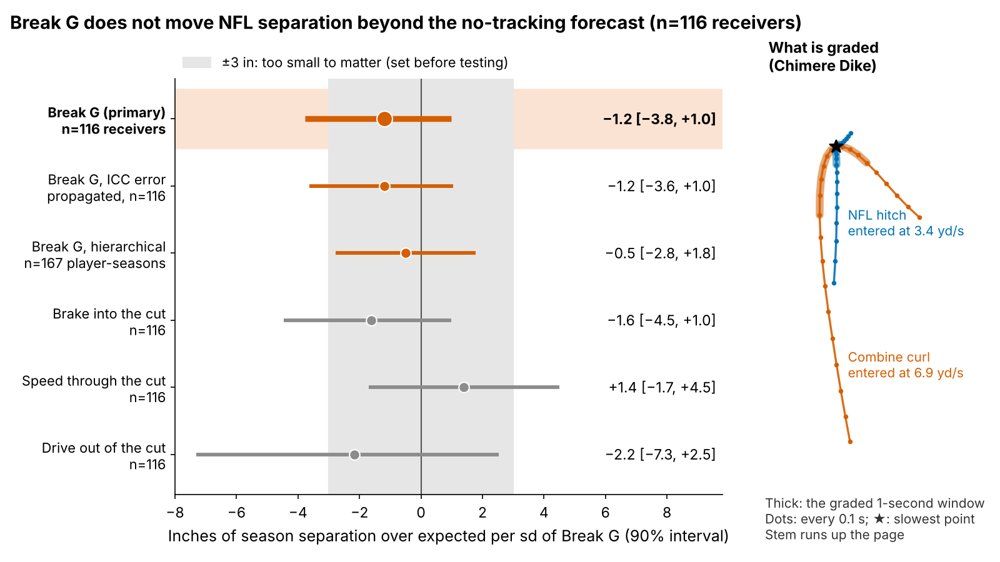
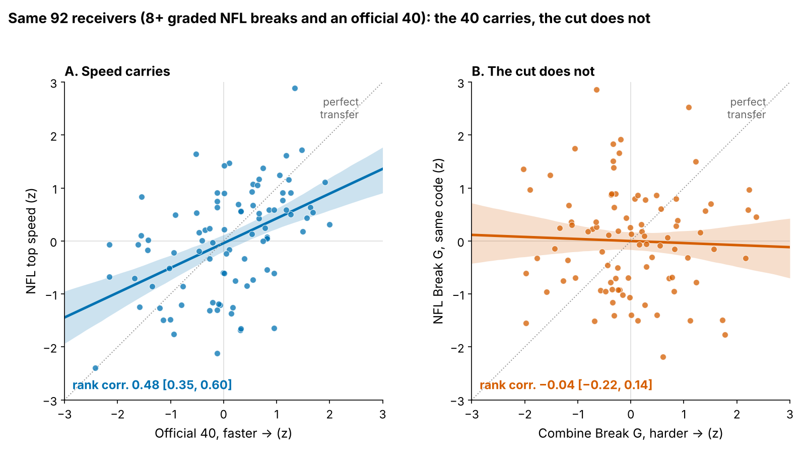
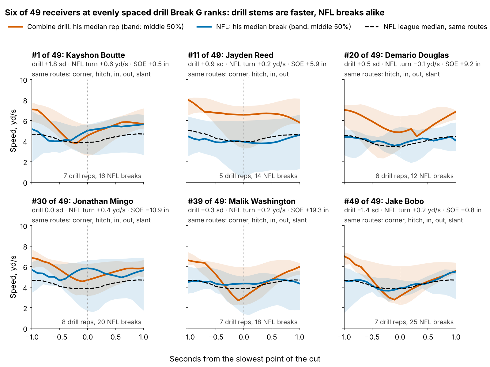
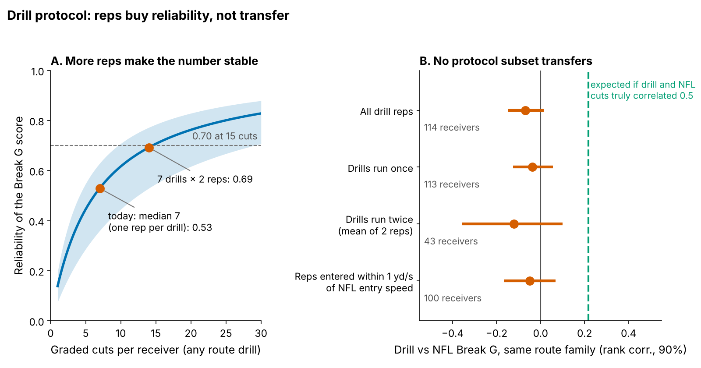
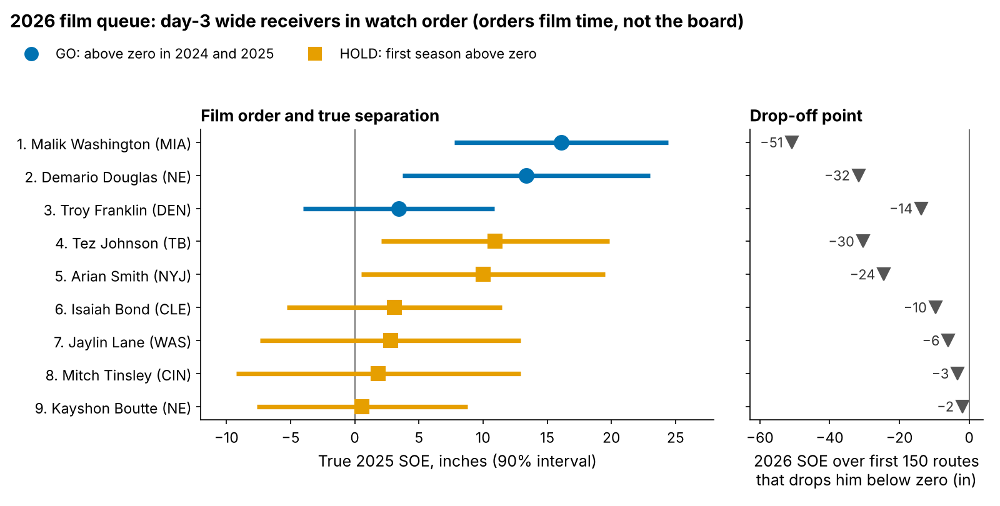

# Combine Cuts Don't Predict NFL Separation; Last Year's Separation Doesn't Beat Draft Order

**A receiver who cuts one standard deviation harder in Combine route drills is no more open in the NFL: {ho} inches of separation per sd (90% interval {ho_lo} to {+ho_hi}), across {n_main} receivers from draft classes the model never saw.**

Why receivers: clubs already pay for the cut. A receiver 1 sd harder in the route drills goes {price}% earlier in the draft [{price_lo}, {price_hi}] at the same position. Why now: the 2023 class's rookie contracts run out after this 2026 season, so clubs set day-3 receiver prices this winter.

- **Break G**, in coach terms. Take the Combine curl: the receiver stems upfield, plants and comes back to the ball. Break G is how hard he pushes into the ground in the one second around that plant (sink, turn, drive out), as a share of body weight: snap the curl off and he grades high, round it and he grades low. One sd is {g_sd} g. The same code grades NFL slants, outs, hitches, ins and corners from 10 Hz tracking (Figure 1, right).
- **Separation over expected (SOE)**: inches more open at the throw than Next Gen Stats separation predicts from alignment, cushion and season, over full regular seasons.
- **Combine years**: every rep is z-scored within drill and year, so protocol changes between Combines do not leak in.
- **Samples**: {n_combine} receivers with a drill score; {n_main} of them with NFL separation (season tests); {f1_n} of those with 8+ graded NFL breaks and an official 40 (transfer tests).

## 1. Break G adds nothing to season separation

The outcome is route-weighted career SOE ({n_seasons} player-seasons, median {routes_med} routes). The baseline without tracking, fixed before the test, is log pick, official 40, weight, NGS athleticism score and a tight-end flag, fitted on two draft classes and scored on the third.

| Test (held out by draft class unless noted) | Estimate [90%] | n |
|---|---|---|
| Baseline R² (error) | {bl_r2} ({bl_rmse} in) | {n_main} receivers |
| Change in R² from adding Break G | {dr2} [{dr2_lo}, {dr2_hi}] | {n_main} receivers |
| **Slope, inches per sd of true Break G** | **{ho} [{ho_lo}, {+ho_hi}]** | {n_main} receivers |
| Same, drill reliability redrawn in every resample | {ho} [{eiv_lo}, {+eiv_hi}] | {n_main} receivers |
| Same, raw drill average (no error correction) | {ho_raw} [{ho_raw_lo}, {+ho_raw_hi}] | {n_main} receivers |
| Hierarchical model, receiver and class effects | {hm} [{hm_lo}, {+hm_hi}] | {hm_n} player-seasons, {hm_np} receivers |
| Smallest slope this test detects (80% power) | {mde} in | {n_main} receivers |

Break G is noisy (score reliability {rel_main}), so the null could be attenuation. It is not: each receiver's drill average is shrunk by his own reliability (regression calibration), so the slope is per sd of true Break G, and redrawing the between-drill ICC ({icc_bg} [{icc_bg_lo}, {icc_bg_hi}]) in every resample barely widens it. The calibrated claim: this test catches a {mde}-inch effect 4 times in 5 ({pow3}% power at the 3-inch margin), and every estimate sits on the no-benefit side. None of the three mechanics (brake, speed through, drive out) carries it either.

## 2. Why: the drill grades a cut the NFL does not ask for

| What is compared | Rank corr. [90%] | n | Reading |
|---|---|---|---|
| Official 40 → NFL top speed | {spc} [{spc_lo}, {spc_hi}] | {f1_n} receivers | Speed carries |
| Combine → NFL Break G | {bgc} [{bgc_lo}, {bgc_hi}] | {f1_n} receivers | No transfer |
| Largest correlation the noise allows | {ceil} | {f1_n} receivers | Room for a signal |
| Combine → NFL Break G, same route family | {fam} [{fam_lo}, {fam_hi}] | {fam_np} receivers | No transfer |
| Break G, five drills vs the other five | {rel_bg} [{rel_lo}, {rel_hi}] | {rel_n} receivers | A weak trait |
| Break G, same drill run twice | ICC {icc_med} | {icc_pairs} pairs | One rep is mostly noise |
| NFL Break G, odd vs even snaps | {grel} | {grel_n} receivers | Weak in games too |

Noise does not explain the gap between rows 1 and 2. With reliabilities of {rel_c} (drill) and {rel_nfl} (NFL), the largest correlation the data could show is {ceil}; a true drill-to-game correlation of 0.5 would show up as about {exp50}. The observed {bgc}, corrected for both, is {bgc_dis}.

The reason is entry speed. Combine stems are entered a median {vin_gap} yd/s faster than the same NFL route (hitch: {vin_hitch_d} vs {vin_hitch_n} yd/s), a cut the NFL rarely asks for. Kayshon Boutte, the hardest drill cutter of {ex_n} wide receivers ({+ex0_bg} sd), turns {ex0_v} yd/s faster than the league on Sundays with {+ex0_soe} inches of career SOE. The eight hardest and eight softest drill cutters average {+x8_hard_soe} and {x8_soft_soe} inches, with the same NFL turn speed ({+x8_hard_v} and {+x8_soft_v} yd/s).

## 3. A drill protocol a Combine staff can adopt

- **More reps.** Drills are interchangeable for reliability (the receiver-by-drill share of a rep's variance is {vpd_pct}%), so what counts is total graded cuts: today's median of 7 gives {rel_7x1}, two reps in each of 7 drills give {rel_7x2}, {cuts70} cuts reach {t70} and {cuts80} reach {t80}. But drills run twice transfer no better: {two} [{two_lo}, {+two_hi}] ({two_np} receivers), against {one} for drills run once.
- **NFL entry speed.** Only {match_pct}% of drill reps are entered within 1 yd/s of the NFL speed for that route, and just {match_hitch} of {n_hitch} hitch-family reps (curl, comeback, hook). The matched reps, mostly slants (the one drill entered at NFL speed: {vin_slant_d} vs {vin_slant_n} yd/s), transfer {match} [{match_lo}, {+match_hi}] ({match_np} receivers).

The protocol to adopt: (1) if the cut is graded at all, grade at least {cuts70} cuts per receiver, for example two reps in each of eight route drills; (2) keep the slant and re-stem the curl, comeback and hook at NFL hitch speed (about {vin_hitch_n} yd/s, a controlled three-quarter stem), since today's hitch-family reps have no NFL match to test; (3) until a re-stemmed drill transfers, give Break G zero weight.

## 4. Day 3: pick order stands; separation orders film

The obvious replacement is last season's SOE, shrunk for routes (a 200-route season keeps {k200} of its value). It does not beat draft order. On {d3_n} consecutive-season pairs from {d3_np} day-3 or undrafted receivers, forecast leave-one-draft-class-out, the top half by SOE stayed above zero the next season {hl_k1} of {hl_n} times and the top half by pick {hl_k0} of {hl_n} (difference {hl_d} points [{hl_d_lo}, {+hl_d_hi}]; receiver-level permutation p = {hl_p}).

So the 2026 list orders film time and nothing else, and its expected hit rate is a coin flip: of {fq_n} day-3 receiver-seasons above zero, {fq_k} stayed there ({fq_pct}% [{fq_lo}, {fq_hi}]).

Rule: day-3 or undrafted wide receiver, 14+ games, 100+ routes and SOE above zero in 2025. **GO** = also above zero over 100+ routes in 2024; **HOLD** = first such season. Order: GO then HOLD, each by true SOE (2025 SOE shrunk for routes). "Off the list below" is the 2026 SOE over his first 150 routes that pulls true SOE under zero. There is no injury report here, so missed games mix injury and inactive weeks.

{{GO_TABLE}}

HOLD, in film order: {{HOLD}}.

What a GM will ask: Douglas's 2025 came on half his 2024 workload in the same slot role, so confirm injury or depth chart first. Franklin's routes nearly doubled as he became a starter, but his sampled snaps sit below the league against man and zone and when aligned wide (small cells; appendix), so watch his outside snaps first. Washington held his separation while moving outside. Arian Smith (a top-three drill cutter) and Jaylin Lane are on reserve lists; Boutte has left New England. Day-3 tight ends are left off: only {d3_te} tight-end pairs back the rule.

## Bottom line

1. **Take Break G out of the price.** Clubs pay {price}% in pick position per sd of it for no separation.
2. **Fix the drill before grading it.** At least {cuts70} graded cuts, hitch family re-stemmed at NFL entry speed, zero weight until it transfers.
3. **On day 3, the draft order stands.** Use last season's SOE only to order film: {{GO_NAMES}} first, then the HOLD {l_hold}, each re-checked at 150 routes before the March 2027 league year.

## Limitations

- **Not blind.** All three classes were seen while building this; the ±{sesoi} inch margin, the baseline and the rule were fixed before testing.
- **Power.** The held-out test has {pow3}% power at the 3-inch margin, and harm is not excluded (lower bound {ho_lo} inches per sd).
- **Small day-3 sample.** {d3_n} pairs cannot separate SOE from pick order in either direction.
- **Game tracking is a sample**: up to 40 plays per player, half top-EPA, no defenders or ball. This limits Table 2's NFL rows and Figures 2 to 4, not the season tests (full-season NGS).
- **Survivorship.** Of {n_combine} drill-scored receivers, {n_main} logged NFL routes with separation.

## Appendix

`verify.py` rebuilds both Break G pipelines from the raw frames and independently recomputes the headline, reliability, hierarchical, pick-price and day-3 numbers. `appendix.md` holds the equivalence tests, sensitivity ranges, the pick-gap override rule and the coverage splits.
