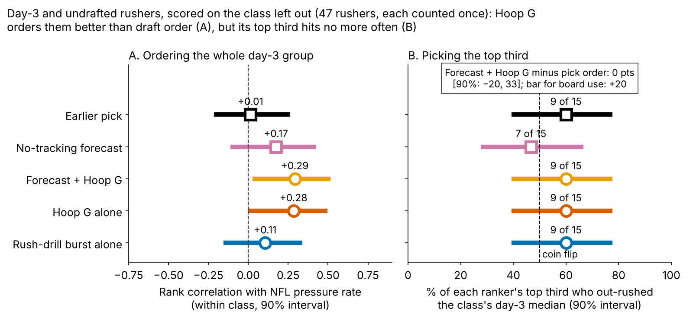

# Run-the-Hoop Bend Earns a Day-3 Rusher the First Film Look, Not a Board Spot

**On a Combine class the model never saw, one sd of Hoop G was worth {{ho_hoop_season}} extra pressures per 450-rush season [90%: {{ho_hoop_season_lo}}, {{ho_hoop_season_hi}}] beyond a forecast built from pick, weight, role, NGS score, 10-yard split and 3-cone (n = {{n_an}} rushers). That is the best of six drill measures we listed, but within what the best of six reaches by chance (family-wise p = {{ho_hoop_pfw}}). Pass-rush-drill burst adds nothing ({{ho_burst_season}} per sd).**

**Hoop G** = how hard a lineman leans sideways at the tightest half-second of the Run-the-Hoop figure-eight: speed squared divided by turn radius, in g, ranked within his Combine class. The median lineman leans {{hoop_g_median}} g, which is {{hoop_speed_median}} yd/s on a {{hoop_radius_median}}-yard radius.

**So what for a team**

1. **Film order, not board order.** Watch the day-3 edge rushers in their class's top third of Hoop G first. Within day 3 it orders rushers better than draft order did, but its top third hits no more often.
2. **Drop pass-rush-drill burst.** One rep repeats at {{rel_burst1}}. The official 3-cone and 10-yard split carry NFL get-off at least as well.
3. **2026 snap calls** for eight named day-3 rushers are in Figure 4. NFL pressure makes those calls; Hoop G only put the names on the list.

## Why bend, and why day 3

On {{epa_n}} randomly sampled NFL pass plays involving these linemen, a pressured snap cost the offense {{epa_press}} expected points more than a clean one [{{epa_press_lo}}, {{epa_press_hi}}]. {{pct_day3_dl}}% of the {{n_dl}} defensive linemen in the 2023–25 classes went on day 3 or undrafted, where tape is thin and the board needs a tiebreak. Before fitting anything we set the smallest effect worth acting on: {{margin_season}} pressures per 450-rush season per sd, about {{margin_epa}} expected points a season.

Figure 1 shows the problem in four players. Javon Solomon (BUF) and Cedric Johnson (CIN) lean hard in the hoop and win in the NFL. Tyrion Ingram-Dawkins (MIN) leans almost as hard and does not. Byron Murphy (SEA) is below his class in the hoop and still beats his forecast by {{h3_over}} pressures a season. The NFL bend beneath each lap does not track the lap.

## The NFL end of the chain works; the drill end does not

We tested three links: does the drill show up in the matching NFL movement, and does that movement produce pressure? NFL movements come from a median of {{median_random_rushes}} randomly sampled rushes per lineman, measured against his own start (the data have no blockers or ball). Every link controls for weight and EDGE share. The right column is the no-tracking benchmark: the official time that should carry the same trait.

| Link | Tracking ρ [90%] (n) | Stopwatch ρ [90%] (n) |
|---|---|---|
| Combine → NFL bend (sideways g, first 2 s) | Hoop G {{tr_hoop_g_bend}} [{{tr_hoop_g_bend_lo}}, {{tr_hoop_g_bend_hi}}] ({{tr_hoop_g_bend_n}}) | 3-cone {{bm_3c_bend}} [{{bm_3c_bend_lo}}, {{bm_3c_bend_hi}}] ({{bm_3c_bend_n}}) |
| Combine → NGS get-off | Drill burst {{tr_burst_quick}} [{{tr_burst_quick_lo}}, {{tr_burst_quick_hi}}] ({{tr_burst_quick_n}}) | 10-yd split {{bm_split_quick}} [{{bm_split_quick_lo}}, {{bm_split_quick_hi}}] ({{bm_split_quick_n}}) |
| NFL bend → pressure rate | {{gp_g_bend}} [{{gp_g_bend_lo}}, {{gp_g_bend_hi}}] ({{gp_g_bend_n}}) | — |
| NGS get-off → pressure rate | {{gp_quick}} [{{gp_quick_lo}}, {{gp_quick_hi}}] ({{gp_quick_n}}) | — |

*Table 1. Partial Spearman ρ, class-stratified bootstrap 90% intervals. Repeatability: one hoop lap {{rel_hoop1}} (only {{rel_hoop_nrep}} linemen ran two), one rush-drill rep {{rel_burst1}} (n = {{rel_burst_nrep}}); NFL bend {{rel_game_bend}} split-half, NGS get-off {{rel_getoff_season}} season to season.*

Linemen who get off quicker and bend harder on NFL snaps generate more pressure. The Combine end breaks: the rush-drill rep cannot see get-off ({{tr_burst_quick}}), and the 3-cone carries it better ({{bm_3c_quick}} [{{bm_3c_quick_lo}}, {{bm_3c_quick_hi}}], n = {{bm_3c_quick_n}}). Hoop G reaches NFL bend only weakly. On the {{tr_hoop_bend_3csub_n}} linemen who ran both, Hoop G does no better than the stopwatch 3-cone ({{tr_hoop_bend_3csub}} against {{bm_3c_bend}}). Hoop G matters because {{n_hoop_no3c}} of the {{n_hoop}} hoop runners never ran the 3-cone.

## Held out by class, Hoop G leads but does not clear the screen

**Baseline without tracking:** log draft pick, Combine weight, NFL EDGE share, NGS athleticism score, official 10-yard split and 3-cone. **Outcome:** career pressure rate through 2025, shrunk toward the {{press_mean}}% mean, for linemen with 30+ rushes. **Out of class:** each class ({{ho_n_per_class}} rushers) is forecast by a model fit on the other two. All drill measures are standardized within Combine year.

| Model (held out, n = {{n_an}}) | R² | Rank ρ | R² gain [90%] |
|---|---|---|---|
| Pick + role only | {{r2_pick}} | {{rho_pick}} | — |
| No-tracking baseline | {{r2_base}} | {{rho_base}} | — |
| Baseline + Hoop G | {{r2_hoop}} | {{rho_hoop}} | {{dr2_hoop}} [{{dr2_hoop_lo}}, {{dr2_hoop_hi}}] |
| Baseline + drill burst | {{r2_burst}} | {{rho_burst}} | {{dr2_burst}} [{{dr2_burst_lo}}, {{dr2_burst_hi}}] |

*Table 2. Leave-one-class-out fit. The extra Combine times cost more in fitting noise than they add.*

- **Hoop G** is positive in 2023 and 2024 ({{ho_hoop_2023}}, {{ho_hoop_2024}}) and flat in 2025 ({{ho_hoop_2025}}). Only {{ho_hoop_pabove}}% of bootstrap draws clear the action margin.
- **The estimate does not hinge on one implementation, but its size does move.** Weighting rushers by the inverse chance of having all six drill measures ({{n_in_set}} of {{n_co30}}) gives {{ipw_hoop_season}}. A separate script with different smoothing, shrinkage, imputation and seed gives {{v_slope}} [{{v_lo}}, {{v_hi}}] (n = {{v_n}}). Prior strength and rush minimums move it between {{sens_slope_min}} and {{sens_slope_max}}.
- **Burst is out:** {{ho_burst_pinside}}% of draws fall inside the margin, and it is negative in two of three classes.
- **Clubs do not pay for bend.** Top-third Hoop G linemen went at a median pick of {{pick_top_third}}, bottom-third at {{pick_bot_third}}.

## Within day 3, Hoop G orders film but does not pick players

We ranked the {{d3_n}} day-3 and undrafted rushers with 30+ rushes ({{d3_n_per_class}} by class), each counted once. The Hoop G weight added to the forecast comes from the other two classes. The bar for letting Hoop G touch board order: its top third must beat pick order's top third by {{hg_bar}} points of hit rate, with the 90% lower bound above zero.

- **Ordering:** forecast + Hoop G ρ = {{dr_fch}} [{{dr_fch_lo}}, {{dr_fch_hi}}] against {{dr_pick}} for draft order (gap {{dd_fch_pick}} [{{dd_fch_pick_lo}}, {{dd_fch_pick_hi}}]).
- **Picking:** both top thirds hit {{tt_fch_k}} of {{tt_fch_n}} ({{tt_fch_pct}}% [{{tt_fch_lo}}, {{tt_fch_hi}}]). The gap is {{hg_gap}} points [{{hg_gap_lo}}, {{hg_gap_hi}}], far from the bar. As a picker, Hoop G is a coin flip.

That is why the use is film order. It changes which tape a scout opens first, not where a name sits.

## 2026 calls for the day-3 rushers Hoop G flagged

- **Go:** {{T:go}}. Johnson ({{go0_pr}}% against a {{go0_fc}}% forecast over {{go0_rush}} rushes) and Solomon ({{go1_pr}}% against {{go1_fc}}%) cannot drop below forecast in one season. Give both third-down snaps from wide alignments. Brinson is the interior case: use him as the looper on stunts. He flips below {{go2_flip}}%.
- **No-go:** {{T:nogo}}. Each needs a 2026 rate of at least {{nogo_flip_min}}% to reach his forecast; keep them on run-down rotation until then.
- **Hold:** {{T:hold}}. Stackhouse and Kennard first need 100 rushes.

The sampled splits (Figure 4) are {{cards_min_sampled}} rushes each, so they direct film cut-ups, not grades. The rule is frozen (sha256 `{{T:hash}}…`). After the 2026 class's first season, Hoop G must show a positive slope on pressure over forecast (one-sided p < 0.10) or the flag is retired. Power at the observed slope is {{pws_obs_1}}% for one class and {{pws_obs_3}}% for three.

## Limitations

- **Small samples.** {{n_an}} rushers in the model, {{d3_n}} on day 3, mostly single drill reps: {{pct_one_run}}% ran one hoop lap.
- **Multiplicity.** This writeup reports {{n_tests}} tests; only the six-measure family is corrected. Earlier work screened ideas on these same classes, so 2026 is the first clean test.
- **Thin NFL tracking.** A median of {{median_random_rushes}} sampled rushes per lineman, with no blockers or ball. Bend may follow from beating the tackle rather than cause it.
- **Weak baseline.** Pick + role alone beats the full no-tracking model out of class, so gains over it look larger than gains over a scout.
- **Survivorship and roles.** Rates need 30+ rushes; injuries, scheme and roster moves are not modelled.

## Reproduce

`analysis.py` (about 3 minutes) rebuilds every number, figure and this text from `data/processed`, and runs `verify.py`, the independent re-implementation of the headline slope.
