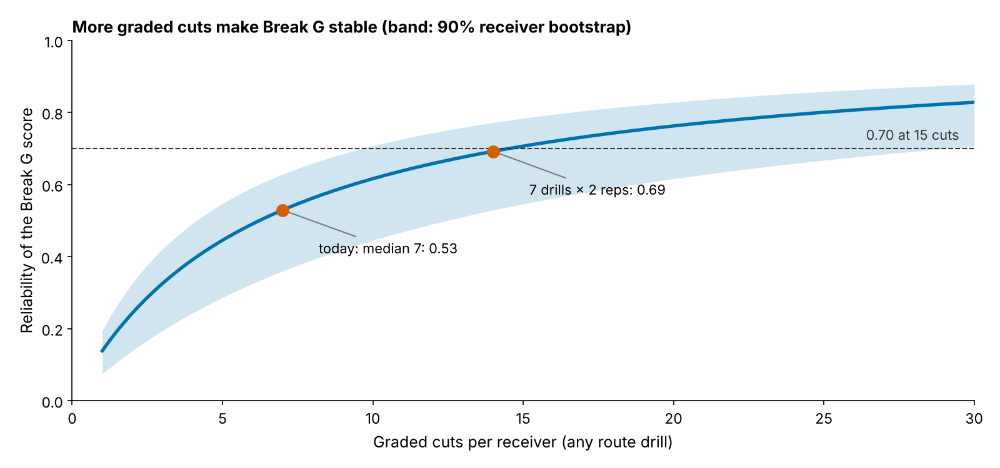

# Appendix: robustness, measurement error and the 2025 day-3 names

Rendered by `analysis.py`; every number is in `all_numbers.json` and the starred ones are recomputed by `verify.py` (own bootstrap seeds; the held-out fit is also redone in statsmodels).

## Equivalence, measurement error and sensitivity

| Check | Result |
|---|---|
| TOST of the held-out slope at ±3 in* | p = 0.11 (benefit arm 0.001, harm arm 0.11) |
| TOST of the hierarchical slope at ±3 in (Wald) | p = 0.04 |
| Hierarchical slope, receiver and class effects (167 player-seasons, 91 receivers)* | −0.5 [−2.8, 1.8] |
| Slope with the between-drill ICC (0.17 [0.10, 0.23]) redrawn in every resample* | −1.2 [−3.6, 1.0] |
| Slope on the raw drill average, per observed sd (no error correction)* | −1.0 [−2.8, 0.8] |
| Held-out slope across 6 outcome builds (route cut-offs 50/100, no cushion term, unweighted, wide receivers only)* | −3.0 to −0.7 in per sd |
| Mechanics, held out: brake into / speed through / drive out of the cut | −1.6, 1.4, −2.2 |
| Break G split-half (five drills vs the other five)* | 0.28 [0.15, 0.40], 145 receivers |
| Same drill run twice: median ICC* | 0.05 (70 pairs) |
| NFL Break G, odd vs even snaps* | 0.23, 113 receivers |
| Transfer corrected for both reliabilities* | −0.08 |
| What 3 inches of SOE is worth | about 0.44 catches a season |

## Day 3: the earlier 100-route back-test and the film queue

With 100+ routes in both seasons (20 pairs, 16 receivers), the SOE half hit 3 of 10 and the pick half 4 of 10* (difference −10 points [−36, 12]*, permutation p = 0.81). Of 12 day-3 receiver-seasons above zero, 6 stayed above zero*: 50% [28, 72], a coin flip.

The pick-gap override rule (pick gap under 32) overrode pick order 11 times and was wrong 36 per 100 [0, 75]* against a break-even of 64*.

## 2025 day-3 wide receivers above zero (film aid only; the body publishes no ordered list)

"Off the list below" is the 2026 SOE over his first 150 routes that pulls his true SOE under zero. Splits are sampled-snap SOE against the league in the same coverage or alignment; only 5 of 36 cells reach 30 snaps.

| Receiver (2025 team) | True 2025 SOE, in | Off the list below | Man, in (snaps) | Zone, in (snaps) | Slot, in (snaps) | Wide, in (snaps) |
|---|---|---|---|---|---|---|
| Malik Washington (MIA) | +16.1 | −51 | −1 (5) | +23 (34) | +24 (11) | +19 (26) |
| Demario Douglas (NE) | +13.4 | −32 | +33 (14) | −13 (26) | +5 (27) | −4 (11) |
| Troy Franklin (DEN) | +3.4 | −14 | −16 (9) | −17 (31) | +7 (12) | −24 (27) |
| Tez Johnson (TB, HOLD) | +10.9 | −30 | +4 (14) | +3 (26) | −13 (14) | +9 (25) |
| Arian Smith (NYJ, HOLD) | +10.0 | −24 | −9 (11) | +14 (29) | −6 (17) | +18 (23) |
| Isaiah Bond (CLE, HOLD) | +3.1 | −10 | +11 (14) | +36 (26) | +25 (16) | +29 (24) |
| Jaylin Lane (WAS, HOLD) | +2.8 | −6 | −4 (19) | −13 (21) | +3 (13) | −17 (25) |
| Mitch Tinsley (CIN, HOLD) | +1.8 | −3 | +8 (14) | +4 (26) | +29 (7) | 0 (33) |
| Kayshon Boutte (NE, HOLD) | +0.6 | −2 | −7 (9) | +2 (30) | −10 (4) | +1 (35) |
