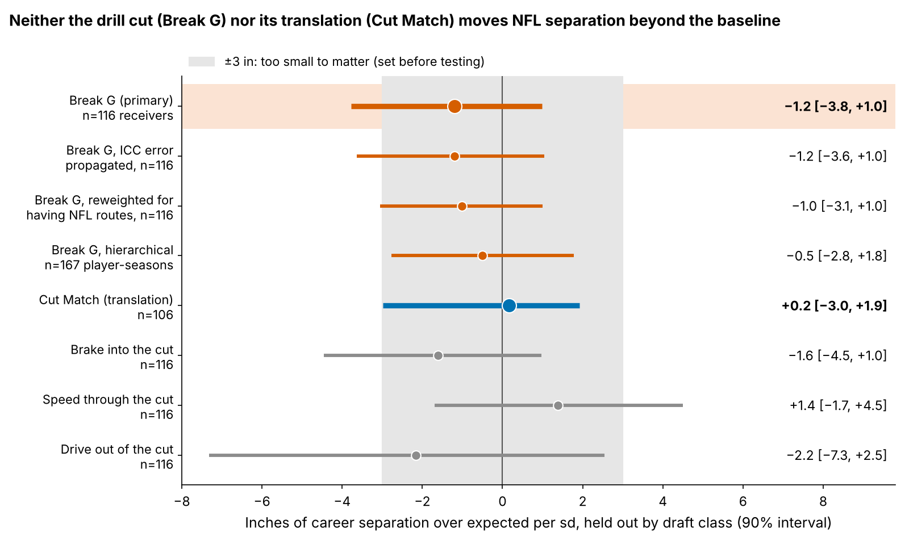
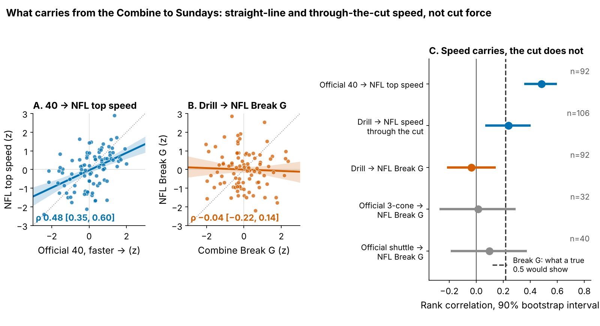

# Combine Route Cuts Do Not Translate Into NFL Separation

**A receiver who cuts 1 sd harder in Combine route drills is no more open in the NFL: −1.2 inches of separation per sd (90% interval −3.8 to +1.0), across 116 receivers from draft classes the model never saw. A receiver whose NFL cuts look most like his drill cuts is no more open either: +0.2 inches per sd [−3.0, +1.9], 106 receivers.**

- **Break G**, in one line: how hard the receiver pushes into the ground in the one second around his first real cut, as a share of body weight. In drills it ranks like the speed he sheds into the plant (ρ = 0.70 per rep), which a laser gun or GPS vest can time. One sd is 0.021 g.
- **Cut Match**, in one line: does his cut on Sundays look like his cut in Indianapolis? For the routes he ran in both, his speed through the cut every 0.1 s, each read against the league median for that route in that setting; the gap (yd/s) is the distance between the two curves (Figure 1). Higher Cut Match = closer than his rep counts predict.
- **Separation over expected (SOE)**: inches more open at the throw than Next Gen Stats separation predicts from alignment, cushion and season, over full regular seasons.

Why it matters: clubs pay for the cut, and the 2023 class's rookie deals end after the 2026 season, so day-3 receiver prices get set this winter. A receiver 1 sd harder in the route drills goes 9% earlier in the draft [1, 17] at the same position. Drill reps are z-scored within drill and Combine year, so protocol changes between Combines do not leak in.

## 1. Neither the cut nor its translation adds to separation

The outcome is route-weighted career SOE (213 player-seasons, median 231 routes). The baseline without tracking, fixed before testing, is log pick, official 40, weight, NGS athleticism score and a tight-end flag. Every test fits on two draft classes and scores the third.

| Held out by draft class | Estimate [90% bootstrap] | n |
|---|---|---|
| Baseline R² (error) | 0.00 (8.6 in) | 116 receivers |
| Change in R² from adding Break G | 0.013 [−0.141, 0.079] | 116 receivers |
| **Break G, inches per sd** | **−1.2 [−3.8, +1.0]** | 116 receivers |
| **Cut Match, inches per sd** | **+0.2 [−3.0, +1.9]** | 106 receivers |

Break G is noisy (score reliability 0.50), so each receiver's drill average is shrunk by his own reliability and the slope is per sd of true Break G. Power: 68% at ±3 in; 80% only for 3.5 in. Redrawing the reliability in every resample gives −3.6 to +1.0; reweighting for having NFL routes (116 of 149) gives −1.0 [−3.1, +1.0]. Across all 5 Combine-side metrics tested against SOE (Break G, Cut Match and three cut phases), the smallest two-sided p is 0.29, against a Bonferroni line of 0.01.

What the numbers look like for three named wide receivers (closest, middle and farthest Cut Match of 49; medians of his reps on shared routes):

| Receiver (class, pick) | Drill reps: in → slowest → out, yd/s | NFL breaks: in → slowest → out, yd/s | Break G, drill / NFL (sd) | Cut Match gap, yd/s | Career SOE, in |
|---|---|---|---|---|---|
| **Jaxon Smith-Njigba** (2023, R1-20) | 5.9 → 5.1 → 6.4 (4 reps) | 4.4 → 4.2 → 5.5 (6 breaks) | +0.6 / −0.4 | 0.44 | +2.6 |
| **Demario Douglas** (2023, R6-210) | 7.2 → 4.9 → 7.1 (6 reps) | 4.8 → 3.6 → 5.0 (12 breaks) | +0.5 / −0.4 | 0.58 | +9.2 |
| **Ryan Flournoy** (2024, R6-216) | 7.2 → 3.9 → 6.5 (9 reps) | 4.7 → 2.4 → 4.8 (18 breaks) | +0.3 / 0.0 | 0.97 | −6.0 |

Ryan Flournoy carries more speed than the league through his drill cuts and less on Sundays (Figure 1, bottom right), the widest mismatch of the 49, and his career SOE is −6.0 inches; but Demario Douglas, a middling match, is the most open of the three. Across all 106 receivers, translation and separation do not line up.

## 2. Why: speed carries, the cut does not

| What carries from the Combine to the NFL | ρ [90%] | n |
|---|---|---|
| Official 40 → NFL top speed | 0.48 [0.35, 0.60] | 92 receivers |
| Drill → NFL speed through the cut (each vs its league) | 0.24 [0.07, 0.40] | 106 receivers |
| Drill → NFL Break G | −0.04 [−0.22, 0.14] | 92 receivers |
| No tracking: official shuttle → NFL Break G | 0.10 [−0.19, 0.37] | 40 receivers |

A receiver who carries speed through his drill cuts tends to carry it on Sundays, but how hard he plants does not transfer, and the official shuttle does no better (3-cone: 0.01, n=32). Noise is not the reason: with reliabilities of 0.51 (drill) and 0.37 (NFL), a true drill-to-game correlation of 0.5 would show up as 0.22; corrected for both, the observed −0.04 is −0.08.

The reason is entry speed. Combine stems are entered a median 1.4 yd/s faster than the same NFL route (hitch: 6.9 vs 4.7 yd/s), so the drill grades a hard plant at a speed the NFL rarely asks for.

## 3. A drill protocol a Combine staff can adopt

- **More reps.** Drills are interchangeable for reliability, so what counts is total graded cuts: today's median of 7 gives 0.53; 15 cuts reach 0.70. Drills run twice still transfer −0.12 [−0.36, +0.10] (43 receivers).
- **NFL entry speed.** Only 35% of drill reps are entered within 1 yd/s of NFL speed for that route, and 4 of 265 curl, comeback and hook reps. Matched reps, mostly slants, transfer −0.05 [−0.16, +0.07] (100 receivers).

Protocol: grade at least 15 cuts per receiver, re-stem the curl, comeback and hook at NFL hitch speed (about 4.7 yd/s, a controlled three-quarter stem), and give Break G zero weight until a re-stemmed drill transfers.

## 4. Day 3: the draft order stands

On 20 consecutive-season pairs from 16 day-3 or undrafted receivers, forecast leave-one-draft-class-out, the top half by last season's SOE stayed above zero 3 of 10 times and the top half by pick 4 of 10 (−10 points [−36, +12], receiver-cluster bootstrap; 80% power only for a 37-point gap). The bar for issuing a separation list was a lower bound above zero, so there is no list in the body; the film order, with man/zone and slot/wide splits, is in the appendix as a coin-flip prioritization tool only.

## Bottom line

1. **Take Break G out of the price.** Clubs pay 9% in pick position per sd of it for no separation.
2. **Do not buy translation either.** A receiver whose NFL cut mirrors his drill cut is no more open.
3. **Read the Combine for speed, not cut force.** The 40 and speed through the cut carry to Sundays; plant force does not. Fix the drill (at least 15 cuts, hitch family at NFL speed) before grading the cut again.

## Limitations

- **Not blind.** All three classes were seen while building this; the ±3 inch margin and the baseline were fixed before testing.
- **Power.** 68% at ±3 in; harm is not excluded (lower bound −3.8 inches per sd).
- **Game tracking is a sample**: up to 40 plays per player, half top-EPA, no defenders or ball. Cut Match rests on a median 14 NFL breaks and 7 drill reps (odd/even reliability 0.46); the season tests use full-season NGS.
- **Survivorship.** 116 of 149 drill-scored receivers logged NFL routes; reweighting does not change the answer.
- **Benchmarks are thin.** Few receivers run the shuttle or 3-cone (40 and 32).

## Appendix

`verify.py` rebuilds Break G and Cut Match from the raw frames with its own code, its own seeds and a second leave-one-class-out implementation. `appendix.md` holds equivalence tests, sensitivity ranges, the day-3 film order and its coverage splits.
