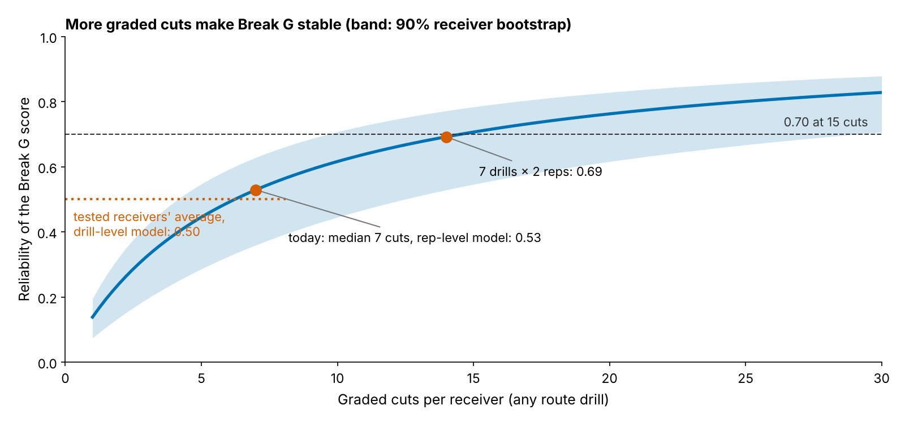

# Appendix: robustness, measurement error and the 2025 day-3 names

Rendered by `analysis.py`; every number is in `all_numbers.json` and the starred ones are recomputed by `verify.py` (own bootstrap seeds; the held-out fit is also redone in statsmodels).

## Error definitions (Section 1)

| Held-out baseline error | Value |
|---|---|
| Root-mean-square miss on career SOE, one row per receiver, weighted by career routes (body)* | {bl_rmse} in |
| Same, unweighted (every receiver counts once)* | {bl_rmse_unw} in |
| Route-weighted sd of career SOE across the same receivers | {soe_sd} in |

The ROPE column of Table 1 is a flat-prior posterior: normal, centred on the estimate, with the bootstrap sd as its standard error. Multiplicity: none of the {n_tests} season-level slopes in Figure 2 excludes zero, so no correction is needed to read the null. Inclusion weights come from a ridge logistic model of reaching NFL routes on pick, tight-end flag, class and Break G, refitted in each resample; they move little because the baseline already holds pick.

## Reliability of the drill score (Section 3)

| Break G score | Reliability |
|---|---|
| Today, median {why_reps} graded cuts (rep-level model)* | {rel_7x1} |
| Tested receivers' average (drill-level model used for the shrinkage)* | {rel_main} |
| Two reps in each of 7 drills* | {rel_7x2} |
| {cuts70} graded cuts* | {t70} |
| Transfer of drills run twice ({two_np} receivers) | {two} [{two_lo}, {two_hi}] |

## Equivalence, measurement error and sensitivity

| Check | Result |
|---|---|
| TOST of the held-out slope at ±{sesoi} in* | p = {tost} (benefit arm {tost_up}, harm arm {tost_dn}) |
| TOST of the hierarchical slope at ±{sesoi} in (Wald) | p = {hm_tost} |
| Hierarchical slope, receiver and class effects ({hm_n} player-seasons, {hm_np} receivers)* | {hm} [{hm_lo}, {hm_hi}] |
| Slope with the between-drill ICC ({icc_bg} [{icc_bg_lo}, {icc_bg_hi}]) redrawn in every resample* | {ho} [{eiv_lo}, {eiv_hi}] |
| Slope on the raw drill average, per observed sd (no error correction)* | {ho_raw} [{ho_raw_lo}, {ho_raw_hi}] |
| Held-out slope across {sens_n} outcome builds (route cut-offs 50/100, no cushion term, unweighted, wide receivers only)* | {sens_lo} to {sens_hi} in per sd |
| Mechanics, held out: brake into / speed through / drive out of the cut | {m_decel}, {m_vapex}, {m_reacc} |
| Break G split-half (five drills vs the other five)* | {rel_bg} [{rel_lo}, {rel_hi}], {rel_n} receivers |
| Same drill run twice: median ICC* | {icc_med} ({icc_pairs} pairs) |
| NFL Break G, odd vs even snaps* | {grel}, {grel_n} receivers |
| Transfer corrected for both reliabilities* | {bgc_dis} |
| What 3 inches of SOE is worth | about {catch3} catches a season |

## Day 3: tests behind the bottom line

Receiver level (body): {r_n} receivers, one season pair each, forecasts leave-one-class-out; correct above/below-zero calls {r_f1}% (pick + SOE) vs {r_f0}% (pick only)*. Pair level: over {p_n} pairs ({p_np} receivers) the top half by SOE stayed above zero {p_soe}% of the time against {p_pick}% for the top half by pick ({p_d} points [{p_d_lo}, {p_d_hi}])*.

With 100+ routes in both seasons ({d3_n} pairs, {d3_np} receivers), the SOE half hit {hl_k1} of {hl_n} and the pick half {hl_k0} of {hl_n}* (difference {hl_d} points [{hl_d_lo}, {hl_d_hi}]*, permutation p = {hl_p}). Of {fq_n} day-3 receiver-seasons above zero, {fq_k} stayed above zero*: {fq_pct}% [{fq_lo}, {fq_hi}], a coin flip.

The pick-gap override rule (pick gap under {gap}) overrode pick order {ov_n} times and was wrong {ov_wr} per 100 [{ov_wr_lo}, {ov_wr_hi}]* against a break-even of {ov_be}*.

## 2025 day-3 wide receivers above zero (film aid only; the body publishes no ordered list)

"Off the list below" is the 2026 SOE over his first 150 routes that pulls his true SOE under zero. Splits are sampled-snap SOE against the league in the same coverage or alignment; only {cells30} of {cells} cells reach 30 snaps.

{{SPLITS}}
