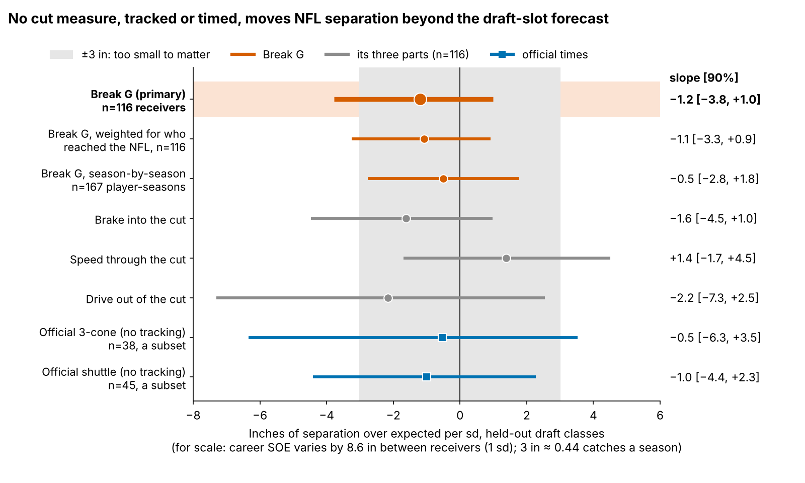

# Combine Route-Drill Cuts Do Not Carry to NFL Separation

**A receiver who cuts 1 sd harder in Combine route drills is no more open in the NFL: −1.2 inches of separation over expected per sd (90% interval −3.8 to +1.0), across 116 receivers from draft classes the model never saw.**

**Break G is how much speed a receiver sheds into his plant and how hard he drives out**, counted as the yards per second of velocity he changes in the second around his first cut. Receivers 1 sd apart differ by 0.22 yd/s. On film, read three speeds: in, slowest, out (Table 3).

Why receivers and tight ends: route-breaking is the skill the Combine films most directly. Ten route drills are tracked at 10 Hz, and we grade every cut with the same code we run on NFL snaps. Why now: clubs already price it. A receiver 1 sd higher in Break G goes 9% earlier in the draft [1, 17] at the same position (149 receivers). The 2023 class's rookie deals expire after this season.

- **Separation over expected (SOE)**: inches more open at the throw than Next Gen Stats separation predicts from alignment, cushion and season, over full regular seasons (213 player-seasons, median 231 career routes).
- **Combine years**: every rep is compared only with the same drill in the same year, so protocol changes do not leak in.
- **Samples**: 149 receivers with a drill score; 116 with NFL separation (season tests); 92 of those with 8+ sampled NFL breaks and an official 40 (transfer tests).

![Figure 1. Player cards for the three receivers of Table 3, the hardest, middle and softest drill cutters among 49 wide receivers with 200+ career routes and 5+ sampled NFL breaks. Top: speed through the cut on route families he ran in both settings, aligned on the slowest point. Bottom: his Break G and its three parts in sd against peers. The drill order not surviving means that across 92 receivers, drill and NFL Break G rank-correlate −0.04: a receiver's drill rank says nothing about where his Sunday breaks rank.](figures/fig1_cuts.png)

## 1. Break G adds nothing to a no-tracking forecast

The baseline uses log pick, official 40, weight, NGS athleticism score and a tight-end flag. It was fixed before the test, fitted on two draft classes and scored on the third. Intervals are 90%, from resampling receivers within class.

| Held-out test | Estimate [90%] | P(\|effect\| < 3 in) | n |
|---|---|---|---|
| No-tracking baseline R² (error per receiver) | 0.00 (8.6 in) | | 116 |
| Change in R² from adding Break G | 0.013 [−0.141, 0.079] | | 116 |
| **Break G, inches per sd** | **−1.2 [−3.8, +1.0]** | **90%** | 116 |
| Break G, weighted for who reached the NFL | −1.1 [−3.3, +0.9] | | 116 of 149 |
| Official 3-cone, inches per sd (no tracking) | −0.5 [−6.3, +3.5] | 67% | 38 |
| Official short shuttle, inches per sd (no tracking) | −1.0 [−4.4, +2.3] | 80% | 45 |

The error is the root-mean-square miss on career SOE, each receiver weighted by his routes: 8.6 in, the size of the spread itself. Counting every receiver once it is 14.9 in, because short careers are noisy. Power is 68% at ±3 in; 80% only at 3.5 in. So the third column states the null directly: with a flat prior, the Break G effect has a 90% probability of being smaller than 3 inches either way. That is likely small, not proven zero. Cut quality as the Combine measures it, tracked or timed, does not price separation.

## 2. Why: the drill grades a different cut

| What is compared | Rank corr. [90%] | n |
|---|---|---|
| Official 40 → NFL top speed | 0.48 [0.35, 0.60] | 92 |
| Same, random plays only | 0.43 [0.27, 0.56] | 87 |
| **Combine → NFL Break G** | **−0.04 [−0.22, 0.14]** | 92 |
| Same, random plays only | 0.13 [−0.05, 0.30] | 94 |
| Same, top-EPA plays only | −0.19 [−0.34, −0.03] | 102 |
| Same route family, NFL breaks entered at drill speed | 0.04 [−0.05, 0.13] | 98 |
| Same route family, entry speed removed on both sides | −0.03 [−0.11, 0.05] | 114 |

Speed carries; the cut does not. Noise is not the reason: given both measures' reliabilities, a true 0.5 would still read 0.22.

The drill demands a cut at 6.9 yd/s and the NFL asks for 4.7 (hitch family). 47 of 49 wide receivers enter the drill cut faster than the same NFL route, by a median 1.4 yd/s, and Break G rises with entry speed (rank corr. 0.37 in drills, 0.56 in games). We tested that explanation. Keeping only NFL breaks entered at drill speed (37% of them) moves the transfer from −0.07 to 0.04. Removing entry speed from both sides gives −0.03. Both stay well short of 0.22. Entry speed is part of the gap, not all of it: even at matched speed the drill does not rank receivers the way Sunday breaks do.

Half of each receiver's sampled plays are his top-EPA plays, which biases these rows. The two halves pull in opposite directions: −0.19 on top-EPA plays, +0.13 [−0.05, 0.30] on random plays. So the sample may hide a small transfer, but the season tests in Section 1 use full-season NGS and find no separation from it.

| Receiver (drill Break G rank of 49) | Drill cut, yd/s: in → slowest → out | NFL cut, yd/s: in → slowest → out | Takeaway |
|---|---|---|---|
| Kayshon Boutte (#1, +1.8 sd) | 7.1 → 4.5 → 5.9 | 5.7 → 5.0 → 5.9 | sheds 2.6 yd/s into the drill plant, 0.7 on Sundays (least of the three) |
| Ryan Flournoy (#25, +0.3 sd) | 7.2 → 3.9 → 6.5 | 4.7 → 2.4 → 4.8 | sheds 3.3 yd/s into the drill plant, 2.3 on Sundays (most of the three) |
| Jake Bobo (#49, −1.4 sd) | 6.7 → 3.1 → 5.6 | 5.0 → 3.9 → 5.5 | sheds 3.6 yd/s into the drill plant, 1.1 on Sundays (middle of the three) |

Kayshon Boutte, the hardest drill cutter, barely slows on Sundays. Ryan Flournoy, in the middle of the drill order, sheds the most. Career SOE does not follow the drill order either: the eight hardest and eight softest drill cutters average +1.0 and −2.3 inches.

## 3. What a Combine staff and a position coach can do

Grade at least 15 cuts per receiver (today's median is 7). Keep the slant, re-stem the curl, comeback and hook at NFL hitch speed (about 4.7 yd/s, a controlled three-quarter stem), and give Break G zero weight until a re-stemmed drill transfers. For a position coach: rep breaks at game tempo, because nothing here says a harder full-speed plant buys separation.

## 4. The 2025 day-3 receivers: a coin-flip film aid

These are the day-3 or undrafted wide receivers who were more open than expected in 2025. The table shows what each name's drill and NFL breaks look like and what 2026 result would drop him off the list. Read it as a film aid, not a ranking:

| 2025 day-3 receiver (team) | Above zero | True 2025 SOE, in | Off the list if first 150 routes of 2026 below, in | Drill Break G, sd | Speed shed into plant, drill → NFL, yd/s | Man / zone snaps | Slot / wide snaps |
|---|---|---|---|---|---|---|---|
| Malik Washington (MIA) | 2024 and 2025 | +16.1 | −51 | −0.3 | 3.6 → 0.6 | 5 / 34 | 11 / 26 |
| Demario Douglas (NE) | 2024 and 2025 | +13.4 | −32 | +0.5 | 2.4 → 1.2 | 14 / 26 | 27 / 11 |
| Troy Franklin (DEN) | 2024 and 2025 | +3.4 | −14 | −0.1 | 3.5 → 2.2 | 9 / 31 | 12 / 27 |
| Tez Johnson (TB) | 2025 | +10.9 | −30 | −0.1 | 2.6 → 0.8 | 14 / 26 | 14 / 25 |
| Arian Smith (NYJ) | 2025 | +10.0 | −24 | +1.7 | 5.0 → 2.1 | 11 / 29 | 17 / 23 |
| Isaiah Bond (CLE) | 2025 | +3.1 | −10 | −1.3 | 3.9 → 1.9 | 14 / 26 | 16 / 24 |
| Jaylin Lane (WAS) | 2025 | +2.8 | −6 | +0.2 | 3.0 → 2.7 | 19 / 21 | 13 / 25 |
| Mitch Tinsley (CIN) | 2025 | +1.8 | −3 | +0.5 | 2.3 → 1.6 | 14 / 26 | 7 / 33 |
| Kayshon Boutte (NE) | 2025 | +0.6 | −2 | +1.8 | 2.6 → 0.7 | 9 / 30 | 4 / 35 |

Only 5 of 36 man/zone and slot/wide cells reach 30 sampled snaps. The splits themselves are in the appendix.

## Bottom line

1. **Take Break G out of the price.** Clubs pay 9% in pick position per sd of it and get no separation back.
2. **Fix the drill before grading it.** Grade 15+ cuts, re-stem the hitch family at NFL entry speed, and give it zero weight until it transfers.
3. **On day 3, draft order stands.** Across 28 day-3 receivers, pick plus last season's SOE called the next season above or below zero 39% of the time, against 54% for pick alone (−14 points [−32, 0]). That is too few receivers to order names either way, which is why Table 4 is a film aid.

## Limitations

- **Not blind.** All three classes were seen while this was built. The ±3 inch margin and the baseline were fixed before each test.
- **Power.** 68% at the margin, and harm is not excluded (lower bound −3.8 inches per sd).
- **Selection.** 116 of 149 drill-scored receivers logged NFL routes. Weights for who reached the NFL give −1.1, but they cannot repair receivers who never played.
- **Game tracking is a sample.** Up to 40 plays per player, half top-EPA, with no defenders or ball. This affects Tables 2–4 and Figures 1 and 3, not the season tests, which use full-season NGS.
- **Small benchmarks.** Few receivers run the official 3-cone (38) or shuttle (45).

## Appendix

`verify.py` rebuilds both Break G pipelines from the raw frames and refits the held-out model a second way, with its own bootstrap seeds. It reproduces 124 of 124 checked numbers, including both error definitions: 68 exactly, 56 resampled within tolerance. `appendix.md` holds the reliability table, error definitions, measurement-error and multiplicity checks, the protocol-subset figure and the man/zone and slot/wide splits.
