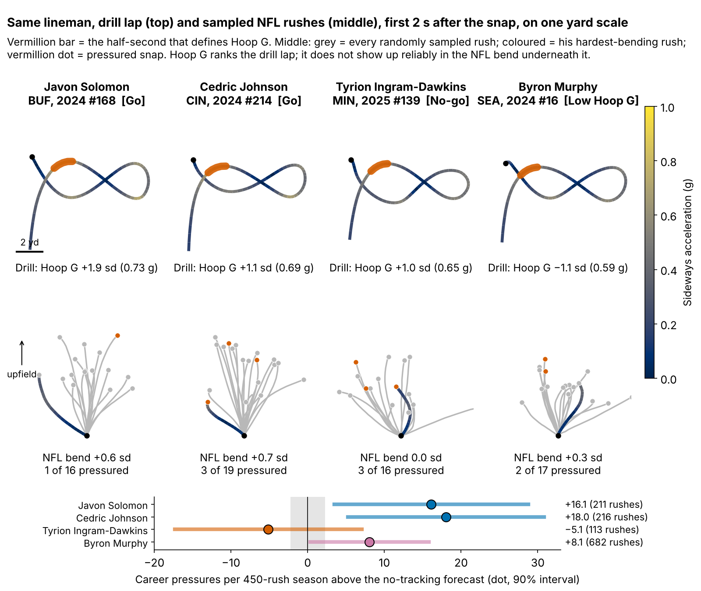
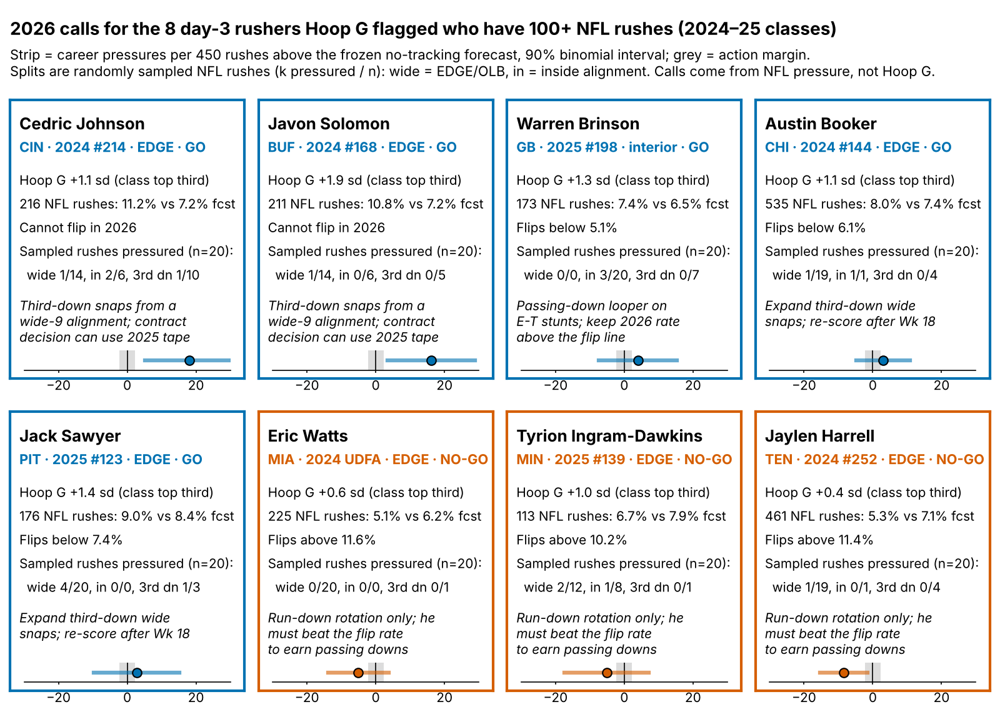

# Run-the-Hoop Bend Earns a Day-3 Rusher the First Film Look, Not a Board Spot

**On a Combine class the model never saw, one sd of Hoop G was worth {{ho_hoop_season}} extra pressures per 450-rush season [90%: {{ho_hoop_season_lo}}, {{ho_hoop_season_hi}}] beyond a no-tracking forecast (n = {{n_an}} rushers). It is the best of six drill measures we listed, but within what the best of six reaches by chance (family-wise p = {{ho_hoop_pfw}}), and one lap is too noisy to grade a lineman on.**

**Hoop G, in coach terms:** how hard a lineman leans into the tightest part of the Run-the-Hoop figure-eight, the dip-and-flatten an edge needs to turn the corner on a tackle. Physically it is speed squared over turn radius, in g, ranked within his Combine class. The median lineman carries {{hoop_mph_median}} mph around a {{hoop_radius_median}}-yard radius: {{hoop_g_median}} g.

**So what for a team**

1. **Film order, not board order.** Open the tape of day-3 edge rushers in their class's top third of Hoop G first. Do not move anyone up the board for it.
2. **Four hoop laps, no burst reps.** One lap has reliability {{rel_turn_lap}}; four reach {{rel_target}}. Pass-rush-drill burst needs {{reps_burst}} reps to get there and does not carry to NFL get-off.
3. **2026 snap calls** for eight day-3 rushers are in Figure 4. NFL pressure makes those calls; Hoop G only put the names on the list.

## Drill rep against NFL rep

The hoop asks for about three times the lean a rusher shows in his first two seconds on Sunday ({{hoop_g_median}} g against a median {{nfl_bend_median}} g on sampled NFL rushes), so each player is compared with his class, not in raw g.

- **{{T:h0}} ({{T:h0_team}}).** Hoop: {{h0_hoopg}} g at {{h0_mph}} mph (+{{h0_hoopz}} sd, top of his class). NFL: {{h0_nflg}} g on average (+{{h0_bendz}} sd), {{h0_over}} pressures a season above forecast. *Coach read:* the bend carries; give him third-down snaps from a wide alignment.
- **{{T:h1}} ({{T:h1_team}}).** Hoop: {{h1_hoopg}} g at {{h1_mph}} mph (+{{h1_hoopz}} sd). NFL: {{h1_nflg}} g (+{{h1_bendz}} sd), {{h1_over}} pressures above forecast. *Coach read:* same profile; keep him on the edge on passing downs.
- **{{T:h2}} ({{T:h2_team}}).** Hoop: {{h2_hoopg}} g at {{h2_mph}} mph (+{{h2_hoopz}} sd). NFL: class-average bend ({{h2_bendz}} sd), {{h2_over}} pressures against forecast. *Coach read:* the hips are there, the rush plan is not; rep dip-and-rip off a live get-off, not the bag.
- **{{T:h3}} ({{T:h3_team}}).** Hoop: {{h3_hoopg}} g at {{h3_mph}} mph ({{h3_hoopz}} sd, below his class). NFL: {{h3_nflg}} g (+{{h3_bendz}} sd), {{h3_over}} pressures above forecast. *Coach read:* an interior quickness-and-power winner; never grade him on the hoop.

Two of four fit the story and two do not. The rest of this writeup asks whether that is better than chance.

## Why bend, and why day 3

On {{epa_n}} randomly sampled NFL pass plays, a pressured snap cost the offense {{epa_press}} expected points more than a clean one [{{epa_press_lo}}, {{epa_press_hi}}]. {{pct_day3_dl}}% of the {{n_dl}} defensive linemen in the 2023–25 classes went on day 3 or undrafted, where tape is thin. Before fitting, we set the smallest effect worth acting on: {{margin_season}} pressures per 450-rush season per sd (about {{margin_epa}} expected points).

## The NFL end of the chain works; the drill end does not

NFL movements come from a median of {{median_random_rushes}} randomly sampled rushes per lineman, measured against his own start (the data have no blockers or ball). Every link controls for weight and EDGE share; the right column is the official time that should carry the same trait.

| Link | Tracking ρ [90%] (n) | Stopwatch ρ [90%] (n) |
|---|---|---|
| Combine → NFL bend (first 2 s) | Hoop G {{tr_hoop_g_bend}} [{{tr_hoop_g_bend_lo}}, {{tr_hoop_g_bend_hi}}] ({{tr_hoop_g_bend_n}}) | 3-cone {{bm_3c_bend}} [{{bm_3c_bend_lo}}, {{bm_3c_bend_hi}}] ({{bm_3c_bend_n}}) |
| Combine → NGS get-off | Drill burst {{tr_burst_quick}} [{{tr_burst_quick_lo}}, {{tr_burst_quick_hi}}] ({{tr_burst_quick_n}}) | 10-yd split {{bm_split_quick}} [{{bm_split_quick_lo}}, {{bm_split_quick_hi}}] ({{bm_split_quick_n}}) |
| NFL bend → pressure rate | {{gp_g_bend}} [{{gp_g_bend_lo}}, {{gp_g_bend_hi}}] ({{gp_g_bend_n}}) | — |
| NGS get-off → pressure rate | {{gp_quick}} [{{gp_quick_lo}}, {{gp_quick_hi}}] ({{gp_quick_n}}) | — |

*Table 1. Partial Spearman ρ, class-stratified bootstrap 90% intervals.*

Rushers who get off quicker and bend harder on NFL snaps generate more pressure; the NFL-to-pressure links are the only results among all {{n_tests}} tests here that survive a Holm correction. The Combine end breaks. Drill burst does not see NGS get-off, while the 3-cone does better ({{bm_3c_quick}} [{{bm_3c_quick_lo}}, {{bm_3c_quick_hi}}], n = {{bm_3c_quick_n}}). On the {{tr_hoop_bend_3csub_n}} linemen who ran both, Hoop G does no better than the 3-cone ({{tr_hoop_bend_3csub}} against {{bm_3c_bend}}). Hoop G matters because {{n_hoop_no3c}} of the {{n_hoop}} hoop runners never ran the 3-cone.

**Why the drill end breaks: one rep.** The hoop is a figure-eight, so every lap has a left-hand and a right-hand turn. Across {{rel_turn_n}} runners the two turns of the same lap agree at only ρ = {{rel_turn_half}}, which puts one lap at reliability {{rel_turn_lap}} [{{rel_turn_lap_lo}}, {{rel_turn_lap_hi}}]. The {{rel_hoop_nrep}} linemen who ran two laps give a consistent {{rel_hoop1}}. It takes {{reps_hoop_turn}} laps to reach {{rel_target}} ({{reps_hoop}} on the two-lap estimate), about the reliability of the NFL bend measure ({{rel_game_bend}}). A burst rep repeats at {{rel_burst1}} (n = {{rel_burst_nrep}}). That is the evidence behind the protocol: four graded hoop laps, and no burst reps.

## Held out by class, Hoop G leads but does not clear the screen

**Baseline without tracking:** log draft pick, Combine weight, NFL EDGE share, NGS athleticism score, official 10-yard split and 3-cone. **Outcome:** career pressure rate through 2025, shrunk toward the {{press_mean}}% mean, for linemen with 30+ rushes. **Out of class:** each class ({{ho_n_per_class}} rushers) is forecast by a model fit on the other two. Fits are unweighted; RMSE is in pressure-rate points (outcome sd {{sd_y}}). Drill measures are standardized within Combine year.

| Model (held out, n = 77) | R² | RMSE | Rank ρ | R² gain [90%] |
|---|---|---|---|---|
| Pick + role | {{r2_pick}} | {{rmse_pick}} | {{rho_pick}} | — |
| Pick + role + Hoop G | {{r2_phoop}} | {{rmse_phoop}} | {{rho_phoop}} | {{dr2_phoop}} [{{dr2_phoop_lo}}, {{dr2_phoop_hi}}] |
| Full no-tracking baseline, ridge | {{r2_rbase}} | {{rmse_rbase}} | {{rho_rbase}} | — |
| Ridge baseline + Hoop G | {{r2_rhoop}} | {{rmse_rhoop}} | {{rho_rhoop}} | {{dr2_rhoop}} [{{dr2_rhoop_lo}}, {{dr2_rhoop_hi}}] |

*Table 2. Leave-one-class-out; ridge penalty chosen inside the two training classes. Pick alone: R² {{r2_pick1}}; full baseline by OLS: {{r2_base}}. Every gain interval spans zero.*

- **Class by class,** Hoop G is positive in 2023 and 2024 ({{ho_hoop_2023}}, {{ho_hoop_2024}}) and flat in 2025 ({{ho_hoop_2025}}). Only {{ho_hoop_pabove}}% of bootstrap draws clear the action margin.
- **The sign is stable; the size moves:** {{ridge_hoop_season}} on the ridge residual, {{ipw_hoop_season}} weighting for having all six drill measures, {{v_slope}} [{{v_lo}}, {{v_hi}}] from an independent script (n = {{v_n}}), {{sens_slope_min}} to {{sens_slope_max}} across priors and rush minimums.
- **Multiplicity.** Across all {{n_tests}} tests, {{n_bh}} survive Benjamini–Hochberg at q = {{q_fdr}}: the three NFL trait-to-pressure links and drill burst to NFL burst. Hoop G (two-sided p = {{ho_hoop_p2}}) does not.
- **Clubs do not pay for bend.** Top-third Hoop G linemen went at a median pick of {{pick_top_third}}, bottom-third at {{pick_bot_third}}.

## Day 3: a film list, not a ranking

Among the {{d3_n}} day-3 and undrafted rushers, forecast + Hoop G orders each held-out class better than draft order (ρ {{dr_fch}} against {{dr_pick}}). But its top third hit {{tt_fch_k}} of {{tt_fch_n}}, exactly as often as pick order's; the gap of {{hg_gap}} points [{{hg_gap_lo}}, {{hg_gap_hi}}] is far below the +{{hg_bar}}-point bar we set for board use. Hoop G changes which tape opens first, not where a name sits.

## 2026 calls for the day-3 rushers Hoop G flagged

- **Go:** {{T:go}}. Johnson ({{go0_pr}}% against a {{go0_fc}}% forecast) and Solomon ({{go1_pr}}% against {{go1_fc}}%) cannot drop below forecast in one season. Use Brinson, the interior case, as the stunt looper; he flips below {{go2_flip}}%.
- **No-go:** {{T:nogo}}. Each needs a 2026 rate of at least {{nogo_flip_min}}%; run downs until then.
- **Hold:** {{T:hold}}.

The rule is frozen (sha256 `{{T:hash}}…`). After the 2026 class's first season, Hoop G must show a positive slope on pressure over forecast (one-sided p < 0.10) or the flag is retired. Power at the observed slope is {{pws_obs_1}}% for one class and {{pws_obs_3}}% for three.

## Limitations

- **Small samples, single reps.** {{n_an}} rushers in the model, {{d3_n}} on day 3; {{pct_one_run}}% ran one hoop lap, so every Hoop G here is the noisy one-lap version.
- **Reuse of the same classes.** Earlier rounds screened ideas on these three classes, so the 2026 class is the first clean test.
- **Thin NFL tracking.** A median of {{median_random_rushes}} sampled rushes per lineman, with no blockers or ball. Bend may follow from beating the tackle rather than cause it.
- **Timing and missed time.** No tracked 40 is used, so the 0.3 s clip offset never enters; drill burst is timed from the lineman's own first step. Rates are per rush, so injured weeks shrink the denominator, not the rate, and short careers are shrunk toward the mean. The {{n_short_career}} of {{n_dl}} linemen with fewer than 30 rushes (injured, cut or stashed) are left out and not reweighted.
- **Weak models.** Pick plus role beats the full no-tracking model out of class, and no model explains much of a lineman's pressure rate.

## Bottom line

For day-3 edge rushers, open the tape in Hoop G order, and move no one on the board for it until four-lap Hoop G passes the 2026 test.

`analysis.py` (about 5 minutes) rebuilds every number, figure and this text from `data/processed`, and runs `verify.py`, an independent re-implementation of the headline slope.
