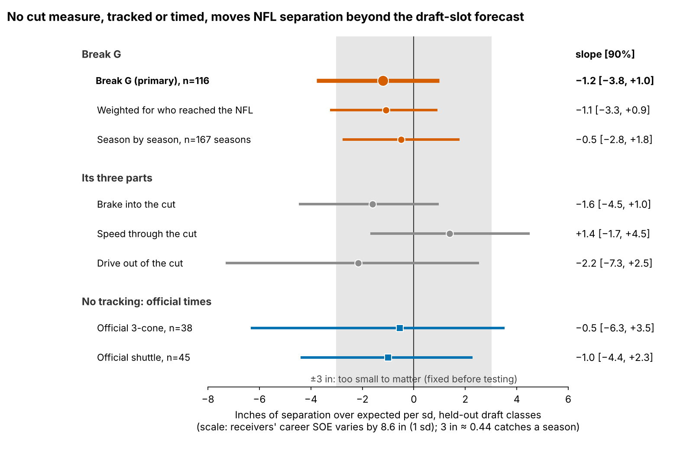
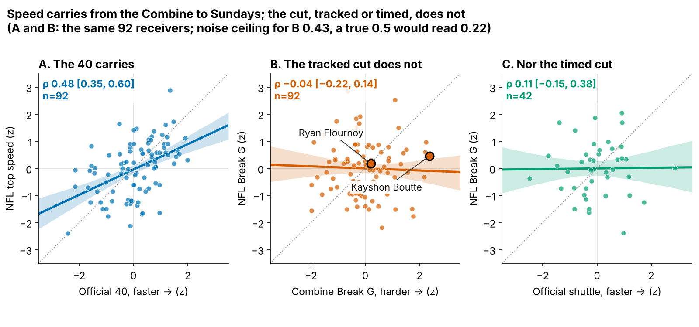

# Combine Route-Drill Cuts Do Not Carry to NFL Separation

**A receiver who cuts 1 sd harder in Combine route drills is no more open in the NFL: −1.2 inches of separation over expected per sd (90% interval −3.8 to +1.0), across 116 receivers from draft classes the model never saw.**

**Break G is how much speed a receiver sheds going into his plant and how hard he drives out, measured over the second around his first cut.** On film, read three speeds: in, slowest, out. The typical drill rep sheds 2.8 mph into the plant; the typical NFL break, 1.9 mph.

Why receivers and tight ends: route-breaking is the skill the Combine films most directly. Ten route drills are tracked at 10 Hz, and we grade every cut with the same code we run on NFL snaps (slant, out, hitch, in and corner families). Why it matters: clubs pay for it. A receiver 1 sd higher in Break G goes 9% earlier in the draft [1, 17] at the same position (149 receivers), yet, as shown below, buys no separation.

- **Separation over expected (SOE)**: inches more open at the throw than Next Gen Stats separation predicts from alignment, cushion and season, over full regular seasons (213 player-seasons, median 231 career routes).
- **Combine years**: every rep is compared only with the same drill in the same year. Break G is timed from each rep's own slowest point, so the 40 clip's 0.3 s start offset never touches it; the 40 enters only as the official time.
- **Samples**: 149 receivers with a drill score; 116 with NFL separation (season tests); 92 with 8+ sampled NFL breaks and an official 40 (transfer tests).

## 1. Break G adds nothing to a no-tracking forecast

The baseline (log pick, official 40, weight, NGS athleticism score, tight-end flag) was fixed before the test, fitted on two draft classes and scored on the third, route-weighted. Intervals are 90%, resampling receivers within class.

| Held-out test | Estimate [90%] | P(\|effect\| < 3 in) | n |
|---|---|---|---|
| Change in R² from adding Break G to the baseline | 0.013 [−0.141, 0.079] | | 116 |
| **Break G, inches per sd** | **−1.2 [−3.8, +1.0]** | **90%** | 116 |
| Official 3-cone, inches per sd (no tracking) | −0.5 [−6.3, +3.5] | 67% | 38 |
| Official short shuttle, inches per sd (no tracking) | −1.0 [−4.4, +2.3] | 80% | 45 |

The baseline itself explains nothing held out (R² 0.00): its typical miss, 8.6 in, equals the 8.6 in spread of career SOE between receivers (fitted without route weights it is 9.7 in; the appendix grid shows all four recipes). A pick-only baseline (−0.03) and a ridge baseline with a nested penalty (0.02) do no better, so the zero is not an artefact of the five covariates. Break G has a 90% probability (flat prior) of being smaller than 3 inches either way; power at ±3 in is 68%. Resampling receivers across classes instead of within gives [−3.7, +1.0]. Of the 8 slopes in Figure 2, none excludes zero; the smallest Holm-adjusted p is 1.00. Likely small, not proven zero.

## 2. Why: the drill grades a different cut

| What is compared | Rank corr. [90%] | n |
|---|---|---|
| Official 40 → NFL top speed | 0.48 [0.35, 0.60] | 92 |
| **Combine Break G → NFL Break G** | **−0.04 [−0.22, 0.14]** | 92 |
| Official shuttle → NFL Break G (no tracking) | 0.11 [−0.15, 0.38] | 42 |
| Same route family, NFL breaks entered at drill speed | 0.04 [−0.05, 0.13] | 98 |

Speed carries; the cut does not, tracked or timed. Noise is not the reason: through both measures' noise a true 0.5 would still read 0.22.

The drill asks for a cut at 6.9 yd/s (14.2 mph) on the hitch family; the NFL asks for 4.7 (9.5 mph). 47 of 49 wide receivers enter the drill cut faster than the same NFL route. Keeping only NFL breaks entered at drill speed moves the same-family transfer from −0.07 to just 0.04: entry speed is part of the gap, not all of it. Sampled NFL plays are half top-EPA; the random half alone reads +0.13 [−0.05, 0.30] (appendix).

| Receiver (drill rank of 49) | Drill cut, yd/s: in → slowest → out | NFL cut, yd/s: in → slowest → out | Career SOE, in | What a position coach would rep |
|---|---|---|---|---|
| Kayshon Boutte (#1) | 7.1 → 4.5 → 5.9 | 5.7 → 5.0 → 5.9 | +0.5 | rounds his Sunday breaks; rep sink-and-plant on curls at game tempo |
| Ryan Flournoy (#25) | 7.2 → 3.9 → 6.5 | 4.7 → 2.4 → 4.8 | −6.0 | slowest into and through his Sunday breaks, easy to read; rep a faster stem into the same plant |
| Jake Bobo (#49) | 6.7 → 3.1 → 5.6 | 5.0 → 3.9 → 5.5 | −0.8 | softest drill cutter, ordinary Sunday cut; nothing to fix from the Combine tape |

Read Boutte's rows as film. In drill reps on the route families he also ran on Sundays, he enters the cut at 7.1 yd/s and sheds 5.3 mph into the plant. (Raw shed depends on the route: hitch-family drills shed more than slants. His #1 rank compares him with peers in the same drill across all ten drills; these rows are only the families he also ran on Sundays.) On Sundays he enters at 5.7 and sheds 1.4 mph: he rounds the break. Flournoy, mid-pack in the drill, sheds 4.7 mph on Sundays, the most of the three. Bobo, the softest drill cutter, sheds 2.2 mph. Their career SOE does not follow the drill order, and neither does the group's: the eight hardest and eight softest drill cutters average +1.0 and −2.3 inches.

## 3. What a Combine staff and a position coach can do

A single graded cut is mostly noise: today's median of 7 cuts gives a reliability of 0.53; it takes 15 to reach 0.70 (appendix curve). So grade at least 15 cuts per receiver, keep the slant, and re-stem the curl, comeback and hook at NFL hitch speed (about 4.7 yd/s, a controlled three-quarter stem). That re-stem is a design proposal; this data cannot test it. Until a re-stemmed drill transfers, Break G gets zero weight. For a position coach: rep breaks at game tempo; nothing here says a harder full-speed plant buys separation.

## 4. The 2025 day-3 receivers: a film list, not a ranking

Day-3 or undrafted wide receivers who were more open than expected in 2025, in order of 2025 SOE. The threshold is the SOE over his first 150 routes of 2026 that would pull his estimate below zero. Last season's SOE did not beat pick order at calling the next season on 28 day-3 receivers, so this list is for film, not for the board.

| 2025 day-3 receiver (team) | Above zero in | Off the list if his first 150 routes of 2026 are below, in | Speed shed into plant, drill → NFL, yd/s |
|---|---|---|---|
| Malik Washington (MIA) | 2024 and 2025 | −51 | 3.6 → 0.6 |
| Demario Douglas (NE) | 2024 and 2025 | −32 | 2.4 → 1.2 |
| Troy Franklin (DEN) | 2024 and 2025 | −14 | 3.5 → 2.2 |
| Tez Johnson (TB) | 2025 | −30 | 2.6 → 0.8 |
| Arian Smith (NYJ) | 2025 | −24 | 5.0 → 2.1 |
| Isaiah Bond (CLE) | 2025 | −10 | 3.9 → 1.9 |
| Jaylin Lane (WAS) | 2025 | −6 | 3.0 → 2.7 |
| Mitch Tinsley (CIN) | 2025 | −3 | 2.3 → 1.6 |
| Kayshon Boutte (NE) | 2025 | −2 | 2.6 → 0.7 |

## Bottom line for scouts

**Take Break G out of the price.** Clubs pay 9% in pick position per sd of it and get no separation back; the 40 and draft slot already carry what the Combine can say about getting open.

## Limitations

- **Not blind.** All three classes were seen while this was built; the ±3 inch margin and the baseline were fixed before each test.
- **Power.** 68% at the margin; harm is not excluded (lower bound −3.8 inches per sd).
- **Selection and missed seasons.** 116 of 149 drill-scored receivers logged NFL routes; weighting for who reached the NFL gives −1.1. Career SOE is route-weighted, so an injured or inactive season adds no weight rather than a zero. 23 tested receivers missed a season; dropping them gives −1.4 (93 receivers).
- **Game tracking is a sample.** Up to 40 plays per player, half top-EPA, no defenders or ball. This affects Section 2 and Figures 1 and 3, not the season tests, which use full-season NGS.
- **Small benchmarks.** Few receivers ran the official 3-cone (38) or shuttle (45).

## Appendix

`verify.py` rebuilds both Break G pipelines from the raw frames and refits the held-out model a second way, with its own seeds; it reproduces all 124 numbers it checks. The new baseline grid, ridge and pooled-bootstrap rows are computed in `analysis.py` only. `appendix.md` holds the error-recipe grid (route-weighted or not, fitted and scored), the reliability curve, the sampling-half and entry-speed rows, measurement-error checks and the man/zone and slot/wide splits.
