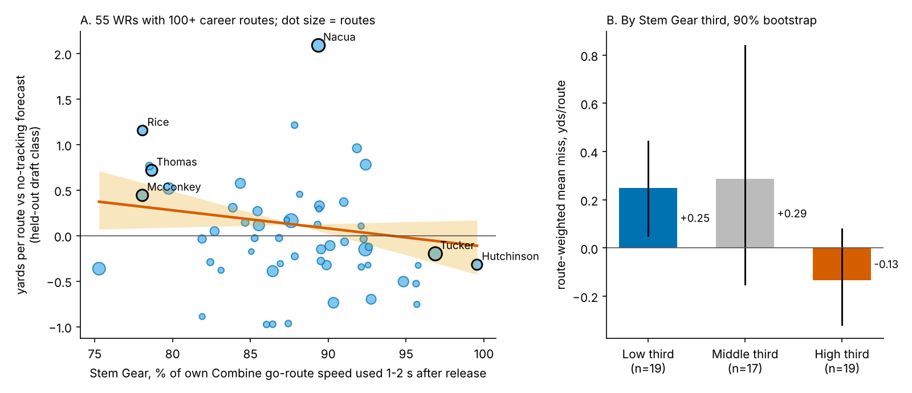
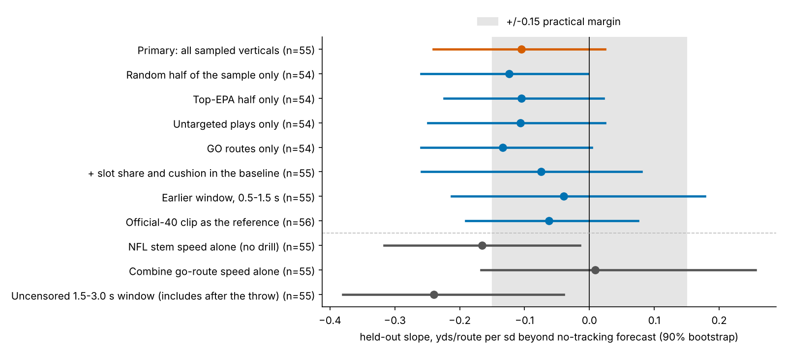

# Receivers Do Not Run Their Combine Speed on Sundays, and the Combine Cannot Tell You Who Will

**On NFL vertical routes a wide receiver uses a median 88% of the speed he showed on the Combine go-route drill at the same moment of the route. Who runs closer to his drill speed is unrelated to that drill speed (ρ = −0.02, 70 receivers). Using more of it does not add production beyond draft pick: −0.10 yards per route run per sd (90% interval −0.24 to +0.02), 55 receivers, tested on draft classes held out of the fit.**

**Stem Gear**, in one line: the share of his own Combine go-route speed a receiver carries 1.0 to 2.0 seconds into an NFL vertical stem (go, post or corner), before the ball is thrown. 100% means he runs his stem like the drill. Below 85% means he is clearly holding speed back.

Why this question: scouts write "plays to his 40 time" as a compliment. The Combine go route and an NFL go route start the same way, from a stance, straight downfield, so this is the cleanest drill-to-game comparison the Combine offers. If translation mattered, it would show up here.

## 1. The same movement in two settings

Release is the first frame at which the receiver reaches 1.5 yd/s, in both the Combine clip and the NFL snap. Aligning on that crossing removes the ~0.3 s the Combine clip runs before the laser starts, and it removes stance and motion differences. Drill speeds are adjusted for each Combine year's mean, because protocols shift between years.

At 0.5 s the two settings match: 4.2 yd/s in the drill and 4.5 on Sundays. By 2.0 s they have separated: 8.9 yd/s (18.2 mph) in the drill against 7.6 (15.5 mph) in games. NFL receivers are not slow off the line. They stop accelerating at about 15 mph to keep a speed they can break from. Across 70 receivers with the drill and 3 or more clean NFL stems (median 11), Stem Gear runs from 82% (10th percentile) to 96% (90th).

Stem Gear is a tape tendency of moderate stability: odd and even NFL reps agree at a split-half reliability of 0.56.

## 2. The Combine does not predict the gear

| What carries from the Combine to NFL verticals | ρ [90%] | n |
|---|---|---|
| Combine go-route speed → NFL stem speed, same 1–2 s window | −0.02 [−0.21, 0.19] | 70 receivers |
| Official-40 clip, same window → NFL stem speed | 0.12 | 70 receivers |
| No tracking: official 40 → NFL top speed on the same plays | 0.45 | 70 receivers |

The stopwatch ranks a receiver's top gear on Sundays well. It says nothing about how much of that gear he uses in the stem. So Stem Gear is mostly an NFL quantity: it tracks his NFL stem speed (ρ = 0.75) and runs against his drill speed (ρ = −0.63), because the fastest drill runners have the most to hold back.

## 3. Does translation explain production beyond pick?

The outcome is career yards per route run (route-weighted, receivers with 100+ routes, mean 1.42). The no-tracking forecast uses log draft pick, official 40, weight and NGS athleticism score. Each draft class is forecast from a model fitted on the other two, and the held-out miss is regressed on Stem Gear. Intervals come from 2,000 receiver resamples within class, with the whole forecast refitted in every resample.

| Held out by draft class | Estimate [90%] | n |
|---|---|---|
| No-tracking forecast, R² (pick only: 0.00) | −0.10 | 55 receivers |
| **Stem Gear, yards per route per sd** | **−0.10 [−0.24, 0.02]** | 55 receivers |
| Same, season t gear → season t+1, given season-t yards per route and pick | 0.00 [−0.15, 0.13] | 42 pairs, 33 receivers |
| Targets per 100 routes per sd | −1.1 [−2.3, 0.2] | 55 receivers |

The sign leans negative: receivers who hold back more produce more than forecast, and 91% of resamples fall below zero. But the size stays inside the ±0.15 practical margin (about 10% of the average receiver's output), and only 29% of resamples fall beyond it. The 2025 class runs the other way (+0.19, 13 receivers; 2023 −0.10, 2024 −0.23). A within-class shuffle gives p = 0.12. Next season's production does not follow this season's gear at all.

The thirds in Figure 2B show where the lean comes from. The top third (90%+ of drill speed, 19 receivers) misses its forecast by −0.13 yards per route, and only 21% beat it. The bottom third (86% or less) beats its forecast by +0.25, and 58% beat it. The middle third is just as good as the bottom third, so this is a warning about full-speed stems, not a "slower is better" rule.

Two checks matter for honesty. First, the drill adds nothing to the lean: NFL stem speed alone gives −0.17 [−0.32, −0.02], and Combine go-route speed alone gives +0.01. Second, a window that ignores the throw (1.5 to 3.0 s) gives a "significant" −0.24 [−0.38, −0.04]. That is a trap: the median throw comes 2.3 s after release, and un-targeted receivers coast once the ball is gone. Every number above is cut at the throw. I looked at five windows before fixing the primary as the latest fully pre-throw one, so the primary is not pre-registered (Figure 3).

## 4. Five receivers, drill rep vs NFL rep

Speeds are the 1–2 s window means, converted to mph for film use.

| Receiver (pick) | Drill → NFL stem, mph | Stem Gear (rank of 55) | Yds/route (vs forecast) |
|---|---|---|---|
| Rashee Rice (55) | 16.6 → 13.0 | 78% (3) | 2.54 (+1.15) |
| Ladd McConkey (34) | 16.2 → 12.6 | 78% (2) | 1.93 (+0.44) |
| Brian Thomas (23) | 18.3 → 14.4 | 79% (5) | 2.08 (+0.72) |
| Tre Tucker (100) | 15.6 → 15.1 | 97% (54) | 1.13 (−0.20) |
| Xavier Hutchinson (205) | 15.4 → 15.4 | 100% (55) | 0.80 (−0.32) |

How a position coach would read them:
- **Rice**: flattens at about 13 mph by 1.5 s and keeps a speed he can break from (Figure 1). This is film to copy, not a flaw.
- **McConkey**: same pattern, 3.6 mph under his drill. His production comes from tempo change, so do not coach him to run every stem flat-out.
- **Thomas**: the fastest drill runner of the five still holds back 3.9 mph. Top-end speed and a controlled stem are compatible.
- **Tucker**: runs the stem at drill speed. Rep him on throttling down before the break so it does not have to absorb a full sprint.
- **Hutchinson**: every vertical at 100%. On tape, check whether corners simply carry him, because nothing in his stem threatens a break.

These are readings of five receivers. They are not the model's output, and the sample cannot show that coaching tempo raises production.

## 5. What a team can do with this

- **Scouts:** grade the 40 for top gear (it carries, ρ = 0.45) and grade stem tempo from college tape. No Combine number, timed or tracked, predicts how much speed a receiver will use in his stem.
- **Pro personnel:** treat Stem Gear as a film flag. When a receiver runs every vertical near 100%, check whether his routes threaten anything else. Do not use it as a forecast, because next-season production does not follow it.

**Bottom line for scouts:** stop writing "plays to his 40 speed" as a plus on vertical routes. The best young receivers in this sample do not.

## Limitations

- **Small and sampled.** 55 receivers with the drill, 3+ clean NFL stems and 100+ routes, drawn from up to 40 sampled plays each (half chosen by top EPA). The random and top-EPA halves give the same answer (−0.12 and −0.10). Gear rests on a median 11 stems, reliability 0.56.
- **Not blind.** The window was chosen after looking. The margin of ±0.15 was set before the held-out run but after exploratory fits.
- **No defenders or ball in the tracking.** A slow stem can be a choice, a press release or a route assignment (clear-out vs. read). Adding slot share and cushion to the forecast gives −0.07 [−0.26, 0.08].
- **Survivorship and missed seasons.** Career production is route-weighted across whatever seasons a receiver played. 15 of 70 receivers with a gear score had fewer than 100 routes (injury, practice squad) and are excluded.
- **Wide receivers only.** Tight ends do not run the go-route drill.
- **The no-tracking forecast is weak out of class** (R² −0.10; pick only 0.00). Stem Gear is measured against a low bar and still does not clear the margin.

Code: `analysis.py` rebuilds every number and figure from `data/processed`; `inputs.csv` lists each receiver's drill speed, NFL speed, gear and held-out miss.
