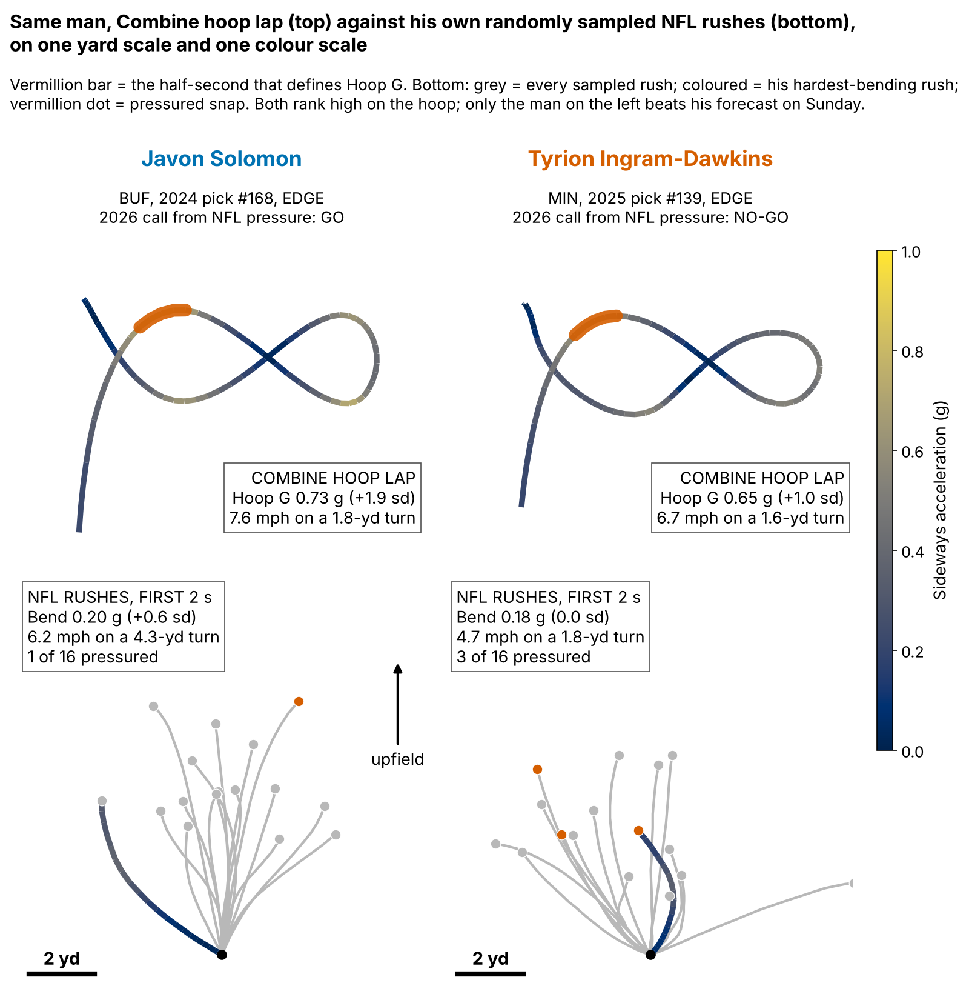
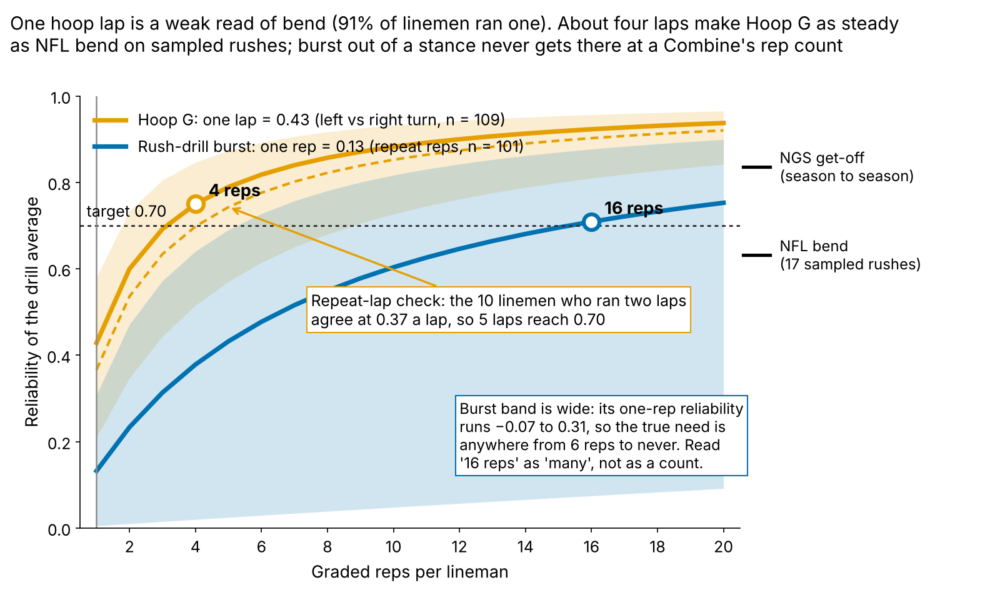
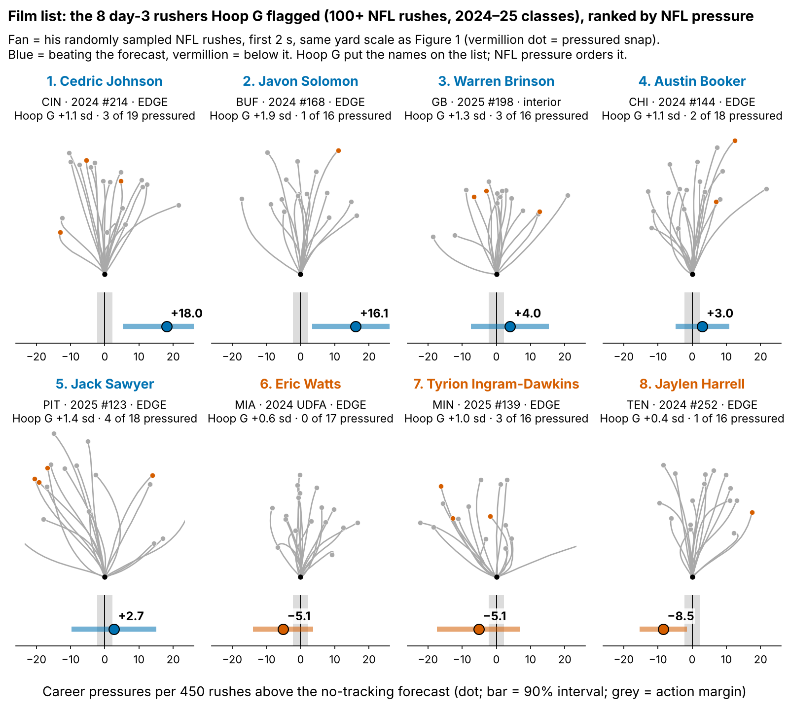

# Run-the-Hoop Bend Puts a Day-3 Edge Rusher on the Film List, Not Higher on the Board

**Run-the-Hoop bend flags day-3 edge rushers worth a film look, but it is not strong enough to move a draft board: +1.8 pressures per 450 rushes per sd, 90% interval 0.2 to 3.4, n = 77, not distinguishable from chance after trying six drill measures. Against the strongest forecast without tracking (draft pick plus edge role, held-out R² 0.10), Hoop G adds 0.06 R², interval adjusted for six measures −0.16 to 0.29.**

**Hoop G, in coach terms:** how hard a lineman leans into the tightest half-second of the Run-the-Hoop figure-eight, the dip-and-flatten an edge needs to turn the corner on a tackle. It is speed squared over turn radius, in g, ranked within his Combine class. The median lineman carries 7.1 mph around a 1.8-yard radius: 0.62 g. On a sampled NFL rush his hardest lean comes at 5.6 mph around a 4.1-yard radius: 0.18 g. Same formula, slower and twice as wide, so we compare within class, never in raw g. Each lap has a left and a right turn; Hoop G keeps the harder one (the left in 82% of laps, median gap 0.06 g), as NFL bend keeps his hardest lean either way.

**Why the hoop, why day 3, why now.** On 1655 randomly sampled NFL pass plays, a pressured snap cost the offense 0.52 expected points [0.35, 0.67]. The pass-rush drill times get-off, which NGS already measures on every NFL snap, and one burst rep repeats at only 0.13. The hoop isolates bend, which no box score records. 69% of the 118 defensive linemen in the 2023–25 classes went on day 3 or undrafted, where tape is thinnest. And the 2026 class ran the same tracked hoop, so a rule frozen now is graded after Week 18.

**So what for a team**

1. **Film order, not board order.** Open day-3 edge rushers' tape in Hoop G order. Hoop G does not change the board.
2. **Four hoop laps, no burst reps.** One lap has reliability 0.43; 4 reach 0.70.
3. **A ranked film list** of eight 2024–25 day-3 rushers (Figure 4).

## Drill turn against NFL turn

- **Javon Solomon (BUF).** Hoop: 0.73 g, 7.6 mph on a 1.8-yard turn (+1.9 sd, top of his class). NFL: 0.20 g, 6.2 mph on a 4.3-yard turn (+0.6 sd); 16.1 pressures a season above forecast.
- **Tyrion Ingram-Dawkins (MIN).** Hoop: 0.65 g, 6.7 mph on a 1.6-yard turn (+1.0 sd). NFL: 0.18 g, 4.7 mph on a 1.8-yard turn (class average); −5.1 against forecast.

Ingram-Dawkins turns as tight on Sunday as on the hoop, but slowly; Solomon carries speed through a wider arc. To link drill and play directly, **Turn Match** divides a rusher's NFL turn radius by his own hoop radius. Its median is 2.7 (1.2 to 4.8, 10th–90th percentile, n = 78); only 23% of sampled rushes turn as tight as the same man's hoop lap, and tighter hoop turners do not run tighter NFL turns (Table 1). Drill and play share a skill, not a path.

## The NFL end of the chain works; the drill end does not

NFL movement: a median of 17 randomly sampled rushes per lineman, measured from his own start. Links control for weight and edge share.

| Link | Partial ρ [90%] | n |
|---|---|---|
| Hoop G → NFL bend (first 2 s) | 0.14 [−0.06, 0.32] | 78 |
| Hoop turn radius → NFL turn radius | 0.01 [−0.19, 0.20] | 78 |
| NFL bend → pressure rate | 0.36 [0.20, 0.52] | 85 |
| NGS get-off → pressure rate | 0.41 [0.27, 0.54] | 85 |

*Table 1. Partial Spearman ρ, class-stratified bootstrap.*

NFL get-off and bend drive pressure; the Combine end barely reaches them. The 3-cone does no better, but 69 of 109 hoop runners never ran one.

**Why the drill end breaks: one rep.** The two turns of the same lap agree at only ρ = 0.27 (n = 109), so one lap has reliability 0.43 [0.21, 0.58]; 4 laps reach 0.70, the steadiness of NFL bend. The 10 linemen who ran two laps roughly agree (Figure 2).

## Held out by class, Hoop G leads but does not clear the screen

**Outcome:** career pressure rate through 2025, shrunk toward the 8.1% mean, linemen with 30+ rushes. **Out of class:** each class (27/23/27 rushers) is forecast by a model fit on the other two; drill measures are standardized within Combine year. Before fitting we set the smallest effect worth acting on: 2.25 pressures per 450 rushes per sd (about 1.2 expected points).

| Held out, n = 77 | R² | RMSE | R² gain [90%; six-measure adjusted] |
|---|---|---|---|
| Pick + role, no tracking | 0.10 | 1.63 | — |
| Pick + role + Hoop G | 0.16 | 1.58 | 0.06 [−0.10, 0.20; −0.16, 0.29] |

*Table 2. RMSE in pressure-rate points (outcome sd 1.72). The full no-tracking model (adding weight, NGS score, 10-yard split, 3-cone) is weaker: R² 0.01.*

- **Against the stronger baseline** the slope holds at 2.3 [0.9, 3.7]; both R² gain intervals span zero.
- **Class by class:** 2.4, 3.0, −0.1. 2025 is flat, not reversed: interval −2.9 to 2.5, and dropping any one rusher moves it only between −0.9 and 0.7 (pooled slope: 1.5 to 2.1).
- **Edge and interior:** 2.2 [−0.2, 5.0] (n = 38) against 1.8 [−0.7, 4.2] (n = 39). Similar slopes, so one within-class scale costs nothing here; still, bend is an edge job, so the flag targets edge alignments and interior names (Brinson) are read against interior linemen only.
- **Reliability-corrected:** one lap carries 0.44 of true bend variance. Disattenuated (errors-in-variables, paired bootstrap): 4.1 [0.4, 11.2]; empirical-Bayes shrunk Hoop G: 4.2. The case for four laps, not a new effect: p is unchanged.
- **Independent script:** 2.4 [0.7, 4.2], n = 78, classes 2.2, 3.9, 0.5. It keeps one rusher with no valid burst rep (Chop Robinson) and fills missing times with the fold median; our pipeline with both choices gives 2.4 (2.3, 3.9, 0.7).
- **Multiplicity:** of 31 tests here, only 2 survive Holm at 0.10, both NFL trait-to-pressure links.

## The film list

Among 47 day-3 and undrafted rushers, forecast plus Hoop G orders held-out classes better than draft order (ρ 0.29 against 0.01), but its top third hit 9 of 15, exactly as often as pick order: a gap of 0 points [−20, 33] against the +20 we required for board use. **Hoop G does not change the board; it decides whose tape opens first.** The eight flagged 2024–25 day-3 rushers with 100+ NFL rushes, ranked by career pressures per 450 rushes above forecast (NFL pressure, not Hoop G, sets the order):

1. **Cedric Johnson** (CIN, EDGE, 2024 #214), +18.0 a season: the bend carries to Sunday; third-down snaps from a wide alignment.
2. **Javon Solomon** (BUF, EDGE, 2024 #168), +16.1 a season: top hoop lap of his class, above-average NFL bend; same wide passing-down role.
3. **Warren Brinson** (GB, interior, 2025 #198), +4.0 a season: 315-lb interior, read against interior linemen only; the looper on end-tackle stunts.
4. **Austin Booker** (CHI, EDGE, 2024 #144), +3.0 a season: largest sample on the list, a steady small plus; keep his rotation share.
5. **Jack Sawyer** (PIT, EDGE, 2025 #123), +2.7 a season: hardest NFL bend of the eight; widen his passing-down role.
6. **Eric Watts** (MIA, EDGE, 2024 UDFA), −5.1 a season: bend without a first step (slowest NFL burst of the eight); run downs until the get-off improves.
7. **Tyrion Ingram-Dawkins** (MIN, EDGE, 2025 #139), −5.1 a season: hips there, rush plan not; rep dip-and-rip off a live get-off.
8. **Jaylen Harrell** (TEN, EDGE, 2024 #252), −8.5 a season: most rushes of the eight, furthest below forecast: the flag missed; run downs only.

## Limitations

- **Small samples, single reps.** 77 rushers in the model, 47 on day 3; 91% ran one hoop lap.
- **Reused classes.** Earlier rounds screened ideas on these classes, and pick plus role was chosen as the baseline after seeing them; the 2026 class is the first clean test.
- **Thin NFL tracking.** 17 sampled rushes per lineman, no blockers; bend may follow from beating the tackle rather than cause it.
- **Missed time.** Rates are per rush, so injured weeks shrink the denominator, not the rate; the 33 linemen under 30 rushes are left out. No tracked 40 is used, so the clip offset never enters.
- **Reads are ours,** from 16–19 sampled rushes each, not scheme film.

## Bottom line

Open day-3 edge rushers' tape in Hoop G order, grade four hoop laps at the 2027 Combine, and move no one on the board until Hoop G beats the pick-plus-role forecast on the 2026 class.

## Appendix

- **Variants.** Full no-tracking model by OLS: R² −0.02; Hoop G gain over its ridge version 0.04 [−0.07, 0.17]. Slope on the ridge residual 2.1; weighted for drill completeness 1.9; across priors and rush minimums 1.5 to 2.0; 78-rusher set alone 2.0; median fill alone 2.2.
- **Multiplicity.** Hoop G: two-sided p 0.03, best-of-six p 0.23, Bonferroni slope interval −0.6 to 4.3. 5 of 31 tests survive Benjamini–Hochberg at q = 0.10, including the slope against pick plus role, a baseline chosen after the fact (`multiplicity.csv`).
- **Reliability.** Spearman-Brown for k laps: k·r/(1+(k−1)·r). The two-lap estimate gives a corrected slope of 4.8. Averaging both turns instead of keeping the harder one: 1.1 [−0.6, 2.8].
- **2026 test.** Frozen in `frozen_rule.json` (sha256 `a8f5e5be6e51…`): positive Hoop G slope over the pick-plus-role forecast, one-sided p < 0.10, or the flag is retired. Power at the observed slope: 44% for one class, 77% for three.

`analysis.py` (about 6 minutes) rebuilds every number, figure and this text from `data/processed` and runs `verify.py`, an independent re-implementation of the headline slope.
