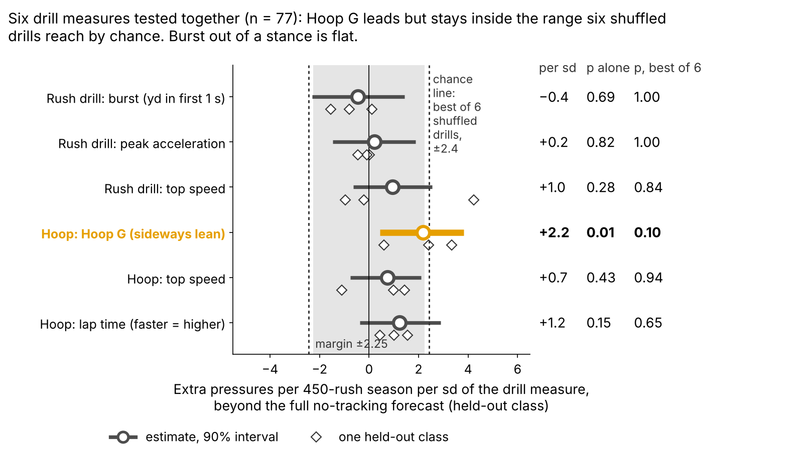

# Run-the-Hoop Bend Points Toward NFL Pass Rush, but Not Yet Past Draft Order

Defensive linemen who lean harder through the Combine's Run-the-Hoop turn went on to get slightly more NFL pressure than their draft slot predicted. The edge is real enough to guide day-3 film study and a frozen 2026 test, but too small and noisy to move anyone on a draft board.

- **Scout, Monday:** queue day-3 edges in their class's top third on Hoop G beside pick order, not ahead of it, and check on tape whether he flattens at the top of the rush.
- **Coach:** low Hoop G gets tight-circle and dip-and-rip reps off a live get-off; high Hoop G who still loses gets first-step work.
- **Combine:** grade four hoop laps, not one.

## Hoop G in coach terms

Hoop G is how hard a lineman leans through the tightest half-second of the hoop's figure-eight: speed squared over turn radius, in g, ranked within his Combine class. The median lineman carries 7.1 mph around a 1.8-yard radius, which is 0.62 g. His hardest lean on a sampled NFL rush comes at 5.6 mph around 4.1 yards, which is 0.18 g.

**Why NFL turns are wider.** The hoop is a painted circle with nobody on it; on Sunday the tackle's set and hands push the arc out and contact bleeds speed. A rusher's NFL turn is a median 2.7 times wider than his own hoop turn (10th–90th percentile 1.2 to 4.8, n = 78). Only 23% of sampled rushes turn as tight as the same man's hoop lap, and tighter hoop turners do not run tighter NFL arcs (Table 1). The drill measures the ability to lean, not the NFL path, so we compare men within a class, never raw g across drill and game.

**Why the hoop, why day 3.** A pressured snap cost the offense 0.52 expected points [0.35, 0.67] on 1655 randomly sampled pass plays. The pass-rush drill times get-off, which NGS already measures every snap, and one burst rep repeats at only 0.13; bend has no box-score column. 69% of the 118 linemen in the 2023–25 classes went on day 3 or undrafted, where tape is thinnest.

## Film check: do high-Hoop-G men turn the corner on Sunday?

A sampled rush is a **corner turn** when its hardest half-second of lean in the first 2 s is in the top quarter of all sampled rushes (at least 0.24 g). Linemen in their class's top third on Hoop G turned the corner on 29% of rushes, the bottom third on 21%: a gap of 9 points [3, 15], n = 78. Corner-turn rushes ended in pressure 15% of the time, against 7% for other rushes (1437 rushes; gap 90% interval 4 to 11 points, resampling linemen).

The NFL half of the chain is strong. The drill half is weak per lineman:

| Link (controls: weight, edge share) | Partial ρ [90%] | n |
|---|---|---|
| Hoop G → NFL bend | 0.14 [−0.06, 0.32] | 78 |
| Hoop turn radius → NFL turn radius | 0.01 [−0.19, 0.20] | 78 |
| NFL bend → pressure rate | 0.36 [0.20, 0.52] | 85 |
| NGS get-off → pressure rate | 0.41 [0.27, 0.54] | 85 |

*Table 1. Partial Spearman ρ, bootstrap within class. NFL movement: median 17 randomly sampled rushes lasting the full 2 s, for the 85 linemen with 8+ such rushes (all have 30+ career rushes; before the 2-s filter, median 20 across 86).*

## Held out by class, against three baselines

**Outcome:** career pressure rate through 2025, shrunk toward the 8.1% mean, for linemen with 30+ rushes. **Out of class:** each class (27/23/27 rushers) is forecast by a model fitted on the other two. Drill measures are standardized within Combine year, and a missing 10-yard split or 3-cone takes the training-fold median. We set the smallest effect worth acting on before fitting: 2.25 pressures per 450 rushes per sd.

| Baseline without tracking (n = 77) | Baseline R² | + Hoop G R² | R² gain [90%] | Hoop G, pressures per 450 rushes per sd [90%] |
|---|---|---|---|---|
| Pick only | 0.03 | 0.16 | 0.13 [−0.05, 0.32] | +3.2 [1.7, 4.6] |
| Pick + edge role | 0.10 | 0.16 | 0.06 [−0.10, 0.20] | +2.3 [0.9, 3.7] |
| **Full (pre-specified):** pick, role, weight, NGS score, split, 3-cone | −0.04 | 0.07 | 0.11 [−0.12, 0.31] | **+2.2 [0.4, 3.8]** |
| Chosen inside each training fold | −0.08 | 0.08 | 0.16 [−0.06, 0.28] | +2.4 [1.1, 4.0] |

*Table 2. Intervals come from resampling linemen within each class and refitting every fold (1.72 = outcome sd in rate points). The fold-chosen baseline picked pick only for 2023, pick + role for 2024, full no-tracking for 2025.*

Every slope interval excludes zero; every R² gain interval includes it. The full baseline, fixed in the project rules beforehand, overfits (held-out R² below zero); against the strongest forecast, pick plus role, Hoop G is worth +2.3.

Hoop G leads the six but stays just inside the chance line. Its p is 0.01 alone and 0.10 as the best of six. Three checks:

- **Class by class:** 2.4, 3.3, 0.6. The 2025 class is flat, not reversed (−2.9 to 3.5). Across 200 random three-way splits that ignore class, the slope stays between 1.7 and 2.4.
- **Edge and interior:** +2.3 [−0.2, 4.9] (n = 38) against +2.4 [−0.1, 5.0] (n = 39); alike, so one class-wide scale is fine.
- **One-lap noise (Figure 2):** one lap has reliability 0.43 [0.21, 0.58]. Simulating known true slopes through that noise, one lap shows about 65% of a true slope, and true slopes from 1.1 to 5.9 fit the observed +2.2. At a true 3.4, four laps would show 2.8, and a one-sided 10% test on 77 linemen would catch it 97% of the time (one lap: 87%).

## Day 3: a film queue, not a board

Among 47 day-3 and undrafted rushers in held-out classes, the top third by forecast plus Hoop G beat its class's day-3 median 10 of 15 times; pick order's top third, 9 of 15. The gap, 7 points [−13, 40], misses the +20 we required for board use, and the forecast alone also went 10 of 15. The Hoop G top third beat its own forecast 47% of the time, the same as the rest (47%). **Hoop G has not shown it picks better day-3 tape; it is a reason to open tape and a hypothesis to test.**

The 8 flagged 2024–25 day-3 rushers with 100+ NFL rushes, in Hoop G order (pressures a season against forecast):

**Open first** (beat the no-tracking forecast by the margin):

- **Javon Solomon** (BUF, EDGE, 2024 #168): Hoop G +1.9 sd, NFL bend +0.6 sd, NFL +16.2. Top hoop lap of his class, above-average NFL bend; same wide passing-down role.
- **Jack Sawyer** (PIT, EDGE, 2025 #123): Hoop G +1.4 sd, NFL bend +2.0 sd, NFL +4.5. Hardest NFL bend of the eight; widen his passing-down role.
- **Warren Brinson** (GB, interior, 2025 #198): Hoop G +1.3 sd, NFL bend −0.7 sd, NFL +4.4. A 315-lb interior man, so compare him with interior linemen only; loop him on end-tackle stunts.
- **Cedric Johnson** (CIN, EDGE, 2024 #214): Hoop G +1.1 sd, NFL bend +0.7 sd, NFL +19.1. The bend carries to Sunday; give him third-down snaps from a wide alignment.
- **Austin Booker** (CHI, EDGE, 2024 #144): Hoop G +1.1 sd, NFL bend +1.0 sd, NFL +2.7. Most rushes of the eight, a steady small plus; keep his rotation share.

**Flag missed or unproven** (fell below it):

- **Tyrion Ingram-Dawkins** (MIN, EDGE, 2025 #139): Hoop G +1.0 sd, NFL bend 0.0 sd, NFL −4.6. Hips there, first step not: slowest NGS get-off of the eight; rep dip-and-rip off a live get-off.
- **Eric Watts** (MIA, EDGE, 2024 UDFA): Hoop G +0.6 sd, NFL bend +0.1 sd, NFL −7.3. Shortest first-second burst of the eight on sampled rushes; coach the get-off before the corner.
- **Jaylen Harrell** (TEN, EDGE, 2024 #252): Hoop G +0.4 sd, NFL bend +1.7 sd, NFL −8.4. Second-hardest NFL bend of the eight, yet furthest below forecast: the bend is not becoming pressure. The flag missed.

The three misses have the three lowest Hoop G of the eight; with eight names, that may be chance.

## The one action: a frozen 2026 test

Stored in `frozen_rule.json` (sha256 `ad1cc734cdd4…`): grade the 2026 class's hoop laps; after Week 18, regress pressure rate minus the pick-plus-role forecast frozen on 2023–25 on Hoop G. Positive at one-sided p < 0.10 keeps the flag; zero or below retires it. Hoop G reaches the board only if its day-3 top third beats pick order by 20+ points over two classes. At the observed slope, power is 52% for one class and 87% for three.

## Limitations

- **Small samples, single reps.** 77 rushers are in the model and 47 are on day 3; 91% ran one hoop lap.
- **Reused classes.** Earlier rounds screened ideas on these classes; 2026 is the first clean test.
- **Thin NFL tracking, no blockers.** Corner turns and pressure may both follow from beating the tackle, so the film check shows co-occurrence, not cause.
- **Missed time.** Rates are per rush; the 33 linemen under 30 rushes are left out.
- **The reads are ours,** from 16–19 sampled rushes each, not scheme film.

## Bottom line

Hoop G is a small, consistent bend signal worth a look at day-3 edge tape, not a board input. Grade four laps and let the frozen 2026 test decide.

## Appendix

- **Sources.** The EPA figure comes from the play-level `time_to_pressure` (rusher credited) and `sack` fields on 1655 distinct randomly sampled DL plays (132 pressured), using nflverse EPA. `pressure_allowed` is a blocker field and is empty on 100% of DL rows.
- **One set, one fill rule.** `verify.py` shares no code with `analysis.py`; it rebuilds the same 77 rushers from raw frames (exact match) with the same median fill but different smoothing, shrinkage and fitting code, and gives +2.2 [0.3, 3.8], with classes 2.4, 3.5 and 0.4. Round 22's regression fill gave 1.8; adding the one rusher without a valid burst rep gives 2.4 (n = 78).
- **Multiplicity.** Of 36 tests, 2 survive Holm at 0.10 (both NFL trait-to-pressure links) and 10 survive Benjamini–Hochberg (`multiplicity.csv`). The six-measure Bonferroni slope interval is −0.2 to 4.8, and the R² gain interval is −0.26 to 0.49.
- **Variants.** Priors and rush minimums: 1.8 to 2.5; weighting for drill completeness: 2.2; dropping one rusher at a time: 1.8 to 2.4; averaging both turns instead of the harder one: 1.3 [−0.5, 3.0].
- **Simulation.** Observed Hoop G = true bend plus noise at each lineman's own reliability, redrawn from its bootstrap every run; outcome noise matches the observed residual. Reliability: the two turns of one lap agree at ρ = 0.27 (n = 109); the 10 two-lap linemen agree at 0.37.

`analysis.py` (about 6 minutes) rebuilds every number, figure and this text from `data/processed`, and runs `verify.py`.
