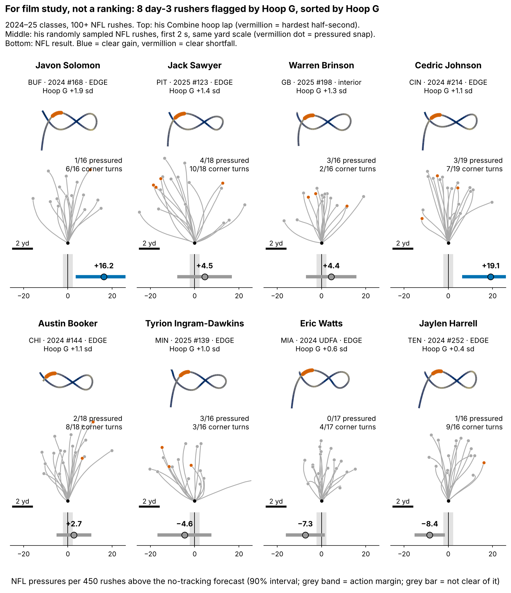

# Run-the-Hoop Bend Points Toward NFL Pass Rush, but Not Yet Past Draft Order

Defensive linemen who lean harder through the Combine's Run-the-Hoop turn went on to get slightly more NFL pressure than their draft slot predicted. The edge is real enough to guide day-3 film study and a frozen 2026 test, but too small and noisy to move anyone on a draft board.

- **Scout, Monday:** queue day-3 edges in their class's top third on Hoop G beside pick order, not ahead of it, and check on tape whether he flattens at the top of the rush.
- **Coach:** low Hoop G gets tight-circle and dip-and-rip reps off a live get-off; high Hoop G who still loses gets first-step work.
- **Combine:** grade four hoop laps, not one.

## Hoop G in coach terms

Hoop G is how hard a lineman leans through the tightest half-second of the hoop's figure-eight: speed squared over turn radius, in g, ranked within his Combine class. The median lineman carries {{hoop_mph_median}} mph around a {{hoop_radius_median}}-yard radius, which is {{hoop_g_median}} g. His hardest lean on a sampled NFL rush comes at {{nfl_mph_median}} mph around {{nfl_radius_median}} yards, which is {{nfl_bend_median}} g.

**Why NFL turns are wider.** The hoop is a painted circle with nobody on it; on Sunday the tackle's set and hands push the arc out and contact bleeds speed. A rusher's NFL turn is a median {{turn_match_median}} times wider than his own hoop turn (10th–90th percentile {{turn_match_p10}} to {{turn_match_p90}}, n = {{turn_match_n}}). Only {{pct_rush_hooptight}}% of sampled rushes turn as tight as the same man's hoop lap, and tighter hoop turners do not run tighter NFL arcs (Table 1). The drill measures the ability to lean, not the NFL path, so we compare men within a class, never raw g across drill and game.

**Why the hoop, why day 3.** A pressured snap cost the offense {{epa_press}} expected points [{{epa_press_lo}}, {{epa_press_hi}}] on {{epa_n}} randomly sampled pass plays. The pass-rush drill times get-off, which NGS already measures every snap, and one burst rep repeats at only {{rel_burst1}}; bend has no box-score column. {{pct_day3_dl}}% of the {{n_dl}} linemen in the 2023–25 classes went on day 3 or undrafted, where tape is thinnest.

## Film check: do high-Hoop-G men turn the corner on Sunday?

A sampled rush is a **corner turn** when its hardest half-second of lean in the first 2 s is in the top quarter of all sampled rushes (at least {{ct_g}} g). Linemen in their class's top third on Hoop G turned the corner on {{ct_top}}% of rushes, the bottom third on {{ct_bot}}%: a gap of {{ct_gap}} points [{{ct_gap_lo}}, {{ct_gap_hi}}], n = {{ct_n}}. Corner-turn rushes ended in pressure {{ct_press_corner}}% of the time, against {{ct_press_other}}% for other rushes ({{ct_rush_n}} rushes; gap 90% interval {{ct_press_lo}} to {{ct_press_hi}} points, resampling linemen).

The NFL half of the chain is strong. The drill half is weak per lineman:

| Link (controls: weight, edge share) | Partial ρ [90%] | n |
|---|---|---|
| Hoop G → NFL bend | {{tr_hoop_g_bend}} [{{tr_hoop_g_bend_lo}}, {{tr_hoop_g_bend_hi}}] | {{tr_hoop_g_bend_n}} |
| Hoop turn radius → NFL turn radius | {{tr_rad}} [{{tr_rad_lo}}, {{tr_rad_hi}}] | {{tr_rad_n}} |
| NFL bend → pressure rate | {{gp_g_bend}} [{{gp_g_bend_lo}}, {{gp_g_bend_hi}}] | {{gp_g_bend_n}} |
| NGS get-off → pressure rate | {{gp_quick}} [{{gp_quick_lo}}, {{gp_quick_hi}}] | {{gp_quick_n}} |

*Table 1. Partial Spearman ρ, bootstrap within class. NFL movement: median {{median_random_rushes}} randomly sampled rushes lasting the full 2 s, for the {{n_pg}} linemen with 8+ such rushes (all have 30+ career rushes; before the 2-s filter, median {{median_random_any}} across {{n_random_players}}).*

## Held out by class, against three baselines

**Outcome:** career pressure rate through 2025, shrunk toward the {{press_mean}}% mean, for linemen with 30+ rushes. **Out of class:** each class ({{ho_n_per_class}} rushers) is forecast by a model fitted on the other two. Drill measures are standardized within Combine year, and a missing 10-yard split or 3-cone takes the training-fold median. We set the smallest effect worth acting on before fitting: {{margin_season}} pressures per 450 rushes per sd.

| Baseline without tracking (n = {{n_an}}) | Baseline R² | + Hoop G R² | R² gain [90%] | Hoop G, pressures per 450 rushes per sd [90%] |
|---|---|---|---|---|
| Pick only | {{r2_pick1}} | {{r2_pick1_h}} | {{dr2_pick1_h}} [{{dr2_pick1_h_lo}}, {{dr2_pick1_h_hi}}] | +{{bs_pick1}} [{{bs_pick1_lo}}, {{bs_pick1_hi}}] |
| Pick + edge role | {{r2_pick}} | {{r2_pick_h}} | {{dr2_pick_h}} [{{dr2_pick_h_lo}}, {{dr2_pick_h_hi}}] | +{{bs_pick}} [{{bs_pick_lo}}, {{bs_pick_hi}}] |
| **Full (pre-specified):** pick, role, weight, NGS score, split, 3-cone | {{r2_base}} | {{r2_base_h}} | {{dr2_base_h}} [{{dr2_base_h_lo}}, {{dr2_base_h_hi}}] | **+{{bs_base}} [{{bs_base_lo}}, {{bs_base_hi}}]** |
| Chosen inside each training fold | {{r2_nest}} | {{r2_nest_h}} | {{dr2_nest_h}} [{{dr2_nest_h_lo}}, {{dr2_nest_h_hi}}] | +{{bs_nest}} [{{bs_nest_lo}}, {{bs_nest_hi}}] |

*Table 2. Intervals come from resampling linemen within each class and refitting every fold ({{sd_y}} = outcome sd in rate points). The fold-chosen baseline picked {{T:nest_list}}.*

Every slope interval excludes zero; every R² gain interval includes it. The full baseline, fixed in the project rules beforehand, overfits (held-out R² below zero); against the strongest forecast, pick plus role, Hoop G is worth +{{bs_pick}}.

Hoop G leads the six but stays just inside the chance line. Its p is {{ho_hoop_p2}} alone and {{ho_hoop_pfw}} as the best of six. Three checks:

- **Class by class:** {{ho_hoop_2023}}, {{ho_hoop_2024}}, {{ho_hoop_2025}}. The 2025 class is flat, not reversed ({{cls2025_lo}} to {{cls2025_hi}}). Across 200 random three-way splits that ignore class, the slope stays between {{rsplit_lo}} and {{rsplit_hi}}.
- **Edge and interior:** +{{role_EDGE}} [{{role_EDGE_lo}}, {{role_EDGE_hi}}] (n = {{role_EDGE_n}}) against +{{role_interior}} [{{role_interior_lo}}, {{role_interior_hi}}] (n = {{role_interior_n}}); alike, so one class-wide scale is fine.
- **One-lap noise (Figure 2):** one lap has reliability {{rel_turn_lap}} [{{rel_turn_lap_lo}}, {{rel_turn_lap_hi}}]. Simulating known true slopes through that noise, one lap shows about {{me_att}}% of a true slope, and true slopes from {{me_lo}} to {{me_hi}} fit the observed +{{bs_base}}. At a true {{me_true}}, four laps would show {{me_exp4}}, and a one-sided 10% test on {{n_an}} linemen would catch it {{me_pow4}}% of the time (one lap: {{me_pow1}}%).

## Day 3: a film queue, not a board

Among {{d3_n}} day-3 and undrafted rushers in held-out classes, the top third by forecast plus Hoop G beat its class's day-3 median {{tt_fch_k}} of {{tt_fch_n}} times; pick order's top third, {{tt_pick_k}} of {{tt_pick_n}}. The gap, {{hg_gap}} points [{{hg_gap_lo}}, {{hg_gap_hi}}], misses the +{{hg_bar}} we required for board use, and the forecast alone also went {{tt_fc_k}} of {{tt_fc_n}}. The Hoop G top third beat its own forecast {{fl_pct}}% of the time, the same as the rest ({{rs_pct}}%). **Hoop G has not shown it picks better day-3 tape; it is a reason to open tape and a hypothesis to test.**

The {{n_cards}} flagged 2024–25 day-3 rushers with 100+ NFL rushes, in Hoop G order (pressures a season against forecast):

**Open first** (beat the no-tracking forecast by the margin):

{{T:film_open}}

**Flag missed or unproven** (fell below it):

{{T:film_miss}}

The three misses have the three lowest Hoop G of the eight; with eight names, that may be chance.

## The one action: a frozen 2026 test

Stored in `frozen_rule.json` (sha256 `{{T:hash}}…`): grade the 2026 class's hoop laps; after Week 18, regress pressure rate minus the pick-plus-role forecast frozen on 2023–25 on Hoop G. Positive at one-sided p < {{q_fdr}} keeps the flag; zero or below retires it. Hoop G reaches the board only if its day-3 top third beats pick order by {{hg_bar}}+ points over two classes. At the observed slope, power is {{pws_obs_1}}% for one class and {{pws_obs_3}}% for three.

## Limitations

- **Small samples, single reps.** {{n_an}} rushers are in the model and {{d3_n}} are on day 3; {{pct_one_run}}% ran one hoop lap.
- **Reused classes.** Earlier rounds screened ideas on these classes; 2026 is the first clean test.
- **Thin NFL tracking, no blockers.** Corner turns and pressure may both follow from beating the tackle, so the film check shows co-occurrence, not cause.
- **Missed time.** Rates are per rush; the {{n_short_career}} linemen under 30 rushes are left out.
- **The reads are ours,** from {{cards_min_sampled}}–{{cards_max_sampled}} sampled rushes each, not scheme film.

## Bottom line

Hoop G is a small, consistent bend signal worth a look at day-3 edge tape, not a board input. Grade four laps and let the frozen 2026 test decide.

## Appendix

- **Sources.** The EPA figure comes from the play-level `time_to_pressure` (rusher credited) and `sack` fields on {{epa_n}} distinct randomly sampled DL plays ({{epa_n_press}} pressured), using nflverse EPA. `pressure_allowed` is a blocker field and is empty on {{pct_dl_pressure_allowed_null}}% of DL rows.
- **One set, one fill rule.** `verify.py` shares no code with `analysis.py`; it rebuilds the same {{v_n}} rushers from raw frames (exact match) with the same median fill but different smoothing, shrinkage and fitting code, and gives +{{v_slope}} [{{v_lo}}, {{v_hi}}], with classes {{v_cls_2023}}, {{v_cls_2024}} and {{v_cls_2025}}. Round 22's regression fill gave {{ls_fill_hoop_season}}; adding the one rusher without a valid burst rep gives {{rec_med78}} (n = {{n_an78}}).
- **Multiplicity.** Of {{n_tests}} tests, {{n_holm}} survive Holm at {{q_fdr}} (both NFL trait-to-pressure links) and {{n_bh}} survive Benjamini–Hochberg (`multiplicity.csv`). The six-measure Bonferroni slope interval is {{ho_hoop_season_alo}} to {{ho_hoop_season_ahi}}, and the R² gain interval is {{dr2_base_h_alo}} to {{dr2_base_h_ahi}}.
- **Variants.** Priors and rush minimums: {{sens_slope_min}} to {{sens_slope_max}}; weighting for drill completeness: {{ipw_hoop_season}}; dropping one rusher at a time: {{lopo_min}} to {{lopo_max}}; averaging both turns instead of the harder one: {{mt_hoop}} [{{mt_hoop_lo}}, {{mt_hoop_hi}}].
- **Simulation.** Observed Hoop G = true bend plus noise at each lineman's own reliability, redrawn from its bootstrap every run; outcome noise matches the observed residual. Reliability: the two turns of one lap agree at ρ = {{rel_turn_half}} (n = {{rel_turn_n}}); the {{rel_hoop_nrep}} two-lap linemen agree at {{rel_hoop1}}.

`analysis.py` (about 6 minutes) rebuilds every number, figure and this text from `data/processed`, and runs `verify.py`.
