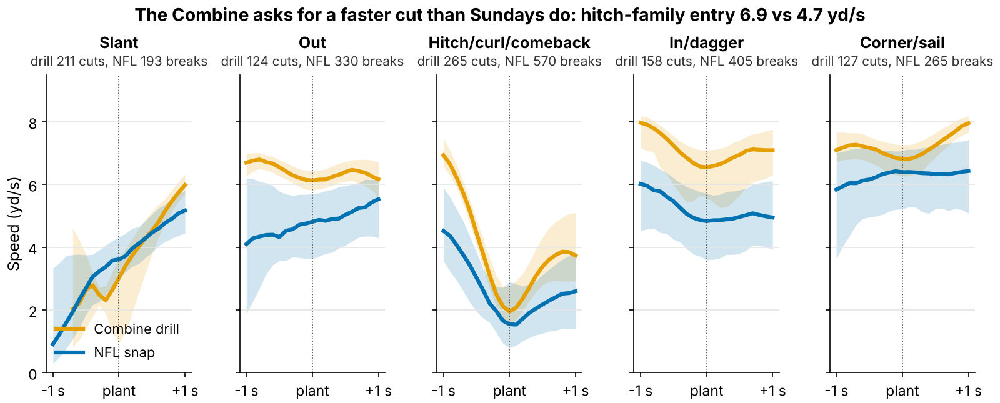
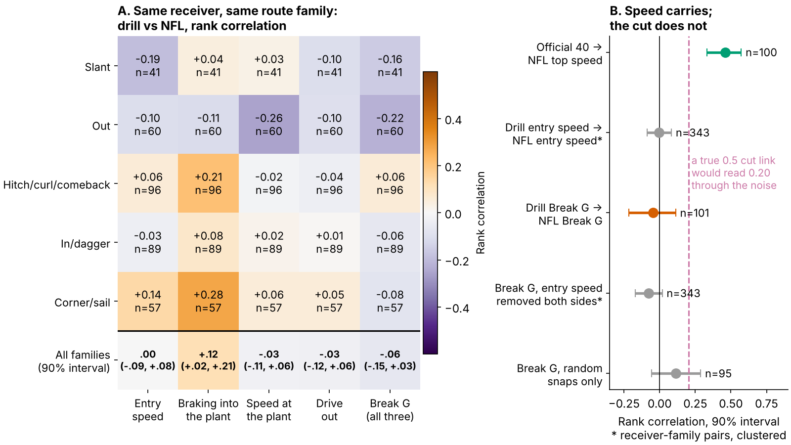

# The Combine Grades a Faster Cut Than Sundays Ask For: Receiver Break G Does Not Buy Separation

**Receivers who cut harder in Combine route drills are not more open in the NFL. Across 116 receivers from draft classes the model never saw, one standard deviation of drill Break G moved separation over expected by −1.2 inches (90% interval −3.7 to +1.0).**

**Break G** is how hard a receiver plants: the average g-force he puts into the ground in the one second around his first real cut, braking in, turning and driving out. A typical NFL hitch break is 0.37 g; the same break in the Combine hitch-family drills is 0.63 g. On film, read three speeds: into the cut, at the plant, out of it.

**Why it matters.** Route-breaking is the receiver skill the Combine films most directly, and clubs already pay for it: at the same 40, weight, NGS score and position, a receiver 1 sd higher in Break G is drafted 14% earlier in pick number (90% interval 4 to 24; 149 receivers). If it does not buy separation, that is draft capital spent on nothing.

**Data.**
- **Combine:** 926 tracked reps in ten route drills (2023–2025 classes), 885 with a gradable cut. Every rep is scored only against the same drill in the same year, because drill medians move between Combines.
- **NFL:** the same cut code run on 1763 sampled regular-season breaks by 115 receivers, grouped into the five route families the drills copy: slant, out, hitch (curl, comeback, hook), in (dagger) and corner (sail).
- **Outcome:** separation over expected (SOE), the inches a receiver is more open at the throw than Next Gen Stats separation predicts from alignment, cushion, position and season. It uses full regular seasons (213 player-seasons, median 231 career routes), not the tracking sample.

## 1. The drill asks for a different cut

Figure 1 is the whole story in one picture. In every family, the Combine receiver enters the cut faster than he will on Sundays. On the hitch family he arrives at 6.9 yd/s (about 14 mph) and in the NFL at 4.7 yd/s (about 10 mph). Only 18% of NFL breaks are entered as fast as the typical drill rep. Break G rises with entry speed (rank correlation 0.37 in drills, 0.56 in games), so the drill rewards whoever can stop from a speed the NFL route rarely asks for.

Then we asked whether the same receiver ranks the same way in both settings, family by family and part by part (Figure 2A).

- **Speed carries.** Official 40 rank vs NFL top speed: 0.46 (90% interval 0.33 to 0.57; 100 receivers).
- **The cut does not.** Drill Break G vs NFL Break G: −0.05 (−0.22 to 0.11; 101 receivers with 8+ sampled breaks). Single families range from −0.22 to 0.06. Removing entry speed on both sides gives −0.08.
- **One part travels a little: braking.** How fast a receiver sheds speed into the plant transfers at 0.12 (90% interval 0.02 to 0.21), mostly on hitches and corners. It is one of 30 cells, so treat it as a lead, not a finding.

Noise alone does not explain the null. Given how noisy both measures are, a true correlation of 0.5 would still read about 0.20. The observed value sits below zero.

## 2. Break G adds nothing to a no-tracking forecast

The test was fixed before it was run: fit the forecast on two draft classes, score it on the third, rotate, and weight receivers by their routes. The ±3 inch margin was set in advance as the smallest effect a club would act on. We show three no-tracking baselines side by side so the null does not depend on one choice. The full one, with pick, official 40, weight, NGS score and a tight-end flag, was pre-specified. Intervals come from resampling whole receivers, refitting every held-out step inside each draw.

| No-tracking baseline | Held-out R² | R² change adding Break G [90%] | Break G effect, inches per sd [90%] |
|---|---|---|---|
| Pick only | −0.03 | −0.003 [−0.090, 0.033] | −0.1 [−2.0, +2.0] |
| Pick + role (TE, slot share) | −0.11 | −0.029 [−0.190, 0.034] | 0.1 [−2.1, +2.3] |
| **Pick + 40, weight, NGS score, TE** (pre-specified) | 0.00 | 0.013 [−0.160, 0.086] | **−1.2 [−3.7, +1.0]** |

*Table 1. 116 receivers with a drill score and NFL separation. R² below zero means the forecast misses held-out classes by more than the class average does.*

No baseline forecasts SOE. Career SOE varies by 8.7 inches between receivers, and draft slot and testing explain none of it out of class. Adding Break G does not help either. 88% of resampled effects fall inside ±3 inches, and none reach +3. The official 3-cone (0.0 in per sd, 38 receivers) and short shuttle (−0.9, 45) tell the same story without tracking. So does braking alone (−1.7, interval −3.8 to +0.4).

**Is the test too weak to see a real effect?** Each graded cut is noisy (reliability 0.14 per cut). At today's median of 7 cuts per receiver, the score's reliability is 0.52. We simulated the whole pipeline: a true skill, a drill reading with the real noise for each receiver's number of drills, real SOE noise and route weights, and the same held-out test (Figure 3B). Because Break G is shrunk for its noise, the test is not biased toward zero; noise costs precision instead (simulated spread 1.4 in). If the true effect were +3 inches per sd, the test would detect it 67% of the time, and would report a slope as low as −1.2 only 0.4% of the time. True effects of +2 inches or more are unlikely. A harmful effect is not excluded.

## 3. Named receivers: the drill order does not survive

| Receiver (drill rank of 49 WRs) | Combine: in → plant → out, yd/s (g) | NFL, same families: in → plant → out (g) | Career SOE, in | Coach's read |
|---|---|---|---|---|
| Kayshon Boutte (#1) | 7.1 → 4.5 → 5.9 (0.62) | 5.7 → 5.0 → 5.9 (0.48) | +0.5 | Hardest drill planter, but on Sundays he sheds only 1.4 mph: he rounds the break. Rep sink-and-plant on curls at game tempo. |
| Ryan Flournoy (#25) | 7.2 → 3.9 → 6.5 (0.61) | 4.7 → 2.4 → 4.8 (0.41) | −6.0 | Mid-pack in drills, slowest of the three into his Sunday breaks (4.7 yd/s): the defender sees it coming. Rep a faster stem into the same plant. |
| Jake Bobo (#49) | 6.7 → 3.1 → 5.6 (0.53) | 5.0 → 3.9 → 5.5 (0.46) | −0.8 | Softest drill cutter, ordinary Sunday cut, separation near expected. Nothing to fix from Combine tape. |

*Table 2. Medians over each man's reps in route families he ran in both settings (7/16, 9/18 and 7/25 drill/NFL breaks). Rank is Break G against all 49 wide receivers with 200+ career routes and 5+ sampled breaks.*

Figure 4 widens the view to the eight hardest and eight softest drill cutters. Most NFL Break G and SOE intervals cross zero, so they are greyed. The hardest eight average −0.5 inches of SOE and the softest eight −2.3. Two cards show why separation is not the whole job. Arian Smith ranks #3 and is +15.8 inches more open than expected over 231 routes, a vertical threat whom corners play off. Puka Nacua ranks #5 and sits at −5.8 inches over 1287 routes: a high-volume target who wins in tight windows. Break G could not have told those two apart.

## 4. What to do on Monday

- **Scouts and the draft room:** give the route-drill cut grade zero weight in the price. Today it moves a receiver 14% up the board per sd and buys no separation. The 40 transfers; the cut grade does not.
- **Combine staff:** grade at least 15 cuts per receiver (reliability 0.70; today's median 7 gives 0.52). Re-stem the curl, comeback and hook at NFL hitch entry speed (about 4.7 yd/s, a controlled three-quarter stem). This is a design proposal; these data cannot test it.
- **Position coaches:** rep breaks at game tempo. Nothing here says a harder full-speed plant buys separation. Braking into the plant is the only part with any drill-to-Sunday carry-over, and only as a lead, so coach the sink at game speed.

## Limitations

- **Not blind.** All three classes were seen in earlier rounds of this work. The Break G definition, the ±3 inch margin and the pre-specified baseline were frozen before these tests and are unchanged here.
- **Power.** Detection is 67% at +3 inches. Harm down to −3.7 inches per sd is not excluded.
- **Tracking is a sample.** Up to 40 NFL plays per player, 50% random and the rest top-EPA, with no defenders or ball. Section 1 and the cards depend on it; Section 2 uses full-season NGS separation. Random snaps alone give a drill-to-NFL Break G correlation of 0.11 (−0.06 to 0.29; 95 receivers).
- **Selection.** 116 of 149 drill-scored receivers logged NFL routes. Receivers who never played cannot be tested.
- **SOE is one output.** It omits contested catches, yards after catch and target earning, as the Nacua card shows.

## Appendix: method in brief

A cut is the first turn of 30° or more after 1.5 yd of stem, entered above 2.5 yd/s. Positions are Savitzky–Golay smoothed at 10 Hz, and Break G averages the acceleration magnitude over ±0.5 s around the turn. The receiver score averages his drills (z-scored within drill and year) and is shrunk toward the mean by the between-drill reliability. NFL breaks are z-scored within route family and position. The 40 enters only as the official time, so the tracked clip's 0.3 s start offset never touches Break G. `analysis.py` rebuilds every number, table and figure from `data/processed` in about two minutes.
