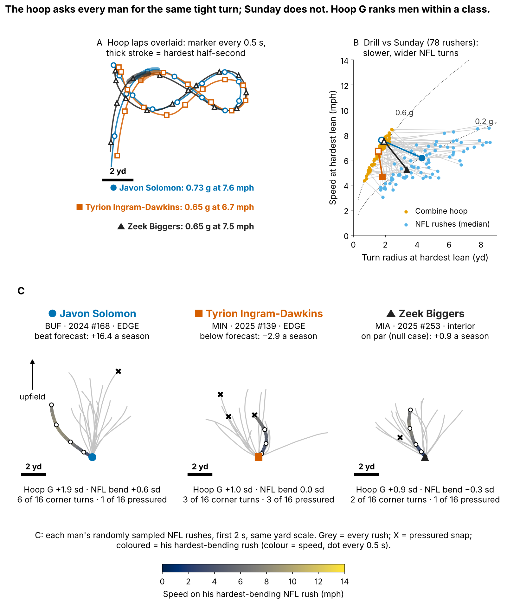
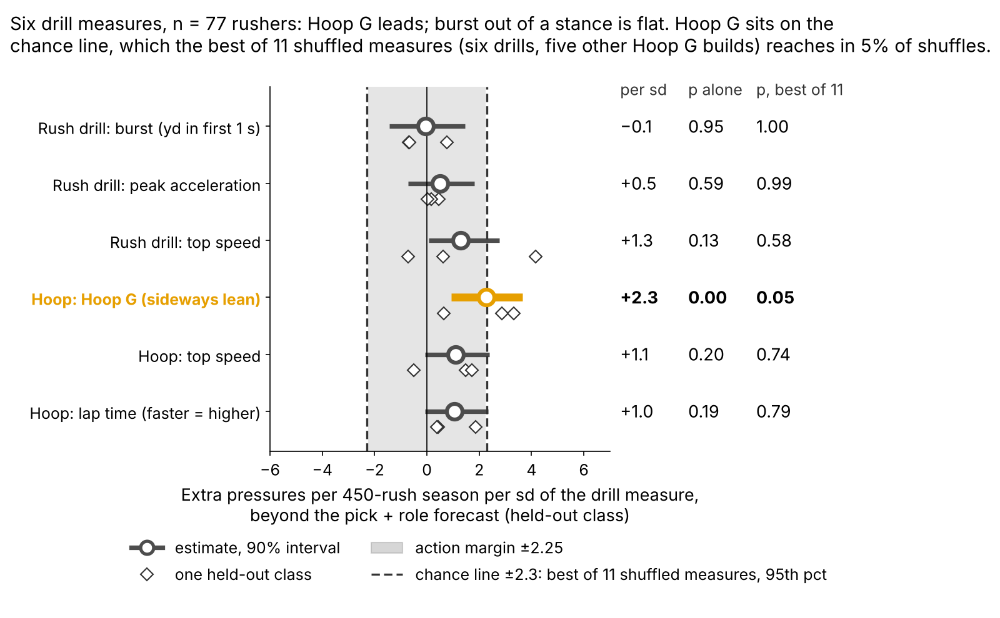
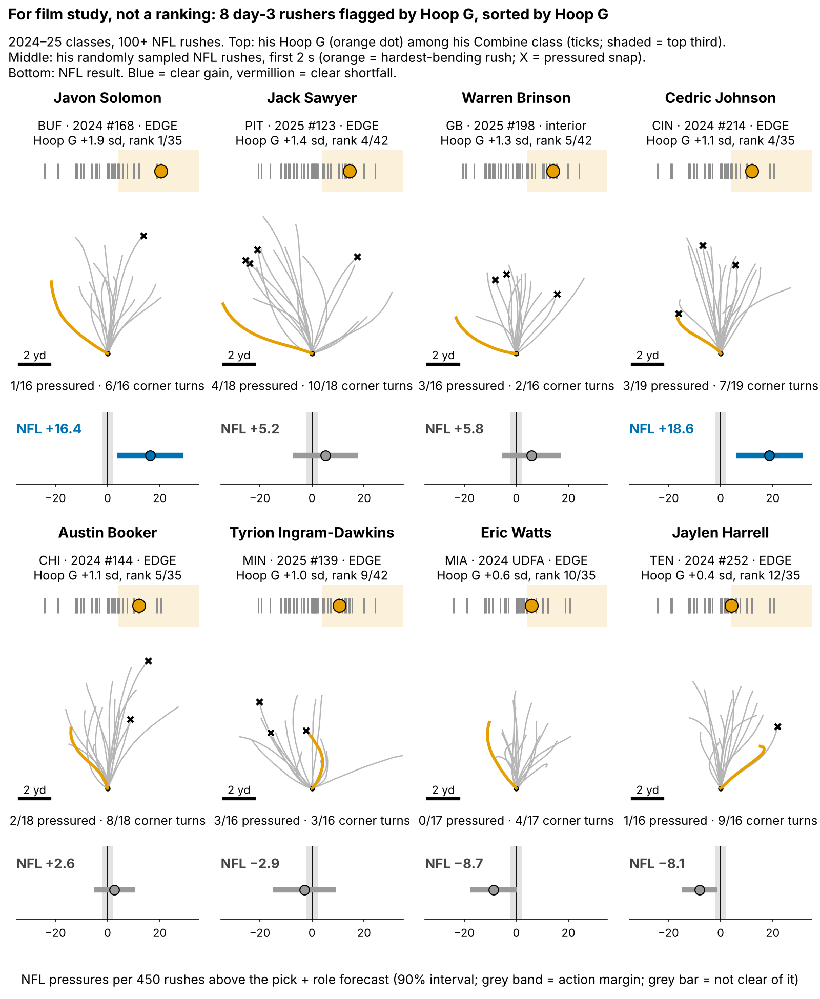
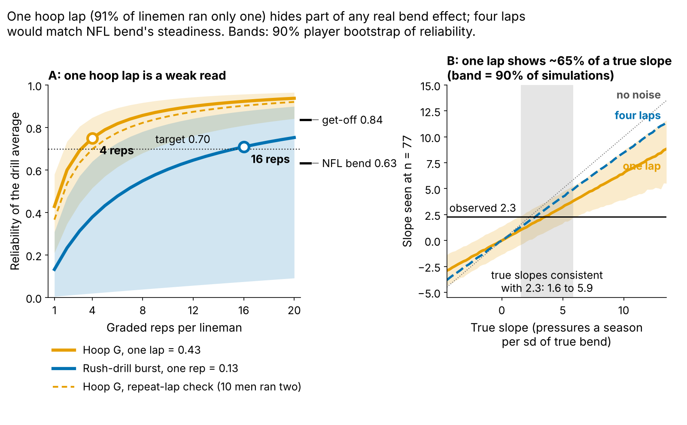

# Run-the-Hoop Bend Points Toward NFL Pass Rush, but Not Past Draft Order

Defensive linemen who lean harder through the Combine's Run-the-Hoop turn got +2.3 pressures per 450 rushes per sd [90%: 0.9, 3.7] more than their pick and role predicted, in draft classes the model never saw (n = 77). It does not pick day-3 tape better than draft order (9 of 15 hits against 9 of 15), so it is a film flag and a frozen 2026 test, not a board input.

**Why now.** Combine tracking began with the 2023 class, which now has three NFL seasons of tracked rushes: the first chance to test a drill within one class against the same men on Sunday.

**What to do on Monday**

- **Scout (fixed rule):** flag a day-3 or undrafted rusher (pick 103+) in the top third of his Combine class on Hoop G. That flagged 8.0 men a class in 2023–25 (6 to 10, of about 36 hoop runners); expect as many in 2026. Queue them beside pick order; on tape, check whether he flattens at the top of the rush at speed.
- **Cost of a miss:** a false flag costs a film session (5 of 17 held-out flags fell short of forecast by the margin). A missed hit costs 5.1 pressures a season, about 2.7 expected points (9 unflagged day-3 rushers beat forecast by the margin). Open tape freely; never move the board.
- **Coach:** low Hoop G gets tight-circle and dip-and-rip reps off a live get-off. **Combine:** grade four hoop laps, not one.

## Hoop G in coach terms

Hoop G is how hard a lineman leans through the tightest half-second of the hoop's figure-eight: speed squared over turn radius, in g, ranked within his Combine class. The median lineman carries 7.1 mph around a 1.8-yard radius, which is 0.62 g. His hardest lean on a sampled NFL rush comes at 5.6 mph around 4.1 yards, which is 0.18 g.

On Sunday the tackle pushes the arc out: a rusher's NFL turn is a median 2.7 times wider than his hoop turn (n = 78), and only 34% of sampled rushes reach his hoop speed at the lean (Figure 1B). So we compare men within a class, never raw g.

**Why the hoop.** The pass-rush drill times get-off, which NGS already measures every snap, and one burst rep repeats at only 0.13. Bend has no box-score column, and a pressured snap cost the offense 0.52 expected points [0.36, 0.67] on 1655 randomly sampled pass plays.

**Why day 3.** 69% of the 118 linemen in the 2023–25 classes went on day 3 or undrafted, where tape is thinnest.

## Does the bend show up on Sunday?

A sampled rush is a **corner turn** when its hardest half-second of lean in the first 2 s is in the top quarter of all sampled rushes (at least 0.24 g). Linemen in their class's top third on Hoop G turned the corner on 29% of rushes, the bottom third on 21%: a gap of 9 points [3, 15], n = 78. Corner-turn rushes ended in pressure 15% of the time, other rushes 7%.

| Link | Rank correlation [90%] | n |
|---|---|---|
| Hoop G → NFL bend | 0.14 [−0.06, 0.32] | 78 |
| Hoop turn radius → NFL turn radius | 0.01 [−0.19, 0.20] | 78 |
| NFL bend → pressure rate | 0.36 [0.20, 0.52] | 85 |
| NGS get-off → pressure rate | 0.41 [0.27, 0.54] | 85 |

*Table 1. Rank correlation after adjusting for weight and edge share. NFL movement: a median 17 randomly sampled rushes per lineman.*

NFL bend goes with pressure, but Hoop G barely predicts NFL bend. Fitting both steps on two classes and applying them to the third, only 9% [−11, 38] of the Hoop G slope runs through measured NFL bend. "Bend" names the drill; it is not a proven mechanism.

## Held out by class

**Outcome:** career pressure rate through 2025, adjusted for small samples (30+ rushes). Each class (27/23/27 rushers) is forecast by a model fitted on the other two. **Baseline:** pick plus role (edge share), the forecast frozen for the 2026 test before Hoop G was examined. The smallest effect worth acting on, set before fitting, is +2.25 pressures per 450 rushes per sd.

**Hoop G adds about +2.3 pressures per 450 rushes per sd [0.9, 3.7]; the interval excludes zero, but the R² gain, 0.06 [−0.10, 0.20], does not.** A ridge-shrunk full no-tracking baseline gives +2.4 [1.0, 3.9]; other baselines are in the appendix.

**Placebo.** We shuffled the whole drill table within class: six drill measures plus five other ways to build Hoop G (averaging both turns; 0.3 s or 0.7 s windows). The best of those eleven reaches +2.3 in 5% of shuffles, the line Hoop G sits on (Figure 2). Its construction (harder turn, 0.5 s) was fixed beforehand; averaging both turns gives +1.5 [0.1, 2.9].

- **Class by class:** 2.9, 3.3, 0.6; 2025 is flat, not reversed.
- **Edge vs interior:** +2.4 (n = 38) vs +2.8 (n = 39).
- **One-lap noise:** one lap repeats at 0.43 and shows about 65% of a true slope; corrected, about +3.5 (secondary only; appendix Figure 4).

**Negative control, not clean.** The same pipeline finds Hoop G also predicts *fewer* run-snap tackles (−0.26 sd [−0.44, −0.05], n = 64; pressure: 0.35 sd). Weight does not explain it (−0.22 after adding weight). Hoop G may partly mark a pass-rush specialist that pick and role miss.

## Day 3: a film queue, not a board

Among 47 held-out day-3 and undrafted rushers, the top third by forecast plus Hoop G beat its class's day-3 median 9 of 15 times; pick order's top third, 9 of 15. The gap, 0 points [−20, 33], misses the +20 we required for board use. Flagged men beat their own forecast 59% of the time (10 of 17), the rest 47%.

The 8 flagged 2024–25 day-3 rushers with 100+ NFL rushes, in Hoop G order (pressures a season against forecast):

**Open first** (beat the forecast by the margin):

- **Javon Solomon** (BUF, EDGE, 2024 #168): Hoop G +1.9 sd, NFL bend +0.6 sd, NFL +16.4. Top hoop lap of his class; keep the wide passing-down role.
- **Jack Sawyer** (PIT, EDGE, 2025 #123): Hoop G +1.4 sd, NFL bend +2.0 sd, NFL +5.2. Hardest NFL bend of the eight; widen his passing-down role.
- **Warren Brinson** (GB, interior, 2025 #198): Hoop G +1.3 sd, NFL bend −0.7 sd, NFL +5.8. A 315-lb interior man: judge him against interior linemen; loop him on stunts.
- **Cedric Johnson** (CIN, EDGE, 2024 #214): Hoop G +1.1 sd, NFL bend +0.7 sd, NFL +18.6. Give him third-down snaps from a wide alignment.
- **Austin Booker** (CHI, EDGE, 2024 #144): Hoop G +1.1 sd, NFL bend +1.0 sd, NFL +2.6. Most rushes of the eight, a steady small plus.

**Flag missed** (fell below it):

- **Tyrion Ingram-Dawkins** (MIN, EDGE, 2025 #139): Hoop G +1.0 sd, NFL bend 0.0 sd, NFL −2.9. Average NFL lean, slowest NGS get-off of the eight; rep dip-and-rip off a live get-off.
- **Eric Watts** (MIA, EDGE, 2024 UDFA): Hoop G +0.6 sd, NFL bend +0.1 sd, NFL −8.7. Shortest first-second burst of the eight; coach the get-off first.
- **Jaylen Harrell** (TEN, EDGE, 2024 #252): Hoop G +0.4 sd, NFL bend +1.7 sd, NFL −8.1. Second-hardest NFL bend of the eight, yet well below forecast: the bend is not becoming pressure (Table 3).

**Tape pull.** We have not watched these plays; tracking has no blockers, so each clip must show the tackle's set and whether he won.

| Rusher (vs forecast) | Clip | Alignment, situation | NGS get-off | Hardest lean | Pressure |
|---|---|---|---|---|---|
| Javon Solomon (+16.4) | 2025 wk 10, Q3, play 2025110904-2524 | EDGE, 2nd & 14, singleback | 1.22 s | 0.34 g at 1.5 s, 2.9 yd upfield, 8.2 mph | no |
| Tyrion Ingram-Dawkins (−2.9) | 2025 wk 15, Q2, play 2025121413-926 | EDGE, 1st & 1, singleback | 1.05 s | 0.31 g at 1.3 s, 2.0 yd upfield, 5.3 mph | yes |
| Jaylen Harrell (−8.1) | 2025 wk 16, Q2, play 2025122108-1521 | EDGE, 1st & 10, singleback | 1.04 s | 0.45 g at 1.8 s, 2.6 yd upfield, 2.1 mph | no |

*Table 3. Each man's hardest-bending randomly sampled rush.*

Solomon's lean is a speed turn (8.2 mph, 2.9 yd upfield), the hit to confirm. Harrell's comes near a stop (2.1 mph; typical 6.5): tape should show whether it is a counter after the tackle stopped him, a reason the drill cannot see.

## The one action: a frozen 2026 test

Stored in `frozen_rule.json` (sha256 `ad1cc734cdd4…`): grade the 2026 class's hoop laps; after Week 18, regress pressure rate minus the frozen pick-plus-role forecast on Hoop G. Positive at one-sided p < 0.10 keeps the flag; zero or below retires it. Hoop G reaches the board only if its day-3 top third beats pick order by 20+ points over two classes.

## Limitations

- **Small samples, single reps.** 77 rushers in the model, 47 on day 3; 91% ran one hoop lap.
- **No film watched, no blockers.** Corner turns and pressure may both follow from beating the tackle; Table 3 is a pull list, not a verdict.
- **Mechanism unproven.** Little of the slope runs through measured NFL bend, and the negative control is not clean.
- **Reused classes.** Earlier rounds screened ideas on these classes; 2026 is the first clean test.
- **Missed time.** 33 linemen under 30 rushes are left out.

## Appendix

| Baseline without tracking (n = 77) | Baseline R² | + Hoop G R² | R² gain [90%] | Hoop G slope [90%] |
|---|---|---|---|---|
| Pick only | 0.03 | 0.16 | 0.13 [−0.05, 0.32] | +3.2 [1.7, 4.6] |
| **Pick + role (headline)** | 0.10 | 0.16 | 0.06 [−0.10, 0.20] | **+2.3 [0.9, 3.7]** |
| Ridge-shrunk full | −0.02 | 0.03 | 0.06 [−0.05, 0.18] | +2.4 [1.0, 3.9] |
| Full OLS: pick, role, weight, NGS score, split, 3-cone | −0.04 | 0.07 | 0.11 [−0.12, 0.31] | +2.2 [0.4, 3.8] |
| Chosen inside each training fold | −0.08 | 0.08 | 0.16 [−0.06, 0.28] | +2.4 [1.1, 4.0] |

*Table 2. Every baseline finds a similar slope; none finds an R² gain clear of zero. Slopes are pressures per 450 rushes per sd; intervals resample linemen within class and refit every fold. The fold-chosen baseline picked pick only for 2023, pick + role for 2024, full no-tracking for 2025.*

- **Mediation.** Hoop G → NFL bend 0.12 sd per sd [−0.06, 0.27]; NFL bend → pressure 1.6 [0.3, 3.1]; indirect 0.2, direct 1.8 [0.3, 3.2] (n = 77).
- **Noise model.** Simulating true slopes through one-lap noise, true slopes 1.6 to 5.9 fit the observed value. 2026 power at the observed slope: 59% for one class, 92% for three.
- **EPA trace.** 1681 rusher rows (135 credited with a pressure or sack) cover 1655 plays; 26 plays had two cohort rushers. A play is pressured if any rusher was credited (134); keeping the first row per play, as round 22 did, gave 132.
- **Multiplicity.** Of 36 tests, 2 survive Holm and 12 Benjamini–Hochberg at 0.10.
- **Variants.** Other Hoop G builds 1.4 to 2.2; priors and rush minimums 1.8 to 2.6; dropping one rusher 2.0 to 2.5. `verify.py`, sharing no code with `analysis.py`, rebuilds the same 77 rushers: +2.3 [0.8, 3.8].
