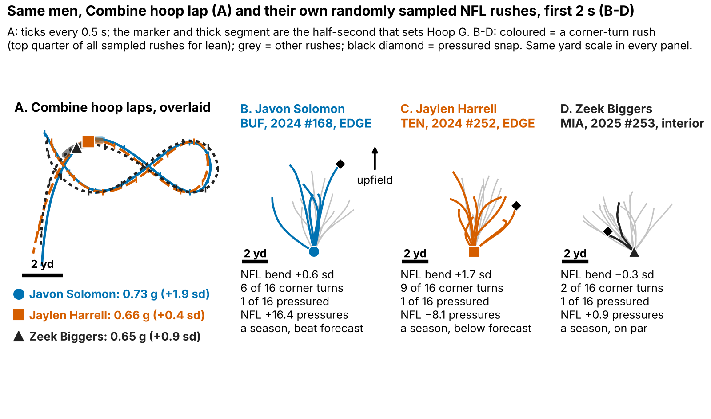
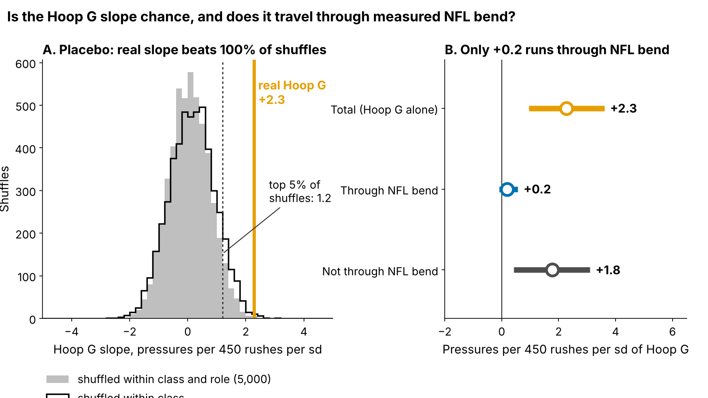
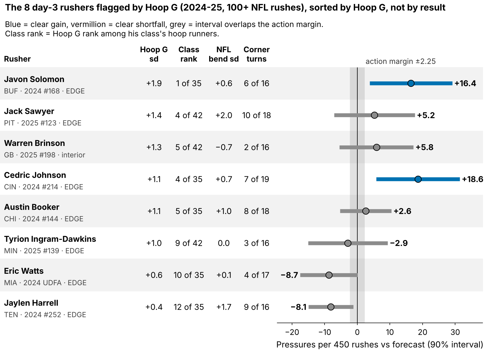

# Run-the-Hoop Bend Points Toward NFL Pass Rush, but Not Yet Past Draft Order

Defensive linemen who lean harder through the Combine's Run-the-Hoop turn got more NFL pressure than their draft slot and role predicted: **+2.3 pressures per 450 rushes for each standard deviation (sd) of "Hoop G" [90% interval 0.9 to 3.7], n = 77**, always scored on a draft class the model never saw. It does not yet choose better day-3 tape than pick order (9 of 15 hits for both), so it is a film flag and a frozen 2026 test, not a board input.

**Why now.** The 2023–25 classes are the first tracked Combine classes with NFL snaps, so the drill can finally be checked against the same men's NFL rushes, and the 2026 class arrives as a clean test.

- **Scout, Monday:** flag every day-3 or undrafted lineman in his class's top third on Hoop G (about 8 a class; 6 to 10 in 2023–25) and watch his rushes for a flat, tight corner before the board meets. The flag sets film order, never board order.
- **Cost of a miss:** in held-out classes 59% of flagged men beat their forecast against 47% of other day-3 men; a miss fell short by 4.7 pressures a season. The flag never moves a name up, so a miss costs film time, not a pick.
- **Coach and Combine:** low Hoop G gets tight-circle and dip-and-rip reps off a live get-off; grade four hoop laps, not one.

## Hoop G in coach terms

Hoop G is how hard a lineman leans through the tightest half-second of the hoop's figure-eight: speed squared over turn radius, in g, ranked within his Combine class. The median lineman carries 7.1 mph around a 1.8-yard radius (0.62 g). His hardest lean on a sampled NFL rush comes at 5.6 mph around 4.1 yards (0.18 g).

On Sunday the tackle's set and hands push the arc out: a rusher's NFL turn is a median 2.7 times wider than his own hoop turn (n = 78), so we compare men within a class, never raw g across drill and game. A pressured snap cost the offense 0.52 expected points [0.35, 0.67] on 1655 sampled pass plays; bend has no box-score column, and 69% of the 118 linemen went on day 3 or undrafted, where tape is thinnest.

## Does it hold on a class the model never saw?

**Outcome:** career pressure rate through 2025 (shrunk toward the 8.1% mean) for linemen with 30+ rushes. **Test:** each class (27/23/27 rushers) is forecast by a model fitted on the other two; drill measures are standardized within Combine year. **Comparator, fixed before this round:** draft pick plus edge-or-interior role, the forecast frozen for the 2026 test.

| Forecast without tracking (n = 77) | Forecast R² | + Hoop G R² | R² gain, resample rushers [90%] | R² gain, resample NFL teams [90%] | Hoop G, pressures per 450 rushes per sd |
|---|---|---|---|---|---|
| Pick only | 0.03 | 0.16 | 0.13 [−0.05, 0.32] | [−0.04, 0.29] | +3.2 [1.7, 4.6] |
| **Pick + role (headline)** | 0.10 | 0.16 | 0.06 [−0.10, 0.20] | [−0.08, 0.20] | **+2.3 [0.9, 3.7]** |
| Everything, shrunk: pick, role, weight, NGS score, 10-yd split, 3-cone | −0.02 | 0.03 | 0.06 [−0.05, 0.18] | [−0.05, 0.17] | +2.4 [1.0, 3.9] |

*Table 2. In plain terms: whatever the forecast, a rusher one sd above his class on Hoop G beat it by 2 to 3 pressures a season, clear of zero; but the share of rusher-to-rusher spread explained rises only slightly and could be zero. "Shrunk" pulls coefficients toward zero by an amount chosen inside the training classes.*

Checks, one line each:

- **Placebo (Figure 2A):** Hoop G shuffled among linemen of the same class and role 5000 times; the real slope beats 100% of shuffles (p = 0.001), whose top 5% reach 1.2.
- **Class by class:** 2.9, 3.3, 0.6; 2025 is flat, not reversed (−1.2 to 2.4).
- **Both turns of the lap averaged** instead of the harder one: +1.5 [0.1, 2.9], smaller but still positive.
- **One-lap noise:** 91% ran one lap, which repeats at only 0.43; corrected for that noise the slope would be about +3.5 (range 1.6 to 5.9).
- **Independent script:** a re-implementation sharing no code gives +2.3 [0.8, 3.8] on the same 77 rushers.

## From drill to Sunday: where the signal travels

| Link (holding weight and edge share fixed) | Rank correlation [90%] | n |
|---|---|---|
| Hoop G → NFL bend | 0.14 [−0.06, 0.32] | 78 |
| Hoop turn radius → NFL turn radius | 0.01 [−0.19, 0.20] | 78 |
| NFL bend → pressure rate | 0.36 [0.20, 0.52] | 85 |

*Table 1. NFL bend = hardest half-second of lean in the first 2 s, averaged over a median 17 randomly sampled rushes per lineman.*

The two halves do not multiply into the headline. NFL bend does turn into pressure, but Hoop G barely predicts NFL bend. On the same 77 rushers, only +0.2 [−0.1, 0.6] of the +2.3 runs through measured NFL bend (8%); +1.8 does not (Figure 2B). Hoop G is not a proxy for the arc we measure on Sunday; it tracks something the sampled 2-s paths miss, such as balance while finishing, counter moves, or rushes we did not sample.

The corner turn still shows on Sunday. Call a sampled rush a **corner turn** when its lean is in the top quarter of all sampled rushes (at least 0.24 g). Linemen in their class's top third on Hoop G turned the corner on 29% of rushes, the bottom third on 21% (gap 9 points [3, 15], n = 78); corner-turn rushes were pressured 15% of the time against 7% (1437 rushes).

## Day 3: a film queue, not a board

Among 47 day-3 and undrafted rushers in held-out classes, the top third by forecast plus Hoop G beat its class's day-3 median 9 of 15 times; pick order's top third also went 9 of 15, and the forecast alone 8 of 15. The gap, 0 points [−20, 33], misses the +20 we required for board use. **Hoop G has not shown it picks better day-3 tape; it is a reason to open tape.**

The 8 flagged 2024–25 day-3 rushers with 100+ NFL rushes, in Hoop G order (pressures a season against the pick + role forecast):

**Open first** (beat the forecast by the 2.25 margin):

- **Javon Solomon** (BUF, EDGE, 2024 #168): Hoop G +1.9 sd, NFL bend +0.6 sd, NFL +16.4. Hoop G rank 1 of 35 in his class; keep the wide passing-down role.
- **Jack Sawyer** (PIT, EDGE, 2025 #123): Hoop G +1.4 sd, NFL bend +2.0 sd, NFL +5.2. Hardest NFL bend of the eight; widen his role.
- **Warren Brinson** (GB, interior, 2025 #198): Hoop G +1.3 sd, NFL bend −0.7 sd, NFL +5.8. A 315-lb interior man; loop him on end-tackle stunts.
- **Cedric Johnson** (CIN, EDGE, 2024 #214): Hoop G +1.1 sd, NFL bend +0.7 sd, NFL +18.6. Give him third-down snaps from a wide alignment.
- **Austin Booker** (CHI, EDGE, 2024 #144): Hoop G +1.1 sd, NFL bend +1.0 sd, NFL +2.6. Most rushes of the eight; keep his rotation share.

**Flag missed** (fell below it):

- **Tyrion Ingram-Dawkins** (MIN, EDGE, 2025 #139): Hoop G +1.0 sd, NFL bend 0.0 sd, NFL −2.9. Slowest NGS get-off of the eight; rep dip-and-rip off a live get-off.
- **Eric Watts** (MIA, EDGE, 2024 UDFA): Hoop G +0.6 sd, NFL bend +0.1 sd, NFL −8.7. Shortest first-second burst of the eight; coach the get-off before the corner.
- **Jaylen Harrell** (TEN, EDGE, 2024 #252): Hoop G +0.4 sd, NFL bend +1.7 sd, NFL −8.1. Second-hardest NFL bend of the eight, yet second-furthest below forecast (play log below).

**Play-log check (not film).** With no video or blockers, we read every sampled snap of the top hit and the miss with the most corner turns.

- **Javon Solomon** lined up on the edge on 14 of 20 snaps and turned the corner on 6 of 16 2-s rushes, but only 1 sampled snap was pressured (at his 10.8% career rate, 2.2 were expected). Tape must show whether his pressures come off the corner.
- **Jaylen Harrell** lined up on the edge on 19 of 20 snaps and turned the corner on 9 of 16 rushes, yet 6 of those corner turns ended in a completed pass and 1 in pressure. His median NGS get-off on them was 0.97 s, close to the 0.95 s of all sampled rushes, so the first step is not obviously late. Tape question: does he reach the corner after a quick throw, or fail to finish?

## The one action: a frozen 2026 test

Stored in `frozen_rule.json` (sha256 `ad1cc734cdd4…`): grade the 2026 class's hoop laps; after Week 18, regress pressure rate minus the pick-plus-role forecast frozen on 2023–25 on Hoop G. Positive at one-sided p < 0.10 keeps the flag; zero or below retires it. Hoop G reaches the board only if its day-3 top third beats pick order by 20+ points over two classes.

## Limitations

- **Small samples, single reps.** 77 rushers are in the model and 47 on day 3; most ran one hoop lap.
- **Reused classes.** Earlier rounds screened ideas on these classes; 2026 is the first clean test.
- **Thin NFL tracking, no blockers or film.** Corner turns and pressure may both follow from beating the tackle; the play-log reads are ours, from 16–19 sampled rushes each.
- **Missed time.** Rates are per rush; the 33 linemen under 30 rushes are left out.

## Bottom line

Hoop G is a small, steady signal worth a look at day-3 edge tape, not a board input. Grade four laps and let the 2026 test decide.

## Appendix

- **Other comparators.** The unshrunk full forecast overfits (held-out R² −0.04; Hoop G +2.2 [0.4, 3.8]). A forecast chosen inside each training fold gives +2.4 [1.1, 4.0] (pick only for 2023, pick + role for 2024, full no-tracking for 2025). Team resampling (30 clubs) gives a slope interval of 1.1 to 3.8.
- **Six drill measures (Figure A1).** Hoop G is one of six pre-listed measures; p = 0.003 alone and 0.05 as the best of six, where six shuffled drills reach ±2.3 5% of the time. Pass-rush-drill burst is flat.
- **EPA trace.** 1681 sampled rusher-rows (135 pressured) cover 1655 plays: 26 plays had two sampled linemen, and one row per play keeps 132 pressured. Flagging a play if either lineman pressured gives 134 and 0.52 EPA; counting rows gives 0.53.
- **Multiplicity.** Of 36 tests, 2 survive a strict family-wise correction at 0.10 (both NFL trait-to-pressure links) and 12 survive a false-discovery correction (`multiplicity.csv`).
- **Variants.** Priors and rush minimums: 1.8 to 2.6; dropping one rusher at a time: 2.0 to 2.5; 200 random three-way splits: 2.3 to 2.7; edge +2.4 (n = 38), interior +2.8 (n = 39).
- **Noise and power.** Simulated, one lap shows about 65% of a true slope. The 2026 test has 59% power for one class and 92% for three at the observed slope.

`analysis.py` (about 8 minutes) rebuilds every number, figure and this text from `data/processed`, and runs `verify.py`.
