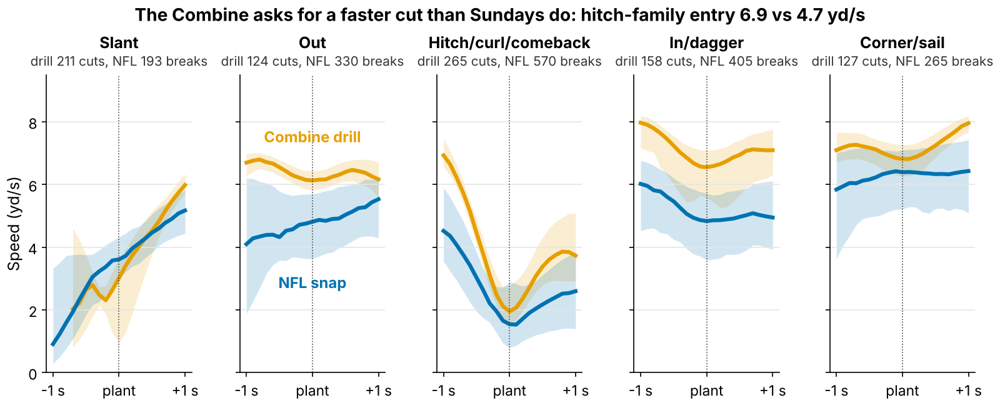
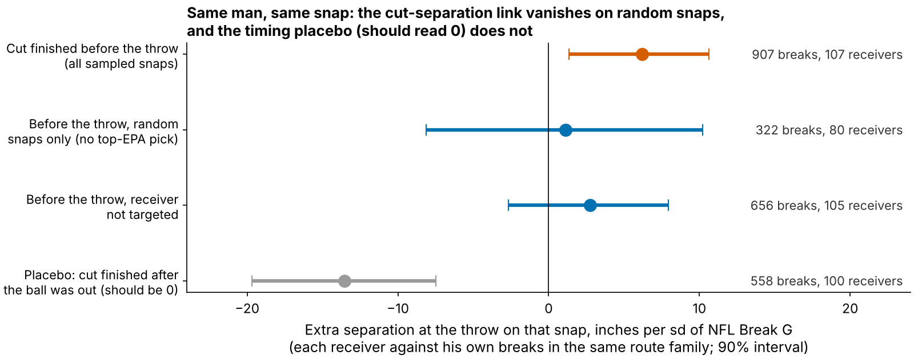

# The Combine Grades a Cut Sundays Don't Ask For: Receiver Break G Buys No Separation

**Receivers who cut harder in Combine route drills are not more open in the NFL. On {n_soe} receivers from draft classes the forecast never saw, one standard deviation of drill Break G moved separation over expected by {full_b} inches (90% interval {full_b_lo} to {full_b_hi}).**

**Break G** measures how hard a receiver plants. It is his average g-force over the one second around his first real cut, covering the brake into the cut, the turn and the drive out. A typical NFL hitch break is {hitch_bg_nfl} g; the same break in the Combine hitch-family drills is {hitch_bg_drill} g. On film it reads as three speeds: into the cut, at the plant and out of it.

**Why now.** This is the first draft cycle with 10 Hz tracking of every Combine route drill next to NFL tracking of the same men. Before a room buys a "route-running grade" built from these clips, it should know whether the cut shows up on Sundays. Clubs already pay for it: at the same 40, weight, NGS score and position, a receiver 1 sd higher in Break G goes {price}% earlier in pick number (90% interval {price_lo} to {price_hi}; {n_drill} receivers).

**Data**
- **Combine:** {n_reps} tracked reps in ten route drills (2023–2025 classes), {n_cuts} with a gradable cut, each scored against the same drill and year.
- **NFL:** the same code on {n_nfl_breaks} sampled regular-season breaks by {n_nfl_rec} receivers, in the five route families the drills copy: slant, out, hitch (curl, comeback, hook), in (dagger) and corner (sail).
- **Outcome:** separation over expected (SOE). Inches more open at the throw than Next Gen Stats separation predicts from alignment, cushion, position and season, over full regular seasons ({n_pseason} player-seasons, median {med_routes} career routes), not from the tracking sample.

## 1. The drill asks for a different cut

In every route family, the Combine receiver arrives at the cut faster than he will on Sundays (Figure 1). On the hitch family he arrives at {hitch_in_drill} yd/s (about {hitch_in_drill_mph} mph) in the drill and {hitch_in_nfl} yd/s (about {hitch_in_nfl_mph} mph) in the NFL. Only {share_nfl_at_drill}% of NFL breaks are entered as fast as a typical drill rep. Break G rises with entry speed (rank correlation {rho_bg_vin_drill} in drills, {rho_bg_vin_nfl} in games). The drill rewards stopping from a speed NFL routes rarely ask for.

Does the same receiver rank the same way in both settings? Figure 2 checks each route family and each part of the cut.

- **Speed carries.** Official 40 rank vs NFL top speed: {f40_rho} (90% interval {f40_lo} to {f40_hi}; {f40_n} receivers).
- **The cut does not.** Drill Break G vs NFL Break G: {rec_rho} ({rec_lo} to {rec_hi}; {rec_n} receivers with 8+ sampled breaks). Taking entry speed out of both sides gives {res_rho}. Given how noisy both measures are, a true link of {link} would still read about {true05}, so noise alone does not explain this.
- **One part travels a little: braking.** How fast a receiver sheds speed into the plant carries over at {all_decel} ({all_decel_lo} to {all_decel_hi}), mostly on hitches and corners. It is one of 30 cells, so treat it as a lead.

## 2. Break G adds nothing to a no-tracking forecast

The test was fixed in advance: fit on two draft classes, score the third, rotate, weight by routes. A ±3 inch margin was set beforehand as the smallest effect a club would act on. Intervals resample whole receivers and refit every step.

| No-tracking forecast | Its held-out R² | R² change adding Break G [90%] | Break G effect, inches per sd [90%] |
|---|---|---|---|
| Pick only | {pick_r2} | {pick_dr2} [{pick_dr2_lo}, {pick_dr2_hi}] | {pick_b} [{pick_b_lo}, {pick_b_hi}] |
| Pick + role (TE, slot share) | {role_r2} | {role_dr2} [{role_dr2_lo}, {role_dr2_hi}] | {role_b} [{role_b_lo}, {role_b_hi}] |
| Ridge-shrunk: pick, 40, weight, NGS, TE, slot | {ridge_r2} | {ridge_dr2} [{ridge_dr2_lo}, {ridge_dr2_hi}] | {ridge_b} [{ridge_b_lo}, {ridge_b_hi}] |
| **Pick + 40, weight, NGS, TE** (set in advance) | {full_r2} | {full_dr2} [{full_dr2_lo}, {full_dr2_hi}] | **{full_b} [{full_b_lo}, {full_b_hi}]** |

*Table 1. {n_soe} receivers with a drill score and NFL separation. An R² below zero means the forecast does worse on a new class than that class's own average.*

No forecast predicts SOE. Career SOE varies by {sd_soe_in} inches between receivers, and draft slot plus testing explains none of it on a new class. Adding Break G does not help under any of the four forecasts; with the pre-set forecast, {p_pos3}% of resampled effects reach +3 inches. The official 3-cone ({cone_b} in per sd, {cone_n} receivers) and short shuttle ({shut_b}, {shut_n}) say the same without tracking.

**Placebo.** We shuffled Break G among receivers of the same class {n_shuffle} times and reran the test. 90% of the shuffled effects fall between {plac_lo} and {plac_hi} inches, and {plac_p}% are at least as far from zero as the real {full_b}. Real Break G behaves like a shuffled one (Figure 3B).

## 3. Is there a Sunday cut skill to predict?

If the drill misses a real NFL skill, a harder Sunday cut should buy space on the same snap. We compared each receiver with himself, within one route family, on breaks finished before the throw, controlling for cushion and for how early the cut ended. {share_post}% of detected breaks ended after the ball was out. Those make a timing placebo (Figure 4): they cannot create separation at the throw, so they should read zero.

Across all sampled snaps the link is {snap_pre} inches per sd ({snap_pre_lo} to {snap_pre_hi}; {snap_pre_n} breaks, {snap_pre_r} receivers). On random snaps it drops to {snap_pre_rand} ({snap_pre_rand_lo} to {snap_pre_rand_hi}); the link lives in the top-EPA half of the sample, where completions to open receivers are over-represented. The placebo reads {snap_post} ({snap_post_lo} to {snap_post_hi}), not zero, likely because a covered receiver keeps working and cutting after the throw. Play context, not the cut, most likely drives the same-snap numbers. Between receivers, a man's NFL Break G does not track his career SOE either ({nsoe_rho}, {nsoe_lo} to {nsoe_hi}; {nsoe_n} receivers). The drill is not missing a Sunday cut skill: in these data the cut grade is not a separation skill at any level.

## 4. Named receivers: the drill order does not survive

| Receiver (drill rank of {n_elig} WRs) | Combine: in → plant → out, yd/s (g) | NFL, same families: in → plant → out (g) | Career SOE, in | Clip to pull (tracking-located, random snap) | Coach's read |
|---|---|---|---|---|---|
| {top_name} (#{top_rank}) | {top_din} → {top_dap} → {top_dout} ({top_dg}) | {top_nin} → {top_nap} → {top_nout} ({top_ng}) | {top_soe} | {top_clip}: {top_clip_g} g, {top_clip_sep} yd open | Hardest drill planter; on Sundays sheds only {top_nmph} mph and rounds the break. Rep sink-and-plant at game tempo. |
| {mid_name} (#{mid_rank}) | {mid_din} → {mid_dap} → {mid_dout} ({mid_dg}) | {mid_nin} → {mid_nap} → {mid_nout} ({mid_ng}) | {mid_soe} | {mid_clip}: {mid_clip_g} g, {mid_clip_sep} yd open | Slowest into Sunday breaks; the defender sees it coming. Rep a faster stem. |
| {bot_name} (#{bot_rank}) | {bot_din} → {bot_dap} → {bot_dout} ({bot_dg}) | {bot_nin} → {bot_nap} → {bot_nout} ({bot_ng}) | {bot_soe} | {bot_clip}: {bot_clip_g} g, {bot_clip_sep} yd open | Softest drill cutter, ordinary Sunday cut. Nothing to fix. |

*Table 2. Medians over each man's reps in route families he ran in both settings ({top_nd}/{top_nn}, {mid_nd}/{mid_nn} and {bot_nd}/{bot_nn} drill/NFL breaks). The clip is his random-sample break closest to his own NFL median, listed so a scout can confirm the read on film. We have not watched it.*

Figure 5 shows the eight hardest and eight softest drill cutters. The hardest eight average {top8_soe} inches of SOE and the softest eight {bot8_soe}. Two cards show why separation is not the whole job. Arian Smith ranks #{smith_rank} and is {smith_soe} inches more open than expected over {smith_routes} routes, a vertical threat whom corners play off. Puka Nacua ranks #{nacua_rank} and sits at {nacua_soe} inches over {nacua_routes} routes, a high-volume target who wins in tight windows. Break G could not tell them apart.

## 5. What to do on Monday

- **Draft room, fixed rule:** strike "top third of the class on route-drill cut grade" from the board. That rule flags about {t3_per_class} of {t3_class_n} drill-tested receivers a year, so expect about {t3_per_class} 2026 names. Today those men go {t3_price}% earlier, about {t3_slots} slots at their median pick of {t3_med_pick}. They have been {t3_soe} inches more open than the rest ({t3_soe_lo} to {t3_soe_hi}; {t3_n_soe} with NFL routes). The cost of keeping the rule is about {t3_slots} draft slots per flagged player for no measurable separation. The 40 carries over; the cut grade does not.
- **Combine staff:** re-stem the curl, comeback and hook at NFL hitch entry speed (about {hitch_in_nfl} yd/s, a controlled three-quarter stem) and grade at least {cuts70} cuts per receiver. These data cannot test this proposal.
- **Position coaches:** rep breaks at game tempo. Nothing here says a harder full-speed plant buys separation. Braking is the only part that carries over, so coach the sink at game speed.

## Limitations

- **Not blind.** All three classes were seen in earlier rounds of this work. The Break G definition, the ±3 inch margin and the forecast set in advance were frozen before these tests. The ridge row, the placebo and Section 3 were added afterwards.
- **Power.** A true +3 inch effect would be detected {sim_pow3}% of the time (appendix). Harm down to {full_b_lo} inches per sd is not excluded.
- **Tracking is a sample.** Up to 40 NFL plays per player, half random and half top-EPA, with no defenders and no ball. Sections 1, 3 and 4 depend on it. Section 2 uses full-season NGS separation. On random snaps only, drill vs NFL Break G is {rand_rho} ({rand_lo} to {rand_hi}; {rand_n} receivers).
- **Section 3 is descriptive.** Without defenders, "cut created space" and "open receiver ran through" look alike; the failed placebo favours the second.
- **Selection.** Only {n_soe} of {n_drill} drill-scored receivers logged NFL routes.
- **SOE is one output.** It leaves out contested catches, yards after catch and earning targets, as the Nacua card shows.

## Appendix: method, reliability and power

A cut is the first turn of 30° or more after {def_path} yd of stem, entered above {def_entry} yd/s. Positions are Savitzky–Golay smoothed at 10 Hz, and Break G averages acceleration magnitude over ±{def_hw} s around the turn. A receiver's score averages his drills (z-scored within drill and year), shrunk toward the mean by between-drill reliability, so the slope needs no further noise correction. NFL breaks are z-scored within route family and position. The 40 is the official time, so the clip's {clip_offset} s start offset never touches Break G. The ridge penalty is chosen inside the training classes.

A single graded cut has reliability {rel_rep}. At the median of {med_cuts} cuts per receiver the score's reliability is {rel_med}, and {cuts70} cuts would reach {rel70}. Simulating the whole pipeline with real noise and route weights, the slope averages {sim_mean3} when the truth is +3, so it is not biased toward zero, and its spread under no effect is {sim_sd} inches. A true +3 effect is detected {sim_pow3}% of the time and gives a slope as low as {full_b} only {sim_p3}% of the time. True effects of +{sim_rule} inches or more are unlikely. {p_rope}% of resampled effects fall inside ±3 inches. Braking alone gives {brk_b} ({brk_lo} to {brk_hi}). `analysis.py` rebuilds every number, table and figure from `data/processed` in under two minutes.
