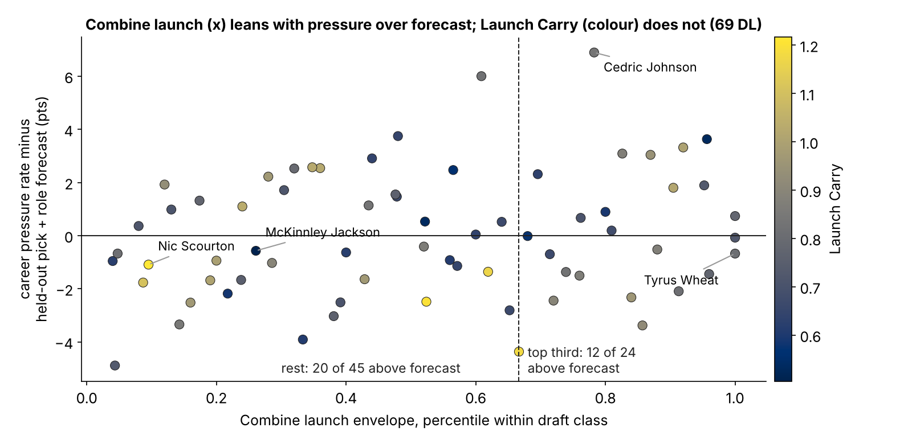

# Launch Carry: Whether a Pass Rusher Shows His Combine Burst on Sunday Mostly Says Where He Lines Up

**Lede.** We measured, for {dl_n_env} defensive linemen, how much of their Combine acceleration they show in their first steps of NFL pass rushes ("Launch Carry"). Carry looks like it predicts pressure beyond draft slot, but that is because edge rushers run free and interior rushers hit a guard. Once alignment is held fixed it adds nothing ({carry_z_pickrole_slope} pressure-rate points per sd in unseen draft classes, 90% interval [{carry_z_pickrole_lo}, {carry_z_pickrole_hi}], n={dl_n}). The Combine side alone still leans positive (+{cs_z_pickrole_slope} [{cs_z_pickrole_lo}, {cs_z_pickrole_hi}]), and almost none of that runs through the NFL launch.

- **Scout:** do not mark a rusher down because his NFL get-off "looks slower than his testing". That gap mostly reflects where he lines up.
- **Coach:** read the launch against rushers at the same alignment, never against his own Combine tape.
- **Combine:** the drill battery already records a usable launch. It is a whole-workout number, not a single 40.

**Why now.** Every team now has its own players' tracking. The obvious next step is to compare each prospect's Combine movement with his Sunday movement, the "does he play to his testing" question. This writeup tests that comparison on the one group where it has a chance and shows where it fails.

## 1. The metric: same movement, same speeds, two venues

A rush starts with the first two or three yards, from 1 to 5 yd/s. For each speed band (1–2, 2–3, 3–4, 4–5 yd/s) we take a player's hardest forward acceleration (90th percentile of straight-line frames):

- **Combine launch envelope:** across all of his Combine drills ({n_combine_events} tracked attempts, {n_drills} drills), z-scored within his Combine year because drill tracking shifts between years.
- **NFL launch envelope:** across the first 3 s after the snap of his *random* sampled NFL snaps (median {dl_n_snaps_med} per lineman). The top-EPA plays are left out so that good outcomes do not select fast launches.
- **Launch Carry** = NFL ÷ Combine at the same speed, median over bands. A Carry of 1 means he shows his full Combine launch on Sundays. The median is {carry_med} (10th–90th percentile {carry_p10}–{carry_p90}). Split by odd and even snaps and drills, its reliability is {carry_rel}, so Carry is a stable trait of the player.

## 2. Why defensive line: the only group where the launch carries at all

We ran the same metric on all five groups. The rule was fixed before any production model was fit: choose the highest lower bound on the drill-to-NFL rank correlation among groups with an individual production stat. Defensive line wins clearly. Its pooled correlation is {scr_DL_r} [{scr_DL_lo}, {scr_DL_hi}], against {scr_OL_r} for OL and {scr_WR_r} for WR. DBs show nothing (reliability ceiling {scr_DB_ceil}: backpedal starts do not repeat).

The DL correlation, however, is mostly alignment. Edge rushers' NFL envelope sits {ns_edge_gap} sd above interior rushers' (Launch Carry {carry_edge} vs {carry_int}; Carry vs share of snaps at edge ρ {rho_carry_edge}), because an interior rusher meets a guard within a yard. With weight and alignment held fixed, translation falls to {scr_DL_rp} [{scr_DL_plo}, {scr_DL_phi}], about a quarter of the {scr_DL_ceil} the two sides' reliabilities would allow. Within interior rushers it is {tr_int} [{tr_int_lo}, {tr_int_hi}]; within edge rushers it is {tr_edge} [{tr_edge_lo}, {tr_edge_hi}].

## 3. Does translation explain pressure beyond the pick?

**Outcome.** Career pressure rate: pressures per 100 pass-rush snaps, for linemen with at least 100 rushes. That covers {dl_n} rushers with a median of {prs_med} rushes. A pressured random snap costs the offense {epa_gap} EPA [{epa_gap_lo}, {epa_gap_hi}] ({epa_npress} pressured of {epa_n} random DL snaps). One pressure-rate point therefore matters.

**Test.** Fit on two draft classes and predict the third, rotating through 2023, 2024 and 2025. Each metric is z-scored within class. The comparison baseline is fixed in advance as **log draft pick + share of snaps at edge**. It forecasts unseen classes with R² {r2_pickrole}, against {r2_pick} for pick alone. A full baseline (adding weight, official 40 and NGS athleticism score) and a ridge-shrunk version are shown as checks. Intervals come from resampling players within class, with all three folds refit in every draw (1,000 draws). The **placebo** shuffles each metric within class 1,000 times; 90% of placebo slopes fall in [{perm_carry_z_lo}, {perm_carry_z_hi}].

| Baseline (held-out R²) | Launch Carry, pts/sd [90%] | Combine launch envelope, pts/sd [90%] | Combine envelope R² change [90%] |
|---|---|---|---|
| Pick only ({r2_pick}) | +{carry_z_pick_slope} [{carry_z_pick_lo}, {carry_z_pick_hi}] | +{cs_z_pick_slope} [{cs_z_pick_lo}, {cs_z_pick_hi}] | {cs_z_pick_gain} [{cs_z_pick_glo}, {cs_z_pick_ghi}] |
| **Pick + role ({r2_pickrole})** | **{carry_z_pickrole_slope} [{carry_z_pickrole_lo}, {carry_z_pickrole_hi}]** | **+{cs_z_pickrole_slope} [{cs_z_pickrole_lo}, {cs_z_pickrole_hi}]** | {cs_z_pickrole_gain} [{cs_z_pickrole_glo}, {cs_z_pickrole_ghi}] |
| Ridge, full set ({r2_ridge}) | {carry_z_ridge_slope} [{carry_z_ridge_lo}, {carry_z_ridge_hi}] | +{cs_z_ridge_slope} [{cs_z_ridge_lo}, {cs_z_ridge_hi}] | {cs_z_ridge_gain} [{cs_z_ridge_glo}, {cs_z_ridge_ghi}] |

*Table 1. Slopes in pressure-rate points per sd, on unseen draft classes, n={dl_n}. The full unshrunk baseline (R² {r2_full}) gives the same answers as ridge: Carry {carry_z_full_slope}, Combine envelope +{cs_z_full_slope}.*

Three readings:

1. **The trap.** Against pick alone, Carry looks like a find (+{carry_z_pick_slope}, interval above zero). Add alignment and it flips to {carry_z_pickrole_slope}, inside the placebo band (shuffle p {perm_carry_z_p}). Carry was a role detector all along. In-class slopes run +{carry_z_cls2023}, +{carry_z_cls2024} and {carry_z_cls2025} for 2023 to 2025.
2. **Translation proper adds nothing.** The NFL envelope minus what the Combine envelope, weight and role predict ("translation residual") gives +{trans_pickrole_slope} [{trans_pickrole_lo}, {trans_pickrole_hi}], with an R² change of {trans_pickrole_gain}.
3. **The Combine side leans positive but is not proven.** It gives +{cs_z_pickrole_slope} per sd, roughly {cs_per400} pressures per 400 rushes, worth about {cs_epa400} EPA. The slope interval clears zero, but the shuffle p is {perm_cs_z_p}, the R² change interval spans zero, and the effect comes mostly from 2024 (in-class +{cs_z_cls2024}; 2023 {cs_z_cls2023}, 2025 +{cs_z_cls2025}).

**Negative controls.** The same Carry in groups where no link is expected stays flat, in sd of each group's production stat: OL pressure allowed {ctrl_OL_slope} [{ctrl_OL_lo}, {ctrl_OL_hi}] (n={ctrl_OL_n}), WR yards per route +{ctrl_WR_slope} [{ctrl_WR_lo}, {ctrl_WR_hi}] (n={ctrl_WR_n}). For scale, DL Carry is {carry_z_pickrole_slope} pts, which is {carry_sd_units} sd of pressure rate.

## 4. Where the Combine effect goes

If Combine burst produced pressure *by* showing up in the NFL launch, the effect should pass through the NFL envelope. We split it on the same {dl_n} rushers, in-sample, holding pick, alignment and weight fixed. The total effect is +{med_total} [{med_total_lo}, {med_total_hi}]. Only +{med_indirect} [{med_indirect_lo}, {med_indirect_hi}] (about {med_share}%) runs through the NFL launch envelope, because the Combine envelope barely moves the NFL one once role and weight are fixed ({med_a} sd per sd). The NFL launch itself leans toward pressure (+{med_b} [{med_b_lo}, {med_b_hi}]). Each half leans positive on its own, and the two are nearly unrelated.

**Football reading.** The Combine records the burst in clean space. The NFL first two yards record alignment, the set of the tackle or guard, and the call. Whatever the Combine burst buys later in the rush (the second move, the finish) is not visible in the launch.

## 5. Players

| Player | Class, pick | Role | Launch Carry (class rank) | Combine envelope rank | Pressure rate / forecast | Hardest NFL launch (clip) |
|---|---|---|---|---|---|---|
{table_named}

*Table 2. Forecast = held-out pick + role. Clip = the random snap with his hardest launch, located by tracking for film review (not yet watched).*

- **Nic Scourton** has the highest Carry in his class ({nm_high_carry}): he shows more than his Combine launch. Yet he ranks near the bottom of his class on the Combine envelope and sits below forecast ({nm_high_pr} vs {nm_high_fc}). High Carry here means a modest Combine number, not a better rusher.
- **McKinnley Jackson** (interior) shows half his Combine launch (Carry {nm_low_carry}). This is the typical interior pattern, since he is engaged at 2–3 yd/s, and he is close to forecast ({nm_low_pr} vs {nm_low_fc}).
- **Cedric Johnson**, a pick-214 edge rusher in his class's top third on the Combine envelope, is the case for the Combine side: {nm_d3hit_pr} vs a {nm_d3hit_fc} forecast. His Carry ({nm_d3hit_carry}) is ordinary.
- **Tyrus Wheat** has the top Combine envelope in his class and is the miss: {nm_day3_pr} vs {nm_day3_fc}.

## 6. Monday action

- **Fixed rule for film, not the board:** flag any DL in the top third of his class on the Combine launch envelope. That is about {rule_per_class} names per class, {rule_day3_share}% of them picked after 100 (median pick {rule_pick_med}). In back-test, {rule_beat} of {rule_n} beat the held-out forecast against {rest_beat} of {rest_n} for the rest, an average edge of +{rule_diff} pts [{rule_diff_lo}, {rule_diff_hi}]. A miss costs one film session, so the rule is cheap. The edge is not proven, and the flag should break ties, not move a player up the board.
- **Retire "plays slower than he tests"** as a negative note for pass rushers. In this sample it measures alignment, and it has no held-out value.

## Limitations

- **Sample.** {dl_n} rushers in three classes. The NFL side uses about {dl_n_snaps_med} random sampled snaps per player, with no blockers and no ball, so the launch cannot tell a stunt or a read-step from a slow get-off.
- **Combine envelope.** It pools drills of different kinds. Its split-half reliability is {scr_DL_relc}, and it is year-standardized but not drill-mix standardized. The positive lean depends on the 2024 class.
- **Role** is a share of sampled snaps at edge. That is a coarse proxy that also absorbs scheme.
- **Outcome.** Career pressure rate is concurrent with the sampled snaps, and 2025 rookies have one season.
- **Multiplicity.** Four metrics against four baselines. Only the pick + role row was pre-set as the headline, and nothing here survives as a board-ready signal.
- **Film.** The clips in Table 2 are located but not yet reviewed.

## Appendix: definitions and reproducibility

- Forward acceleration = centred speed difference over 0.2 s. Frames count as straight if heading changes by less than 20° over 0.4 s. Each band needs at least 5 frames, and each player at least 2 bands.
- Role = share of random sampled snaps lined up at EDGE or OLB.
- EPA filter: random DL snaps with EPA recorded; pressured means `time_to_pressure` is present or a sack is credited. (`pressure_allowed` is a blocker column.)
- Translation residual = NFL envelope regressed on Combine envelope, weight and role, then z-scored within class.
- `analysis.py` rebuilds every number, figure and this text from `data/processed` in about four minutes, and writes `numbers.json` and `board.csv`.
