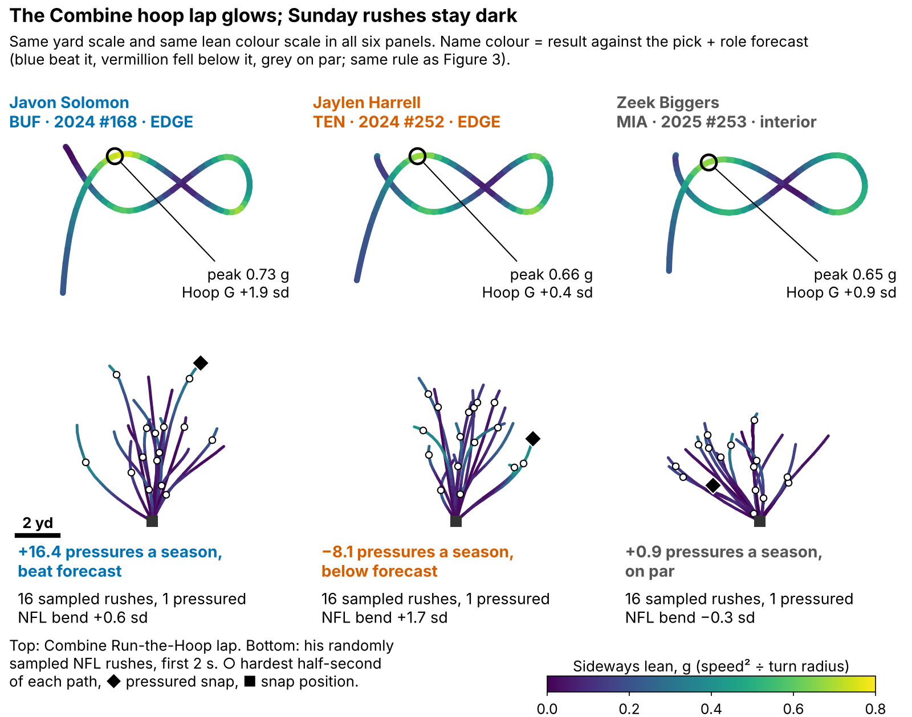
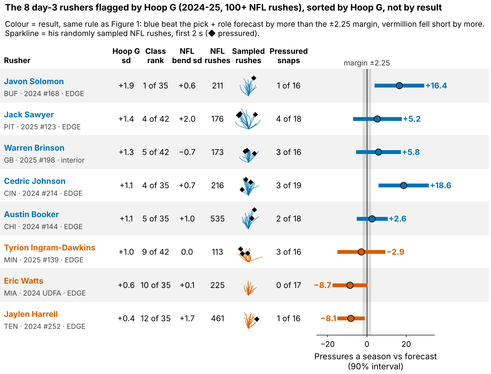
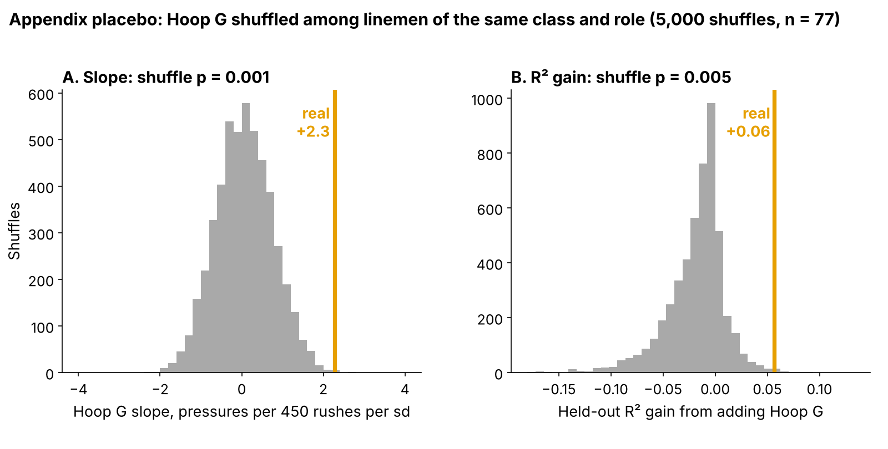

# Run-the-Hoop Lean: A Small Pass-Rush Flag That Draft Order Misses

Linemen who lean hardest through the Combine's Run-the-Hoop turn went on to about 2 more pressures per season than their draft slot and role predicted (77 rushers, three classes, each scored on a class the model never saw). **Hoop G** is how hard he leans through the tightest part of the hoop.

We do not know why. Hoop G barely predicts the bend we can measure on his NFL rushes, so it is a small leftover signal and a flag for tape, not an explanation. The 2026 class is the test.

- **Scout, Monday:** flag every day-3 or undrafted lineman in his class's top third on Hoop G, about 8 names in 2026, and watch his rushes before the board meets. In held-out classes a flagged man beat his forecast 59% of the time (other day-3 men: 47%). The flag sets film order and never moves a name up the board, so a miss costs film time, not a pick.
- **Combine:** grade four hoop laps, not one; a single lap repeats at only 0.43.

**Why now.** The 2023–25 classes are the first tracked Combine classes with NFL snaps, so the drill can be checked against the same men's NFL rushes.

## Hoop G in coach terms

Exactly: speed squared over turn radius at his hardest half-second of the figure-eight, in g, ranked within his Combine class. The median lineman carries 7.1 mph around a 1.8-yard radius (0.62 g). On a sampled NFL rush his hardest lean comes at 5.6 mph around 4.1 yards (0.18 g): the tackle pushes the arc out to a median 2.7 times his hoop radius (n = 78), so we compare men within a class, never raw g across venues.

A pressured snap cost the offense 0.52 expected points [90%: 0.35, 0.67] on 1655 sampled pass plays, and 69% of the 118 linemen went on day 3 or undrafted, where tape is thinnest.

## Does it hold on a class the model never saw?

**Outcome:** career pressure rate through 2025, shrunk toward the 8.1% mean, for linemen with 30+ rushes. **Test:** each class (27/23/27 rushers) is forecast by a model fitted on the other two; drill measures are standardized within Combine year. **The one test** is the one written down for 2026: Hoop G against a forecast from draft pick plus edge-or-interior role.

| Forecast without tracking (n = 77) | Forecast R² | R² with Hoop G | Hoop G, pressures per 450 rushes per sd [95%] |
|---|---|---|---|
| **Pick + role (the test)** | 0.10 | 0.16 | **+2.3 [0.7, 4.0]** |
| Everything, shrunk: pick, role, weight, NGS score, 10-yd split, 3-cone | −0.02 | 0.03 | +2.4 [0.7, 4.2] |

*Table 1. R² = share of rusher-to-rusher spread explained on a class the forecast never saw. "Shrunk" pulls coefficients toward zero by an amount chosen inside the training classes.*

In plain terms: a rusher one standard deviation (sd) above his class beat the forecast by about 2 pressures a season, but Hoop G explains only a little of why one rusher out-pressures another.

**Chance?** We shuffled Hoop G 5000 times among linemen of the same class and role. Shuffles almost never match the real slope (p = 0.001) or its R² gain (p = 0.005; Figure A2). It was also the best of six drill measures we looked at (appendix).

**The flat 2025 class.** Fitted on 2023–24 alone, the slope is +3.1 [95%: 1.2, 4.8]. Tested on the 27 rushers of 2025 it is +0.6 [−1.5, 2.6], and adding Hoop G lowers the 2025 R² from −0.62 to −0.80 (both forecasts miss the rookie-year level). The gap between the two slopes is not clear of chance (p = 0.10), but 2025 did not confirm the flag.

**Controls.** Run through the same pipeline, five straight-line measures (rush-drill burst, acceleration and speed, hoop speed and lap time) stay within ±1.3 (smallest p 0.08), and the same lean computation on the OL long-pull drill against pressures allowed gives −1.1 [95%: −2.9, 0.6] (n = 61). But lean on a second DL drill, the wave drill, also predicts pressure, +1.8 [0.1, 3.6] (p = 0.04), although it barely tracks Hoop G (ρ 0.11). The signal may be lateral body control in general, not the hoop arc.

## Drill to Sunday: the mechanism is unknown

Most of the effect does not run through the bend we can measure on Sunday, so treat Hoop G as a flag, not an explanation. As measured, +0.2 [90%: −0.1, 0.6] of the +2.3 goes through NFL bend (8%), because Hoop G barely predicts NFL bend (rank correlation 0.14) even though NFL bend does track pressure (0.36).

Both measures are noisy: a man's Hoop G has reliability 0.44 (mostly one lap) and his NFL bend 0.43 (a median 17 sampled rushes). With each man's values shrunk toward the mean by their own noise (a random-effects model of lap-to-lap and rush-to-rush variation), the share through NFL bend rises to 19% [90%: −11, 78]. Noise hides part of the route, but that interval runs from none of the effect to most of it: these data cannot tell a weak mechanism from a noisy Sunday measure.

## Day 3: a film queue, not a board

Among 47 day-3 and undrafted rushers in held-out classes, the top third by forecast plus Hoop G beat its class's day-3 median 9 of 15 times; pick order's top third also went 9 of 15. **Hoop G has not shown it picks better day-3 tape; it is a reason to open tape.**

Figure 3 shows all 8 flagged 2024–25 day-3 rushers with 100+ NFL rushes. The four that teach most, chosen by fixed rules (highest Hoop G hit, biggest hit, the miss with the most corner turns, biggest miss):

| Rusher | Pick | Hoop G rank in class | NFL bend (sd) | Pressures a season vs forecast [90%] | Result |
|---|---|---|---|---|---|
| Javon Solomon (BUF) | 2024 #168 | 1 of 35 | +0.6 | +16.4 [+3.8, +29.1] | beat |
| Cedric Johnson (CIN) | 2024 #214 | 4 of 35 | +0.7 | +18.6 [+5.8, +31.4] | beat |
| Jaylen Harrell (TEN) | 2024 #252 | 12 of 35 | +1.7 | −8.1 [−15.0, −1.3] | fell below |
| Eric Watts (MIA) | 2024 UDFA | 10 of 35 | +0.1 | −8.7 [−17.5, +0.1] | fell below |

*Table 2. Class rank among his class's hoop runners; NFL bend in sd across sampled linemen.*

- **Javon Solomon:** tape confirms the flag if his pressures come from flattening around the tackle's outside shoulder; kills it if they come from stunts, clean-ups or free runs.
- **Cedric Johnson:** tape confirms it if his wins are speed to the corner from a wide alignment; kills it if they are mostly inside counters or effort sacks.
- **Jaylen Harrell:** tape confirms it (bad luck) if he reaches the corner as the ball leaves; kills it if he turns too deep and runs past the quarterback.
- **Eric Watts:** tape kills it if a late first step means he never threatens the corner; keeps it if he bends but meets a chip or a slide.

Without video or blockers we read their sampled snaps. Javon Solomon turned the corner on 6 of 16 rushes but was pressured on 1 (2.2 expected at his career rate); Jaylen Harrell turned it on 9 of 16, yet 6 of those ended in a completed pass and 1 in pressure, with a normal get-off (0.97 s against 0.95 s). Clip locations are in the appendix; nobody has watched them yet.

## The 2026 test

Written down before any 2026 NFL data were in hand (`frozen_rule.json`): grade the 2026 class's hoop laps; after Week 18, check whether Hoop G still predicts pressure beyond the frozen pick + role forecast. A positive slope at one-sided p < 0.10 keeps the flag; zero or below retires it. If the 2023–25 slope is real, one class detects it only a little more than half the time; three classes, 92% of the time. Hoop G reaches the board only if its day-3 top third beats pick order by 20+ points over two classes.

## Limitations

- **Small samples, single reps.** 77 rushers in the model, 47 on day 3; most ran one hoop lap.
- **Forking paths.** Hoop G was the best of six measures, and these classes were explored before the pick + role comparator was fixed, so 2023–25 is not a clean test; 2026 is.
- **Not hoop-specific.** Wave-drill lean predicts too, and 2025 was flat.
- **Thin NFL tracking, no blockers or film.** 17 sampled rushes per man; the play-log reads are ours.
- **Missed time.** Rates are per rush; the 33 linemen under 30 rushes are left out.

## Bottom line

Hoop G is a small, unexplained signal worth a look at day-3 edge tape, not a board input. Grade four laps and let the 2026 class decide.

## Appendix

- **Other comparators.** Pick only: R² 0.03 → 0.16, slope +3.2 [95%: 1.5, 5.0]. Unshrunk full forecast: R² −0.04, +2.2. Forecast chosen inside each training fold: +2.4. R² gain of Hoop G over pick + role, 90%: [−0.10, 0.20] resampling rushers, [−0.08, 0.20] resampling 30 NFL teams.
- **Checks.** Class by class: 2.9, 3.3, 0.6. Both turns of the lap averaged: +1.5. Corrected for one-lap noise: about +3.5 (1.6 to 5.9). An independent script sharing no code: +2.3 [90%: 0.8, 3.8] on the same 77 rushers.
- **Six drill measures (Figure A1).** Hoop G: p = 0.003 alone, 0.05 as the best of six.
- **Drill-to-Sunday links,** holding weight and edge share (90%): Hoop G → NFL bend [−0.06, 0.32] (n = 78); hoop radius → NFL radius 0.01; NFL bend → pressure [0.20, 0.52] (n = 85). Top-third Hoop G men turned the corner on 29% of sampled rushes, bottom third 21%; corner-turn rushes were pressured 15% of the time against 7%.
- **Noise model.** Using the split-half reliability of NFL bend (0.63) instead of the variance components gives a 13% share through bend.
- **EPA trace.** 1681 sampled rusher-rows cover 1655 plays; flagging a play if either sampled lineman pressured gives 0.52 EPA.
- **Multiplicity.** Of 36 tests, 2 survive a family-wise correction at 0.10 and 12 a false-discovery correction (`multiplicity.csv`).
- **Variants.** Priors and rush minimums 1.8 to 2.6; dropping one rusher 2.0 to 2.5; edge +2.4 (n = 38), interior +2.8 (n = 39).
- **Clips (season, week, quarter, clock, offense).** Javon Solomon: 2024 wk 18 Q4 12:22 v NE (pressure); 2024 wk 5 Q2 00:12 v HOU (incompletion). Cedric Johnson: 2025 wk 9 Q2 02:26 v CHI (pressure); 2024 wk 16 Q3 01:35 v CLE (scramble). Jaylen Harrell: 2024 wk 12 Q4 11:24 v HOU (pressure); 2024 wk 12 Q2 02:00 v HOU (completion). Eric Watts: 2024 wk 5 Q2 08:46 v MIN (incompletion); 2024 wk 18 Q1 09:23 v MIA (incompletion).

`analysis.py` (about 8 minutes) rebuilds every number, figure and this text from `data/processed`, and runs `verify.py`.
