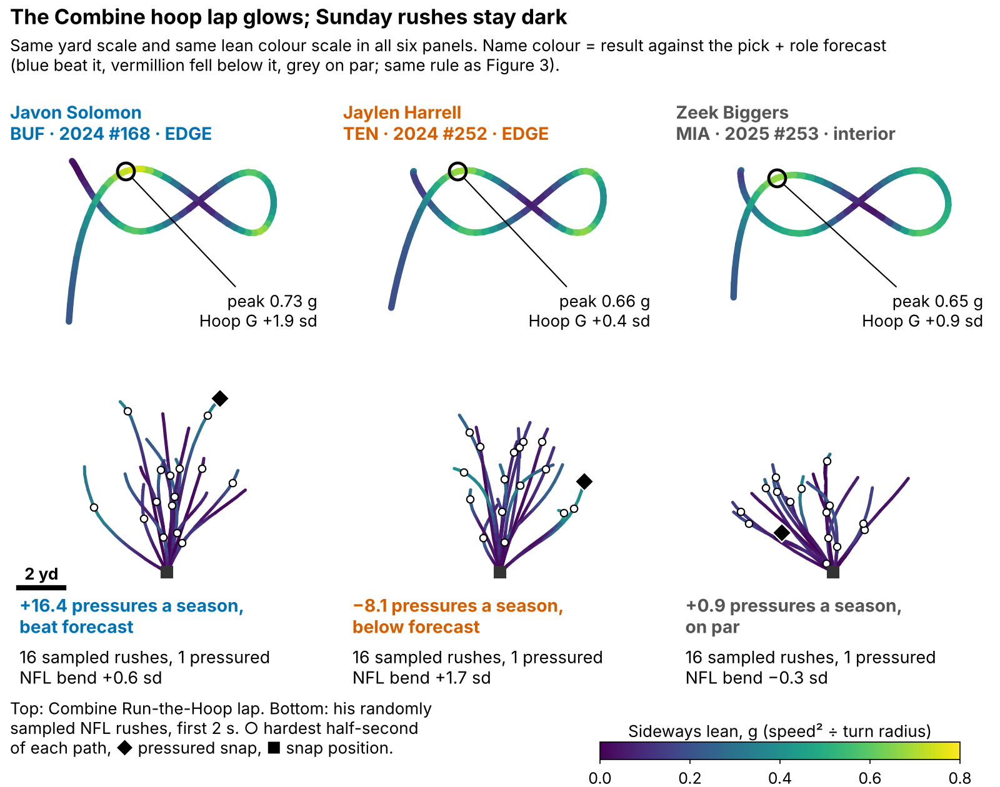
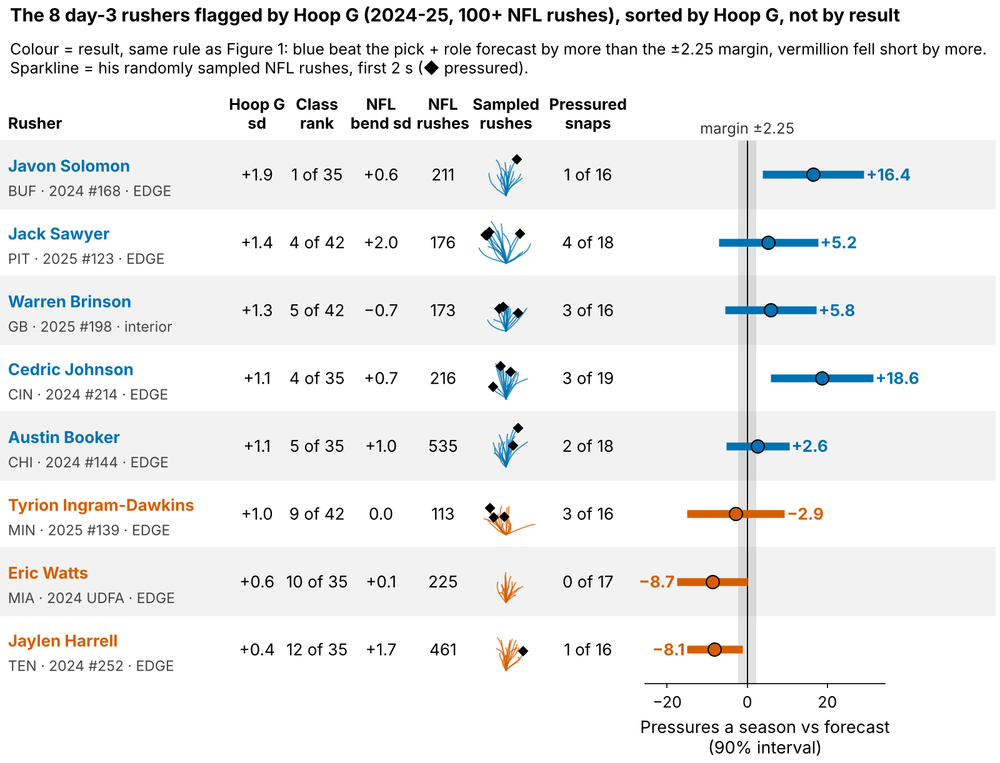
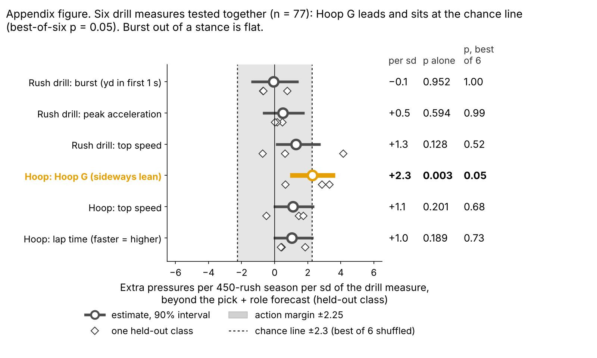
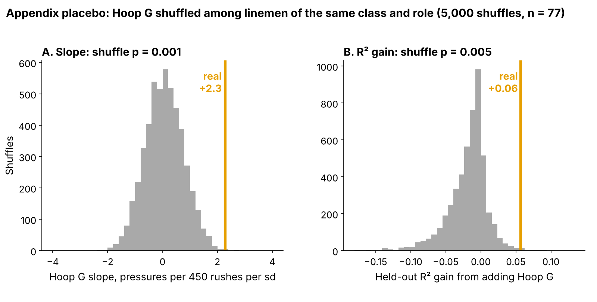

# Run-the-Hoop Lean: A Small Pass-Rush Flag That Draft Order Misses

Linemen who lean hardest through the Combine's Run-the-Hoop turn went on to about 2 more pressures per season than their draft slot and role predicted ({{n_an}} rushers, three classes, each scored on a class the model never saw). **Hoop G** is how hard he leans through the tightest part of the hoop.

We do not know why. Hoop G barely predicts the bend we can measure on his NFL rushes, so it is a small leftover signal and a flag for tape, not an explanation. The 2026 class is the test.

- **Scout, Monday:** flag every day-3 or undrafted lineman in his class's top third on Hoop G, about {{flags_per_class}} names in 2026, and watch his rushes before the board meets. In held-out classes a flagged man beat his forecast {{fl_pct}}% of the time (other day-3 men: {{rs_pct}}%). The flag sets film order and never moves a name up the board, so a miss costs film time, not a pick.
- **Combine:** grade four hoop laps, not one; a single lap repeats at only {{rel_turn_lap}}.

**Why now.** The 2023–25 classes are the first tracked Combine classes with NFL snaps, so the drill can be checked against the same men's NFL rushes.

## Hoop G in coach terms

Exactly: speed squared over turn radius at his hardest half-second of the figure-eight, in g, ranked within his Combine class. The median lineman carries {{hoop_mph_median}} mph around a {{hoop_radius_median}}-yard radius ({{hoop_g_median}} g). On a sampled NFL rush his hardest lean comes at {{nfl_mph_median}} mph around {{nfl_radius_median}} yards ({{nfl_bend_median}} g): the tackle pushes the arc out to a median {{turn_match_median}} times his hoop radius (n = {{turn_match_n}}), so we compare men within a class, never raw g across venues.

A pressured snap cost the offense {{epa_press}} expected points [90%: {{epa_press_lo}}, {{epa_press_hi}}] on {{epa_n}} sampled pass plays, and {{pct_day3_dl}}% of the {{n_dl}} linemen went on day 3 or undrafted, where tape is thinnest.

## Does it hold on a class the model never saw?

**Outcome:** career pressure rate through 2025, shrunk toward the {{press_mean}}% mean, for linemen with 30+ rushes. **Test:** each class ({{ho_n_per_class}} rushers) is forecast by a model fitted on the other two; drill measures are standardized within Combine year. **The one test** is the one written down for 2026: Hoop G against a forecast from draft pick plus edge-or-interior role.

| Forecast without tracking (n = {{n_an}}) | Forecast R² | R² with Hoop G | Hoop G, pressures per 450 rushes per sd [95%] |
|---|---|---|---|
| **Pick + role (the test)** | {{r2_pick}} | {{r2_pick_h}} | **+{{bs_pick}} [{{bs_pick_lo95}}, {{bs_pick_hi95}}]** |
| Everything, shrunk: pick, role, weight, NGS score, 10-yd split, 3-cone | {{r2_ridge}} | {{r2_ridge_h}} | +{{bs_ridge}} [{{bs_ridge_lo95}}, {{bs_ridge_hi95}}] |

*Table 1. R² = share of rusher-to-rusher spread explained on a class the forecast never saw. "Shrunk" pulls coefficients toward zero by an amount chosen inside the training classes.*

In plain terms: a rusher one standard deviation (sd) above his class beat the forecast by about 2 pressures a season, but Hoop G explains only a little of why one rusher out-pressures another.

**Chance?** We shuffled Hoop G {{n_perm}} times among linemen of the same class and role. Shuffles almost never match the real slope (p = {{pl_cr_p}}) or its R² gain (p = {{gain_p}}; Figure A2). It was also the best of six drill measures we looked at (appendix).

**The flat 2025 class.** Fitted on 2023–24 alone, the slope is +{{pro_wtr}} [95%: {{pro_wtr_lo95}}, {{pro_wtr_hi95}}]. Tested on the {{pro_n_te}} rushers of 2025 it is +{{pro_s25}} [{{pro_s25_lo95}}, {{pro_s25_hi95}}], and adding Hoop G lowers the 2025 R² from {{pro_r2_0}} to {{pro_r2_1}} (both forecasts miss the rookie-year level). The gap between the two slopes is not clear of chance (p = {{pro_diff_p}}), but 2025 did not confirm the flag.

**Controls.** Run through the same pipeline, five straight-line measures (rush-drill burst, acceleration and speed, hoop speed and lap time) stay within ±{{nc_dl_maxabs}} (smallest p {{nc_dl_min_p}}), and the same lean computation on the OL long-pull drill against pressures allowed gives {{nc_ol}} [95%: {{nc_ol_lo}}, {{nc_ol_hi}}] (n = {{nc_ol_n}}). But lean on a second DL drill, the wave drill, also predicts pressure, +{{nc_wave}} [{{nc_wave_lo}}, {{nc_wave_hi}}] (p = {{nc_wave_p}}), although it barely tracks Hoop G (ρ {{rho_hoop_wave}}). The signal may be lateral body control in general, not the hoop arc.

## Drill to Sunday: the mechanism is unknown

Most of the effect does not run through the bend we can measure on Sunday, so treat Hoop G as a flag, not an explanation. As measured, +{{med_ind}} [90%: {{med_ind_lo}}, {{med_ind_hi}}] of the +{{med_tot}} goes through NFL bend ({{med_share}}%), because Hoop G barely predicts NFL bend (rank correlation {{tr_hoop_g_bend}}) even though NFL bend does track pressure ({{gp_g_bend}}).

Both measures are noisy: a man's Hoop G has reliability {{lam_hoop_md}} (mostly one lap) and his NFL bend {{lam_bend}} (a median {{median_random_rushes}} sampled rushes). With each man's values shrunk toward the mean by their own noise (a random-effects model of lap-to-lap and rush-to-rush variation), the share through NFL bend rises to {{mc_share}}% [90%: {{mc_share_lo}}, {{mc_share_hi}}]. Noise hides part of the route, but that interval runs from none of the effect to most of it: these data cannot tell a weak mechanism from a noisy Sunday measure.

## Day 3: a film queue, not a board

Among {{d3_n}} day-3 and undrafted rushers in held-out classes, the top third by forecast plus Hoop G beat its class's day-3 median {{tt_fch_k}} of {{tt_fch_n}} times; pick order's top third also went {{tt_pick_k}} of {{tt_pick_n}}. **Hoop G has not shown it picks better day-3 tape; it is a reason to open tape.**

Figure 3 shows all {{n_cards}} flagged 2024–25 day-3 rushers with 100+ NFL rushes. The four that teach most, chosen by fixed rules (highest Hoop G hit, biggest hit, the miss with the most corner turns, biggest miss):

| Rusher | Pick | Hoop G rank in class | NFL bend (sd) | Pressures a season vs forecast [90%] | Result |
|---|---|---|---|---|---|
{{T:four_rows}}

*Table 2. Class rank among his class's hoop runners; NFL bend in sd across sampled linemen.*

{{T:four_tape}}

Without video or blockers we read their sampled snaps. {{T:plog_hit}} turned the corner on {{plog_hit_nc}} of {{plog_hit_n2}} rushes but was pressured on {{plog_hit_np}} ({{plog_hit_exp}} expected at his career rate); {{T:plog_miss}} turned it on {{plog_miss_nc}} of {{plog_miss_n2}}, yet {{plog_miss_cmp_c}} of those ended in a completed pass and {{plog_miss_npc}} in pressure, with a normal get-off ({{plog_miss_go_c}} s against {{plog_getoff_all}} s). Clip locations are in the appendix; nobody has watched them yet.

## The 2026 test

Written down before any 2026 NFL data were in hand (`frozen_rule.json`): grade the 2026 class's hoop laps; after Week 18, check whether Hoop G still predicts pressure beyond the frozen pick + role forecast. A positive slope at one-sided p < 0.10 keeps the flag; zero or below retires it. If the 2023–25 slope is real, one class detects it only a little more than half the time; three classes, {{pws_obs_3}}% of the time. Hoop G reaches the board only if its day-3 top third beats pick order by 20+ points over two classes.

## Limitations

- **Small samples, single reps.** {{n_an}} rushers in the model, {{d3_n}} on day 3; most ran one hoop lap.
- **Forking paths.** Hoop G was the best of six measures, and these classes were explored before the pick + role comparator was fixed, so 2023–25 is not a clean test; 2026 is.
- **Not hoop-specific.** Wave-drill lean predicts too, and 2025 was flat.
- **Thin NFL tracking, no blockers or film.** {{median_random_rushes}} sampled rushes per man; the play-log reads are ours.
- **Missed time.** Rates are per rush; the {{n_short_career}} linemen under 30 rushes are left out.

## Bottom line

Hoop G is a small, unexplained signal worth a look at day-3 edge tape, not a board input. Grade four laps and let the 2026 class decide.

## Appendix

- **Other comparators.** Pick only: R² {{r2_pick1}} → {{r2_pick1_h}}, slope +{{bs_pick1}} [95%: {{bs_pick1_lo95}}, {{bs_pick1_hi95}}]. Unshrunk full forecast: R² {{r2_base}}, +{{bs_base}}. Forecast chosen inside each training fold: +{{bs_nest}}. R² gain of Hoop G over pick + role, 90%: [{{dr2_pick_h_lo}}, {{dr2_pick_h_hi}}] resampling rushers, [{{cdr2_pick_lo}}, {{cdr2_pick_hi}}] resampling {{n_teams}} NFL teams.
- **Checks.** Class by class: {{ho_hoop_2023}}, {{ho_hoop_2024}}, {{ho_hoop_2025}}. Both turns of the lap averaged: +{{mt_hoop}}. Corrected for one-lap noise: about +{{me_true}} ({{me_lo}} to {{me_hi}}). An independent script sharing no code: +{{v_slope}} [90%: {{v_lo}}, {{v_hi}}] on the same {{v_n}} rushers.
- **Six drill measures (Figure A1).** Hoop G: p = {{pl_c_p}} alone, {{ho_hoop_pfw}} as the best of six.
- **Drill-to-Sunday links,** holding weight and edge share (90%): Hoop G → NFL bend [{{tr_hoop_g_bend_lo}}, {{tr_hoop_g_bend_hi}}] (n = {{tr_hoop_g_bend_n}}); hoop radius → NFL radius {{tr_rad}}; NFL bend → pressure [{{gp_g_bend_lo}}, {{gp_g_bend_hi}}] (n = {{gp_g_bend_n}}). Top-third Hoop G men turned the corner on {{ct_top}}% of sampled rushes, bottom third {{ct_bot}}%; corner-turn rushes were pressured {{ct_press_corner}}% of the time against {{ct_press_other}}%.
- **Noise model.** Using the split-half reliability of NFL bend ({{rel_game_bend}}) instead of the variance components gives a {{ms_share}}% share through bend.
- **EPA trace.** {{epa_rows}} sampled rusher-rows cover {{epa_n}} plays; flagging a play if either sampled lineman pressured gives {{epa_press_any}} EPA.
- **Multiplicity.** Of {{n_tests}} tests, {{n_holm}} survive a family-wise correction at {{q_fdr}} and {{n_bh}} a false-discovery correction (`multiplicity.csv`).
- **Variants.** Priors and rush minimums {{sens_slope_min}} to {{sens_slope_max}}; dropping one rusher {{lopo_min}} to {{lopo_max}}; edge +{{role_EDGE}} (n = {{role_EDGE_n}}), interior +{{role_interior}} (n = {{role_interior_n}}).
- **Clips (season, week, quarter, clock, offense).** {{T:clips}}.

`analysis.py` (about 8 minutes) rebuilds every number, figure and this text from `data/processed`, and runs `verify.py`.
