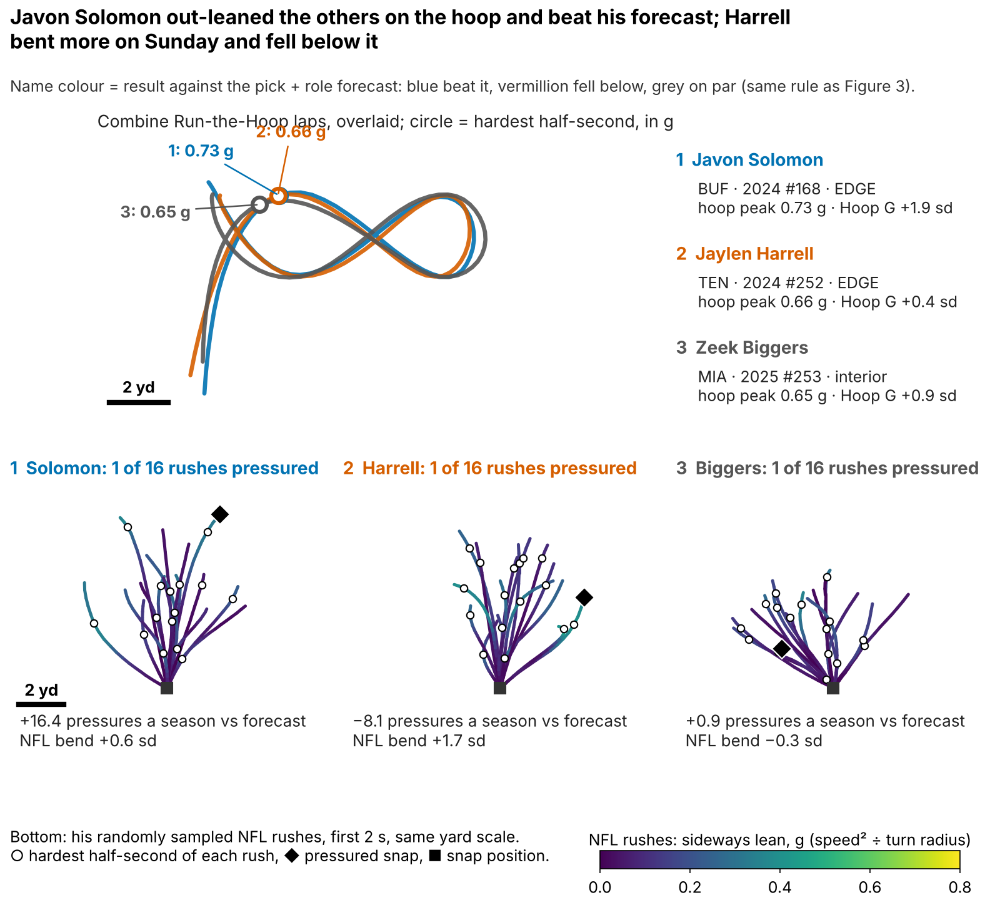
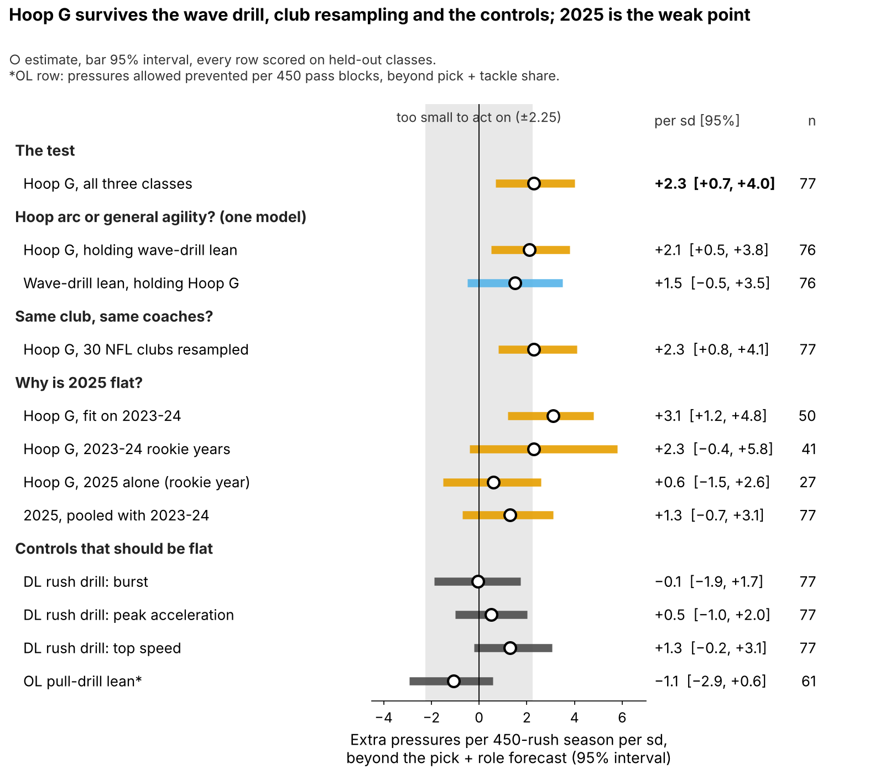
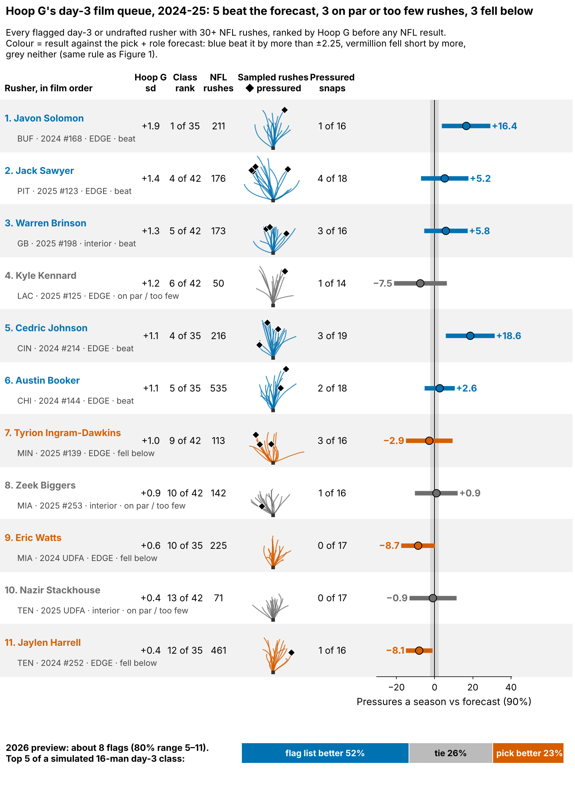
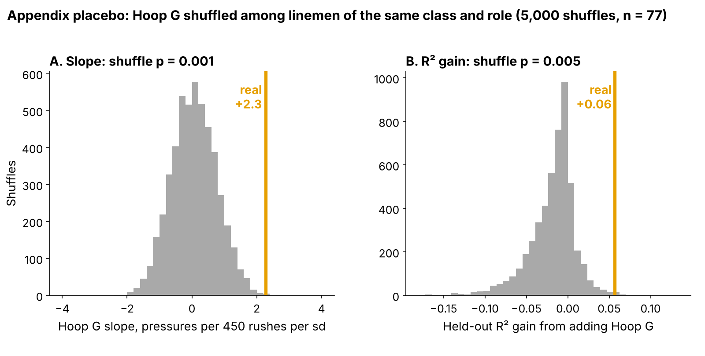

# Run-the-Hoop Lean: A Small Pass-Rush Flag That Draft Order Misses

Linemen who lean hardest through the Combine's Run-the-Hoop turn went on to about 2 more pressures per season than their draft slot and role predicted: **+2.3 pressures per 450 rushes per sd [95%: 0.7, 4.0]**, 77 rushers from three classes, each scored on a class the model never saw. **Hoop G** is how hard he leans through the tightest part of the hoop.

Two caveats. Hoop G was the best of 6 drill measures we tried; allowing for that, the chance of a slope this large is still small (one-sided p = 0.019). And the 2025 class, tested alone, was flat. Hoop G is a reason to open a rusher's tape, not a board input. The 2026 class decides.

- **Scout, Monday:** flag every day-3 or undrafted lineman in his class's top third on Hoop G, about 8 names in 2026 (5–11), and watch his rushes before the board meets. The list does not pick better tape than pick order (both 9 of 15 in held-out classes). Its value is the 7 names pick order would have left off; 4 of them beat their class median.
- **Combine:** grade four hoop laps, not one; a single lap repeats at only 0.43.

**Why now.** Day 3 is where clubs find rotational edge rushers, and 69% of these 118 linemen went there, where tape is thinnest. Bend, dipping the shoulder and flattening to the quarterback, is graded only off tape; the hoop is the one Combine drill that times it, and 2023–25 are the first tracked classes with NFL snaps to check it against.

## Hoop G in coach terms

Speed squared over turn radius at his hardest half-second of the figure-eight, in g, ranked within his Combine class. The median lineman carries 7.1 mph around a 1.8-yard radius (0.62 g). On an NFL rush his hardest lean is 5.6 mph around 4.1 yards (0.18 g): the tackle pushes the arc out to 2.7 times his hoop radius, so we compare men within a class, never raw g across venues.

A pressured snap cost the offense 0.52 expected points [90%: 0.35, 0.67] on 1655 sampled pass plays.

## Does it hold on a class the model never saw?

**Outcome:** career pressure rate through 2025, shrunk toward the 8.1% mean, for linemen with 30+ rushes. **Test:** each class (27/23/27 rushers) is forecast by a model fitted on the other two; drill measures are standardized within Combine year. **The one test**, written down for 2026: Hoop G against a forecast from draft pick plus edge-or-interior role.

| Forecast without tracking (n = 77) | R² | R² with Hoop G | Hoop G per sd [95%] |
|---|---|---|---|
| **Pick + role (the test)** | 0.10 | 0.16 | **+2.3 [0.7, 4.0]** |
| Everything, shrunk: pick, role, weight, NGS score, 10-yd split, 3-cone | −0.02 | 0.03 | +2.4 [0.7, 4.2] |

*Table 1. R² = share of rusher-to-rusher spread explained on a held-out class. "Shrunk" pulls coefficients toward zero by an amount chosen inside the training classes.*

A rusher one standard deviation (sd) above his class beat the forecast by about 2 pressures a season, but Hoop G explains only a little of why one rusher out-pressures another. Figure 2 puts every check on one scale.

- **Hoop arc or general change of direction?** Lean on a second drill, the wave drill, also predicts pressure on its own. With both in one model, Hoop G holds at +2.1 [0.5, 3.8] and wave lean falls to +1.5 [−0.5, 3.5] (n = 76). Hoop-specific bend is the better reading, but the two are not cleanly separated.
- **Same club, same coaches?** Resampling the 30 NFL clubs keeps the slope clear of zero, but not the R² gain: it is positive in only 70% of club resamples (one-sided p = 0.298). Hoop G orders rushers; it adds little accuracy.
- **Why is 2025 flat?** Fitted on 2023–24 the slope is +3.1; tested on 2025 it is +0.6 [−1.5, 2.6]. 2025 men have one rookie season (median 159 rushes against 408), but rookie year is not the whole answer: the 2023–24 classes already showed +2.3 in their rookie seasons. A model that pools the three classes finds no real class difference (interaction p = 0.33) and pulls 2025 to +1.3; it puts the chance of a positive 2026 slope at 88%.
- **Controls stay flat:** straight-line rush-drill measures (largest slope 1.3, smallest p 0.08) and the same lean computation for offensive linemen in a pull drill (−1.1, n = 61).

## Drill to Sunday: the route is unknown

NFL bend on sampled rushes does track pressure (rank correlation 0.36), but Hoop G barely predicts NFL bend (0.14). A chain that weak can carry at most a correlation of about 0.05 from drill to pressure, so most of the Hoop G signal does not run through the bend we can measure on Sunday. With only 17 sampled rushes per man, that may be noise in the Sunday measure rather than a missing link (appendix).

## Day 3: a film queue, not a board

Among 47 day-3 and undrafted rushers in held-out classes, the top third by forecast plus Hoop G beat its class's day-3 median 9 of 15 times; pick order's top third also went 9 of 15. The lists share 8 names. Hoop G adds 7 pick order would skip (4 hits) and drops 7 (4 hits). In a simulated 2026 day-3 class the flag list wins the race 52% of the time, ties 26% and loses 23%. So it decides **which tape opens first**, never where a name sits on the board.

Figure 3 is that queue for 2024–25.

**The play log, not film.** For four names chosen by fixed rules (highest Hoop G hit, biggest hit, the miss with most corner turns, biggest miss), we read every sampled snap. A corner turn is a rush whose hardest lean is in the top quarter of all sampled rushes. Verdict rules were set before the rows were read.

| Rusher | Hoop G rank | Pressures a season vs forecast [90%] | Corner turns, random snaps | Pressures on a corner turn | Median get-off | Verdict |
|---|---|---|---|---|---|---|
| Javon Solomon (BUF), 2024 #168 | 1 of 35 | +16.4 [+3.8, +29.1] | 6 of 16 | 3 of 4 | 0.89 s | **supports the flag** |
| Cedric Johnson (CIN), 2024 #214 | 4 of 35 | +18.6 [+5.8, +31.4] | 7 of 19 | 2 of 5 | 0.85 s | **beat it, but not by bending** |
| Jaylen Harrell (TEN), 2024 #252 | 12 of 35 | −8.1 [−15.0, −1.3] | 9 of 16 | 1 of 4 | 0.85 s | **bends, no finish** |
| Eric Watts (MIA), 2024 UDFA | 10 of 35 | −8.7 [−17.5, +0.1] | 4 of 17 | 0 of 2 | 0.97 s | **against the flag** |

*Table 2. All sampled snaps (40 each) for pressures; the random half for corner turns (25% is average by construction). Sampled-lineman median get-off: 0.94 s.*

Javon Solomon's pressures came from bending; Cedric Johnson beat his forecast in other ways; Jaylen Harrell turned the corner on 9 of 16 rushes with a quick get-off but finished once; Eric Watts bent less than average and was the slowest of the four off the ball. One verdict fully supports the flag, one is against it, so the flag is a starting point for tape.

## The 2026 test

Written down before any 2026 NFL data (`frozen_rule.json`): after Week 18, check whether Hoop G still predicts pressure beyond the frozen pick + role forecast. A positive slope at one-sided p < 0.10 keeps the flag; zero or below retires it. One class detects a real slope this size 59% of the time; three classes, 92%. Hoop G reaches the board only if its day-3 top third beats pick order by 20+ points over two classes.

## Limitations

- **Small samples, single reps.** 77 rushers in the model, 47 on day 3; most ran one hoop lap.
- **Forking paths.** Hoop G was the best of 6 measures, and these classes were explored before the comparator was fixed; only 2026 is a clean test.
- **Accuracy gain is fragile.** The slope survives club resampling; the R² gain does not.
- **Thin NFL tracking, no blockers or film.** 17 sampled rushes per man; the verdicts are play-log reads, not tape.
- **Missed time.** Rates are per rush; the 33 linemen under 30 rushes are left out.

## Bottom line

Hoop G is a small, unexplained signal that moves about 8 day-3 rushers a year to the front of the film queue; it is not a board input. Grade four laps and let the 2026 class decide.

## Appendix

| Check (n = 77 unless stated) | Estimate | Interval |
|---|---|---|
| Pick only: R² 0.03 → 0.16; slope | +3.2 | 95%: 1.5, 5.0 |
| R² gain over pick + role, rushers resampled / clubs resampled | +0.06 | 90%: −0.10, 0.20 / 95%: −0.13, 0.22 |
| Shuffle p (Hoop G shuffled within class and role, 5000 times): slope / R² gain | 0.001 / 0.005 | best of 6: 0.019 / 0.047 |
| Class by class: 2023, 2024, 2025 | 2.9, 3.3, 0.6 | pooled mean +2.0 (95%: −0.5, 4.6), class spread 1.2 |
| 2025 forecast R² without / with Hoop G | −0.62 / −0.80 | gap to 2023–24 slope p = 0.10 |
| 2023–24, seasons after the rookie year (n = 47) | +3.0 | 95%: 0.7, 5.7 |
| Wave lean alone (n = 76); ρ with Hoop G 0.11 | +1.8 | 95%: 0.1, 3.6 |
| R² gain of Hoop G beyond wave lean / of wave beyond Hoop G | +0.06 / +0.04 | |
| OL pull-drill lean (n = 61) | −1.1 | 95%: −2.9, 0.6 |
| Share of the slope through NFL bend, as measured / noise removed (n = 77) | 8% / 19% | 90%: −11, 78 |
| Edge (n = 38) / interior (n = 39) | +2.4 / +2.8 | |
| Priors and rush minimums; drop one rusher | 1.8 to 2.6; 2.0 to 2.5 | |
| Independent script, no shared code (n = 77) | +2.3 | 90%: 0.8, 3.8 |

*Table A1. Multiplicity: of 36 tests, 2 survive a family-wise correction at 0.10 and 12 a false-discovery correction (`multiplicity.csv`). Reliability: Hoop G 0.44, NFL bend 0.43.*

**Clips (season, week, quarter, clock, offense).** Javon Solomon: 2024 wk 18 Q4 12:22 v NE (pressure); 2024 wk 5 Q2 00:12 v HOU (incompletion). Cedric Johnson: 2025 wk 9 Q2 02:26 v CHI (pressure); 2024 wk 16 Q3 01:35 v CLE (scramble). Jaylen Harrell: 2024 wk 12 Q4 11:24 v HOU (pressure); 2024 wk 12 Q2 02:00 v HOU (completion). Eric Watts: 2024 wk 5 Q2 08:46 v MIN (incompletion); 2024 wk 18 Q1 09:23 v MIA (incompletion).

`analysis.py` (about 9 minutes) rebuilds every number, figure and this text from `data/processed`, and runs `verify.py`.
