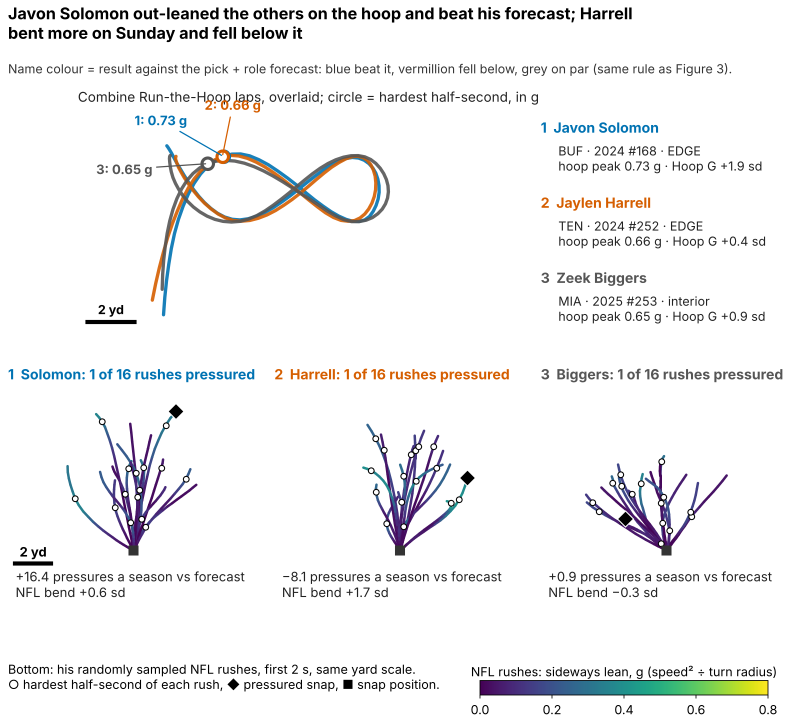
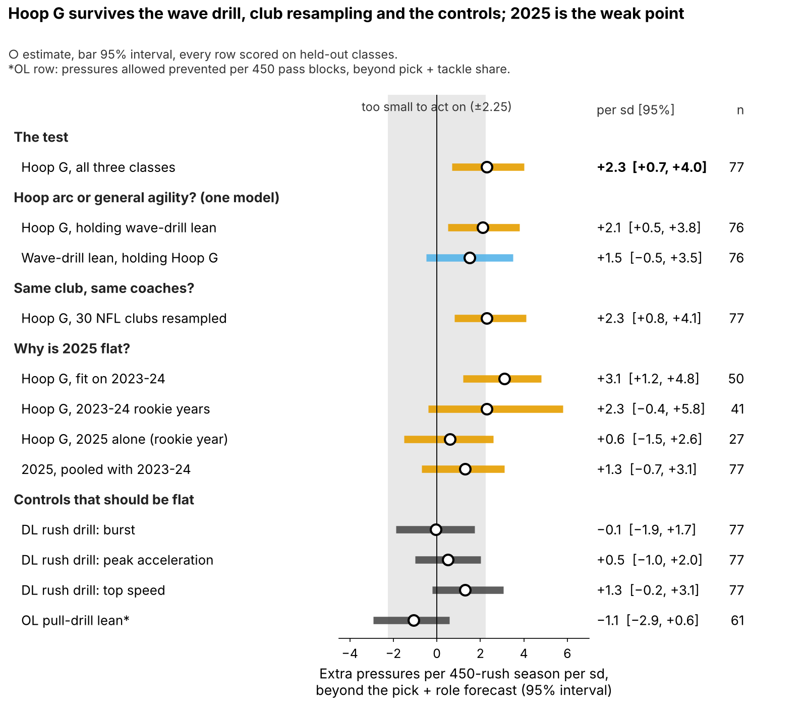
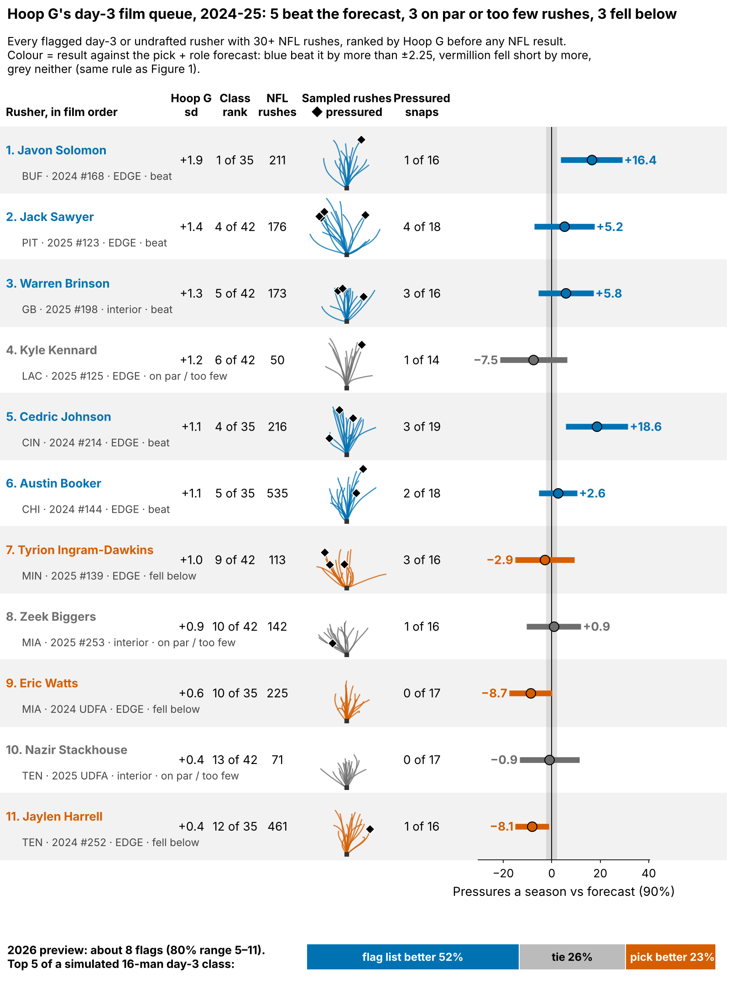
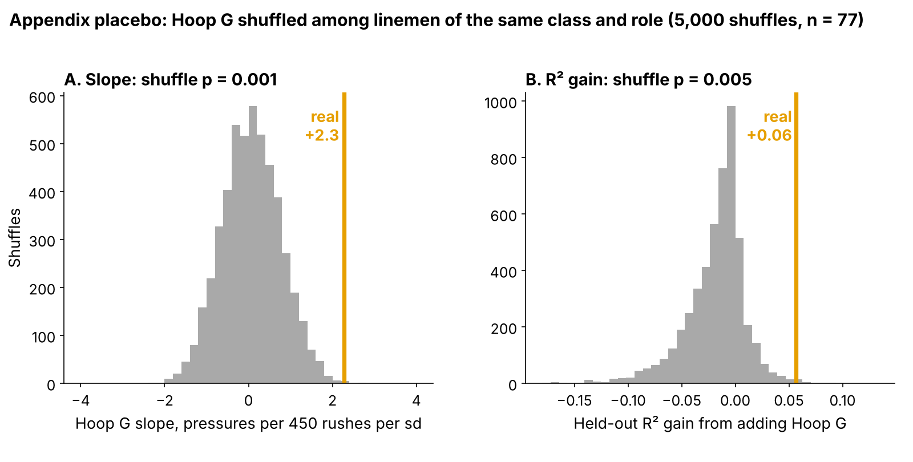

# Run-the-Hoop Lean: A Small Pass-Rush Flag That Draft Order Misses

Linemen who lean hardest through the Combine's Run-the-Hoop turn went on to about 2 more pressures per season than their draft slot and role predicted: **+{{bs_pick}} pressures per 450 rushes per sd [95%: {{bs_pick_lo95}}, {{bs_pick_hi95}}]**, {{n_an}} rushers from three classes, each scored on a class the model never saw. **Hoop G** is how hard he leans through the tightest part of the hoop.

Two caveats. Hoop G was the best of {{n_family}} drill measures we tried; allowing for that, the chance of a slope this large is still small (one-sided p = {{slope_pfw1}}). And the 2025 class, tested alone, was flat. Hoop G is a reason to open a rusher's tape, not a board input. The 2026 class decides.

- **Scout, Monday:** flag every day-3 or undrafted lineman in his class's top third on Hoop G, about {{flags_per_class}} names in 2026 ({{flags_2026_p10}}–{{flags_2026_p90}}), and watch his rushes before the board meets. The list does not pick better tape than pick order (both {{tt_fch_k}} of {{tt_fch_n}} in held-out classes). Its value is the {{ov_add}} names pick order would have left off; {{ov_add_hit}} of them beat their class median.
- **Combine:** grade four hoop laps, not one; a single lap repeats at only {{rel_turn_lap}}.

**Why now.** Day 3 is where clubs find rotational edge rushers, and {{pct_day3_dl}}% of these {{n_dl}} linemen went there, where tape is thinnest. Bend, dipping the shoulder and flattening to the quarterback, is graded only off tape; the hoop is the one Combine drill that times it, and 2023–25 are the first tracked classes with NFL snaps to check it against.

## Hoop G in coach terms

Speed squared over turn radius at his hardest half-second of the figure-eight, in g, ranked within his Combine class. The median lineman carries {{hoop_mph_median}} mph around a {{hoop_radius_median}}-yard radius ({{hoop_g_median}} g). On an NFL rush his hardest lean is {{nfl_mph_median}} mph around {{nfl_radius_median}} yards ({{nfl_bend_median}} g): the tackle pushes the arc out to {{turn_match_median}} times his hoop radius, so we compare men within a class, never raw g across venues.

A pressured snap cost the offense {{epa_press}} expected points [90%: {{epa_press_lo}}, {{epa_press_hi}}] on {{epa_n}} sampled pass plays.

## Does it hold on a class the model never saw?

**Outcome:** career pressure rate through 2025, shrunk toward the {{press_mean}}% mean, for linemen with 30+ rushes. **Test:** each class ({{ho_n_per_class}} rushers) is forecast by a model fitted on the other two; drill measures are standardized within Combine year. **The one test**, written down for 2026: Hoop G against a forecast from draft pick plus edge-or-interior role.

| Forecast without tracking (n = {{n_an}}) | R² | R² with Hoop G | Hoop G per sd [95%] |
|---|---|---|---|
| **Pick + role (the test)** | {{r2_pick}} | {{r2_pick_h}} | **+{{bs_pick}} [{{bs_pick_lo95}}, {{bs_pick_hi95}}]** |
| Everything, shrunk: pick, role, weight, NGS score, 10-yd split, 3-cone | {{r2_ridge}} | {{r2_ridge_h}} | +{{bs_ridge}} [{{bs_ridge_lo95}}, {{bs_ridge_hi95}}] |

*Table 1. R² = share of rusher-to-rusher spread explained on a held-out class. "Shrunk" pulls coefficients toward zero by an amount chosen inside the training classes.*

A rusher one standard deviation (sd) above his class beat the forecast by about 2 pressures a season, but Hoop G explains only a little of why one rusher out-pressures another. Figure 2 puts every check on one scale.

- **Hoop arc or general change of direction?** Lean on a second drill, the wave drill, also predicts pressure on its own. With both in one model, Hoop G holds at +{{jw_hoop}} [{{jw_hoop_lo95}}, {{jw_hoop_hi95}}] and wave lean falls to +{{jw_wave}} [{{jw_wave_lo95}}, {{jw_wave_hi95}}] (n = {{jw_n}}). Hoop-specific bend is the better reading, but the two are not cleanly separated.
- **Same club, same coaches?** Resampling the {{n_teams}} NFL clubs keeps the slope clear of zero, but not the R² gain: it is positive in only {{cdr2_pick_ppos}}% of club resamples (one-sided p = {{cdr2_pick_p1}}). Hoop G orders rushers; it adds little accuracy.
- **Why is 2025 flat?** Fitted on 2023–24 the slope is +{{pro_wtr}}; tested on 2025 it is +{{pro_s25}} [{{pro_s25_lo95}}, {{pro_s25_hi95}}]. 2025 men have one rookie season (median {{rk_rush_med_2025}} rushes against {{rk_rush_med_2324}}), but rookie year is not the whole answer: the 2023–24 classes already showed +{{tm_rk2324}} in their rookie seasons. A model that pools the three classes finds no real class difference (interaction p = {{int_p}}) and pulls 2025 to +{{hm_b25}}; it puts the chance of a positive 2026 slope at {{hm_new_ppos}}%.
- **Controls stay flat:** straight-line rush-drill measures (largest slope {{nc_dl_maxabs}}, smallest p {{nc_dl_min_p}}) and the same lean computation for offensive linemen in a pull drill ({{nc_ol}}, n = {{nc_ol_n}}).

## Drill to Sunday: the route is unknown

NFL bend on sampled rushes does track pressure (rank correlation {{gp_g_bend}}), but Hoop G barely predicts NFL bend ({{tr_hoop_g_bend}}). A chain that weak can carry at most a correlation of about {{chain_prod}} from drill to pressure, so most of the Hoop G signal does not run through the bend we can measure on Sunday. With only {{median_random_rushes}} sampled rushes per man, that may be noise in the Sunday measure rather than a missing link (appendix).

## Day 3: a film queue, not a board

Among {{d3_n}} day-3 and undrafted rushers in held-out classes, the top third by forecast plus Hoop G beat its class's day-3 median {{tt_fch_k}} of {{tt_fch_n}} times; pick order's top third also went {{tt_pick_k}} of {{tt_pick_n}}. The lists share {{ov_shared}} names. Hoop G adds {{ov_add}} pick order would skip ({{ov_add_hit}} hits) and drops {{ov_drop}} ({{ov_drop_hit}} hits). In a simulated 2026 day-3 class the flag list wins the race {{r26_better}}% of the time, ties {{r26_tie}}% and loses {{r26_worse}}%. So it decides **which tape opens first**, never where a name sits on the board.

Figure 3 is that queue for 2024–25.

**The play log, not film.** For four names chosen by fixed rules (highest Hoop G hit, biggest hit, the miss with most corner turns, biggest miss), we read every sampled snap. A corner turn is a rush whose hardest lean is in the top quarter of all sampled rushes. Verdict rules were set before the rows were read.

| Rusher | Hoop G rank | Pressures a season vs forecast [90%] | Corner turns, random snaps | Pressures on a corner turn | Median get-off | Verdict |
|---|---|---|---|---|---|---|
{{T:verdict_rows}}

*Table 2. All sampled snaps ({{v0_npl}} each) for pressures; the random half for corner turns (25% is average by construction). Sampled-lineman median get-off: {{getoff_all_med}} s.*

{{T:v0_name}}'s pressures came from bending; {{T:v1_name}} beat his forecast in other ways; {{T:v2_name}} turned the corner on {{v2_ct}} of {{v2_ctn}} rushes with a quick get-off but finished once; {{T:v3_name}} bent less than average and was the slowest of the four off the ball. One verdict fully supports the flag, one is against it, so the flag is a starting point for tape.

## The 2026 test

Written down before any 2026 NFL data (`frozen_rule.json`): after Week 18, check whether Hoop G still predicts pressure beyond the frozen pick + role forecast. A positive slope at one-sided p < 0.10 keeps the flag; zero or below retires it. One class detects a real slope this size {{pws_obs_1}}% of the time; three classes, {{pws_obs_3}}%. Hoop G reaches the board only if its day-3 top third beats pick order by {{hg_bar}}+ points over two classes.

## Limitations

- **Small samples, single reps.** {{n_an}} rushers in the model, {{d3_n}} on day 3; most ran one hoop lap.
- **Forking paths.** Hoop G was the best of {{n_family}} measures, and these classes were explored before the comparator was fixed; only 2026 is a clean test.
- **Accuracy gain is fragile.** The slope survives club resampling; the R² gain does not.
- **Thin NFL tracking, no blockers or film.** {{median_random_rushes}} sampled rushes per man; the verdicts are play-log reads, not tape.
- **Missed time.** Rates are per rush; the {{n_short_career}} linemen under 30 rushes are left out.

## Bottom line

Hoop G is a small, unexplained signal that moves about {{flags_per_class}} day-3 rushers a year to the front of the film queue; it is not a board input. Grade four laps and let the 2026 class decide.

## Appendix

| Check (n = {{n_an}} unless stated) | Estimate | Interval |
|---|---|---|
| Pick only: R² {{r2_pick1}} → {{r2_pick1_h}}; slope | +{{bs_pick1}} | 95%: {{bs_pick1_lo95}}, {{bs_pick1_hi95}} |
| R² gain over pick + role, rushers resampled / clubs resampled | +{{gain_obs}} | 90%: {{dr2_pick_h_lo}}, {{dr2_pick_h_hi}} / 95%: {{cdr2_pick_lo95}}, {{cdr2_pick_hi95}} |
| Shuffle p (Hoop G shuffled within class and role, {{n_perm}} times): slope / R² gain | {{pl_cr_p}} / {{gain_p}} | best of {{n_family}}: {{slope_pfw1}} / {{gain_pfw}} |
| Class by class: 2023, 2024, 2025 | {{ho_hoop_2023}}, {{ho_hoop_2024}}, {{ho_hoop_2025}} | pooled mean +{{hm_mu}} (95%: {{hm_mu_lo95}}, {{hm_mu_hi95}}), class spread {{hm_tau}} |
| 2025 forecast R² without / with Hoop G | {{pro_r2_0}} / {{pro_r2_1}} | gap to 2023–24 slope p = {{pro_diff_p}} |
| 2023–24, seasons after the rookie year (n = {{tm_lt2324_n}}) | +{{tm_lt2324}} | 95%: {{tm_lt2324_lo95}}, {{tm_lt2324_hi95}} |
| Wave lean alone (n = {{nc_wave_n}}); ρ with Hoop G {{rho_hoop_wave}} | +{{nc_wave}} | 95%: {{nc_wave_lo}}, {{nc_wave_hi}} |
| R² gain of Hoop G beyond wave lean / of wave beyond Hoop G | +{{jw_gain_h_given_w}} / +{{jw_gain_w_given_h}} | |
| OL pull-drill lean (n = {{nc_ol_n}}) | {{nc_ol}} | 95%: {{nc_ol_lo}}, {{nc_ol_hi}} |
| Share of the slope through NFL bend, as measured / noise removed (n = {{med_n}}) | {{med_share}}% / {{mc_share}}% | 90%: {{mc_share_lo}}, {{mc_share_hi}} |
| Edge (n = {{role_EDGE_n}}) / interior (n = {{role_interior_n}}) | +{{role_EDGE}} / +{{role_interior}} | |
| Priors and rush minimums; drop one rusher | {{sens_slope_min}} to {{sens_slope_max}}; {{lopo_min}} to {{lopo_max}} | |
| Independent script, no shared code (n = {{v_n}}) | +{{v_slope}} | 90%: {{v_lo}}, {{v_hi}} |

*Table A1. Multiplicity: of {{n_tests}} tests, {{n_holm}} survive a family-wise correction at 0.10 and {{n_bh}} a false-discovery correction (`multiplicity.csv`). Reliability: Hoop G {{lam_hoop_md}}, NFL bend {{lam_bend}}.*

**Clips (season, week, quarter, clock, offense).** {{T:clips}}.

`analysis.py` (about 9 minutes) rebuilds every number, figure and this text from `data/processed`, and runs `verify.py`.
