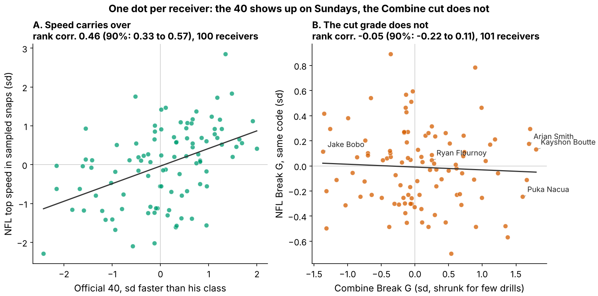
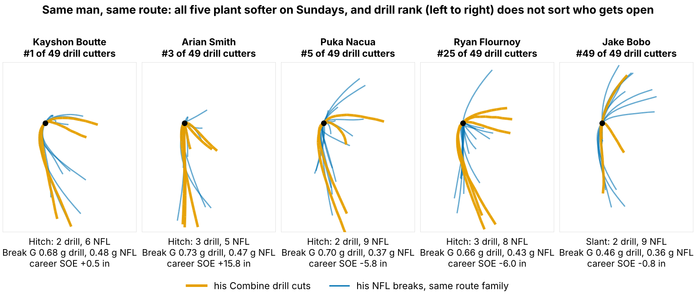

# Break G: The Combine Grades a Receiver Cut That Sundays Don't Ask For

**Receivers who plant harder in Combine route drills are not more open in the NFL. On 116 receivers, each draft class scored by a forecast fit on the other two, one standard deviation of drill Break G moved separation over expected by −1.2 inches (90% interval −3.7 to +1.0). This is one metric, defined before the test; it is a bounded null, not a hidden edge.**

**Break G** measures how hard a receiver plants: his average g-force over the one second around his first real cut, covering the brake into the cut, the turn and the drive out. On film it reads as three speeds: into the break, at the plant and out of it. A typical NFL hitch break is 0.37 g; the same break in the Combine hitch drills is 0.63 g.

**Why now.** Route drills are the only Combine test that looks like playing receiver, and scouts grade "sink and burst" off them. This is the first cycle where every rep is tracked at 10 Hz next to NFL tracking of the same men, so the grade can be checked against Sundays before it hardens into a number. Clubs already pay for it: at the same 40, weight, NGS score and position, a receiver 1 sd higher in Break G goes 14% earlier in pick number (90% interval 4 to 24; 149 receivers).

**Data**
- **Combine:** 926 tracked reps in ten route drills (2023–2025 classes), 885 with a gradable cut, each scored against the same drill and year.
- **NFL:** the same code on 1763 sampled regular-season breaks by 115 receivers, in the five route families the drills copy: slant, out, hitch (curl, comeback, hook), in (dagger) and corner (sail).
- **Outcome:** separation over expected (SOE), inches more open at the throw than Next Gen Stats separation predicts from alignment, cushion, position and season. Full regular seasons (213 player-seasons, median 231 career routes), not the tracking sample.

## 1. The drill asks for a different cut

Figure 1 draws the routes. At the Combine every rep runs the same scripted path and arrives hot (yellow-green). On Sundays the same second and a half covers less ground because he arrives slower, and the exit angle fans out with coverage. On the hitch family he arrives at 6.9 yd/s (about 14 mph) in the drill and 4.7 yd/s (about 10 mph) in the NFL. Drill entry is faster in all 5 families, and only 18% of NFL breaks are entered as fast as a typical drill rep. Because Break G rises with entry speed (rank correlation 0.37 in drills, 0.56 in games), the drill mostly rewards stopping from a speed NFL routes rarely use.

## 2. Speed carries; the cut does not

The control works: a receiver's official 40 ranks with his NFL top speed at 0.46 (90% interval 0.33 to 0.57; 100 receivers). The cut does not: drill Break G vs NFL Break G is −0.05 (−0.22 to 0.11; 101 receivers). Both measures are noisy, but a true link of 0.5 would still read about 0.20.

We also checked each route family and each part of the cut separately (30 cells, 343 receiver-family pairs). The best cell is braking into the plant, 0.12 (0.02 to 0.21). Once the search over 30 cells is accounted for by shuffling, its adjusted p-value is 1.00: not a finding.

## 3. Break G adds nothing to a no-tracking forecast

The test was fixed in advance: fit on two draft classes, score the third, rotate, weight by routes; ±3 inches per sd is the smallest effect a club would act on. Intervals resample whole receivers and refit every step.

| No-tracking forecast | Its held-out R² | R² change adding Break G [90%] | Break G effect, inches per sd [90%] |
|---|---|---|---|
| Pick only | −0.03 | −0.003 [−0.090, 0.033] | −0.1 [−2.0, +2.0] |
| Pick + role (TE, slot share) | −0.11 | −0.029 [−0.190, 0.034] | 0.1 [−2.1, +2.3] |
| Ridge: pick, 40, weight, NGS, TE, slot | −0.08 | −0.007 [−0.214, 0.066] | −0.9 [−3.2, +1.4] |
| **Pick + 40, weight, NGS, TE** (set in advance) | 0.00 | 0.013 [−0.160, 0.086] | **−1.2 [−3.7, +1.0]** |

*Table 1. 116 receivers with a drill score and NFL separation. An R² below zero means the forecast does worse on a new class than that class's own average.*

Career SOE varies by 8.7 inches between receivers; draft slot plus testing explains none of it on a new class, and Break G does not help under any forecast. All three classes lean the same way, slightly negative: 2023 −1.1, 2024 −1.9, 2025 −0.3 inches per sd (Figure 3A), so no single class hides a positive effect. Three stress tests agree:

- **Shuffle placebo.** Shuffling Break G within class 2000 times puts 90% of effects between −2.2 and +2.2. The one-sided p-value for "harder cutters are more open" is 0.81.
- **Same team, same quarterback.** Resampling whole teams (32) instead of receivers gives −4.0 to +1.2. The one-sided p-value for an R² gain is 0.60.
- **No tracking at all.** The official 3-cone (0.0 in per sd, 38 receivers) and short shuttle (−0.9, 45) say the same.

## 4. Is there a Sunday cut skill to predict?

Perhaps the drill misses a real NFL skill. We compared each receiver with himself, within one route family, on breaks finished before the throw, controlling for cushion and cut timing. Across all sampled snaps a harder Sunday cut goes with +6.2 inches more separation per sd (+1.4 to +10.6; 907 breaks). On random snaps it falls to +1.1 (−8.1 to +10.2). A placebo, cuts finished after the throw, should read zero and reads −13.5. Between receivers, a man's own NFL Break G does not track his career SOE (−0.15, −0.31 to 0.03; 101 receivers). In these data the cut grade is not a separation skill at any level.

## 5. Named receivers: the drill order does not survive

| Receiver (class, pick; drill rank of 49) | Combine in → plant → out, yd/s (g) | NFL, same families (g) | Career SOE, in (routes) | Play-log clip | Verdict |
|---|---|---|---|---|---|
| Kayshon Boutte (2023, pick 187; #1) | 7.1 → 4.5 → 5.9 (0.62) | 5.7 → 5.0 → 5.9 (0.48) | +0.5 (873) | 2024 wk 6, Q4 07:39, out; 0.48 g, 4.7 yd open, targeted, caught, 13 yd | Hardest drill planter; sheds 1.4 mph into Sunday breaks vs 5.3 at Indy. Average separation. |
| Arian Smith (2025, pick 110; #3) | 7.6 → 1.5 → 5.6 (0.67) | 5.5 → 3.4 → 4.8 (0.48) | +15.8 (231) | 2025 wk 7, Q3 10:36, in; 0.50 g, 2.4 yd open, not targeted | Near-dead stop in drills, ordinary Sunday cut (+0.2 sd), wide open over a small sample. The space is not coming from the plant. |
| Puka Nacua (2023, pick 177; #5) | 7.3 → 4.8 → 6.5 (0.61) | 5.2 → 3.8 → 5.0 (0.40) | −5.8 (1287) | 2025 wk 12, Q3 07:48, hitch; 0.39 g, 5.7 yd open, targeted, caught, 10 yd | Top-five drill cutter, below-expected separation on a huge workload; wins in tight windows, which SOE does not credit. |
| Ryan Flournoy (2024, pick 216; #25) | 7.2 → 3.9 → 6.5 (0.61) | 4.7 → 2.4 → 4.8 (0.41) | −6.0 (351) | 2024 wk 16, Q3 07:29, slant; 0.41 g, 4.3 yd open, not targeted | Slowest into Sunday breaks; the defender sees it coming. Fix the stem, not the plant. |
| Jake Bobo (2023, UDFA; #49) | 6.7 → 3.1 → 5.6 (0.53) | 5.0 → 3.9 → 5.5 (0.46) | −0.8 (306) | 2023 wk 14, Q2 11:23, slant; 0.48 g, 3.5 yd open, not targeted | Softest drill cutter, ordinary Sunday cut, near-average separation. Nothing to fix. |

*Table 2. Medians over route families he ran in both settings. The clip is his random-sample break closest to his own NFL median; the play-log column is the official play result, so a scout can pull the snap and confirm the read. Verdicts come from tracking and the play log; we have not watched the film.*

All five plant softer on Sundays than at Indianapolis, and drill rank does not sort their separation: #1 and #49 are both near average, #3 and #5 sit at opposite ends. The eight hardest drill cutters among 49 eligible receivers average −0.5 inches of SOE; the eight softest, −2.3.

## 6. What to do on Monday

- **Draft room:** do not move a receiver up the board for his route-drill cut grade. A "top third of the class" rule flags about 17 of 50 drill-tested receivers a year, so expect about 17 2026 names. Today those men go about 20 slots earlier at their median pick of 133, for +0.9 inches of extra separation (−2.1 to +3.8; 38 with NFL routes). Pay for the 40, which does carry.
- **Scouts:** if the drill plant is not on the Sunday tape, grade the tape; Table 2 shows how to pull the clip.
- **Combine staff:** re-stem the curl, comeback and hook at NFL hitch entry speed (about 4.7 yd/s, a controlled three-quarter stem) and grade at least 15 cuts per receiver. These data cannot test this proposal.
- **Position coaches:** rep breaks at game tempo. Nothing here says a harder full-speed plant buys separation.

## Limitations

- **Not blind.** All three classes were seen in earlier rounds of this work. The Break G definition, the ±3 inch margin and the pre-set forecast were frozen before these tests; the ridge row, the team bootstrap, the placebos and Section 4 came afterwards.
- **Power.** A true +3 inch effect would be detected 67% of the time (appendix). Harm down to −3.7 inches per sd is not excluded.
- **Tracking is a sample.** Up to 40 NFL plays per player, half random and half top-EPA, with no defenders and no ball. Sections 1, 2, 4 and 5 depend on it; Section 3 uses full-season NGS separation. On random snaps only, drill vs NFL Break G is 0.11 (−0.06 to 0.29; 95 receivers).
- **Section 4 is descriptive.** Without defenders, "the cut made space" and "an open man ran through it" look alike.
- **Selection and outcome.** Only 116 of 149 drill-scored receivers logged NFL routes. SOE leaves out contested catches, yards after catch and earning targets, as the Nacua row shows.

## Appendix: method, reliability and power

A cut is the first turn of 30° or more after 1.5 yd of stem, entered above 2.5 yd/s. Positions are Savitzky–Golay smoothed at 10 Hz, and Break G averages acceleration magnitude over ±0.5 s around the turn. A receiver's score averages his drills (z-scored within drill and year), shrunk toward the mean by between-drill reliability. NFL breaks are z-scored within route family and position. Route paths in Figures 1 and 4 are rotated frames and change no metric.

A single graded cut has reliability 0.14. At the median of 7 cuts per receiver the score's reliability is 0.52; 15 cuts would reach 0.70. Simulating the whole pipeline with real noise and route weights, the slope averages 3.0 when the truth is +3, so it is not biased toward zero, and its spread under no effect is 1.4 inches. True effects of +2 inches or more are unlikely given the observed slope; 88% of resampled effects fall inside ±3 inches. Braking alone gives −1.7 (−3.8 to +0.4). `analysis.py` rebuilds every number, table and figure from `data/processed`.
