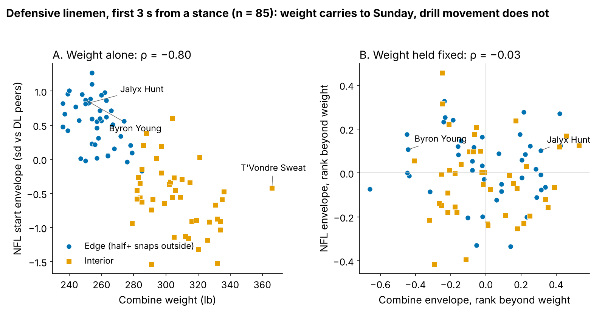
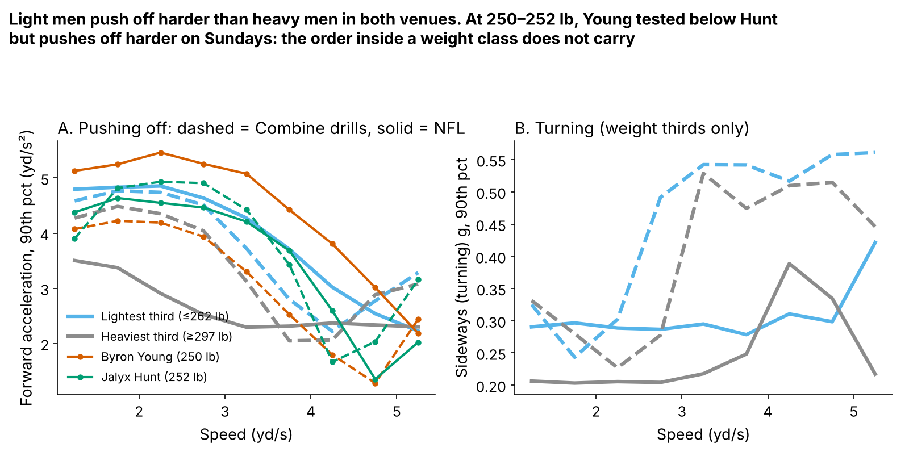
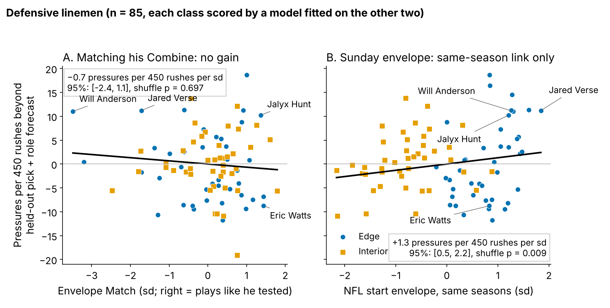

# Weigh Him First: A Lineman's Combine Movement Reaches Sunday Only Through His Weight

"He plays like he tests" is the oldest bridge between the Combine and the tape, and tracking now lets us measure it directly. We asked whether a player's NFL movement in the first 3 seconds off a stance matches his Combine drill movement, and whether players whose movement matches out-produce their draft slot. For defensive linemen, the group where the Combine carries over best, the answer is no. **Envelope Match** is worth −0.7 pressures per 450 rushes per sd [95%: −2.4, 1.1] beyond pick and role (n = 85, every class scored by a model it never saw). The carry-over that does exist is body mass. Weight ranks a lineman's NFL movement at ρ = −0.80; with weight held fixed, his Combine movement ranks it at −0.03.

This is a bounded null, not a new signal. It is one movement type, 3 seconds from a stance, measured on about 20 sampled snaps per man.

- **Scout, Monday:** when a drill clip says a lineman "explodes" or "bends", rank him against men within about 10 lb of his weight before you believe it. Most of the apparent carry-over is the scale talking.
- **Analytics, Monday:** do not buy or build a drill-to-game "translation" score for linemen. The plausible upside is at most 1.1 pressures a season, under our pre-set bar of 2.25 pressures.

## Why this question

Front offices are now being sold "translation" metrics that compare Combine tracking with game tracking. If a man's drill movement shows up on Sunday, a match score could flag rookies who are already playing to their tools and veterans who are not. The 2023–25 classes are the first with tracked Combine drills and tracked NFL snaps for the same men, so the bridge can be tested rather than assumed.

## The metric in coach terms

**Movement type:** the first 3.0 s of a start from a stance. On the Combine side that means the position drills that start from a stance (linemen: the pass-rush drill and Run-the-Hoop), timed from first movement. On the NFL side it means randomly sampled snaps from the snap, cut at the throw or sack (6565 snaps for 347 players across all groups, median 20 per lineman).

**Envelope:** how hard he pushes off (forward acceleration) and how hard he turns (sideways g) when he is moving at jog, run and stride speeds (1–2.5, 2.5–4 and 4–5.5 yd/s). We take his top-10% effort in each of the six cells. Each side is ranked against his position group, and Combine cells are ranked within Combine year.

**Envelope Match** is the negative mean gap, in sd, between his six Combine cells and his six NFL cells. Zero means he moves on Sunday exactly where he tested relative to his peers.

Figure 2 shows the movement itself. Light linemen push off harder than heavy ones at every speed, in drills and in games. That shared ordering produces the raw Combine-to-NFL correlation of 0.39 [95%: 0.19, 0.54]. Inside a weight class the order breaks. Byron Young (250 lb, pick 77) tested −0.6 sd on the drill envelope and Jalyx Hunt (252 lb, pick 94) tested 2.1. On Sundays they sit at 1.3 and 1.2, and they pressure on 11.1% and 10.0% of rushes.

## Which position group?

We fixed the rule before looking at production: study the group with the highest lower 95% bound on weight-held translation, among groups with 50+ players. Figure 3A shows the screen. No group clears zero once weight is held fixed. Defensive line is chosen at 0.05 [−0.04, 0.14] (n = 85), against a noise ceiling of 0.27. The ceiling is set by how well a man's envelope agrees with itself: 0.45 between halves of his NFL snaps, but only 0.16 between his two Combine drills. Receivers are the runner-up at 0.05.

Figure 3B runs the production test in all five groups, so the choice of group cannot hide a result. Envelope Match moves production by a tenth of an sd per sd or less in every group, and every interval includes zero.

## Does matching explain pass rush beyond the pick?

**Outcome:** career pressure rate through 2025, shrunk toward the 7.3% mean, for linemen with 30+ rushes. **Baseline without tracking:** log draft pick plus edge share (the share of snaps lined up outside). **Validation:** leave one class out (31/25/29 linemen), with a class-stratified bootstrap that refits every fold, and a placebo that shuffles the measure 2000 times within class and role.

| Measure, per sd (n = 85) | Pressures per 450 rushes beyond pick + role [95%] | Held-out R², pick + role → with measure | Shuffle p |
|---|---|---|---|
| **Envelope Match (the test)** | **−0.7 [−2.4, +1.1]** | 0.22 → 0.22 | 0.697 |
| Combine envelope alone | +0.6 [−0.6, +2.0] | 0.22 → 0.21 | 0.168 |
| Sunday surplus (NFL minus Combine, signed) | +0.9 [−0.1, +2.1] | 0.22 → 0.23 | – |
| NFL envelope, same seasons | +1.3 [+0.5, +2.2] | 0.22 → 0.28 | 0.009 |
| NFL envelope 2023–24 → 2025 rate, beyond 2023–24 rate (n = 33) | −4.8 [−10.0, +0.6] | – | – |

*Table 1. Held-out R² is the share of rusher-to-rusher spread explained in a class the model never saw. One sd of pressure rate is about 8 pressures a season.*

**Matching does not pay.** The slope is slightly negative. None of the 1000 bootstrap fits reaches our pre-set bar of 0.5 rate points (2.25 pressures a season, 1.2 expected points at 0.52 EPA per pressure). The result holds against a fuller no-tracking baseline that adds weight and the NGS athleticism score (−0.13 rate points [−0.57, 0.25]). Match does not track weight (0.07), role (−0.03) or the number of sampled snaps (0.00), so it is not simply noise from small samples.

**Why it cannot work:** an unsigned match punishes a rusher for beating his Combine. Will Anderson has the lowest Match of all 85 linemen, and Jared Verse is number 4 from the bottom among the 49 with 200+ rushes. Both move far better on Sundays than they tested, and both beat their forecast by 10+ pressures a season (Figure 4A).

**The Sunday envelope itself** lines up with pressure in the same seasons (+1.3, shuffle p = 0.009). The link is weak, though. The R² gain of 0.055 has a 95% interval of [−0.103, 0.192] across rushers and [−0.109, 0.154] when 30 NFL teams are resampled. It also fails the forward test: measured on 2023–24 snaps, it does not predict 2025 pressure once the 2023–24 rate is known, and the estimate points the wrong way (n = 33, Table 1). Prior pressure rate already carries that information (ρ = 0.72 season to season).

## Six named linemen

By a fixed rule: the three lowest and three highest Envelope Match scores among the 49 linemen with 200+ career rushes.

| Lineman | Class, pick | Weight | Combine envelope (sd) | NFL envelope (sd) | Match (sd) | Pressures a season vs forecast |
|---|---|---|---|---|---|---|
| Will Anderson (HOU) | 2023 #3 | 253 | 0.1 | 1.3 | −3.5 | +11.0 |
| Tyleik Williams (DET) | 2025 #28 | 334 | −0.2 | −1.4 | −2.5 | −5.5 |
| Justin Eboigbe (LAC) | 2024 #105 | 297 | −3.8 | −0.2 | −1.7 | +2.7 |
| Eric Watts (MIA) | 2024 UDFA | 274 | 0.6 | 0.8 | 1.4 | −8.8 |
| Ashton Gillotte (KC) | 2025 #66 | 264 | 1.0 | 0.1 | 1.4 | −6.8 |
| Jalyx Hunt (PHI) | 2024 #94 | 252 | 2.1 | 1.2 | 1.4 | +10.2 |

*Table 2. Envelopes are ranked against all defensive linemen; Match is in sd (higher = closer to his Combine).*

On average the three low matchers ran +2.7 pressures a season against their forecast and the three high matchers −1.8. Low Match covers three different stories: Will Anderson moves above his test, Tyleik Williams below it, and Justin Eboigbe tested far below his weight and plays at it. Eric Watts and Ashton Gillotte move on Sunday as they tested and still miss their forecast. Matching his test says nothing about whether a rusher wins.

## What a team should do with this

1. **Grade drill movement within weight.** Our raw drill-to-NFL correlation of 0.39 looks like a real bridge, but weight alone does better (−0.80). Compare a 250-lb edge with 250-lb edges.
2. **Do not pay for translation scores.** The test spans five groups and three baselines, and no version clears zero.
3. **Use NFL snaps to judge NFL movement.** A man's NFL envelope agrees with itself at 0.45 across halves of 20 snaps. His two Combine drills agree at 0.16. Once a lineman has played, his snaps beat his Combine, and his pressure rate beats both.

## Limitations

- **One movement type, generic cells.** These are 3-second starts from a stance, not specific moves such as a hoop dip or a rip. A narrower drill trait could still carry over, and this test does not rule that out.
- **Thin NFL tracking.** About 20 random snaps per man, with no blockers, ball or opponents in the data, so the envelope is self-referenced and cannot see the move that beat the tackle.
- **Single Combine reps.** Most men ran each drill once, and the two DL drills agree with each other at only 0.16. That noise caps any translation at 0.27, so the weight-held interval up to 0.14 still allows a modest true link.
- **Small groups.** TE has 23 players, and the forward test has 33 linemen.
- **Survivorship.** Only players with 8+ sampled snaps and 30+ rushes enter, which leaves out men who never played.

## Appendix

- **Cells, DL, weight held (partial ρ):** push-off 0.14 / 0.04 / 0.06 and turning 0.07 / 0.00 / −0.02 at the three speed bands (n = 85). Weight also ranks the Combine envelope (−0.50).
- **Fuller baseline** (pick, edge share, weight, NGS athleticism; held-out R² 0.22): Combine envelope 0.04 [−0.25, 0.30], NFL envelope 0.28 [0.04, 0.48], signed surplus 0.26 [−0.01, 0.56] rate points per sd. Against pick alone, Match scores −0.18 rate points per sd.
- **Match R² gain:** −0.003 [−0.150, 0.081]; team resampling [−0.230, 0.107]. Shuffle band for the slope: [−0.41, 0.27] rate points.
- **EPA per pressure:** 0.52 [0.34, 0.69] on 1655 randomly sampled DL pass plays.
- **Other groups' reliability (NFL halves / Combine drills):** OL 0.25 / 0.05, WR 0.37 / 0.17, TE −0.13 / 0.08, DB 0.13 / 0.16.

`analysis.py` (about 3 minutes) rebuilds every number, figure and this text from `data/processed`.
