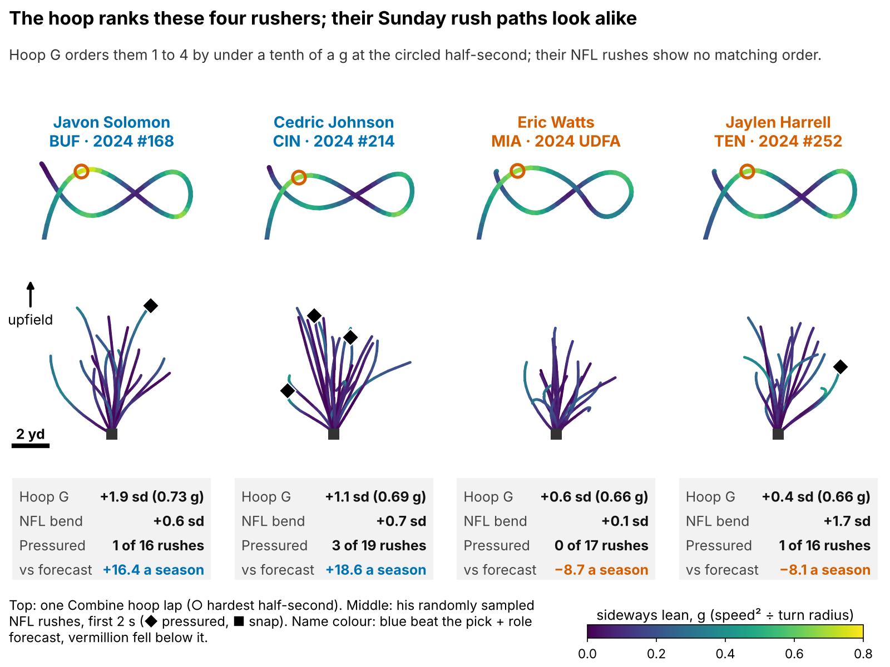
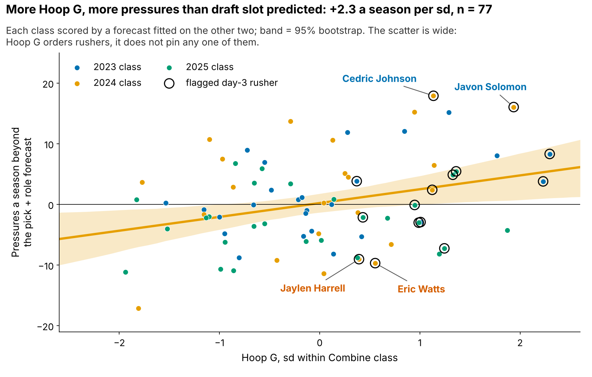
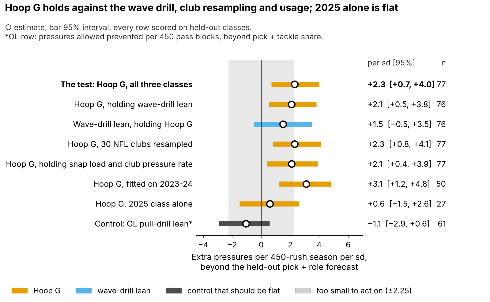
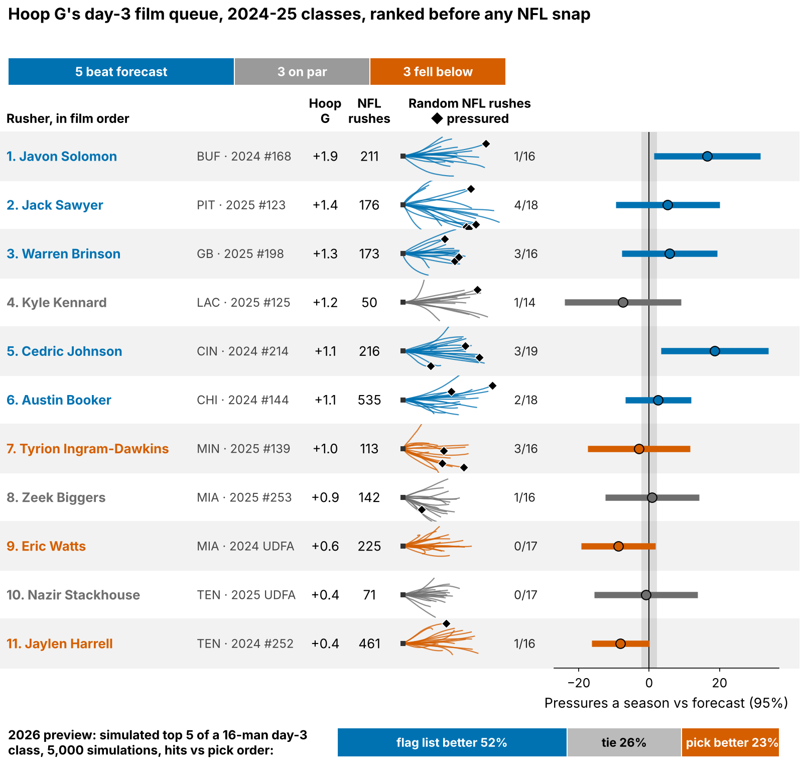
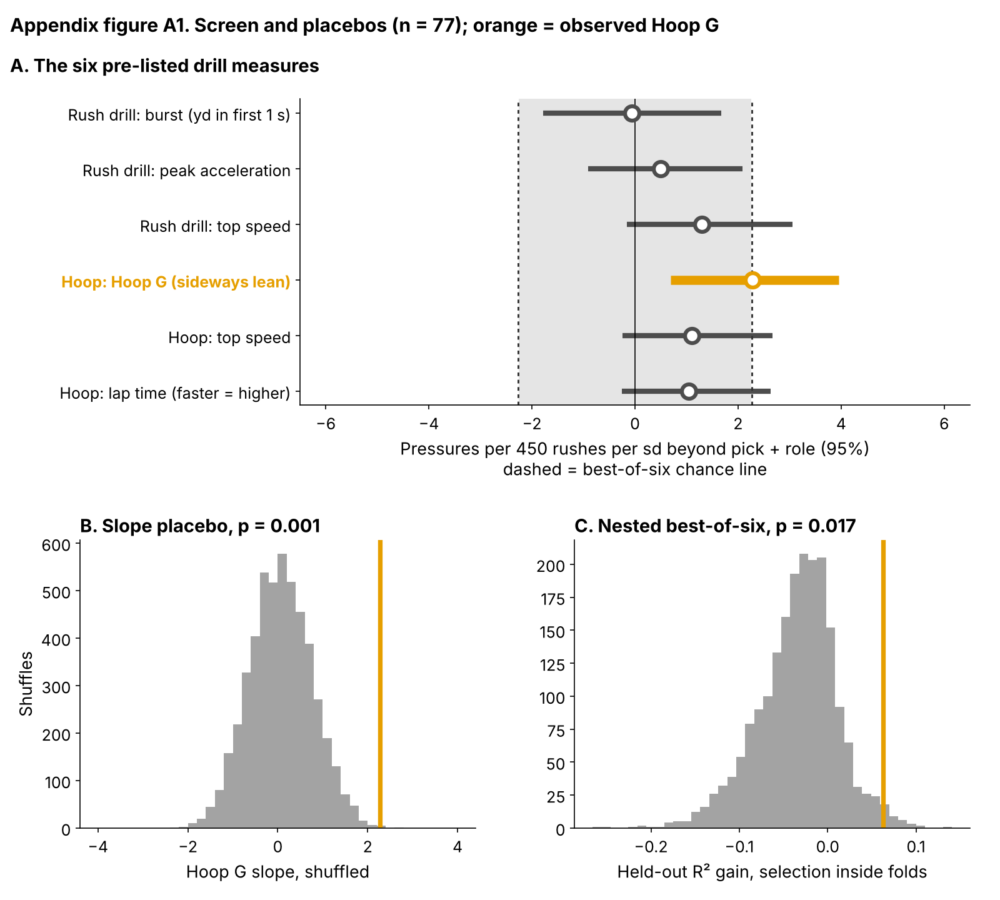

# Run-the-Hoop Lean: A Film Flag for Day-3 Edge Rushers, Not a Board Input

Day-3 linemen who carry the most speed through the Combine's tightest corner went on to out-rush their draft slot by about 2 pressures a season. We call that corner lean **Hoop G**. It is a reason to open a rusher's tape first. It is not a reason to move him on the board: it was the best of {{n_family}} drill measures we tried, the 2025 class alone is flat, and it does not pick more hits than draft order.

- **Scout, Monday:** in each class, flag the day-3 and undrafted linemen in the top third on Hoop G (about {{flags_per_class}} names) and watch their rushes before the board meets. Clubs do not draft for it: a 1-sd edge in Hoop G moves a lineman's pick {{price_pct}}% earlier [95%: {{price_lo}}, {{price_hi}}].
- **Combine:** grade four hoop laps, not one; a single lap repeats at only {{rel_turn_lap}}.

**Why lean should produce pressure.** On a wide rush the tackle kicks to a spot and the rusher has about 2.5 seconds to get his outside shoulder past the tackle's hip and flatten to the quarterback's launch point. The tighter the arc he can run at full speed, the shorter that trip. A rusher who has to throttle down to turn gives the tackle time to recover and ride him past the pocket. Bend, dipping the shoulder and flattening, is graded only off tape. The hoop is the one Combine drill that measures it, and 2023–25 are the first tracked classes with NFL snaps to check it against. {{pct_day3_dl}}% of these {{n_dl}} linemen went on day 3 or undrafted, where tape is thinnest.

## Hoop G in coach terms

Speed squared over turn radius at his hardest half-second of the figure-eight, in g, ranked within his Combine class. The median lineman carries {{hoop_mph_median}} mph around a {{hoop_radius_median}}-yard radius ({{hoop_g_median}} g). On an NFL rush his hardest lean is {{nfl_mph_median}} mph around {{nfl_radius_median}} yards ({{nfl_bend_median}} g): the tackle pushes the arc out to {{turn_match_median}} times his hoop radius, so we compare men within a class, never raw g across venues. A pressured snap cost the offense {{epa_press}} expected points on {{epa_n}} sampled pass plays.

## Does it hold on a class the model never saw?

**Outcome:** career pressure rate through 2025, shrunk toward the {{press_mean}}% mean, for the {{n_an}} linemen with 30+ rushes and every drill measure. **Test:** each class ({{ho_n_per_class}} rushers) is scored by a model fitted on the other two; drill measures are standardized within Combine year. **The one test**, written down for 2026: Hoop G against a forecast from draft pick plus edge-or-interior role, the information a club has without tracking.

| Question (held-out classes) | Result [95%] | n |
|---|---|---|
| **Extra pressures a season per sd of Hoop G, beyond pick + role** | **+{{bs_pick}} [{{bs_pick_lo95}}, {{bs_pick_hi95}}]** | {{n_an}} |
| Same, beyond a shrunk forecast from pick, role, weight, NGS score, 10-yd split and 3-cone | +{{bs_ridge}} [{{bs_ridge_lo95}}, {{bs_ridge_hi95}}] | {{n_an}} |
| Share of rusher-to-rusher spread explained (R²): pick + role, then with Hoop G | {{r2_pick}} → {{r2_pick_h}} | {{n_an}} |
| R² gain when the best of {{n_family}} measures is chosen inside each training fold | +{{n6_gain}} [{{n6_lo95}}, {{n6_hi95}}]; shuffle p = {{n6_p}} | {{n_an}} |
| Day 3: rank correlation with pressure, pick order vs pick + role + Hoop G | {{e3_pick_rho}} vs {{e3_fch_rho}}; gap {{e3d_fch_pick_rho}} [{{e3d_fch_pick_rho_lo}}, {{e3d_fch_pick_rho_hi}}] | {{d3_n}} |
| Day 3: top third that beat its class median, pick order vs Hoop G list | {{tt_pick_k}} of {{tt_pick_n}} vs {{tt_fch_k}} of {{tt_fch_n}} | {{d3_n}} |

*Table 1. Intervals from class-stratified bootstraps that refit every fold. The fold-chosen row repeats the six-way choice inside every training pair, so it pays for the search; it chose Hoop G in {{n6_hoop_folds}} of 3 folds and other hoop measures in the rest.*

The slope is the dependable part. The accuracy gain is not: once the six-way search is paid for, its interval spans zero. The slope holds with wave-drill lean in the model and with snap load and club pressure rate held fixed, and it is flat in 2025 (Figure 3; details in Table A1).

## Drill to Sunday: what we can and cannot say

NFL bend tracks pressure, but the hoop does not predict how often a man bends on Sunday, so we cannot say for sure why the signal exists. We checked this on the {{rl_n}} randomly sampled rushes of {{rl_men}} hoop runners, with a player random effect, rather than on per-man averages. A rush on which a lineman leaned 1 sd harder than his own norm ended in pressure {{rl_bw}} points more often [95%: {{rl_bw_lo}}, {{rl_bw_hi}}]: bending pays on Sunday. Hoop G barely moved how hard he leaned ({{rl_a}} sd per sd [{{rl_a_lo}}, {{rl_a_hi}}]).

One lead for tape: on corner turns (a rush in the top quarter of lean), each sd of Hoop G added {{rl_c}} points to the pressure rate [95%: {{rl_c_lo}}, {{rl_c_hi}}]. With errors clustered on the player that weakens to p = {{rl_c_pclu}}, so treat it as a hypothesis. The hoop may measure finishing a bend more than how often a man bends. Figure 1 shows the problem: the hoop orders Javon Solomon, Cedric Johnson, Eric Watts and Jaylen Harrell, but Harrell bent most on Sunday (+{{four2_bendz}} sd) and still finished {{four2_over}} pressures a season against his forecast.

## Day 3: a film queue, not a board

Among the held-out day-3 and undrafted rushers, adding Hoop G to pick + role orders pressure better than pick order does (Table 1), but the gap's interval includes zero and both top thirds hit equally often. In a simulated 2026 day-3 class, the flag list wins {{r26_better}}% of the time, ties {{r26_tie}}% and loses {{r26_worse}}%. So it decides **which tape opens first**.

Table 2 lists the {{ov_add}} rushers the flag added beyond pick order's top third, in the order a scout would open them. Most rarely bent on their sampled rushes, the same gap between drill and Sunday. The tape cue follows rules fixed in code from each man's sampled rushes.

| Rusher | Class, pick | Hoop G (sd) | Pressures a season vs forecast | Beat class day-3 median | Corner turns, random rushes | What to look for on tape |
|---|---|---|---|---|---|---|
{{T:add_rows}}

*Table 2. Held-out classes; {{add_hits}} of {{ov_add}} beat their class's day-3 median. Corner turn = top quarter of lean among all sampled rushes (25% is average).*

Figure 4 is the live queue: every flagged 2024–25 day-3 rusher with 30+ NFL rushes.

The 2026 Combine tracking is not in this data release, so the 2026 names cannot be listed here; `analysis.py` scores a class the day its hoop clips load, with the rule frozen in `frozen_rule.json`.

## The 2026 test

Written down before any 2026 NFL data: after Week 18, check whether Hoop G still predicts pressure beyond the frozen pick + role forecast. A positive slope at one-sided p < 0.10 keeps the flag; zero or below retires it. One class detects a real slope this size {{pws_obs_1}}% of the time; three classes, {{pws_obs_3}}%. Hoop G reaches the board only if its day-3 top third beats pick order by {{hg_bar}}+ points over two classes.

## Limitations

- **Small samples, single laps.** {{n_an}} rushers in the model, {{d3_n}} on day 3; most ran one hoop lap.
- **Forking paths.** Hoop G was the best of {{n_family}} measures; paying for that keeps the slope but not a reliable accuracy gain. Only 2026 is a clean test.
- **Scheme and alignment.** Snap load and club pressure rate are controlled; stand-up versus hand-in-dirt is not, because only {{olb_pct}}% of these linemen's snaps are tagged OLB.
- **Thin NFL tracking, no blockers or film.** About {{median_random_rushes}} random rushes per man; the corner-turn lead is exploratory.
- **Missed time.** Rates are per rush; the {{n_short_career}} linemen under 30 rushes are left out.

## Bottom line

Hoop G is a small signal that we cannot yet explain. It moves about {{flags_per_class}} day-3 rushers a year to the front of the film queue and should not touch the board. Grade four laps and let the 2026 class decide.

## Appendix

| Check (n = {{n_an}} unless stated) | Estimate | 95% interval or p |
|---|---|---|
| R² gain over pick + role, clubs resampled ({{n_teams}} clubs) | positive in {{cdr2_pick_ppos}}% | p = {{cdr2_pick_p1}} |
| Shuffle p, Hoop G within class and role: slope / best of {{n_family}} slope | {{pl_cr_p}} / {{slope_pfw1}} | |
| Wave-drill lean in the model (n = {{jw_n}}): Hoop G / wave lean | +{{jw_hoop}} / +{{jw_wave}} | [{{jw_hoop_lo95}}, {{jw_hoop_hi95}}] / [{{jw_wave_lo95}}, {{jw_wave_hi95}}] |
| R² gain of Hoop G beyond wave lean | +{{jw_gain_h_given_w}} | [{{jw_gain_lo95}}, {{jw_gain_hi95}}] |
| Holding snap load and club pressure rate | +{{ctl}} | [{{ctl_lo95}}, {{ctl_hi95}}] |
| Class by class: 2023, 2024, 2025 | {{ho_hoop_2023}}, {{ho_hoop_2024}}, {{ho_hoop_2025}} | Hoop G × class p = {{int_p}} |
| 2025 pooled with 2023–24; chance of a positive 2026 slope | +{{hm_b25}}; {{hm_new_ppos}}% | |
| 2023–24 rookie seasons / later seasons (n = {{tm_lt2324_n}}) | +{{tm_rk2324}} / +{{tm_lt2324}} | later [{{tm_lt2324_lo95}}, {{tm_lt2324_hi95}}] |
| Edge (n = {{role_EDGE_n}}) / interior (n = {{role_interior_n}}) | +{{role_EDGE}} / +{{role_interior}} | |
| Rush level: a man's average lean; tightness-matched turn × Hoop G | +{{rl_bb}}; +{{rl_d}} points | [{{rl_bb_lo}}, {{rl_bb_hi}}]; [{{rl_d_lo}}, {{rl_d_hi}}] |
| Per-man Hoop G vs NFL bend; largest value noise allows | {{tr_hoop_g_bend}}; {{noise_ceiling}} | |
| Day 3, pooled AUC for beating the median: pick / Hoop G list | {{e3_pick_auc}} / {{e3_fch_auc}} | gap [{{e3d_fch_pick_auc_lo}}, {{e3d_fch_pick_auc_hi}}] |
| Priors and rush minimums; drop one rusher | {{sens_slope_min}} to {{sens_slope_max}}; {{lopo_min}} to {{lopo_max}} | |
| Independent script, no shared code (n = {{v_n}}) | +{{v_slope}} | 90%: {{v_lo}}, {{v_hi}} |

*Table A1. Multiplicity: of {{n_tests}} tests, {{n_holm}} survive a family-wise correction at 0.10 and {{n_bh}} a false-discovery correction (`multiplicity.csv`).*

**Clips (season, week, quarter, clock, offense).** {{T:clips}}.

`analysis.py` (about 9 minutes) rebuilds every number, figure and this text from `data/processed`, and runs `verify.py`.
