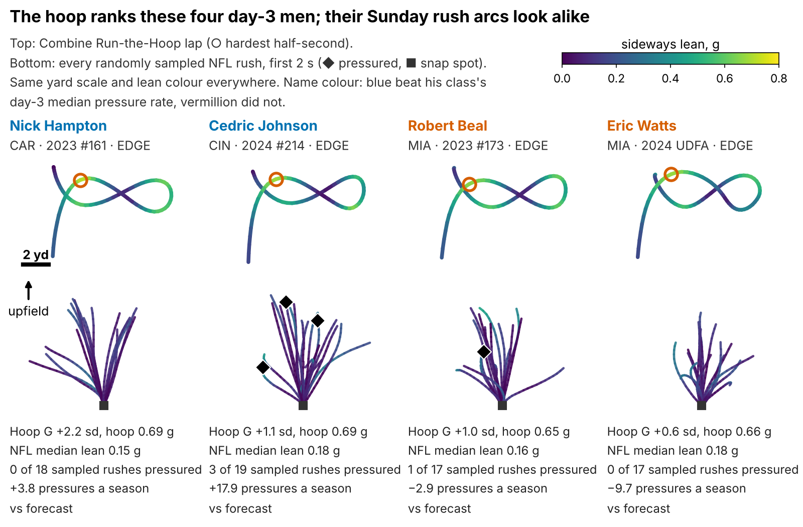
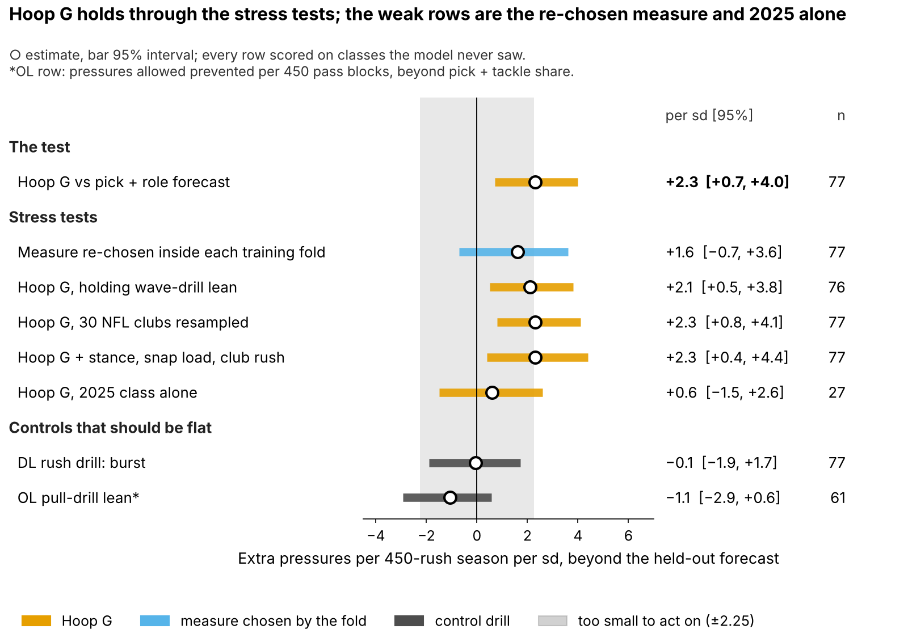
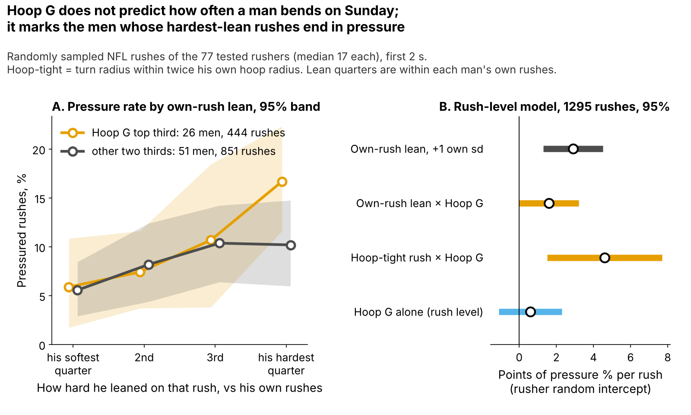
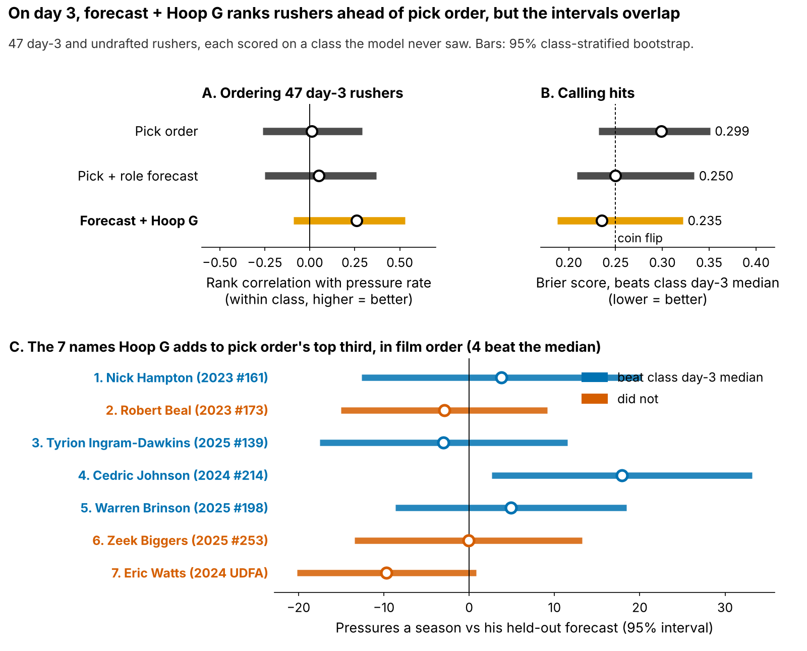
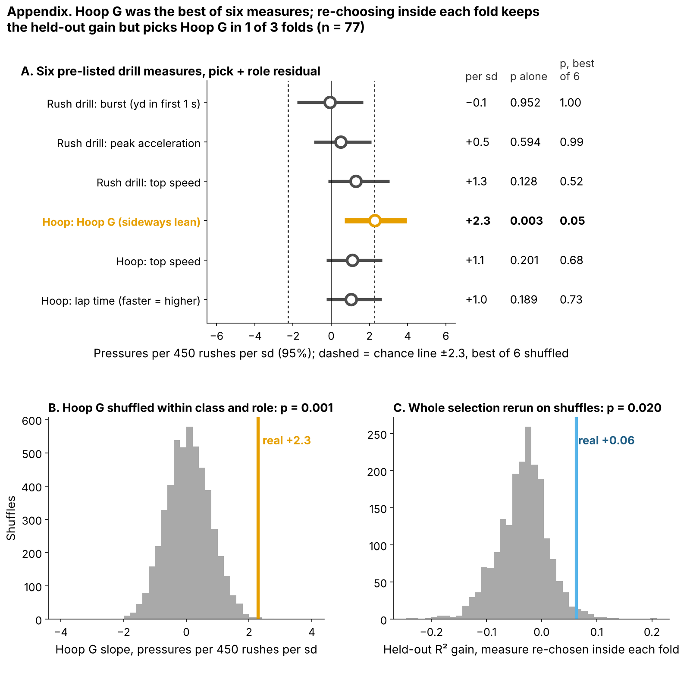

# Run-the-Hoop Lean: A Day-3 Film Flag, Not a Board Input

Defensive linemen who lean hardest through the tightest turn of the Combine's Run-the-Hoop drill went on to about 2 more pressures a season than their draft slot and role predicted. On Sunday they do not bend more often than other rushers; their hardest bends end in pressure more often. Use the drill to decide whose tape to open first, not where a name goes on the board.

Two caveats. The hoop measure was the best of 6 drill measures we tried, and the 2025 class, tested alone, was flat. The 2026 class decides.

- **Scout, Monday:** flag every day-3 or undrafted lineman in his class's top third on the hoop, about 8 names a class (5–11), and watch his rushes before the board meets. Table 2 says what to look for. The 2026 class is not in this release's Combine tracking, so no 2026 names yet; the frozen rule (`frozen_rule.json`) prints the 2026 list the day it posts.
- **Combine:** grade four hoop laps, not one; a single lap repeats at only 0.43.

**Why now.** 69% of these 118 linemen went on day 3 or undrafted, where tape is thinnest and clubs find rotational edge rushers. Bend is graded only off tape; the hoop is the one Combine drill that times it.

## Why lean should make pressure

An edge rusher who reaches the tackle's outside shoulder has to turn toward the quarterback without slowing down. If he must brake to turn, the tackle recovers and rides him past the pocket. How hard a body leans through a turn is speed squared over turn radius, in g: the rusher who keeps his speed through a tighter circle leans harder. The hoop measures that with no blocker in the way.

**Hoop G** is his hardest half-second of lean in the figure-eight, ranked within his Combine class. The median lineman carries 7.1 mph around a 1.8-yard radius (0.62 g). On an NFL rush his hardest lean is 5.6 mph around 4.1 yards (0.18 g): the tackle pushes the arc out to 2.7 times his hoop radius. So we compare men within a class, never raw g across venues. A pressured snap cost the offense 0.52 expected points [90%: 0.35, 0.67] on 1655 sampled pass plays.

## Does it hold on a class the model never saw?

**Outcome:** career pressure rate through 2025, shrunk toward the 8.1% mean, for linemen with 30+ rushes. **Test:** each class (27/23/27 rushers) is forecast by a model fitted on the other two; drill measures are standardized within Combine year. **The one test**, written down for 2026: Hoop G against a forecast from draft pick plus edge-or-interior role.

| Forecast without tracking (n = 77) | R² | R² with drill | Drill effect per sd [95%] | Chance it is luck |
|---|---|---|---|---|
| **Pick + role, with Hoop G (the test)** | 0.10 | 0.16 | **+2.3 [0.7, 4.0]** | one-sided p = 0.019, best of 6 |
| Pick + role, measure re-chosen inside each training fold | 0.10 | 0.16 | +1.6 [−0.7, 3.6] | R² gain p = 0.020, selection rerun on shuffles |
| Everything, shrunk: pick, role, weight, NGS score, 10-yd split, 3-cone | −0.02 | 0.03 | +2.4 [0.7, 4.2] | |

*Table 1. Pressures per 450-rush season per sd of the drill measure. R² = share of rusher-to-rusher spread explained on a held-out class.*

A rusher one standard deviation (sd) above his class beat the forecast by about 2 pressures a season. The honest version of the selection matters: when each training fold picks its own best measure from the six, it picks Hoop G in 1 of 3 folds and a hoop-drill measure in 3 of 3, and the held-out R² gain stays at 0.06 but with a 95% interval of [−0.30, 0.21]. The hoop drill carries the signal; which hoop number is best is not settled.

Figure 2 puts the stress tests on one scale. The slope holds with wave-drill lean in the model, with the 30 NFL clubs resampled, and with stance (listed as an outside linebacker), snap load and the club's pass-rush level added to the forecast. It is flat in 2025 alone; Table A1 has the detail.

## Drill to Sunday: the hoop marks who finishes the bend

NFL bend tracks pressure, but the hoop does not predict how often a man bends on Sunday: the rank correlation of Hoop G with his average NFL rush lean is 0.14, and with his hardest tenth of rushes 0.08 [90%: −0.12, 0.29]. So we asked the question rush by rush.

On each of 1295 randomly sampled rushes by the 77 tested men (median 17 each), we compared his lean with his own other rushes, which takes his size, role and usual blockers out of the comparison. A rush on which a man leans 1 sd harder than his own norm is pressured 2.9 points more often [95%: 1.3, 4.5]. For a rusher 1 sd higher on Hoop G that payoff grows by 1.6 points [0.0, 3.2]. On rushes as tight as twice his own hoop radius, the gain per sd of Hoop G is 4.6 points [1.5, 7.7]. On their hardest-lean quarter of rushes, top-third Hoop G men were pressured 17% of the time, against 10% for the rest; on their softest quarter both were near 6%.

In scout terms: high-Hoop-G men do not turn the corner more often; when they do, they keep enough speed to finish. That is a mechanism a scout can check on tape. It rests on about 17 sampled rushes per man, and the own-lean × Hoop G interval reaches zero.

## Day 3: a film queue, not a board

All 47 day-3 and undrafted rushers in held-out classes, each class scored by a model that never saw it:

- **Ordering:** within-class rank correlation with pressure rate is 0.26 [95%: −0.09, 0.53] for forecast + Hoop G, against 0.01 [−0.26, 0.29] for pick order; the difference is above zero in 91% of resamples.
- **Calling hits** (beat his class's day-3 median): Brier score 0.235 [0.188, 0.322] against 0.299 [0.232, 0.351] for pick order (a coin is 0.25; lower is better).
- **Top third:** the two lists tie, 9 of 15 hits each. They share 8 names; Hoop G adds 7 that pick order skips (4 hit) and drops 7 (4 hit).

So Hoop G orders day-3 tape a little better than pick order, the intervals overlap, and it does not pick more hits. It decides **which tape opens first**. Table 2 is the queue of the 7 added names, with the cue a fixed rule draws from each man's sampled snaps.

| Added name, film order | Hoop G (sd) | Pressures a season vs forecast | Beat day-3 median | Corner turns, random snaps | What to look for on tape |
|---|---|---|---|---|---|
| 1. Nick Hampton (CAR), 2023 #161 | +2.2 | +3.8 | yes | 3 of 18 | wins off the ball, not around it: get-off and first step |
| 2. Robert Beal (MIA), 2023 #173 | +1.0 | −2.9 | no | 4 of 17 | wins off the ball, not around it: get-off and first step |
| 3. Tyrion Ingram-Dawkins (MIN), 2025 #139 | +1.0 | −3.0 | yes | 3 of 16 | no bend, no get-off edge: power and effort, lowest priority |
| 4. Cedric Johnson (CIN), 2024 #214 | +1.1 | +17.9 | yes | 7 of 19 | bends but finishes elsewhere: check hands at the top |
| 5. Warren Brinson (GB), 2025 #198 | +1.3 | +4.9 | yes | 2 of 16 | wins off the ball, not around it: get-off and first step |
| 6. Zeek Biggers (MIA), 2025 #253 | +0.9 | −0.1 | no | 2 of 16 | wins off the ball, not around it: get-off and first step |
| 7. Eric Watts (MIA), 2024 UDFA | +0.6 | −9.7 | no | 4 of 17 | no bend, no get-off edge: power and effort, lowest priority |

*Table 2. Cue rules, fixed in code: corner turn = a rush whose hardest lean is in the top quarter of all sampled rushes (25% is average). 25%+ corner turns and most pressures on them: "dip and flatten"; 25%+ otherwise: "bends but finishes elsewhere"; fewer, with get-off quicker than the 0.94 s lineman median: "wins off the ball"; else "power and effort".*

Cedric Johnson (#214) is the strongest case: 7 corner turns in 19 random snaps and 17.9 pressures a season over forecast, though the rule says to check where his finishes come from. Eric Watts is the weakest: −9.7, with a median get-off of 0.97 s; his cue is the lowest priority.

## The 2026 test

Written down before any 2026 NFL data (`frozen_rule.json`): after Week 18, check whether Hoop G still predicts pressure beyond the frozen pick + role forecast. A positive slope at one-sided p < 0.10 keeps the flag; zero or below retires it. One class detects a real slope this size 59% of the time; three classes, 92%. The rush-level finish effect is checked the same way. Hoop G reaches the board only if its day-3 top third beats pick order by 20+ points over two classes.

## Limitations

- **Small samples, single reps.** 77 rushers in the model, 47 on day 3; most ran one hoop lap.
- **Forking paths.** Hoop G was the best of 6 measures; re-choosing inside each fold keeps the gain but not always Hoop G. Of 41 tests, 2 survive a family-wise correction at 0.10 and 15 a false-discovery correction.
- **Thin NFL tracking.** About 17 random rushes per man, no blockers, ball or film; the cues in Table 2 are play-log reads.
- **Controls are proxies.** Stance is the roster listing (18 listed outside linebackers); snap load is partly an outcome; the club's pass rush is read from other cohort linemen only.
- **Missed time.** Rates are per rush; the 33 linemen under 30 rushes are left out.

## Bottom line

The hoop picks out day-3 rushers whose hardest bends end in pressure, worth about 2 pressures a season. It orders film; it does not set the board. Grade four laps and let the 2026 class decide.

## Appendix

| Check (n = 77 unless stated) | Estimate | 95% interval |
|---|---|---|
| Hoop G, holding wave-drill lean (n = 76) / wave lean, holding Hoop G | +2.1 / +1.5 | 0.5, 3.8 / −0.5, 3.5 |
| R² gain of Hoop G beyond wave lean | +0.06 | −0.12, 0.24 |
| R² gain over pick + role, NFL clubs resampled | positive in 70% | one-sided p = 0.298 |
| Measure re-chosen in each fold: R² gain | +0.06 | −0.30, 0.21 (positive 44%) |
| With stance, snap load, club pass rush | +2.3 | 0.4, 4.4 |
| Fit on 2023–24, tested on 2025 | +0.6 | −1.5, 2.6 |
| 2023–24 rookie seasons only / later seasons | +2.3 / +3.0 | −0.4, 5.8 / 0.7, 5.7 |
| Hoop G × class interaction; 2025 pooled with 2023–24 | p = 0.33; +1.3 | 2026 slope positive: 88% |
| Pick only: R² 0.03 → 0.16; slope | +3.2 | 1.5, 5.0 |
| Shuffle p, Hoop G within class and role (5000 shuffles) | 0.001 | |
| Rush level, Hoop G alone | 0.6 points | −1.1, 2.3 |
| Rush level, own-lean × Hoop G, rusher bootstrap | +1.6 | 0.0, 3.6 |
| Hoop G vs share of hoop-tight NFL rushes | 0.06 | 90%: −0.13, 0.25 |
| Independent script, no shared code (n = 77) | +2.3 | 90%: 0.8, 3.8 |

*Table A1. Every row scored on held-out classes; units are pressures per 450-rush season per sd unless stated.*

`analysis.py` (about 11 minutes) rebuilds every number, figure and this text from `data/processed`, and runs `verify.py`.
